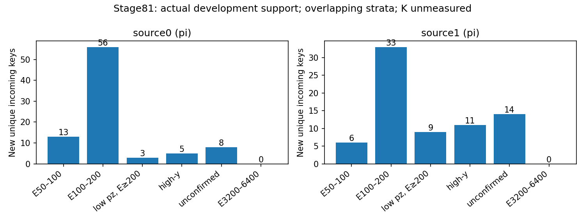

# Stage81：兼容PHYS的实际新增开发支持交付

日期：2026-11-03，起点`e359caf`。执行路线§61、信息预算§41和主stage81 Prompt，独立支持协议沿原stage77合同逐字不改。本轮完成两个π来源的完整提取与独立验证，实际新增742唯一开发key；两个预定K的旧PHYS不满足名义merge轨迹合同，完整产额未测量。0能量fit、0新F7推理、0RDO/HITS/重建/生成/谱toy；继续F7。

## 1. 阶段目标与来源冻结

目标是在原pz>50 GeV与原62/raw/pz0/typed NaN下交付真实新增低E及同reco pz真高E、高y/未确认的歧义两侧支持，测量选择、去重和实际成本。不能以目录数或旧28例复评替代补样，也不把未知谱系当全部有界开发提取的无限前置。

沿`files.tsv`与`low_energy_files.tsv`跨flux/geometry的canonical component:generation-range角色并集；任何test/validation/calibration范围排除。名义run不作为alternative来源；排除stage55已经完整交付的run/group（257未交付保留为partial）和stage70完整π00440–00449。π直接使用历史manifest明确的本地d32 merge PHYS，剩22个可访问来源。K仅对`file_config.yaml`已知run200081 `bck/s0014`目录做一次非递归文件名核对，71文件中42合法train且未完整交付；未打开候选事件按产额筛选，没有遍历22run或全EOS。

seed **2026110377**，在各排序池均匀无放回抽2来源；源概率π2/22、K2/42，文件内条件包含概率1。先冻结source_plan，后读4个选定header（各10000条，总40000），再读各前10个事前身份做QA，共40个独立身份。没有按新能量/残差/新key数换源。

| source | component/run | canonical范围 | 历史角色 | 源包含概率 | PHYS bytes | 完整交付 |
|---|---|---|---|---:|---:|---|
|0|π/200080|00100–00109|train＋challenge|2/22|31,249,983|成功|
|1|π/200080|00250–00259|train＋challenge|2/22|30,158,301|成功|
|2|K/200081|00090–00099|train|2/42|50,757,891|不兼容，未测量|
|3|K/200081|00160–00169|train|2/42|50,029,891|不兼容，未测量|

精确路径、完整池、历史角色、排除run/group和选择索引见[source_plan](stage81_energy_ml/source_plan.json)。π为`.../ntuples/merge_mc24_master_d32b0ff3/200080/FaserMC-MC24_Genie_sibyll_pi-200080-{range}-s0014-merge-PHYS.root`；K为`/eos/experiment/fasernu-data0/faser/sim/mc24/genie/200081/bck/s0014/FaserMC-MC24_Genie_sibyll_k-200081-{range}-s0014-PHYS.root`。源概率不是flux权重；去重后的key总体包含概率未测量，不对计数作22/2或42/2外推。

## 2. 实际兼容性、条件与40身份QA

### 2.1 π直接兼容路径

两个π源各527 branch，原选择和62派生必需字段齐全；与stage70完整参考闭合相同的d32b0ff3 merge/without-IFT生产族，复用现成build/analysis与LCG109，不重建、不安装。各10个原身份临时CloneTree后跑原选择/派生，source0选中2、source1选中0；不因source1 QA选中0而换源。两份QA的62维、逐例run/event/input_entry/incoming、raw/status联结通过；source1只验证空选择路径，不能伪称其QA已有非空62逐值验证，正式完整输出再独立核验。

四模块Calo沿原native MeV、scintillator pC；reference01-LG实际charge_ref=.07129999995231628pC/MIP，MC E_EM/charge=330/charge_ref≈4628.331MeV/pC。π固定QA仅module1/2各有1个status0非零信号，比例4628.330965/4628.330962，其他模块该QA有效非零N=0、其独立小样本标度未测；四模块共同换算证据继承stage70完整参考闭合及相同writer族，不扩写成新源完整条件snapshot认证。**本轮不乘stage70的03→01比例，不二次缩放现成reference x**。最终四模块NaN和total依赖代数逐值核查，完整响应/历史共同snapshot仍未认证。

### 2.2 K存在但不能静默混入

两个K各426 branch，缺少`Track_isForward`。源码`derive(...,diagnostic=False)`表明它仅诊断，不是62特征，**缺这一列本身不足以否定K的物理可用性**。继续核两个精确rec/ntp日志：actual6d6ab70b、TI12MC04/FASERNU-04、Use IFT=False、Calo01-LG，但ntuple命令均`--backward`。对应6d6ab70b脚本明确绑定`CKFTrackCollectionBackwardWithoutIFT`，而stage55原链路`--CKFTrackType merge`绑定`CKFTrackCollectionMergeWithoutIFT`；两个轨迹集合的事件/最高pz leading与62读出没有逐例等价证据。

这是真实生产定义不兼容，不能用“同geometry/Calo”当完整共同重建，不猜缺失诊断或把backward当merge。各K仍只读固定10个身份的scalar条件QA，原Calo系数已在实际信号上核实；不进行完整选择，不把QA行当交付支持，不换源或重跑失败K RDO。K完整selected、新增N及其各层均**未测量**，不是物理0。最小缺失输入为这两个固定K来源的名义d32 merge/without-IFT PHYS与实际条件/联结/62 QA，或一个能建立完整等价性的实际逐例证据；本轮不自动生产。

| QA source | 身份N | parent wall/s | parent CPU/s | analysis child CPU/s | parent peak/MiB |
|---|---:|---:|---:|---:|---:|
|0|10|13.554232|3.329918|6.221185|829.543|
|1|10|10.035722|2.997923|6.054572|834.531|
|2|10|1.144423|.254542|未运行|194.289|
|3|10|1.240097|.260116|未运行|194.977|

实际581,860-byte软件包再对原两个π前10身份做启动/提取，0新身份、0fit，全部数组与首次QA相同；wall25.894285s、parent CPU2.719562s、child CPU4.987042/4.891561s。启动无目录冲突，无正式提交前失败。先QA/生产定义确认，再冻结protocol、硬上限，实际包启动和ClassAd dry-run/队列核实后提交；没有复制旧stage70/79条件晚核的顺序偏差。header只查branch/tree元信息不计新物理身份。

## 3. 完整提取与实际支持

正式只有两个QA通过的π文件，Condor **9663224.0–1**，各1CPU/3000MB/MaxRuntime3600s、CPU软/硬3300/3350s、外层timeout3500s，0重试；K不提交且保持显式缺项。两任务一次exit0，完整20000输入，未截prefix或删困难尾。

沿原`extract_alternative_support.py`选择/build链，仅允许调用者传明确source字典，旧stage70默认接口不变；stage81 wrapper拒绝不兼容source。原truth νpz/reco highest-pz leading>50 GeV、质量/几何/fitted-charge cuts、truth fiducial和VetoNu reduced定义不改。一次方模长/纵向动量仅pz0，px/py、q/p、弯折保留；11signed raw不以fit charge替代，typed sentinel/domain/status/dependency NaN、缺一Calo使total NaN不改，不设真E上限。

每源run/eventID唯一索引，输入entry和最高pz leading对齐，truth能量独立派生与analysis输出闭合。原生MeV key=(pdg,px,py,pz)，对stage55**95748已曝光行/66843唯一key**及stage70实际28个新增key做veto，再按source/entry稳定排内部重复。NumPy联合唯一ID/first-index法独立验证，而非只复用collector的Python tuple-set算法。

| source | raw N | selected N | stage55复用行 | stage70复用行 | 源内重复行 | 跨源重复行 | 新增唯一key |
|---|---:|---:|---:|---:|---:|---:|---:|
|0|10000|415|24|0|3|0|388|
|1|10000|382|21|0|2|6|354|
|合计|20000|797|45|0|5|6|742|

已知复用与内部重复有1行重叠，所以797−45−11＋1=742，不能简单相加所有排除数。797选择行含786唯一key；最终742 key内部唯一，与旧两缓存交集0。原train/cal/eval **41447/8440/14057**、91/16/22来源角色与42缺失21/3/7＋11 protected保持，旧缓存只读。新增均开发增补，完整GENIE parent/subfile/entry/seed仍未知；不同flux/文件名和native key排重不能认证独立确认。

| 层（E,pz单位GeV） | source0新key | source1新key | 新key合计 | 原F7 train N | 相对增量/% |
|---|---:|---:|---:|---:|---:|
| all | 388 | 354 | 742 | 41447 | 1.790238 |
| E50_100 | 13 | 6 | 19 | 767 | 2.477184 |
| E100_200 | 56 | 33 | 89 | 3564 | 2.497194 |
| E50_100_confirmed_low_transfer | 10 | 6 | 16 | 685 | 2.335766 |
| E100_200_confirmed_low_transfer | 39 | 25 | 64 | 2562 | 2.498048 |
| pz50_100 | 29 | 23 | 52 | 2498 | 2.081665 |
| pz50_100_E50_100 | 13 | 6 | 19 | 765 | 2.483660 |
| pz50_100_E100_200 | 13 | 8 | 21 | 728 | 2.884615 |
| pz50_100_trueE200_inf | 3 | 9 | 12 | 1005 | 1.194030 |
| pz50_100_high_y | 1 | 5 | 6 | 512 | 1.171875 |
| pz50_100_unconfirmed | 3 | 7 | 10 | 692 | 1.445087 |
| high_y | 5 | 11 | 16 | 1204 | 1.328904 |
| unconfirmed | 8 | 14 | 22 | 1495 | 1.471572 |
| input_missing | 0 | 0 | 0 | 21 | 0.000000 |
| E3200_6400 | 0 | 0 | 0 | 282 | 0.000000 |
| E6400_inf | 0 | 0 | 0 | 0 | 未测量 |

low_transfer为confirmed＋finite y∈[0,1]且y<.2，high-y沿既定y≥.8；y=1−产生μ能量/Eν不是可见能测量。分层互相重叠，不相加当独立N。两个来源都新增低E与同低pz真高E，本轮克服stage70只交付同低pz真高E=0的入口限制；但最低能仅+19、第二低能+89，全部只两个π来源、高端+0、K未交付，**不足以裁决缺数据假说或证明足量功效**。

## 4. 变量清理与性能成本

完整797例的62列所有typed域/sentinel规则、11raw的wave-invalid mask逐值通过；fit失败16/32不额外抹除合法raw，合法signed负值保留。选择后负raw通道记录586，新支持558；有fit失败但raw有效40/32通道记录。新742例原62缺失0，不能因此删旧42例或声称未来缺失都解决。四Calo status无效→NaN、任一模块缺失→total NaN精确传播，不用nansum；无p0/p1/pz1/ln比值作为模型输入。没有新能量预测，巨动量/负修正和高y/未确认行保留，模型bias/RMSE/尾率改善未测量。

| 完整源 | extractor wall/s | Python CPU/s | C++ child CPU/s | C++ peak/MiB | Uproot请求bytes |
|---|---:|---:|---:|---:|---:|
|0|13.860499|1.433685|7.950987|662.766|4,016,231|
|1|13.308915|1.451501|6.061354|669.668|4,026,311|

两源worker /usr/bin/time wall20.30/20.63s（包括LCG启动、Python导入、C++运行），user+system13.30/11.04s；Condor remote CPU **25s**、wall合计 **48s**（含其启动开销），脚本和remote不同口径。两完整文件逻辑输入 **61,408,284bytes**；请求复用一次scalar数组＋一次track/truth批读/源，没有逐selected事例远程读取或保存整ROOT。Uproot正式请求 **8,042,542bytes**，含重复QA ROOT clone/Uproot的已计请求 **27,509,060bytes**；C++ analysis自身ROOT请求及物理EOS网络I/O均**未测量**，不能把已计部分当全部物理流量或将理论文件大小当请求量。

实测QA＋Condor CPU合计 **56.716421s**（不含独立metadata/collector/validator等另列进程），远低7200s上限；没有把有利prefix速率作为完整成本保证。collector wall/CPU2.520999/1.750875s、peak358.855MiB；独立validator wall/CPU1.052681/.926046s、peak259.590MiB。Python AST、shell语法及git diff空白检查通过。10个主分层独立计数、原QA与完整输出逐数组一致、原角色/42缺失、事前source抽样重现、K未知标志和两job资源全部通过。验证后删除分片/传输包/软件输入和重复worker元数据日志共 **1,077,359bytes**，紧凑数据/QA/表图/中文报告约 **0.659MB**，低于10MB；精确最终留存见[storage.json](stage81_energy_ml/storage.json)，不长期留PHYS/xAOD副本。



## 5. 命令、产物、阶段结论和下一合同

实际执行（LCG109 wrapper只设置已有LCG/单线程BLAS，不安装）：

```bash
bash /tmp/stage69_python.sh ml/prepare_phys_support.py
bash /tmp/stage69_python.sh /tmp/stage81_headers.py
# 已执行的header读取器代码同时保存在 ml/inspect_phys_support.py
bash /tmp/stage69_python.sh ml/audit_phys_support.py --index 0
bash /tmp/stage69_python.sh ml/audit_phys_support.py --index 1
bash /tmp/stage69_python.sh ml/audit_phys_support.py --index 2
bash /tmp/stage69_python.sh ml/audit_phys_support.py --index 3
bash /tmp/stage69_python.sh ml/submit_phys_support.py
bash /tmp/stage69_python.sh ml/collect_phys_support.py
bash /tmp/stage69_python.sh ml/validate_phys_support.py
```

正式紧凑缓存`ntuples/energy_ml_stage81/support.npz`（不进Git），含797原选择行、742 new_training_support mask、原62、native incoming、source/概率、truth诊断、raw/status；不新增有效性筛选。source0/1分片与传输包验证后删除，只保留一个合并支持缓存及极小QA缓存。精确输入/协议/完整20步cutflow、支持、raw/62有效性、资源和独立验证放在[stage81目录](stage81_energy_ml/)，[summary](stage81_energy_ml/summary.json)、[训练增幅](stage81_energy_ml/training_context.tsv)、[支持分层](stage81_energy_ml/support.tsv)、[独立验证](stage81_energy_ml/validation.json)、[PDF](stage81_energy_ml/support.pdf)。原stage54五项工作不动，不push、不外发、不执行stage82。

**阶段结论：真实交付742唯一π开发key，含两低E与同低pz真高E两侧；K因实际轨迹生产定义不兼容仍未交付。0训练，继续F7。** 这不是充分样本/共同响应/独立确认的证明；新增能量收益、足量功效、K产额均未测量。

唯一下一单项 **stage82：原F7政策的固定0＋两档新增支持学习曲线**，落实路线§58.3而非再扫方法。将本轮742与已验证stage70的28合并（770唯一π key/3来源），原train41447作size0，复用F7旧预测，0基线重训/推理；按source事前seed2026110382均匀取一半385（194/177/14）和全770，实际train41832/42217。仅原3seed/原62/400轮/unit direct logE，两档各3fit共最多6fit，0pilot fit；每档ensemble均值raw＋原8440 cal一个unit offset，主候选预定full_cal，half只作学习曲线诊断、不选赢家。

先核pooled key与角色/NaN/原F7实际初始化和软件版本，实际包无fit两档启动/资源，再冻结拟议≤2Condor、每1CPU3000MB、CPU总1800s/wall每1800s、最终20MB。两低E、低pz、同pz高E/high-y/未确认、全体/高端/缺失/双向尾和500component分层保守来源固定预测区间并报；旧传统1.05/all F7 1.01/困难1.03/总正负tail50+2pp全部不降。cal/eval仍开发，区间不含重训/增补抽样/offset估计/谱系/响应/研究选择，不称独立确认或纯样本量因果效应。

本有限π增量仅约原train1.86%（含旧28），不能把失败当缺数据无关或低E信息极限；失败关闭这次固定增补实验，不扫规模/来源/权重/seed/架构。具体见[下一请求](stage81_energy_ml/followup_input_request.json)与主Prompt，本轮不训练。K名义merge输入、真实随机未开发确认/上游谱系、共同raw/stage54、Calo/脉冲条件、interaction/FSI/材料/接受度/背景继续待交付，不自动RDO生产或K重试。
