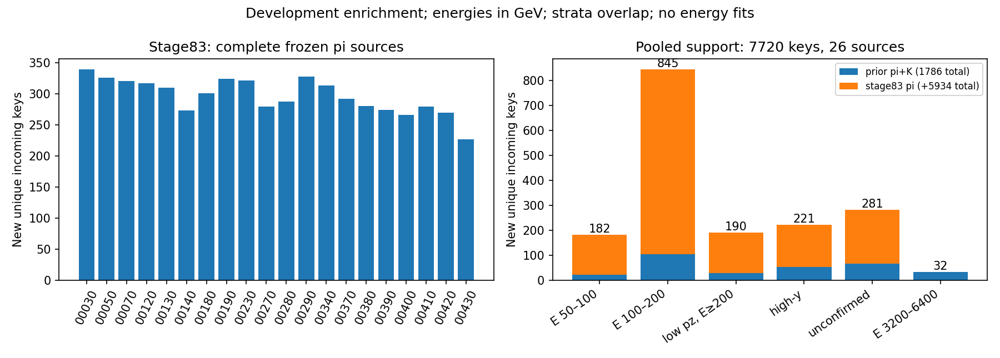

# Stage83：完整交付剩余兼容 π 支持，保留已用 K

## 阶段目标与范围

执行路线§63及stage82实测输入合同：全取剩余20个已知兼容π PHYS的完整文件，交付真实新增训练支持，测低能和同低动量歧义另一侧的支持量与成本。不是重训阶段：本轮能量fit=0、F7新推理=0、重建/GENIE/G4/谱toy=0，未打开test/locked，未自动执行stage84。当前仍保留F7；本轮能量表现、所需充分N和统计功效均**未测量**。

K并非弃用：stage82已解除旧3600秒限制并完整重建3源，1016新增K已实际进入6fit。本轮保留全部K；用户覆盖的旧不生产/不重试K禁令不能恢复为阻碍。stage83只提取已有兼容π，不需要额外K生产。

## 输入、物理表示与实际执行

冻结计划见[source_plan.json](stage83_energy_ml/source_plan.json)，起始commit `1f3af68`。来源全部为200080、d32b0ff3本地merge withoutIFT，路径在既有stage81候选manifest内，不遍历EOS寻找产额更好的替代源。20个完整来源各10000输入，逻辑PHYS合计611,988,745 bytes，分成4个连续五源分片；全取剩余池、source与conditional-event概率均1，仅对这个已知兼容池成立，不当物理flux权重。

| index | π source（十个原子文件的merge group） | selected | 新唯一key |
|---:|---|---:|---:|
|0|00030–00039|366|340|
|1|00050–00059|364|326|
|2|00070–00079|355|321|
|3|00120–00129|357|317|
|4|00130–00139|353|310|
|5|00140–00149|328|273|
|6|00180–00189|350|301|
|7|00190–00199|377|324|
|8|00230–00239|395|322|
|9|00270–00279|346|280|
|10|00280–00289|378|288|
|11|00290–00299|415|328|
|12|00340–00349|405|314|
|13|00370–00379|386|292|
|14|00380–00389|367|281|
|15|00390–00399|352|274|
|16|00400–00409|371|266|
|17|00410–00419|392|280|
|18|00420–00429|359|270|
|19|00430–00439|338|227|
|合计|20来源|7354|5934|

历史角色均为合法train＋challenge，没有calibration/validation/test。原train/cal/eval=41447/8440/14057、保守来源组91/16/22、缺失21/3/7及unused11逐值复核不变。新支持只是development enrichment；精确入射key干净不证明完整GENIE parent/subfile/seed独立，也不称未开发随机确认。

复用现成`build/analysis`、LCG109（x86_64-el9-gcc15-opt）及stage70/81提取器，不编译/安装。原`ml_low_energy_cuts.yaml`/definitions/output/grl通过显式路径传给C++，保持reco/truth pz>50 GeV、原quality/geometry/truth fiducial和全部困难尾。原选择中的fitted-charge cut保持；模型只用raw闪烁体输入。

原62 `F7_pz0_raw_v1`中，一次方动量仅pz0，不含p0/p1/pz1/log(p0/p1)；px/py、q/p、弯折仍允许。11signed raw_charge、VetoNu reduced、typed domain/status/dependency NaN保持，合法有符号负值不统一去掉。Calo原生已为参考01-LG，本轮不缩放；模块缺失时total通过普通sum传播NaN，不用nansum。

实际命令（仓库根目录）：

```bash
# /tmp/stage69_python.sh加载LCG109并限制OMP/OPENBLAS/MKL为1线程。
bash /tmp/stage69_python.sh ml/pi_support_delivery.py prepare
# 四个独立小QA进程，各覆盖固定五源，每源头两个身份，共40身份：
bash /tmp/stage69_python.sh ml/pi_support_delivery.py qa --shard 0
bash /tmp/stage69_python.sh ml/pi_support_delivery.py qa --shard 1
bash /tmp/stage69_python.sh ml/pi_support_delivery.py qa --shard 2
bash /tmp/stage69_python.sh ml/pi_support_delivery.py qa --shard 3
bash /tmp/stage69_python.sh ml/pi_support_delivery.py submit
# submit先actual payload启动，再提交ml_pi_support.sub；正式cluster9663291。
# 每worker五个完整源，单独Python进程串行原选择＋62提取＋四模块单位检查。
bash /tmp/stage69_python.sh ml/collect_pi_support_delivery.py
bash /tmp/stage69_python.sh ml/validate_pi_support_delivery.py
```

C++实际逐源命令保存在[extractions.json](stage83_energy_ml/extractions.json)；参数包括`--isMC -r 200080 -j 1`及上述显式配置。临时selected ROOT只在worker scratch，读完删除。QA原20份JSON已无损合并为[QA.json](stage83_energy_ml/QA.json)，保留固定身份/完整命令/计数/计时；逐源timing集中[source_resources.tsv](stage83_energy_ml/source_resources.tsv)。

## 小 QA 的证据边界和正式非空验证

40个事前固定身份（20源各input_entry 0/1）**全部未通过原选择**。schema/run/event/标量/raw/status及实际C++链路通过，输出空62矩阵能运行，但不构成非空62逐值闭合。未因产额为空换源、换身份或扩大QA。小QA只有module1两例有效非零Calo formula，其他模块小QA未测量。

正式提交前，实际转移软件包在相同source0/19的两个头身份重新启动并全数组一致，也是selected0，见[package_QA.json](stage83_energy_ml/package_QA.json)。**提交后**才补做旧stage81已验证非空QA缓存的actual payload检查（2 selected、0新ROOT身份），见[nonempty_payload_QA.json](stage83_energy_ml/nonempty_payload_QA.json)。因此并非全部非空QA都在提交前齐备，此顺序局限必须保留。

正式全文件完成后，对7354个非空selected验证原62域/raw/status、truth/native incoming/leading联结、Calo无效mask与总量NaN；40原身份与正式选择的闭合仍是空集合，不能用该项取代非空验证。非空的原表示依赖同一已验证stage70/81 writer/build，独立复核集中于数值域、状态、key归属和统计表，不宣称另写了一套独立C++重建。

另在全200000源事件读取四模块`charge/E_EM/status`，以status0、finite、|charge|>1e−6 pC核原生formula：`E_EM/charge = 330/0.07129999995231628 MeV/pC`，rtol2e−6、atol0.001 MeV/pC。有效非零module0/1/2/3分别12642/12684/10946/10932，全部通过，见[calo_formula.tsv](stage83_energy_ml/calo_formula.tsv)。这是共同单位与formula证据，不是完整历史响应snapshot或data/MC响应系统误差认证。

## 全选择、去重与新增支持

完整cutflow见[cutflow.tsv](stage83_energy_ml/cutflow.tsv)，按20源相加：

| 顺序选择 | 通过事件数 |
|---|---:|
|原truth PMT区域移除|200000|
|CC|151831|
|νμ|151784|
|FASERν box或lead block|63967|
|truth decay r<100 mm|30720|
|truth pz>50 GeV|29628|
|至少一条long track|14903|
|Veto20/21 fitted charge>40 pC|14903|
|Timing charge>20 pC|14901|
|Preshower charge>2.5 pC|14894|
|track pz>50 GeV|13785|
|≥7 layers|13615|
|nDoF≥9|13152|
|chi2/ndof<15|13148|
|R at max radius<95 mm|8637|
|R at IFT<95 mm|8542|
|rVetoNu<120 mm|8464|
|theta<25 mrad|8048|
|VetoNu0 reduced charge<30 pC|7604|
|VetoNu1 reduced charge<30 pC|7354|

稳定按source index/input_entry顺序，以native-MeV `(pdg,px,py,pz)`精确key去重。基准是stage55**全部95748已曝光行/66843唯一key**，不是只排原train；再排stage70实际新增28、stage81实际新增742和stage82实际新增1016。

- 与stage55复用332行、stage70复用4、stage81复用217、stage82复用0，known复用合553行。
- 本批内部重复982行：相对全批最早key归属，同源36、跨源946；此分类不是把每源单独unique再相加。
- known与内部重复交叠115行；独特selected key6372，新增5934。
- 正确计数为7354−553−982＋115=5934，不能把复用与内部重复直接各减一次而漏交叠。

[identities.tsv](stage83_energy_ml/identities.tsv)保留逐源所有复用/重复/交叠；全部新key与旧全曝光及已有π/K无交集，pooled7720也互异。相同run/eventID不能替代精确incoming排重，key干净仍不等于上游谱系独立。

| 支持层（能量/动量GeV） | 原train N | 本轮新π | 含旧π/K累计新增 | 累计相对原train增幅 |
|---|---:|---:|---:|---:|
|all|41447|5934|7720|18.626197%|
|true50–100|767|159|182|23.728814%|
|true100–200|3564|740|845|23.709315%|
|true≥200|37116|5035|6693|18.032654%|
|confirmed低transfer true50–100|685|140|159|23.211679%|
|confirmed低transfer true100–200|2562|509|587|22.911788%|
|reco pz50–100|2498|463|537|21.497198%|
|同低pz true≥200|1005|161|190|18.905473%|
|同低pz high-y|512|92|110|21.484375%|
|同低pz 未确认|692|121|144|20.809249%|
|high-y|1204|167|221|18.355482%|
|未确认|1495|215|281|18.795987%|
|输入缺失|21|1|2|9.523810%|
|true3200–6400|282|0|32|11.347518%|
|true≥6400|0|0|0|未测量（原train分母0）|

两低E、confirmed低transfer、低pz及同pz另一侧、高y和未确认新增均覆盖20来源；本轮≥3200新增0。层有重叠不能相加。更细能箱50–75/75–100/100–150/150–200/200–400/400–800/800–1600/1600–3200新54/105/287/453/1675/2150/1110/100，见[support.tsv](stage83_energy_ml/support.tsv)及[training_context.tsv](stage83_energy_ml/training_context.tsv)。这是已交付selected支持，不能外推所有PHYS或未选事件的真谱/flux和接受度因果。



累计π6704＋K1016=7720新key/26来源，本轮使两低E新增从23/105升到182/845，明显扩充实际可用支持。它仍只增加两个低能区约24%的原训练规模，不是已证足量；来源/flux混合与N共同改变。尚未训练，不能声称恢复低能，也不能把旧训练未恢复唯一归因于缺数据、flux或信息极限。

## 变量、占位值与困难事件

[feature_validity.tsv](stage83_energy_ml/feature_validity.tsv)逐62列记录NaN、负数、−1、−999、范围；[raw_validity.tsv](stage83_energy_ml/raw_validity.tsv)保留11通道raw/status审计。所有selected raw waveform-invalid（mask392）=0；并不因此把fit失败当raw无效。

本轮新样本合法负raw共4493个通道值：VetoNu0/1为306/251、Veto10为18、Timing0–3为913/893/1051/1061。341个fit-failure(bit16/32)但raw有效通道仍保留raw：VetoNu0=1、Veto10=135、Veto20=118、Veto21=82、Timing0/1/2/3=1/2/1/1。不能因fitted charge不可靠便删除可用raw，不能对signed raw、q/p、坐标或charge sign的合法−1一刀切。

非负/正数/计数/allowed-values列按各自规则验证；合成−999/−1清理案例分别检查nonnegative→NaN、有明确sentinel的signed→NaN、合法signed与charge sign−1保留。正式本轮列没有遗留精确−1/−999占位污染（signed规则不等于无条件认定−999为占位）。依赖清理沿原build，未新增比值或ln(p0/p1)。

新增仅1个输入缺失事件：run200080/event56502/source1/input_entry6502，trueE370.3500005 GeV、reco pz290.2560625 GeV，Calo status=[32,1,1,1]。Calo0 fit failure按mask444→NaN，total亦NaN，其余模块与事件保留。全selected另有两例旧复用/重复层的Calo缺失，共3例totalNaN，分别模块0/1/2各1例；不得nansum或删困难事件。signed Calo负响应仍是原噪声/响应表示，新增total负值1920不强制置0。原42例缺失保护与新增两期累计缺失2均保持。

## 资源、I/O、存储与验证

4个正式Condor作业9663291.0–3，均一次启动、exit0、0重试。每作业实际RequestCpus1/RequestMemory3000MB/MaxRuntime1800秒，历史及实际ClassAds见[history.json](stage83_energy_ml/history.json)、[submission.json](stage83_energy_ml/submission.json)、[condor_events.txt](stage83_energy_ml/condor_events.txt)。

| proc | remote CPU/s | execute wall/s |
|---:|---:|---:|
|0|56|76|
|1|55|77|
|2|56|75|
|3|60|80|
|累计|227|308|

20源subprocess（/usr/bin/time）CPU累计224.93秒、wall累计297.07秒，单源wall13.00–19.87秒、peak≤669.671875 MiB；完整输入吞吐200000/297.07=673.242 events/累计wall秒，selected24.755 events/累计wall秒。此分母是串行源wall求和，非四并行作业端到端吞吐，也非排队时间。

worker每源独立Python进程/1线程、timeout210秒，CPU soft400/hard430秒被子进程继承；**不是整个worker累计CPU的硬限制**。4job累计1800秒预算靠实际history核验（227秒），不把单进程ulimit夸成总量限时。小QA wall累计158.947159秒、已计CPU141.502666秒；QA每shard连续五源，RUSAGE_CHILDREN是累计值，只计最后index4/9/14/19，再加每源parent差值，不能把20份child累计量相加。

实际包启动wall26.343032秒、parentCPU2.504290秒，两个C++ childCPU合10.671157秒；旧非空缓存包检查wall3.900054秒。已计QA/package/Condor CPU合381.678113秒是**部分计量**，QA模块import/startup、包内子Python开销和旧缓存检查CPU未测量，不能写成完整会话总CPU。收集CPU1.232780秒/wall3.025482秒；独立验证实测资源见[validation.json](stage83_energy_ml/validation.json)。

正式完整输入逻辑611,988,745 bytes，Uproot正式请求85,770,191 bytes；含重复40QA、actual包重跑已记录的ROOT CloneTree/Uproot请求共192,558,106 bytes。C++ analysis自身ROOT请求与物理EOS网络I/O均**未测量**，不能把请求字节当物理传输。逻辑输入与已计请求均远低10GB；未保存长期ROOT/xAOD/RDO副本。20源一次全读提取所需branches/按selected切片、五源串行避免并发I/O膨胀，不逐事件重复开ROOT。

独立validator使用numpy row unique/inverse，而collector用Python tuple set：逐stage known归属、稳定first、within/cross及交叠、旧角色/来源组、原缺失、raw/typed域/Calo NaN、四模块formula、23层1932条支持表、所有training_context行和pooled去重均通过。逐数组压缩回读在writer执行，合并后再完整回读。实际包的生产脚本与最终提交脚本保持一致，collector的metadata统一规范reference为`WAVE-Calibration-01-LG`，不改生产数值。

最终事件缓存`ntuples/energy_ml_stage83/support.npz`为2,098,931 bytes，保留20个必要空QA NPZ和紧凑表/图/合并JSON；事件缓存不入Git。原始20分片source NPZ、4回传包、临时软件包与重复timing/输出已去重，最终总量2,737,002 bytes（含清单）见[retained.json](stage83_energy_ml/retained.json)，验收<10MB。没有改动stage54既有五项未跟踪工作。`git diff --check`、shell语法、Python编译及历史文档/独立支持协议/stage54后缀原文检查随最终验收记录。

## 阶段性结论与下一步

本轮完成实际支持交付：新增5934π唯一key，同时增加两低E和同低pz真高E/high-y/未确认两侧，排除了“只看文件数而没有真实支持”的程序性问题。高端新增0和小QA为空的局限明确保留。不能凭本轮支持数唯一识别旧低能退化的物理原因；共同响应/interaction/FSI/材料/接受度/背景、raw/stage54及上游谱系/真正随机未开发确认仍未完成。

**下一项仅stage84累计完整π＋K一次固定训练，本轮未执行。** 具体输入与验收见[followup_input_request.json](stage83_energy_ml/followup_input_request.json)和[下一Prompt](../docs/nu_mu_energy_ml_next_step_prompt.md)：

1. 只读stage70/81/82/83原合并支持各new mask，验证7720 key互异、与stage55全曝光无交集、原角色/62/raw/01参考不动；全部1016 K保留，不二次缩放。新train49167，原cal8440/eval14057，原缺失21/3/7＋11与新缺失2保留。
2. 固定原F7 depth5/400轮/unit direct logE/默认初始化及原3seed2026110255/256/257，一个full臂恰3fit、0pilot，无半量/其他规模/权重或来源扫描；三seed ensemble仅原cal一个global offset，主pooled_cal预定，raw并报。基线F7只读旧缓存，stage82full只作同事件机制对照，不重训/推理基线、不增加OOF fit。
3. actual包cache-only零fit启动后冻结≤1Condor1CPU3000MB、CPU累计≤1800秒/wall≤1800秒、最终≤20MB。复用stage82六fit remote43CPU/wall51秒仅作预算依据，stage84实际成本未测量。
4. 完成模型逐位回读、500component分层来源paired区间（seed2026111384，cal+1）和全部诊断层；原两低E/传统上限1.05、all/F7 1.01、困难1.03及七层总/正/负tail50增量2pp不降。同低pz真高E、缺失和高端不能被总量通过掩盖。区间固定预测，排除重训/新增抽样/offset/谱系/响应/研究选择，cal/eval仍开发。
5. 收益或失败都按预定主候选报告。失败继续F7并结束这次固定增补，不续扫规模/来源/seed/架构，不推断缺数据无关或信息极限；全部门槛通过也仅为开发候选，需独立确认。下一阶段实际性能与充分功效尚未测量。
