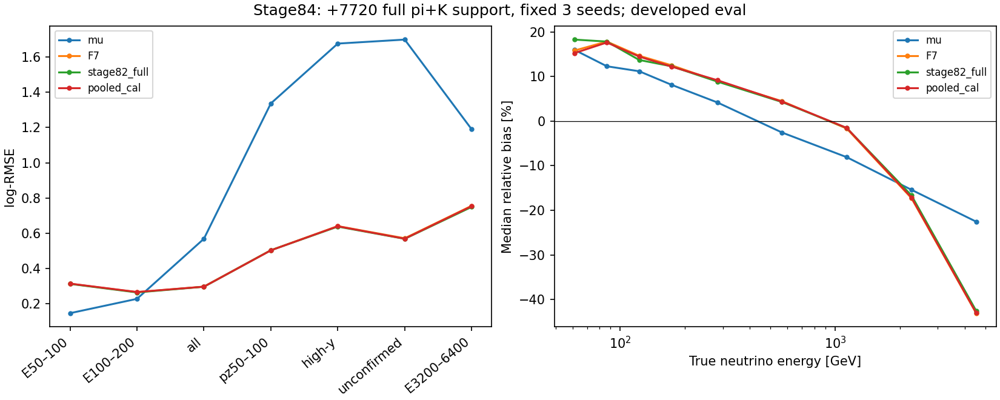

# Stage84：完整 π＋K 支持的一次固定三 seed 训练

## 阶段目标与结论

执行路线§64与stage83实际支持合同：用原41447 train＋累计7720新增唯一入射key训练一个完整支持ensemble，恰3能量fit/0pilot，无半量或更多规模臂。0新ROOT/RDO/GENIE/G4/toy、0F7新fit/推理、0来源OOF。**主pooled_cal没有恢复两低能区，继续F7，结束这次固定完整支持实验。** 原总体/困难RMSE及七层双向尾保护均通过，不能把低能失败写成所有风险失败。

新增支持已实际用入模型，而不是文件计数：π6704＋K1016/26来源，两低E182/845各约原24%，但本次未测出相对原F7的低能收益。这不是数据充分性或探测器信息极限证明；完整随机未开发确认、响应系统效应和上游谱系仍未知。

## 输入、变量与冻结政策

输入按stage70/81/82/83 `support.npz`各自`new_training_support`稳定名单合并，新增分别28/742/1016/5934，总7720，互异且与stage55全部95748曝光/66843唯一native-MeV `(pdg,px,py,pz)` key无交集。保留先前归属，不从所有selected重选另一组。来源均属于原合法train组，新π/K仅development enrichment；选择概率见四阶段原source_plan/协议，不用于物理flux权重。

原41447/8440/14057和91/16/22来源组保持，test/locked未读。新train49167，两低E949/4409（原767/3564＋182/845），reco pz50–100共3035（原2498＋537），同低pz真≥200共1195（原1005＋190），high-y1425/未确认1776。原缺失train/cal/eval/unused=21/3/7/11，新增缺失2保持；训练矩阵23例含NaN，事件不删。支持细表见[training_support.tsv](stage84_energy_ml/training_support.tsv)和原stage83 training_context。

原62 `F7_pz0_raw_v1`：一次方动量仅pz0，px/py、q/p、弯折允许；11signed raw_charge、VetoNu reduced、typed域/status/dependency NaN，合法signed负值保留。nonnegative/count等占位按各自定义清理，不能统一删−1/负raw。Calo缺模块totalNaN，普通sum不nansum。四期缓存metadata均已参考WAVE-Calibration-01-LG，逐数组照用，**没有二次03→01缩放**。原pz>50 GeV/geometry/quality/truth fiducial与所有困难尾保持，原选择fitted-charge cut未改，模型闪烁体不用fitted charge。

复用LCG109/XGBoost2.1.3，原max_depth5/eta.04/subsample.8/colsample1/min_child_weight20/reg_lambda10/hist/nthread1，400轮、seed2026110255/256/257，unit直接回归自然log(E_true/GeV)。原xgb.train默认初始化，没有base_score/boost_from_average override；实际三模型base_score6.3091497、boost_from_average1。混合与样本量改变也改变默认初始化/拟合，不能称纯N干预。

三seed log预测取均值后，原8440 cal只拟一个unit global mean-log offset **0.00755063984043598**（能量乘1.007579217803457）。主pooled_cal事前固定，raw并报，不挑seed/raw/cal或轮数。原F7与stage82full只读既存预测/offset逐行比对，不重训/推理基线。没有新来源OOF，不称整管道留出或独立确认。

[input_QA.json](stage84_energy_ml/input_QA.json)在提交前核角色/key/原raw/域/NaN、原基线参数、DMatrix49167×62和无额外weights；[package_QA.json](stage84_energy_ml/package_QA.json)在实际转移包的干净子进程检查完整train/cal/eval矩阵、版本、缺失和K数，零fit后才提交。stage83小QA40头身份全selected0及旧非空检查在提交后的历史局限保持，不改写成完整非空QA先齐；本轮仅用已全文件验证的标量缓存，不再读新身份。

## 执行命令与资源

仓库根、现成环境，不安装/编译；`/tmp/stage69_python.sh`加载LCG109并设OMP/OPENBLAS/MKL线程1：

```bash
bash /tmp/stage69_python.sh ml/full_support_fit.py prepare
bash -n AnalysisZipFramework/submission/run_ml_full_support.sh
python3 -m py_compile ml/full_support_fit.py ml/report_full_support_fit.py ml/validate_full_support_fit.py
bash /tmp/stage69_python.sh ml/full_support_fit.py submit
# 内部actual payload零fit QA、condor_submit -dry-run后，唯一正式9663311.0
bash /tmp/stage69_python.sh ml/full_support_fit.py collect
bash /tmp/stage69_python.sh ml/report_full_support_fit.py
bash /tmp/stage69_python.sh ml/validate_full_support_fit.py
```

[protocol.json](stage84_energy_ml/protocol.json)冻结参数、输入、原门槛和资源；[submission.json](stage84_energy_ml/submission.json)保存实际ClassAds与包清单。[history.json](stage84_energy_ml/history.json)核唯一job9663311.0一次启动、exit0、无重试，RequestCpus1/Memory3000MB/MaxRuntime1800秒未被改写。remote CPU34秒、execute wall40秒；worker `/usr/bin/time` user33.28/sys.83/wall36.77秒、peak282896 KiB=276.265625 MiB。

脚本CPU30.943590秒/wall31.200644秒/peak276.265625 MiB（包含读cache/三fit/预测/保存，末尾train表写出略在该资源快照后）；不能把这段时间当纯训练迭代基准。三模型每49167事件一次训练，147501/31.200644=4727.499训练行/脚本wall秒，仅描述本固定工作负载。每seed时间见[fit.json](stage84_energy_ml/fit.json)，0pilot。worker单Python soft1080/hard1100 CPU秒、wall1100秒、逐轮budget1050秒，均在实际ClassAd1800秒和累计CPU1800秒上限内。

input准备wall4.707842/CPU3.040839秒/peak616.605469 MiB（含读取全部原开发缓存）；package QA wall4.067011/parentCPU.717256秒，子Python CPU未单独计时。报告CPU4.511857/wall5.130874秒；独立验证资源见[validation.json](stage84_energy_ml/validation.json)。四个新增支持源缓存逻辑读取2,898,147 bytes，正式共享包16,517,975 bytes，Condor事件记录received16,518,085 bytes；后者是Condor传输计量，非全部EOS物理网络I/O。完整input cache和软件包/回传包/重复预测已清理，三模型＋唯一comparison＋紧凑表图留存，最终4,875,209 bytes（含清单）见[retained.json](stage84_energy_ml/retained.json)，验收<20MB；物理EOS网络I/O**未测量**。

## 主结果与原恢复/风险判据

自然log-RMSE，无量纲；全部同一原eval，cal/eval已开发。μ为pz0/.8，stage82full为旧1786新支持的已存模型结果，主stage84完整新支持7720。

| eval层（GeV） | N | μ | F7 | stage82full | pooled_raw | 主pooled_cal |
|---|---:|---:|---:|---:|---:|---:|
|E50_100|208|0.145487|0.312816|0.311861|0.308758|0.313532|
|E100_200|906|0.226876|0.265014|0.263216|0.261817|0.265800|
|all|14057|0.568069|0.296363|0.295603|0.296582|0.295944|
|E200_inf|12943|0.588671|0.298164|0.297472|0.298666|0.297650|
|pz50_100|682|1.336853|0.502965|0.502823|0.502438|0.502276|
|pz50_100_trueE200_inf|299|1.990581|0.649292|0.649736|0.649600|0.646739|
|high_y|440|1.676717|0.640068|0.637151|0.642051|0.639209|
|unconfirmed|510|1.699385|0.570928|0.567693|0.570450|0.568454|
|input_missing|7|0.704495|0.666657|0.655590|0.672798|0.671070|
|E3200_6400|271|1.189880|0.755449|0.748931|0.759654|0.753236|

完整bias/R68/tail50/100及双向损失贡献见[metrics.tsv](stage84_energy_ml/metrics.tsv)，来源/seed诊断见[source_metrics.tsv.gz](stage84_energy_ml/source_metrics.tsv.gz)/[seed_metrics.tsv](stage84_energy_ml/seed_metrics.tsv)。≥6400 GeV eval为0，性能未测量，不能填0性能。

两低E主/μ分别2.155061 [1.810447,2.498753]、1.171565 [1.100987,1.242889]，95%上限均远大1.05。相对F7分别1.002292 [.989558,1.015512]、1.002964 [.990915,1.014544]，未证改善；all/F7=.998587 [.996663,1.000424]中央略低但区间跨1。低pz/F7=.998629 [.990055,1.007464]、high-y=.998658 [.992892,1.004563]、未确认=.995667 [.986640,1.003422]均未证增量。

| 原门槛层 | RMSE参考 | 主RMSE上95% | 上限 | 通过 | 对F7总/正/负tail50上95%最大值/pp |
|---|---|---:|---:|---|---:|
|E50_100|mu|2.498753|1.05|False|1.937852|
|E100_200|mu|1.242889|1.05|False|1.840873|
|all|F7|1.000424|1.01|True|0.217151|
|E200_inf|F7|1.000355|1.03|True|0.197033|
|pz50_100|F7|1.007464|1.03|True|1.325579|
|high_y|F7|1.004563|1.03|True|1.106322|
|unconfirmed|F7|1.003422|1.03|True|1.043207|

五个RMSE保护与七层共21项tail50保护全通过，失败是两低E恢复。raw两低E/μ上95%=2.465946/1.224332亦失败；raw未确认负tail上限+2.093346pp略超2。不能靠换raw为赢家规避主政策，也不能把global offset当唯一失败原因。

来源区间：500次component分层保守source group重抽样，seed2026111384、cal+1，固定同事件预测/offset，与μ/F7/旧stage82配对；报告[paired.tsv](stage84_energy_ml/paired.tsv)。排除重训、增补/来源抽样、offset估计、完整谱系、响应和研究选择不确定，非联合覆盖/独立确认。最低能只19个eval来源组，不能用208事件当208个独立生产；每层N/来源保留。原低能、总体与尾门槛完全不降。

## 尾部、训练内和机制对照

最低能主median bias+16.0655%，32/208正tail50（15.384615%）占73.852209%平方log损失；不是用去掉这32例恢复模型。第二低E主正tail损失份额57.232807%；高端3200–6400 median−42.9553%仍偏。缺失7例主/F7=1.006619 [.786300,1.122628]，宽区间不能称稳定等价。

额外confirmed低transfer最低能181例logRMSE.283410、相对F7=1.006943 [.995699,1.022428]，正/总tail上95%+2.430147pp；原七层通过不掩盖该子层。第二低能confirmed低transfer663例.220073。低pz真≥200的299例主/F7=.996068 [.984494,1.006178]，总/负tail上限+1.427137/+1.753651pp，本次均≤2；同低pz高y172例/未确认239例RMSE比上95%1.007569/1.008142。不能把这些中央改善推广为所有歧义已经解决。

训练内（非OOF）全49167 raw logRMSE.246741，两低E949/4409为.240635/.227733。最低能训练内仍有10.958904%正tail50、median+15.6033%，不是仅eval的208例偶然尾；但训练与eval分布不同，不能据此唯一判定欠拟合/先验或响应不可辨识。全部old/new/pooled train raw/cal细表见[train_metrics.tsv](stage84_energy_ml/train_metrics.tsv)。

与旧stage82full配对，主第二低E比1.009817 [1.000854,1.018749]变差；最低能1.005360 [.988704,1.018561]、all1.001152 [.999480,1.002861]、低pz.998913 [.990168,1.006619]未证改善。22个all来源中15个比F7中央更好、11个比stage82full更好；最低能19来源中9个比F7更好、6个比stage82更好，第二低能22来源对应9/6，不是来源一致收益。来源表是描述，不能作未计研究选择的显著性投票。



可以排除本轮“只交K文件而未入训练”“重复旧曝光充新N”“Calo重复缩放”“丢缺失/困难事件”“挑raw/seed/offset”等具体程序性混淆。共同writer/实际响应仍未完整独立认证，不能说已排除所有程序或物理原因。没有足量多规模独立生产控制，本次π混合、来源、N与重训共同变化；有限24%增补不改善不能证明缺数据无关，亦不能否证其他有依据的新测量。

## 独立验证与交付

numpy unique/inverse独立核7720新key与全旧曝光无交集及互异，逐数组原train/新四缓存/62无缩放，原F7/stage82预测同cal/eval行精确闭合。三保存模型400轮/原参数与protocol attr逐位回读，包含train预测和18条训练内指标。4338条实际指标行与276条配对区间行的500来源draw均以直接逐事件权重独立复核，最大区间差1.1102230246251565e−15；原恢复/风险裁决逐项复核通过，见[validation.json](stage84_energy_ml/validation.json)。

源码静态编译、shell语法、`git diff --check`、文档链接/历史追加、独立支持协议及stage54后缀逐字保护纳入最终验收。原stage54五项未跟踪工作不改动、不stage或清理。阶段报告先落地，再与新代码/配置/紧凑证据本地Conventional Commit，不push。事件缓存/模型不入Git，原四期support保留。

## 下一步：实际共同响应控制，0能量训练

本固定完整支持实验结束，继续F7。唯一下一项stage85执行保留stage54§1–5实际data/MC tracker读出/占据控制，使用新stage85输出，不改原五项未跟踪工作。完整[输入合同](stage84_energy_ml/followup_input_request.json)与[Prompt](../docs/nu_mu_energy_ml_next_step_prompt.md)已经冻结，本轮未执行。其目标是交付缺失的共同响应证据，不是已证明的MC低能退化修复。

输入为既有6data/12MC manifest、stage52统计和stage53原2048同事件摘要；先≤40实际native schema/联结、共用station/sensor/timebin/trigger/mask和active-channel分母QA，再冻结data2048、原100–250/250–1000GeV两层以及一个有物理依据的关联排除定义。保留完整已知PHYS支持的无probe选样，不能用旧entry_stop prefix。原100–1000GeV单μ结果不直接代表50–100GeV ν或shower效率。

验收是真实每active-channel/event活动、孤立性/timebin/站间相关、来源/run/p/位置支持及500来源区间，并回答：能否限定可信noise范围；只能给含背景上限；或当前共同定义无法识别电子噪声。无quiet/random触发不强分解noise、无SDO/未关联不全称noise，不按data改BDT，不把on/off全差当1sigma。入口缺失则交可识别条件统计及具体最小collection/coverage/条件缺口，不能交空metadata阶段。

资源≤6并发/每≤2CPU6GB、累计CPU8h、实际输入10GB/紧凑20MB只为QA后上限，实际可用性/成本/约束均未测量。0ν重放/新G4/谱toy/训练；可定义响应变体后另立真正同事件ν合同，不能先运行或捏造变体收益。K旧限时/禁令仍由用户覆盖；全部已用K、四期支持/三模型保留。interaction/FSI/材料/接受度/背景、共同Calo/脉冲及真正随机未开发确认仍是后续义务。
