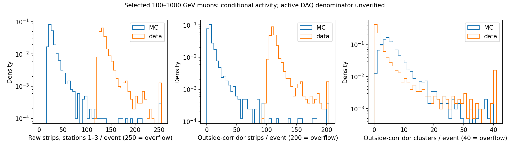

# Stage85：共同 tracker 原生读出控制与条件活动

日期：2026-11-03。输入路线为 roadmap §66 与 stage85 研究复盘。本阶段完成实际 **2048 data＋2048 MC** 原生 REC 联结和读出统计，复用 stage53 两臂，**0 能量 fit、0 新 F7 推理、0 重建/数字化重放、0 ν replay、0 GENIE/G4/toy**。继续保留 F7；既有 1016 个 K 支持不变，用户解除的 K 历史时限与禁令不恢复。

## 1. 阶段目标与结论

目标是在原有单 μ 控制选择下，测量共同 station 的读出活动、时间箱、cluster 与来源差异，判断能否标定电子噪声或构造有依据的响应变体。

结论为 **B：可测条件活动；C：纯电子噪声和 active-channel 概率仍不可识别**，没有达到 A 的响应标定条件。共同三站 data 的 raw strip 明显多于 MC，但其绝大部分差异位于实际 `01X` clustering 不接受的时间箱；data 的邻域外 cluster 反而更少。因此不能从 raw 比值或 stage53 on/off 全差给一个统一 noise scale，也不能据此解释 MC 50–100 GeV ν 能量误差。

本轮取得真实原生集合、完整身份闭合与实际统计，不是 metadata-only 结论。缺少经认证的逐事件有效 DAQ 分母与无偏 quiet/random trigger 时，结束当前纯噪声参数支线，保留响应未识别标记，下一阶段先交实际 latent-state 表与 transfer posterior 预注册。

## 2. 输入、选择与抽样

- 入口：[固定 manifest](../ml/configs/calonu_muon_files.tsv) 的 12 MC、6 data；data run 为 15838、16000、16923，每 run 两个已知合并 PHYS。只检查对应已知 REC 范围，共 **312 文件＝300 data＋12 MC**，未递归扫描 EOS。
- data 完整 PHYS 为 **5,421,535 events**。只读复用 stage54 六个 streaming-priority 抽样 JSON；每文件完整处理，cutflow 与 stage52 全文件充分统计逐项相同。没有使用历史 `entry_stop=100000` 前缀，也没有重新选择有利事件。
- MC 固定 stage53 原 **2048 events**，不重复 nominal/off reconstruction。MC 母样本为 600,000 events；来源/合并条目保持，生成子文件 eventID 重启不当作同一身份。
- 原选择：stable/colliding data、恰一 long track、最高 pz 轨迹、层数/DoF/χ²、100≤p<1000 GeV、VetoNu 外推质量、四 Veto **raw charge>40 pC**、Timing 平面 |x,y|<80 mm、单位电荷。详细公式沿用 `read_f6_muon_response.py` 与 `ml/configs/f6_muon_response.json`，没有按 tracker probe 选样。
- 这里历史控制选择用 p0 定义两个动量箱，保持原抽样合同；**没有把 p0/p1/pz1 加回能量模型**。模型的一次方动量仍仅 pz0，px/py、q/p、弯折量可用；signed raw11、typed NaN、缺失状态与 Calo NaN 传播政策不变。

| 控制动量 | data 合格母样本 | data 抽样 | MC 合格母样本 | MC 固定样本 |
|---|---:|---:|---:|---:|
| 100–250 GeV |343563|1024|53624|1024|
| 250–1000 GeV |597161|1024|145615|1024|
| 合计 |940724|2048|199239|2048|

抽样种子沿用 data 2026110254 / MC 2026110253；每 source/p cell 的有限总体事件纳入概率为实际 `k/N_cell`，36 行明细见 [sampling_audit.json](stage85_energy_ml/sampling_audit.json)。已知文件不是随机抽取的 run 总体，文件纳入概率未定义，不能外推全曝光。母样本数由旧 stage52 40-cell 缓存按 p 边界100/160/250/400/650/1000 GeV 聚合，无新 PHYS 读取。

抽样后 pz0 均值 data/MC 为 **335.159/372.688 GeV**，VetoNu 位置 ρ 均值 **59.749/59.128 mm**。两粗动量层各半不保证层内谱、材料、背景和位置完全相同。全套支持数、source/p/ρ/x/y 分层在 [kinematic_support.tsv](stage85_energy_ml/kinematic_support.tsv) 和 [sources.tsv](stage85_energy_ml/sources.tsv)；没有按活动匹配或训练 domain weight。

## 3. 真实联结、共同集合与分母

原生读取 `CollectionTree` 的 `EventInfoAux.`、`SCT_RDOs`、`SCT_ClusterContainer`、`CKFTrackCollectionBackwardWithoutIFT`。data 扫描所有冻结文件实际 run/event header，匹配 event/time，再逐事件闭合 PHYS 四站 cluster 指纹；没有按文件大小或条目比例猜联结。QA 的首尾事件范围只定位候选，正式扫描全部文件并检查重复。MC 使用已有 source/merged-entry 联结，复核 run/event、文件长度和四站 cluster 指纹。

最终 **4096 个 source/case 与4096 个 native 文件/entry 唯一身份**，2048/2048 全交付，未解决身份 **0**，四站 cluster 不符 **0**。本阶段代表 QA 覆盖18个首事件＋REC entry0 schema，至多 **19 个独立 payload 身份**；旧 stage54 smoke40 只读作历史记录，没有重跑。实际传输包在提交前通过，修复包也先作相同身份的包 QA。

共有读出按 **station1–3** 报告。Identifier helper 从正式运行包 XML 初始化，192 wafer hash 与原生 RDO wafer/hash 及 cluster delta-hash 逐项核对；每站48 wafer、768 readout strip/wafer。station0/IFT 单列：noIFT 跟踪不等于 IFT raw collection 不存在，本定义没有 IFT 关联传播，不能把该站全部未关联活动叫 noise。

几何名义分母每站 **36,864 channels**，三站 **110,592 channels**。data 三个 run 首份实际生产日志各记录 **227/225/227 bad strips**、0 bad modules，SCT geometry FASERNU-04、global tag OFLCOND-FASER-05，且日志明确 clustering 使用 `01X`。证据见 [conditions_audit.json](stage85_energy_ml/conditions_audit.json)。这些首文件日志与当前 DB 不能认证300文件所有 IOV、DAQ link/错误/动态屏蔽、HV 和接受度。因此：

**每 active-channel/event 占据率：未测量，分母未认证。** 表中的 nominal-channel 率是几何归一化的条件活动，不能改称 active-channel 或纯电子噪声概率。真实探测效率、无偏 Veto/Timing 效率、ν shower 闭合也未测量。

## 4. 固定关联排除与软件诊断

唯一排除定义：在每个已保存 backward-track SCT cluster-on-track 命中所在 wafer，沿 strip 坐标取 **含端点 ±64 strip** 的并集。CVMFS geomDB `SCTBRLSENSOR_DATA` 的 strip pitch 为 **0.08 mm**，对应半宽 **5.12 mm**；这是一条保守的固定局部关联带，没有扫半径/能量/噪声。覆盖全部保存轨迹的关联测量，不仅 leading track；无测量 wafer 保留为未归属，不假设进行了可靠传播或已经远离 μ。共有三站平均有测量 wafer 数为 data/MC **17.296875/17.325684**，不能拿它代替144 wafer 的实际 DAQ 覆盖。

raw 以 wafer 内唯一 strip 计数；本4096样本逐事件/逐站 timebin 加权总数与唯一 raw strip 数恰相等，无重复 strip。孤立 raw strip 要求两个相邻 strip 均无 raw 命中。cluster 保存总数、大小1/2/3/4/≥5、外侧/单条带/孤立外侧数量；孤立 cluster 要求其条带之外无立即相邻 raw strip。没有关联的真实次级、beam 背景和漏重建粒子仍包含其中。

两项程序问题均有明确处理，未当成物理效应：

1. 初始 ROOT/Cling 直接包含 Athena24 header 时，`FaserSCT_Cluster_p3` 被解释成72 bytes，现成 production dictionary 实际为56 bytes（嵌入的 `LocalPosition_p1` 是8而非16 bytes）。直接 typed stride 会读错内存；改用已部署字典的 `TVirtualCollectionProxy` 访问真实元素、字段和步长，随后全部 cluster 计数闭合。初始关闭 header branch 后直接读指针的问题也已修正。没有重编译 Calypso 或恢复旧完整安装。
2. 初始9665305.4在 source10 的一例18-strip cluster 停止。生产 converter 将以32-bit base计算的 offset 转成16-bit `short`，strip间隔为2048；+16/+17 strip 对应32768/34816，持久化为 **−32768/−30720**。实际解码 center0 后为 **1008/1009**，超过0–767。该例为 source10/case3、native entry715/event716、station2、cluster101/hash104。修复只将其 **1 cluster/2 RDO-list ID** 标为关联未知，总 cluster 与事件保留，不强行修复位置、不删除负偏移或事件。负 offset 本身可以合法，判断依据是解码后的物理域。诊断见 [invalid_cluster_diagnostic.txt](stage85_energy_ml/invalid_cluster_diagnostic.txt)。

仅重提失败 shard4，单一邻域和冻结样本不变；其余5片不重读。外侧 cluster 下界不分配该未知 cluster，上界把它计入，MC 为 **6.427734–6.428223 cluster/event**，data 为3.718750，差异结论不依赖此例。不能因一例标识异常关闭物理分支，也没有把它当低能失败原因。

## 5. 实测条件活动

以下均为共有 station1–3 的每事件均值。500次来源重抽样，data 在每个固定run内重抽两个文件、MC在每个电荷run内重抽六个来源；种子2026110385。区间为 **data−MC 的边际95%区间**，条件于这三个data run、两个MC生产run、已选事件/重建/输入；不含新run、mask/响应/抽样再实现或研究选择，不是联合95%认证。

| 观测量 | 单位 | data | MC | data−MC 95%区间 |
|---|---|---:|---:|---:|
| 全 raw strip |strip/event|137.606445|29.061523|[107.135967,109.799976]|
| 邻域外 raw strip/未归属 |strip/event|115.122070|8.994141|[104.909555,107.242759]|
| 孤立外侧 raw strip |strip/event|105.897949|5.123047|[100.332752,101.160994]|
| 满足实际01X的 raw strip |strip/event|32.892578|29.057617|[2.433955,5.074317]|
| 不满足01X的 raw strip |strip/event|104.713867|0.003906|[104.652832,104.767834]|
| 全 cluster |cluster/event|21.847168|24.500000|[−3.409927,−1.978731]|
| 外侧 cluster，下界 |cluster/event|3.718750|6.427734|[−3.383406,−2.112768]|
| 孤立外侧 cluster |cluster/event|3.607422|6.422852|[−3.481297,−2.223166]|
| SP（原PHYS） |SP/event|27.504395|23.934082|[−5.067572,12.007556]|
| segment（原PHYS） |segment/event|4.609375|4.482910|[0.058807,0.197007]|

SP 的均值区间跨0，不能把这2048子样本写成显著 SP excess；data/MC SP median均13、q99为230.48/138.01，尾与来源很重要，未删异常。外侧 cluster median为1/5、q95为16/16、q99为46/41.06。详细中央分位数、尾、run/source/p/位置层在 [activity.tsv](stage85_energy_ml/activity.tsv)、[differences.tsv](stage85_energy_ml/differences.tsv)。



### 5.1 时间结构解释了 raw 与 cluster 方向相反的重要部分

| timebin | data strip/event | MC strip/event |
|---|---:|---:|
|000|0|0|
|001|4.437500|0|
|010|6.993652|16.707031|
|011|25.898926|12.350586|
|100|4.136230|0|
|101|1.092773|0|
|110|2.952148|0.001953|
|111|92.095215|0.001953|

实际 `01X` 只接受010/011。raw 均值差108.544922中，**104.709961 strip/event（96.467%）** 位于不接受的时间箱；其中111一项贡献92.093262。共有三站 raw 差分别14.828613/9.725098/83.991211，station3最大；data外侧cluster却在三站各少0.543457/1.011719/1.153809。不能将 raw 热活动自动当成会增加模型使用的 cluster/SP 的噪声。

这是观测与实际 timing rule 的闭合，未扫描时间窗。111来源是否主要为热条带、读出模式、beam背景或其他条件，**未唯一分解**；本轮没有逐wafer历史mask＋quiet trigger的联合认证。坏条带处理和真实次级/接受度可能继续影响01X与cluster，不能从均值反求一个纯 noise 参数。

### 5.2 支持、来源与站间相关

- 邻域外 strip，100–250 GeV 为 data/MC **114.254883/7.601562**，差95%区间[105.515152,107.613594]；250–1000为 **115.989258/10.386719**，[104.094818,107.081679]。
- ρ<40/40–80/≥80 mm 的外侧strip均值分别 data **115.455319/113.394899/119.219955**，MC **8.520000/8.373464/11.380597**；三层差区间均在0上方。2p×3ρ及x/y符号层均有实际支持，数目见支持表。未把这些分层当作已消除所有谱/背景退化。
- 六data来源外侧strip均值 **113.698830–117.771930**，十二MC **6.876471–12.292398**；data外侧cluster **2.988304–5.298246**，MC **5.417647–8.228070**。不是靠删某一来源产生差异。
- 外侧strip Pearson相关(data/MC)：station1–2 **0.385066/0.277053**、1–3 **0.287599/0.109213**、2–3 **0.154226/0.132443**。data1–2来源区间[0.258006,0.445225]、MC[0.218803,0.377823]重叠；相关存在不等于独立电子噪声。完整相关矩阵及500draw区间见 [summary.json](stage85_energy_ml/summary.json)。
- 几何名义全raw率 data/MC 为 **0.001244271/0.000262781 strip/nominal-channel/event**；名义外侧率 **0.001061415/0.000082922**。这些数仅用于可复现几何归一化，**有效分母未认证，不构成 noise 概率或标定上限**。

### 5.3 旧两臂约束

只读 stage53 固定2048匹配摘要，nominal−off每站cluster增加 **1.271484/1.262207/1.291992/1.323730 cluster/event**；SP **+0.025391** [−0.051523,0.082058]、segment **−0.007324** [−0.023938,0.009049]。详见 [stage53_fixed_on_off.tsv](stage85_energy_ml/stage53_fixed_on_off.tsv)。这与额外独立strip噪声主要增加cluster相符，不能解释全部data读出时间结构或已见segment差异。没有拟合插值、没有把全on/off差当1σ。

## 6. 执行、资源与验证

使用现成 d32b0ff3 Calypso archive、Athena24.0.41/gcc13 和其 production dictionaries；无全框架重编译。每文件压缩basket按条目顺序稀疏复用，关闭不必要分支，不复制 REC/RDO/xAOD，不保存逐hit点云。六片各处理一个data来源＋两个MC来源。

```bash
# 只打包现有冻结缓存，不读取新的物理输入
python3 ml/package_tracker_readout.py
# 先用实际传输包做固定代表事件 QA（脚本第三参数qa，不上传批量结果）
bash run_ml_tracker_readout_control.sh 0 /eos/user/x/xcheng/FASER/nu_muAnalysis qa
condor_submit AnalysisZipFramework/submission/ml_tracker_readout_control.sub
# 初始9665305.4失败后，仅修复重提4；实际提交文件保存在stage85 AFS spool
condor_submit /afs/cern.ch/user/x/xcheng/nu_mu_stage85/repair4.sub
bash /tmp/stage69_python.sh ml/analyze_tracker_readout.py \
  --directory ntuples/energy_ml_stage85 --output workbook/stage85_energy_ml
python3 ml/validate_tracker_readout.py \
  --directory ntuples/energy_ml_stage85 --output workbook/stage85_energy_ml
```

`/tmp/stage69_python.sh`仅加载现成LCG109 Python/Numpy/Matplotlib，BLAS线程为1；原生worker自含setup。冻结合同为 [protocol.json](stage85_energy_ml/protocol.json)，异常保留修订为 [protocol_amendment.json](stage85_energy_ml/protocol_amendment.json)。实际传输包曾从错误工作目录启动而在tar前失败，改从含输入包目录启动后通过；没有将该次启动写成成功QA。

| 成本/验证 | 实测 |
|---|---:|
| 初始任务 / 修复任务 |9665305.0–5 / 9665388.0|
| 完成 / 失败后修复 |6 final exit0；初始4 exit1；各只启动1次|
| 最大并发、实际request |6；每任务1 CPU、3072 MB、MaxRuntime7200 s|
| Condor累计CPU（含失败片） |**1123 s**|
| Condor累计wall |**2583 s**（各任务之和，非整体elapsed）|
| 成功读出脚本CPU / wall之和 |1070.541805 / 2462.483738 s|
| 成功读出peak RSS |**792.382813 MiB**|
| native header累计entries |36,142,628|
| 成功ROOT计读入字节 |**2,070,041,538 bytes＝2.070042 GB**|
| 成功schema QA CPU /读入 |38.594075 s /124,252,607 bytes|
| 两次成功实际包 QA CPU /读入 |22.919491 s /39,567,982 bytes|
| 最终汇总分析CPU / wall /peak |11.699119 /12.003943 s /118.148438 MiB|
| 完整联结 / fingerprint失败 |4096 /0|
| stdlib独立校验均值 / 来源区间 |100 /100项；最大差0 /2.220446049250313e−16|

读取吞吐为4096/2462.483738＝**1.663 records/累计wall秒**，其中包含全36.14M header扫描；不能把稀疏输出率当 full reconstruction events/s。资源明细与原始事件日志见 [resources.json](stage85_energy_ml/resources.json)、[condor_events.txt](stage85_energy_ml/condor_events.txt)。

**计量局限：** 初始交互式字典崩溃/失败过程的CPU及ROOT读字节未完整计量，失败批量片的部分ROOT I/O也未落盘；Condor CPU已包含该失败片。上述成功计数不是全会话完整总成本，不能宣称严格认证了全部失败尝试的I/O/CPU上限。物理EOS网络流量未测量；正式成功读入2.07GB与已计成功QA0.164GB远低于10GB。后续这类诊断应从第一次尝试就统一记录计量并落盘异常进度。

独立验证逐事件核对source/case/native身份、timestamp/原条目、四站计数、raw/timebin总数、cluster大小及外侧/未知边界，并用stdlib从source和500个保存draw重算100项均值和区间。结果见 [validation.json](stage85_energy_ml/validation.json)。图已人工查看。没有为低影响文档变更增加空泛测试。

## 7. 产物、研究边界与下一步

新代码：`ml/read_tracker_readout.py`、`tracker_readout_control.h`、`analyze_tracker_readout.py`、`validate_tracker_readout.py`、`package_tracker_readout.py` 及新 stage85 Condor worker/descriptor。紧凑事件样本与6片摘要保留于 `ntuples/energy_ml_stage85/{sample,native_0,…,native_5}.json`，不入Git；表、图、合同和验证入workbook。无ROOT中间副本，最终约 **4 MB**，准确数值见retained清单。原stage54五项未跟踪工作只读保留，未修改、删除或加入本提交。

当前最小缺失输入是：

1. 与各run/event/IOV联结的历史wafer/strip mask、cabling、HV/DAQ link覆盖与错误标志、实际前端readout/threshold配置，以及MC动态disabled-cell等条件；需要能认证共同active分母，不能只有总坏条带数或当前DB。
2. 同读出配置、明确触发/预标度/beam条件的quiet/random触发或可认证无偏时间窗，与上述分母联合提供。本有界PHYS控制输入没有这些无偏样本；没有断言全EOS不存在。
3. 后续ν响应研究还需相应interaction/FSI/材料、Calo与脉冲响应条件及真正未开发来源确认；100–1000 GeV单μ不能替代50–100 GeVν及强子shower。

**下一唯一任务stage86尚未执行：** 用现成stage84完整支持49167、旧F7/传统/stage84预测与来源/incoming谱系，先交实际latent-target/transfer-state交叉表，审计vertex μ/transfer标签、单位与status，分别报告真低能低pz与同pz真高能/high-y、缺失和来源支持、bias/双向tail。固定 bounded residual/shrinkage＋hurdle/连续正transfer mixture 的后续输入族、loss、点估计、68/90% coverage/PIT、先验stress与原门槛；审核真正unused locked source，不能把旧cal/eval改称blind。部署输入仍仅实际观测量，不能用reco pz0/0.8制造非负truth transfer。

该准备阶段0新能量fit/ROOT/F7推理，≤1 Condor、1CPU/3000MB、累计CPU1800s/紧凑20MB；实际表和可执行标签/谱系审计是验收，不以metadata清单代替。新训练的标签、独立split与预算须由该实际证据另冻，不自动开展。具体输入与标准见 [followup_input_request.json](stage85_energy_ml/followup_input_request.json)。不继续纯noise参数/随机扩样/seed/架构网格；本结果没有证明数据量无关、不可观测信息极限，或低能问题已经解决。
