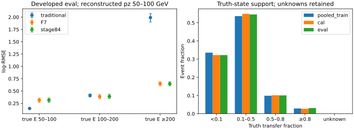

# Stage86：真实 transfer 标签闭合，低能失败存在于常规低 transfer 事件

日期：2026-11-03。起点 `8caf432`；执行路线 §67、信息预算 §47 和 stage85 输入请求。**本阶段完成缓存诊断与有条件的后验预注册，0 新能量 fit、0 ROOT 读取、0 F7 推断、0 重建/生成/谱 toy。继续保留 F7，不发布新能量模型。**

## 1. 目标与阶段结论

目标是实测 transfer 标签、低 pz 两侧、response/missing 状态和来源谱系，判断下一后验实验的监督与 split 是否具备条件。

1. 原 train 41447＋新增 π/K 7720＝**49167**、cal **8440**、eval **14057** 条记录的顶点 μ 标签全部可还原。唯一候选、有限正能量、物理 transfer fraction 全部通过；严格零 transfer 为 **0**，不是缺失标签或必须拟合零点原子的情形。
2. 最低能 eval **208** 例全部属于现有状态定义下的 response-nominal；其中 confirmed、fraction<0.2 的 **181** 例，stage84 log-RMSE **0.283410**，传统 **0.142946**。这类常规事件中也有 **25** 个 stage84 正 tail50，占最低能全部 **32** 个正尾的 **78.125%**。不能把低能失败只归于两例未确认或已标记的坏拟合；也不能据此排除尚未认证的物理响应。
3. 低 reco pz eval **682** 例包含 true E≥200 GeV 的 **299** 例；该侧传统/stage84 log-RMSE **1.990581/0.646739**，传统负 tail50 **95.317726%**。按 pz 硬切传统方法会损害真实高能侧。
4. 现有登记 **151 canonical groups** 中，可认证为全新未开发 locked 来源的数量为 **0**；旧 test/challenge 已曝光。开发 train/cal/eval 的 group 与精确 incoming 跨角色隔离已闭合，但新的确认样本和完整上游 parent/seed 谱系仍缺失。**后验合同只能有条件预注册，不能启动训练或把旧 eval 改称 blind。**

## 2. 实际输入、角色与变量

输入为 `ntuples/energy_ml_stage55/dataset.npz`、stage56 `readout.npz`、stage70/81/82/83 `support.npz` 的 `new_training_support`、stage56 旧预测和 stage84 `comparison.npz`。原历史 65 列不能直接入分析；调用 `audited_features.build` 恢复原 **62** 列。stage84 三 seed raw-log 均值加原 cal offset **0.00755063984043598**；F7 offset **0.004602409250700414**。两者均直接读旧预测，无模型加载或推断。

| 角色 | 记录 N | canonical groups | 带缓存命名空间的 source records | 唯一 incoming key | 任一输入缺失 |
|---|---:|---:|---:|---:|---:|
| 原 train |41447|91|178|32046|21|
| 新支持 |7720|26|26|7720|2|
| pooled train |49167|91|204|39766|23|
| cal |8440|16|32|7946|3|
| developed eval |14057|22|44|12780|7|

`source_records` 是 stage/source-index 记录数，不宣称独立 PHYS 文件数或独立生成数；bootstrap 单位为更保守的 canonical group。原角色内部仍有 **9401/494/1277** 条超过唯一 incoming 数的 train/cal/eval 记录；本轮不改既有训练政策，也不把 **49167** 当独立生成事件数。跨角色 group 和 native-MeV `(PDG,px,py,pz)` key 交集均为零；新增 7720 key 内部唯一，与 stage55 全 **95748** 条已曝光记录无交集，并位于原 train group 内。跨 canonical group 的完整生成关联和相同 incoming 下的 FSI/transport 随机谱系未测量，不能由四元 key 断言完整独立。

原 `readout` 映射有 **17369 unused** 行，其中缺失 **11** 行；没有把这些行激活成新评估或新盲测。读取已有 NPZ 需要解压其数组，但没有对 unused 行开展新的能量诊断，也没有打开 stage34/35 历史逐事件检验文件。

模型变量政策保持：一次方动量仅 **pz0**，允许 px/py、q/p 和弯折；禁止 p0/p1/pz1 与 log 动量比。11 路 signed raw charge 替代 fitted scintillator charge。`check_x` 对实际 62 列重新应用原逐列域规则并逐值比较：非负计数中的负占位变 NaN，符号电荷只允许 ±1，坐标按已登记 sentinel 处理，合法负 raw 不因负号被删。不存在一刀切的 `-1/-999` 替换；原 schema 不把任意负 raw 当缺失。模块无效时 Calo 总量 NaN 传播闭合，所有缺失事件仍保留。没有改变原 pz>50 GeV 或其他选择。

## 3. 真值语义与数值闭合

来源是 `ml/frozen_evaluation.py:truth_diagnostics`，支持提取器复用同一定义：与 incoming ν 电荷对应的 μ、生成顶点与 ν 衰变顶点各坐标差≤**0.0001 mm**，恰一个候选才有效。`confirmed` 另要求 leading track 的 μ PDG/barcode 及父 ν PDG/barcode 全匹配。**顶点标签有效与 leading 匹配确认是两个状态。**

生产者用 native MeV 四动量及质量计算 `E_mu_vertex`，缓存 `y_lepton=1−E_mu_vertex/E_nu`。本轮恢复：

`E_mu_vertex=(1−y_lepton)×E_nu`，`h=E_nu−E_mu_vertex`，单位 GeV。

这是从真值定义还原，不是从重建 pz0/0.8 制造非负目标。h 表示非该顶点 μ 的能量转移，不等同 Calo 可见强子沉积；也不默认等同另一 generator 定义的 Bjorken-y。无效候选、非物理 fraction 和缺失标签预先有显式状态，禁止 clip 或删行；本次实际计数均为零，不能以此声称其他生产永远没有这类事件。

| 角色 | 唯一候选/物理标签 N | 未确认但标签有效 | 最小 h /GeV | 严格 h=0 N | 最大 μ 质量壳差 /GeV |
|---|---:|---:|---:|---:|---:|
| pooled train |49167|1776|0.0450915013|0|2.173243×10⁻⁹|
| cal |8440|301|0.0541808177|0|7.911081×10⁻¹⁰|
| eval |14057|510|0.0511826701|0|1.853198×10⁻⁹|

质量壳检查为恢复的 Eμ 与 `sqrt(primary_p_GeV²+0.1056583755²)` 比较；生产者原始逐事件质量没有单独保留，因此这里是参考 μ 质量的单位/算术闭合，不是新 ROOT 真值验证。0/多候选、负 h、fraction≥1、未知标签在所有角色均 **0**。未确认事件不删，它们的重建 pz 与顶点 μ 关联可能失败，后验必须显式允许这种 response 状态。

## 4. 固定 latent/response 实表

看数字前冻结 trueE `[50,100)/[100,200)/[200,∞)` GeV、reco pz `(50,100)/[100,∞)` GeV、fraction `[0,.1)/[.1,.5)/[.5,.8)/[.8,1)`＋unknown、confirmed fraction<.2、high-y≥.8、未确认及五种响应状态。response 状态允许重叠；`response_nominal` 只表示没有已标记 wave/fit/Calo/input-missing，不代表完整 data/MC response 认证。

| fraction 状态 | pooled train N | cal N | eval N |
|---|---:|---:|---:|
| [0,0.1) |16505|2722|4529|
| [0.1,0.5) |26372|4634|7671|
| [0.5,0.8) |4865|854|1417|
| [0.8,1) |1425|230|440|
| unknown/nonphysical |0|0|0|

最低能 pooled train/cal/eval 的 fraction 中位数分别 **0.057698/0.061405/0.064261**，h 中位数 **4.515361/4.711413/5.151905 GeV**。低 pz 真高能三角色 N 为 **1195/205/299**，fraction 中位数 **0.786996/0.780228/0.806796**，h 中位数 **343.542059/397.779423/408.137311 GeV**。这是不同状态混合的实际证据，尚未证明这些状态可由部署输入可靠区分。

| 响应状态 | pooled train N | cal N | eval N |
|---|---:|---:|---:|
| wave invalid |0|0|0|
| fit failure（scintillator bit16/32） |3072|561|1035|
| 至少一合法负 raw |26259|4391|7218|
| Calo invalid |23|3|7|
| 任一输入缺失 |23|3|7|
| response nominal |46073|7876|13015|

wave invalid 为 `8|128|256`；Calo invalid 为 `8|128|256|16|32|4`；合法负 raw 要求通道 wave-valid。最低能 train/cal/eval **949/150/208** 全属于 response nominal；其中合法负 raw **636/105/147**，这些实际事件保留。仅凭本表不能把合法负电荷当 bad fit、把 status-normal 当无域偏移，或从 fit failure 对比作因果归因。

完整 [state_counts.tsv](stage86_energy_ml/state_counts.tsv) 有 **455** 行（5角色×91预定层），**113** 个空层、**64** 个稀少层（N<30 或 group<5）。例如最低能未确认 train/cal/eval **1/0/2**，不得用其百分比裁决支线；eval missing **7** 例/5 groups，区间很宽。空层标明“未测量”，不隐藏 unknown/wave-invalid 层。

## 5. 旧模型风险与 500 来源区间

下表为 developed eval 的 log-RMSE，括号为 **500** 次 pi/k/charm 内 canonical-group 重抽样的 percentile 95% 区间，seed **2026110386**；prediction 和原 offset 固定。每 draw 按源 multiplicity 展开事件，median 使用该整数多重集的精确中位数。

| 层（GeV） | N/groups | 传统 pz0/0.8 | F7 | stage84 |
|---|---:|---|---|---|
| true 50–100 |208/19|0.145487 [0.135371,0.155916]|0.312816 [0.266713,0.356766]|0.313532 [0.265943,0.358207]|
| true 100–200 |906/22|0.226876 [0.213278,0.238181]|0.265014 [0.247237,0.280107]|0.265800 [0.248509,0.280883]|
| all |14057/22|0.568069 [0.554342,0.582836]|0.296363 [0.290839,0.302319]|0.295944 [0.290608,0.301967]|
| pz50–100, true50–100 |208/19|0.145487 [0.135371,0.155916]|0.312816 [0.266713,0.356766]|0.313532 [0.265943,0.358207]|
| pz50–100, true100–200 |175/20|0.411893 [0.377802,0.438185]|0.386356 [0.342887,0.432336]|0.389474 [0.347256,0.435049]|
| pz50–100, true≥200 |299/22|1.990581 [1.901013,2.071715]|0.649292 [0.605660,0.689998]|0.646739 [0.603650,0.689313]|
| true50–100, confirmed f<.2 |181/18|0.142946 [0.133251,0.153231]|0.281455 [0.237505,0.317193]|0.283410 [0.239480,0.319278]|

重要的双向尾与偏差（stage84；百分数，tail50 指相对误差>+50% 或<−50%）：

| 层 | median bias /% [95%] | 正 tail50 /% [95%] | 负 tail50 /% [95%] |
|---|---|---|---|
| true50–100 |+16.065496 [13.255281,20.748280]|15.384615 [9.502258,22.596154]|0 [0,0]|
| true100–200 |+13.137318 [12.213971,14.289138]|9.271523 [7.373025,10.977564]|0.331126 [0,0.656455]|
| true50–100, confirmed f<.2 |+16.062823 [13.024082,20.559427]|13.812155 [8.784453,20.117978]|0 [0,0]|
| pz50–100, true≥200 |−18.316956 [−22.516989,−13.336820]|11.036789 [7.907113,14.311938]|21.739130 [18.619504,25.216800]|
| high-y |−16.389293 [−19.182637,−10.132693]|11.363636 [9.406292,13.407671]|22.954545 [20.068644,25.863516]|
| 未确认 |−8.505637 [−13.497498,−4.123991]|12.352941 [9.602727,14.702514]|15.686275 [12.611994,18.715312]|

完整 [risk_intervals.tsv](stage86_energy_ml/risk_intervals.tsv) **3251** 行，给三种现成策略的 log-RMSE、median bias、正/负/总 tail50 与有效 draw 数，按 role/stratum 与 state_counts 的 source records 联结。训练逐事件 F7/stage84 预测未保留，本轮严格不生成：train/new/pooled 三角色只报传统基线；历史 stage84 训练聚合指标仍在原报告，不能伪造 pooled OOF。



这些区间不含重训、offset 估计、新增抽样、完整上游谱系、研究选择或 detector/interaction/FSI/material/acceptance/background 系统效应；也不等于多层联合 95% 确认。0尾的 bootstrap [0,0] 仅表示样本内重抽样未见尾，**不是总体零尾概率的置信保证**。没有新候选，未重新宣称原门槛通过或证明信息极限。

## 6. Locked 来源审计与准确缺口

[source_exposure.tsv](stage86_energy_ml/source_exposure.tsv) 对 stage81 已有登记的 **151** 个 canonical groups 逐一记录历史用途；role memberships 为 train **91**、validation **22**、calibration **16**、test **22**、challenge **45**，存在重叠，不能相加当独立来源数。

实际历史摘要证明 stage34 test **12488/22 groups**、challenge **15144/45 groups** 和 stage35 test **3247/18 groups** 已于 **2026-11-01** 用于研究。路线 §16 和顶部原说明明确解封；后续 source-plan 中 `locked_test_read:false` 只说明该阶段没有读，不会恢复其独立性。

当前结论严格限于已提供的缓存/登记：**认证未曝光来源 0**，不是断言整个 EOS 或未来生产不存在新来源。现有开发 split 可用，新 locked split 不可认证。最小输入是外部事先保留、没有参与此次研究的真实 production/source，提供：

- 真实 PHYS 或紧凑缓存入口、release/geometry/conditions、62列/raw/status/Calo参考01-LG语义；
- GENIE parent/subfile/entry/generation-seed 与重建 native identity 的联结，以及累计曝光台账；
- canonical group 和 exact incoming 与现有 train/cal/eval/全部曝光池无重叠的证据；
- 标签封存责任和打开顺序。用于 schema QA 而已看过物理目标/风险的来源必须标为开发，不纳入新 locked。

这里没有挑已有 train group 改名 blind，没有删高-y/未确认，也没有为“找 blind”重新读取旧 test 标签。请求仅写入仓库，未向他人发送消息。

## 7. 有条件的后验预注册

[posterior_contract.json](stage86_energy_ml/posterior_contract.json) 在本轮正式数值出现前冻结了模型结构和验收规范。**这是待输入条件满足的实验规范，不是训练准入。**

- F7 与 stage84 原 direct-logE、传统方法均复用旧值。新两臂用同一固定 **41** 维选择：μ/曲率/几何、station multiplicity、11 signed raw、Calo5；排除重复 reduced charge、额外几何、脉冲/时间族及禁用动量。train-only median/IQR＋每列 missing flag，附 wave/fit/Calo 状态。truth/run/source 不进部署。旧 F7 是62维，不能将未来差异只归因于 loss，而忽略输入和容量变化。
- bounded residual：`log(pz0/.8)+sigmoid(g)×log(64)×tanh(r)`，全事件 unit logE MSE＋有效标签上0.1 gate BCE，gate目标为 f≥.2；原 cal 一个 global log offset，cal 为主、raw 并报。锚是传统 ν 估计，不叫顶点 μ 真值。
- 三成分 posterior：一个连续 f<.1 成分、两个连续 f≥.1 成分；不放严格零点原子。显式学 `r=log((E_mu_truth−m_mu)/pz0)` 和分段 logistic fraction，联合 μ-response 与 transfer，令 `E_mu=m_mu+pz0 exp(r)`、`h=E_mu f/(1−f)`、`E_nu=E_mu+h`。每成分两维独立 Normal，在混合后允许相关/多峰；不认为 reco pz 就是真 μ。
- 固定 joint NLL（含 Jacobian）＋0.25 全事件 marginal logE NLL；未知/非物理标签只保留 marginal 能量监督，不制造 transfer 标签。边界采用预注册宽度10⁻⁶的 fraction 区间似然。32点 Gauss-Hermite 积分；原 cal 两标量 r-location/scale 校准，保持 μ＋h 恒等式。主点估计为 posterior median；68/90% 中央区间、PIT、10固定概率箱、logscore/CRPS及宽度并报。
- 两臂均固定2×64 SiLU、Adam 0.001、batch1024、150 epochs、单 seed2026110387，无 early stopping/架构/seed 扫描；未来最多两项能量 fit，0 pilot fits。**实际训练成本、功效、数值积分收敛、coverage 和收益未测量**，准入后仍须实际零fit资源 QA 再冻提交预算。
- 保留两低E/传统95%上限≤1.05、all/F7≤1.01、困难≤1.03，七层总/正/负tail50差上限≤2pp；额外显式保护低pz真高E。新增 coverage 的支持层 lower95≥名义−5pp、mean PIT95含0.5，并展示可靠性/锐度；稀少层不可据此认证。最终需联合风险判断和真正新确认，不能堆独立95%区间。

先验压力测试单列：pooled train 的固定能箱（50/100/200/400/800/1600/3200/6400 GeV＋两端），每箱0.5 pseudocount；名义为原41447训练谱、平坦 logE `[50,6400]`、低能<200 GeV权重×4；posterior ratio 固定 cap `[0.1,10]` 后逐事件归一，逐层报 ESS/裁剪比例，ESS<0.2N 标不支持。只训练 unit-weight 两臂，不添加 weighted fit；名义主结果预定，另外两谱只作敏感性，不能 eval 选赢家。prior-shift 公式需要 p(x|E) 不变，该假设对 flux/response 是否成立未测量。

data/MC density-ratio 是另一个实验，stage85 条件活动没有给纯noise/active分母或数值1σ；本轮不训练 noise correction，不把 raw比或on/off全差当 nuisance。interaction/FSI/材料/Calo/接受度/背景仍未被后验结构消除。

文献核查：本轮通过公开页面读取 [Gambhir–Nachman–Thaler 2205.05084](https://arxiv.org/abs/2205.05084) 摘要，确认训练谱先验依赖；读取 [Bishop 1994 MDN](https://publications.aston.ac.uk/id/eprint/373/) 的作者/题名/摘要，支持逆问题条件分布而非条件均值的动机；Crossref 核对 [Gneiting–Raftery proper scoring rules](https://doi.org/10.1198/016214506000001437) 题名。均未把文献收益迁移为本项目测量；本合同的具体混合结构是待检验设计。

## 8. 执行、资源与验证

主要命令（CVMFS LCG109，numpy/BLAS单线程，无安装/构建）：

```bash
bash /tmp/stage69_python.sh /tmp/freeze_stage86.py
/usr/bin/time -v -o /tmp/stage86_submission.time \
  bash /tmp/stage69_python.sh ml/latent_transfer_diagnostics.py submit
bash /tmp/stage69_python.sh ml/latent_transfer_diagnostics.py collect
```

临时 freeze 脚本只写合同；永久可审阅配置为 `protocol.json`、`posterior_contract.json`。可在同 LCG view 直接运行 `python ml/latent_transfer_diagnostics.py qa`；scratch 内 `diagnose` 从协议和原缓存完整重建表。完整分析只能 Condor；submit/collect 的已有执行标记防止重复提交，源码无需重编译。

| 实测项目 | 数值 |
|---|---:|
| QA 独立缓存身份 |40（原三角色各10＋新支持10）|
| QA wall / CPU / peak |0.729598 s / 0.559685 s / 124.422 MiB|
| 实际包构建＋解包重跑同40身份 QA wall / parent CPU |3.661196 s / 1.944893 s|
| 成功提交命令 `/usr/bin/time` CPU（含子进程）/ wall |4.33 s / 7.89 s|
| 实际传输输入包 |35,820,788 bytes|
| 唯一 Condor |9666135.0，1次启动，exit0，0重试|
| 实际 request / MaxRuntime |1 CPU / 3000 MB / 1800 s|
| Condor remote CPU / wall |59 s / 63 s|
| 正式 script CPU / wall / peak |58.627701 s / 59.310605 s / 684.426 MiB|
| 独立复核 CPU / wall（已含于正式计时） |12.304288 s / 12.362803 s|
| 主角色记录/正式wall归一吞吐 |71664 / 59.310605 = 1208.28 records/s|

输入清单唯一文件逻辑大小 **36,187,533 bytes**；独立验证另开原 stage55 NPZ **25,505,895 bytes**，两者按文件大小累加为 **61,693,428 bytes**。这是逻辑文件计量，**不是实际读取请求、kernel byte 或 EOS 网络流量**；NPZ/ZIP细粒度请求及物理 EOS I/O 未测量。主分析单次装载后复用，bootstrap按group矩阵聚合；没有逐事件 ROOT I/O。原 `resources.json` 的 input-pass 字段在收集后改为明确的主分析pass，并补独立复核额外打开文件大小，算术/区间未重跑或修改。

首次提交前有一次语法括号错误，在开数据/正式提交前修复；该失败 CPU/wall 未单独测量。SVG预览时环境无 cairosvg，改用现成 Matplotlib 重画临时 PNG，未安装软件、未重做逐事件分析。所有正式事件处理与独立复核在唯一 Condor 内完成；不能将未计的早期语法启动成本冒称精确总成本。已测 CPU 远低于1800 s，正式job预算闭合。

验证证据：

- 同40缓存身份 schema/单位/角色/允许特征与旧预测逐行连接、实际传输包零fit QA在提交前通过；正式全角色的旧F7/labels/incoming/missing再次精确闭合。
- [independent_validation.json](stage86_energy_ml/independent_validation.json)：不调用生产 metric/strata/bootstrap helper，独立重建阈值、物理标签、原身份、分层 multinomial500 draws，以group聚合算均值/尾，以另一CDF实现核中位数；**3040** 个非空指标/区间行全部复核，最大差 **2.842171×10⁻¹⁴**；另 **1799** 次实际事件多重集展开核中位数。
- 图为标准 Matplotlib 独立 SVG，已用同表重画 PNG 人工查看；没有用图像生成代替科学绘图。
- 所有 NPZ 是本地忽略的紧凑缓存，不入 Git；提交仅代码、配置、中文报告与紧凑表图/审计。输入包、重复结果包在验证后删除；最终新留存以 `storage.json` 为准，低于20 MB。原 stage54 五项未跟踪工作只读保留。

## 9. 下一步与验收

**唯一下一项 stage87：实际交付并封存未曝光 source/production 与谱系，关闭确认输入缺口；0 能量 fit。** 输入和验收写入 [followup_input_request.json](stage86_energy_ml/followup_input_request.json)。必须有真实入口、上游联结/曝光台账、compatible scalar/conditions 和 source/incoming 无重叠的实际证据；不能仅拿现有 metadata 重新命名。schema/资源 QA 不得看候选 holdout 的能量风险；若已打开目标用于研究，该 source 退出 locked。

当前没有真实新来源路径，不能虚构 run/seed 或自动开展新 GENIE/G4/重建/随机补样；下一入口不可交付时，准确交接上述最小输入缺口，停止空清单循环。确认输入实际可用后，才冻结训练作业资源并执行本条件合同，不自动在 stage86 或 stage87 训练。后验收益、locked功效、68/90 coverage、prior stress效果及响应系统效应均为**未测量**。K1016已实际保留，用户解除的旧K生产禁令/时限不恢复。
