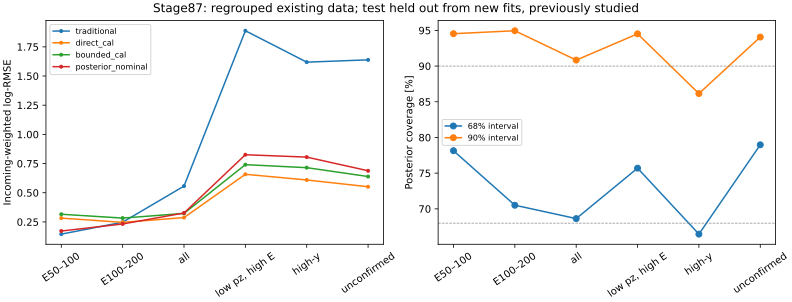

# Stage87：按来源与 incoming 重划现有样本并重训

日期：2026-11-04。起点 `f1390f6`。用户明确说明没有新样本，授权重新整理现有样本、区分训练/测试、重新训练并继续评估。这项新指示覆盖路线 §68 的“先取得新未曝光样本才能训练”和原角色不可重划的前置限制；没有把新分区宣称为独立盲测。

## 1. 目标与固定实验

本轮使用完整可兼容缓存，按 canonical source group 分区，精确 incoming 跨分区排重并隔离，以每 incoming 总权重1重新训练。固定比较传统 pz0/0.8、重新训练的62维 direct-logE三seed ensemble、41维 bounded residual、三成分连续 transfer posterior。新两臂沿用 stage86 的物理目标与主要容量，五个正式模型，无 pilot optimizer step、无参数/seed/架构/测试谱选择。

新 test 只对本轮参数拟合留出；这个样本池曾参与旧模型与研究路线选择，**仍是已曝光的开发评估**。原 F7/stage84 模型可能训练过新 test 中的记录，因此不能把旧缓存预测拿来作同分区留出对照；本轮对照是按新 split 和权重从头训练的 direct62，不能称旧 F7 本身。

## 2. 输入覆盖与变量

原 stage55 缓存 **95748** 条 selected，加已交付 stage70/81/82/83 的新支持 **28/742/1016/5934** 条，总主交付记录 **103468**。其中原 stage56 raw/status 对应 **81313** 条；另 **14435** 条没有现成审计 raw/status，单列而不混用 fitted scintillator charge。实际合池 **89033** 条，包含全部 **1016 K** 新支持；增补缓存中的 known-reuse/internal-repeat 不作为第二份新交付重复追加。

只读取现有 NPZ/JSON，无新 ROOT、PHYS提取、重建或生成。`audited_features.build` 将历史65列恢复为原62列，并对每列重新检查域规则。一次方动量只保留 pz0；允许 px/py、q/p、弯折，禁止 p0/p1/pz1 和 log动量比；11路 signed raw 与 typed NaN、Calo缺项总NaN不变。非负变量中的负占位按域转NaN，合法负 raw 不因负号被删，status-invalid 与 signed数值分别处理。原 pz>50 GeV 和所有困难侧保持。

输入路径：`ntuples/energy_ml_stage55/dataset.npz`、stage56 `readout.npz`、stage70/81/82/83 `support.npz` 的 `new_training_support`。数据集、原模型与 stage54 五项未跟踪工作只读，输入文件不入 Git。

## 3. 分区、重复与权重

协议 `workbook/stage87_energy_ml/protocol.json` 在正式 fit 前冻结。split seed **2026110387**；pi/k/charm 内 canonical groups 独立随机置换，round(15%) test、round(15%) cal，其余 train。不用真能量、loss 或预测挑组。同一 native-MeV `(PDG,px,py,pz)` key 跨角色出现时固定优先级 **test>cal>train**，低优先级来源中的对应行进入 quarantine。源本身不跨分区，既无跨角色 source，也无跨角色精确 incoming。

| 分区 | 记录N | canonical groups | 唯一incoming | 已知source/incoming连通块 | 缺失N | K记录N |
|---|---:|---:|---:|---:|---:|---:|
| train |46575|91|37556|3|21|18901|
| cal |11612|19|10811|3|6|5722|
| test |13189|19|12125|3|5|7091|
| quarantine |17657|109|9563|不计|12|12615|

quarantine 的9563个key在更高优先级角色中有保留，不是另有9563个独立事件被丢弃。活跃三角色共 **71376** 条、**60492** 唯一key；隔离只依据身份冲突，记录仍留在 `split.npz`，不因能量、quality、未确认或尾部坏表现删除。

每个角色内，同key的全部重建视图保留，权重各为1/该key记录数：train/cal/test 权重总和 **37556/10811/12125**。训练目标、cal估计和主指标均用该权重；普通逐记录指标另列。记录层权重ESS为 **41586.261749/11198.044296/12641.593732**，只描述记录权重离散度，**不是独立物理事件数**。

| 层 | train N | cal N | test N | quarantine N |
|---|---:|---:|---:|---:|
| true50–100 GeV |940|183|183|12|
| true100–200 GeV |4245|904|856|142|
| reco pz50–100 GeV |2873|660|659|358|
| 同低pz true≥200 GeV |1086|284|297|331|

### 来源区间的实际限制

把共享 incoming 的 canonical groups 连起来后，每个角色只有 pi/k/charm 各 **1** 个大块，而非可独立重抽样的几十个来源。完整上游 parent/seed 仍未认证。采用连通块作为保守依赖单位、不另假定source/key效应可加时，**component 内来源方差无法估计，source-level95%区间标“未测量”**；不能用一块反复抽自己产生[点值,点值]并称有精度。这不证明一个块内所有事件完全相关，也不证明只有三个独立生成；其他多向聚类估计需要额外假设和实际验证。

在看新模型风险前冻结补充：500次 component 内 incoming-key重抽样，seed为2026110387＋role code，保留每个key的全部视图与每视图权重。这是给定已提供来源/响应混合的**条件区间**，排除跨key上游相关、来源/生成、重训、cal估计、response和研究选择；不代替原门槛要求的真正来源稳健/新盲测确认。旧报告的canonical-source区间同样不能追认为包含本次识别出的完整关联。

## 4. 模型、校准和先验

- direct62：原depth5/eta.04/subsample.8/min_child_weight20/lambda10/hist/400轮，三个原seed2026110255–257；本次incoming权重，训练weighted mean logE固定初始化、boost_from_average=0；新cal一个ensemble global log offset。
- bounded：传统ν锚 `log(pz0/.8)+sigmoid(g)*log(64)*tanh(r)`；incoming加权logE MSE＋0.1有效标签gate BCE（f≥.2），新cal一个weighted log offset。这里锚不是顶点μ真值，禁止低pz硬切。
- posterior：一个f∈[0,.1)连续成分、两个f∈[.1,1)连续成分；显式预测真μ相对reco pz响应，`Eμ=mμ+pz exp(r)`、`h=Eμ f/(1−f)`、`Eν=Eμ+h`。两维正态transformed density和softmax mixture，尺度.05–5；joint NLL（含Jacobian）＋.25全事件marginal logE NLL，无效标签不造伪监督。新cal拟合r均值偏移b∈[−.2,.2]及r尺度T∈[.5,2]，L-BFGS-B最多100轮。
- 两MLP均固定41观测族、train-only median/IQR＋每列缺失flag＋wave/fit/Calo状态，标准化后固定cap±20以控制极端数值（事件保留），85维实际网络输入、2×64 SiLU、Adam.001/batch1024/150epochs/seed2026110387，gradient norm cap10，无early stopping。direct62使用native typed NaN，不用此MLP标准化；差异不是纯loss消融。
- posterior主点值为校准后名义先验median。training-prior、raw、flat-logE及lowE×4只作预定诊断，不选赢家。先验能箱0/50/100/200/400/800/1600/3200/6400/∞ GeV，train与nominal（新train中历史nominal视图）分别每key加权、每箱+.5；ratio cap[.1,10]后逐事件归一。报ESS/裁剪和68/90coverage、PIT十箱、logE NLL、CRPS与宽度。data/MC域reweight和pure-noise校正未执行。

积分主定义为32点Gauss-Hermite，另用首40cal比较64/128点PIT数值敏感性，绝不据test改主定义；CRPS是固定16×32 latent quadrature近似，不是ν谱toy，也不是积分收敛证明。stage85未认证的response nuisance、interaction/FSI/材料/Calo/接受度/背景没有被新结构消除。

## 5. 实际训练和评估结果

### 5.1 主点值与尾部

正式完成 **5个模型**：direct三seed及两个MLP，各自固定轮数，零pilot optimizer step。direct训练weighted mean logE初始化 **6.185596261912373**；direct/bounded新cal offset为 **0.025193691/0.026893944**。posterior校准 **b=0.011721733、T=1.200164170**，L-BFGS-B成功、10迭代，cal logE NLL **−0.063295544**。MLP归一化cap触及的单元数（不是事件数）quarantine/train/cal/test为 **11544/18352/5152/6323**，无相应事件删除。

以下均为新test、incoming加权 **log-RMSE（无量纲）**。完整逐记录/加权、偏差/R68/总正负tail见 [metrics.tsv](stage87_energy_ml/metrics.tsv)；新旧分区不同，禁止直接与stage84数字作配对增量。

| 层 | 传统 pz0/.8 | 新训direct cal | bounded cal | posterior名义cal median |
|---|---:|---:|---:|---:|
| true50–100 GeV |.145661|.282644|.315593|.172273|
| true100–200 GeV |.247937|.246329|.282926|.232803|
| all |.557190|.287491|.323197|.326580|
| reco pz50–100 GeV |1.275310|.498966|.568611|.596989|
| 同低pz true≥200 GeV |1.887790|.658177|.740686|.825773|
| high-y（f≥.8）|1.618799|.609395|.714903|.805321|
| unconfirmed |1.638613|.551305|.638847|.688140|
| 输入缺失（5条）|.253034|.203231|.188727|.226802|
| true3200–6400 GeV |.995785|.683271|.755308|.758164|

posterior最低能相对新direct有明显开发收益，但仍比传统差。最低能direct raw/cal **.265023/.282644**，posterior raw/training-prior-cal/nominal-cal **.166602/.172077/.172273**，并非仅global offset造成失败。最低能median bias direct **+19.882536%**、posterior **+8.223458%**；正tail50 **13.114754%→2.732240%**，posterior负tail0。第二低能posterior median **+5.979142%**、正/负tail **4.112808%/.940071%**。

收益伴随困难侧代价：低pz真≥200的posterior median **−32.350231%**、正/负tail **13.801239%/35.476261%**，direct为 **−23.433434%、11.501032%/24.329106%**；high-y posterior/direct median **−23.017779%/−17.844230%**、负tail **31.299166%/18.069130%**；未确认负tail **20.139292%/14.993229%**。不能靠低pz硬切传统或删掉这些事件消除冲突。

### 5.2 预设风险门槛

[paired.tsv](stage87_energy_ml/paired.tsv)及[gates.tsv](stage87_energy_ml/gates.tsv)是500次incoming条件配对区间。下表为posterior的**95%区间上端**，不是来源稳健确认。

| 风险 | 参考 | 上端 | 门槛 | 条件结果 |
|---|---|---:|---:|---|
| true50–100 |传统|1.482576|1.05|失败|
| true100–200 |传统|1.017330|1.05|通过，仅条件诊断|
| all |direct|1.159577|1.01|失败|
| true≥200 |direct|1.177715|1.03|失败|
| reco pz50–100 |direct|1.255675|1.03|失败|
| 同低pz真≥200 |direct|1.337201|1.03|失败|
| high-y |direct|1.407562|1.03|失败|
| unconfirmed |direct|1.334993|1.03|失败|

最低能相对direct总/正tail差上端 **−6.537833 pp**，负tail差0；all和≥200双向tail保护通过，但低pz、high-y、未确认未通过。低pz真高能总/正/负tail差上端 **+18.252785/+5.403369/+15.321987 pp**，均超过+2pp。bounded全部RMSE门槛及逐层tail联合门槛失败。两候选均无联合通过，**保持既有部署，不晋升本轮模型**；总体优于传统不能抵消最低能或困难侧失败。来源区间不可估，亦不满足独立确认条件。

### 5.3 先验压力与训练内诊断

固定三个先验的posterior median风险如下；只是预设敏感性实验，不能看到test后选flat/pressure为新主值。

| 先验 | true50–100 | true100–200 | all | 低pz真≥200 |
|---|---:|---:|---:|---:|
| 名义（主）|.172273|.232803|.326580|.825773|
| 平坦logE |.102582|.291898|.383274|1.181159|
| 名义<200×4 |.138552|.200395|.375475|1.236519|

flat最低能优于传统，但第二低能、总体及困难侧恶化；pressure两低能改善也未保住真高能侧。这是当前条件分布/先验权衡的实测，**不是信息极限证明**。prior shift还依赖未验证的p(x|E)不变假设。test全部记录的先验加权ESS（非独立物理数）名义 **12650.954870**、flat **4698.873983**、pressure **8667.106373**，原记录ESS **12641.593732**；ratio触cap记录名义/flat/pressure **0/264/0**。后验质量ESS fraction均值 **.999494/.713123/.954852**；flat低pz真高能 **.430553**、未确认 **.403890**，支持损耗需显式保留。

train的传统/direct/bounded/posterior最低能为 **.146877/.238537/.220775/.154764**，第二低能 **.223715/.224653/.222683/.211106**，all **.487551/.240597/.243878/.277837**；cal最低能为 **.145329/.299855/.346228/.236480**、all **.533279/.278757/.312797/.311120**。训练内低能仍有偏，cal/test也存在变化；不能只归因“缺数据”或只归因“过拟合”，loss/先验、支持混合、响应与数值积分尚未唯一分解。

### 5.4 后验覆盖、PIT和数值精度

[posterior_coverage.tsv](stage87_energy_ml/posterior_coverage.tsv)、[PIT_reliability.tsv](stage87_energy_ml/PIT_reliability.tsv)、[posterior_scores.tsv](stage87_energy_ml/posterior_scores.tsv)完整报告新cal/test、四先验、各层。下表为名义主后验test；区间是固定模型和cal参数下的incoming条件95%，不含来源/重训/校准估计/系统学。

| 层 | 68%覆盖及条件95%（%）| 90%覆盖及条件95%（%）| mean PIT | 68/90中位宽度（logE）|
|---|---|---|---:|---|
| all |68.633677 [67.7768,69.4614]|90.836976 [90.3713,91.3374]|.522204|.409623/.751618|
| true50–100 |78.142077 [72.8172,83.5782]|94.535519 [91.0442,97.5065]|.330517|.327346/.828612|
| true100–200 |70.505288 [67.5778,73.4969]|94.947121 [93.4084,96.3448]|.381644|.317656/.708024|
| 低pz真≥200 |75.700383 [70.8098,80.7176]|94.514892 [91.7382,97.0889]|.629771|2.002664/3.892785|
| high-y |66.460072 [61.2438,70.9140]|86.150179 [82.5600,89.7163]|.630434|1.725109/3.353749|
| unconfirmed |78.970787 [75.1420,82.5800]|94.060747 [91.5781,96.0865]|.569075|1.980671/3.759134|
| true3200–6400 |22.343750 [16.5988,27.4764]|59.947917 [53.6327,66.2101]|.885573|.670822/1.142500|

总体覆盖接近名义，**不等于条件校准成功**。按事前“覆盖下端≥名义−5pp、mean PIT95含.5”规则，all mean PIT区间 **[.517522,.526791]**，两低E **[.300020,.361044]/[.362577,.397367]**、低pz真高E **[.603582,.654420]**、high-y **[.604573,.655915]**、未确认 **[.546652,.591639]**均不含.5；high-y两级覆盖下端也低于63/85%。高端明显欠覆盖。缺失5条68/90覆盖 **22.222222%/44.444444%**，统计稀少不认证。由既有表直接核对的[coverage_audit.json](stage87_energy_ml/coverage_audit.json)另列，未重新拟合/重抽样。PIT按truth能层切片本身会受先验选择影响，不能把每个条件切片的非均匀性独立解释成生成模型错误，但已违反预定验收，且全体PIT也有偏。

test all名义 **CRPS(logE)=.155590882、mean logE NLL=−.020506873**；training-prior **.155379080/−.020899102**，flat **.172015098/.084113621**，pressure **.165036533/.013747276**。连续密度NLL可为负；CRPS用固定16×32近似，不是积分收敛认证。exp(E[logE])与额外tail-probability可靠性未单列测量，不用其宣称通过。

首40cal事前固定身份的32/64/128点积分检查：max|PIT32−PIT64| **.039193110**，max|PIT64−PIT128| **.012998450**，为实质的**数值积分敏感性**。主定义保持32，不从test挑节点赢家；当前后验quantile/logscore/calibration不能宣称数值已收敛，也不能把该误差当MC/物理不确定度。这需要后续零fit数值审计，不能直接声称更精确推断会消除训练时32点loss的影响。



## 6. 命令、资源、验证和存储

CVMFS LCG109，torch2.10.0/xgboost2.1.3/numpy2.2.6/scipy1.16.3，BLAS和torch单线程。环境查询torch CUDA可用性为False；大批量缓存处理与训练均走HTCondor，复用软件，不安装/重建。

```bash
python3 /tmp/freeze_stage87.py
bash /tmp/stage69_python.sh ml/resplit_energy.py submit --phase prepare
bash /tmp/stage69_python.sh ml/resplit_energy.py collect --phase prepare
bash /tmp/stage69_python.sh ml/resplit_energy.py submit --phase fit
# EOS FUSE新文件元数据滞后时，XRootD取回同一已完成结果，不重训：
xrdcp --silent root://eoshome-x.cern.ch//eos/user/x/xcheng/FASER/nu_muAnalysis/ntuples/energy_ml_stage87/result_fit.tar.gz /tmp/stage87_result_fit.tar.gz
bash /tmp/stage69_python.sh ml/resplit_energy.py collect --phase fit --result /tmp/stage87_result_fit.tar.gz
```

永久配置为本阶段 `protocol.json`，无需依赖临时freeze脚本重审设计。40缓存身份与实际prepare包检查在先，prepare job **9666913** 一次exit0，remote CPU **7 s**、wall **9 s**；prepare脚本CPU **5.319082 s**、wall **5.411780 s**、peak **274.934 MiB**。实际分区/输入统计在fit前回传并核查；训练包再检查40实际身份、12个解析密度/边界算例、有限forward/backward及CDF差分Jacobian，**零optimizer step**，随后提交fit **9667100**。两job各1CPU/3000MB/MaxRuntime3600 s，总CPU上限7200 s，正式模型上限5。

提交前修复两次包检查问题：一处Python括号语法、一处QA审计dict重复`passed`键；均未提交训练job、未执行优化器更新，失败启动成本由`/usr/bin/time`保存。不能把前置失败隐藏为零尝试。

正式fit **9667100.0** 一次exit0、0重试，remote CPU **607 s**（user568＋sys39）、wall **637 s**；两任务累计remote CPU **614 s**、wall和 **646 s**，小于7200CPU秒预算。fit+cal+全活跃推断函数 **512.532211 CPU s/524.804161 wall s/682.652344 MiB**；其中三direct训练CPU **8.000112/7.393831/7.460365 s**、bounded **41.440361 s**、posterior **85.875955 s**。全fit脚本（含report+独立验证）**598.556685 CPU s/612.990433 wall s/1090.003906 MiB**，report **46.341860 CPU s/47.614271 wall s**，validator **36.412634 CPU s/36.850688 wall s**，它们已含在总数中，不能重复相加。推断/校准/积分占比较高；只优化网络训练不会解决主要成本。

独立复核用不同实现重建全部source/key角色和权重、全部500draw，检查 **7560** 个加权指标值、**1728** 个配对区间端点、**1152** 个coverage/PIT区间端点，最大绝对差 **2.273737e−13**。direct三模型全部活跃预测回读精确；两神经模型只在首40forward算例回读精确，未冒称全事件神经预测独立回读。1140 metrics行、216 paired行、288 coverage行、1440 PIT行、144 proper-score行，空层保留。模型训练及指标的程序一致性通过，不能代替数值积分收敛与物理系统学认证。

实际prepare包 **34,348,576 bytes**、fit包 **23,218,203 bytes**，fit输出传输archive **14,529,967 bytes**。EOS FUSE曾对新archive返回stale/ENOENT；XRootD stat/取回及本地`collect --result`成功，未重提或重训。收集入口的可选参数只修复传输读取，不改变训练语义。环境/提交/两失败预检查的外层time合计 **24.11 CPU s**，与包检查内部时间重叠不重复计；初始AST、collect、文档整理等未完整计时，不声称全命令精确CPU预算认证。实际EOS网络/NPZ底层请求字节**未测量**，逻辑大小/传输包字节不能称物理I/O。

留存五模型、train/cal/test紧凑预测、全部活跃posterior原head及b/T、全合池身份split；不保存xAOD/ROOT。完整临时预测和500draw数组经独立验证后压缩/删除，按原缓存＋split＋保存head/模型/normalization/prior/协议seed可重建。`report`/`validate`入口面向训练时rich临时格式，**不能直接对压缩后的predictions.npz重跑**，必须先还原身份/状态与各先验CDF/quantile；该还原无需重训。模型/NPZ不入Git。只删除本阶段已完成的两个传输包、两个结果archive及可重建`input.npz`，原输入全部保留；最终各项实际字节见`storage.json`。

本阶段源码为 `ml/resplit_energy.py`、`ml/transfer_posterior.py`、`ml/report_resplit_energy.py`、`ml/validate_resplit_energy.py`；提交与worker在`AnalysisZipFramework/submission/*resplit_energy*`。报告表图/固定协议与资源证据在`workbook/stage87_energy_ml/`，模型在`ml/artifacts/stage87/`，身份在`ntuples/energy_ml_stage87/split.npz`。

## 7. 阶段结论与下一步

已按用户要求整理全部可兼容旧样本并重训五模型，源/incoming跨分区隔离和逐key总权重1闭合。后验在最低能明显改善新direct，但尚不及传统且困难侧退化、PIT/高端覆盖不通过；bounded未通过。**本轮固定模型比较到此结束，保留既有部署。** 重划已曝光池只提供开发留出，不补齐未开发来源与完整响应系统学，也没有证明信息极限。

**唯一下一stage88：现成后验的数值积分收敛与推断成本审计，0新能量fit、0ROOT、0生成、0新样本前置。** 输入固定原head/模型、normalization、calibration、prior、split和原缓存；先用≤40既有cal身份做有计时的小QA，冻结确定性参考积分及容差/资源，再通过≤1Condor、1CPU/3000MB、累计CPU≤1800s、wall≤1800s、留存≤20MB完成有界数值验证。先只看train/cal数值误差和成本，不按test风险选择节点/先验；后续test诊断若做必须先冻结算法且不晋升模型。

交付CDF/PIT/median/68–90quantile/log-density的绝对误差、稳定归一化/单调性、cal目标对32点敏感性（只比较已存b/T和预定邻域，不再优化校准）、耗时/peakRSS与缓存方案。参考未收敛就标未认证，不能无限加节点或网格；禁止从本轮结果自动重训、换seed/架构、按低pz硬切或加大cal灵活性。需分清推断近似与训练loss近似；仅提高推断精度不证明修复训练偏差。具体输入、容差与验收提议见[followup_input_request.json](stage87_energy_ml/followup_input_request.json)，未来收益/成本尚未测量，未执行stage88。

原stage54后缀与五项工作保留，1016K继续保留，用户解除的K旧生产禁令/时限不恢复。真实响应、interaction/FSI/材料/Calo/接受度/背景与将来的未开发确认仍需证据，但没有新样本不阻止当前数值审计。
