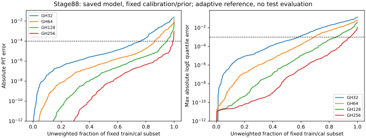

# Stage88：已存后验的积分精度与推断成本审计

日期：2026-11-04。起点 `fc2cfac`。按照路线§69、信息预算§49及stage87交接，实际推进现成后验的数值审计。**0新能量fit、0优化校准、0ROOT读取/生成/重建、0测试集风险评估**。既有部署保持，stage87五模型/主GH32数字不改。本报告的确定性误差不是MC、来源、重训、响应或统计区间。

## 1. 目标与输入

stage87前40cal的PIT32–64/.64–128差已达.039193110/.012998450，不能仅据整体coverage接近名义就宣称后验已数值收敛。本阶段检查：CDF/PIT、central68/90% quantile、median、log-density、固定cal目标对积分的敏感性，以及复用latent节点/分箱CDF的实际成本。不以数值审计证明物理原因、缺数据无关或信息极限，也不把更准确推断等同修复训练时32点loss的偏差。

只用stage87保存的原始15维head、b/T、compact predictions与split，不再运行网络。输入：`ml/artifacts/stage87/posterior_parameters.npz`、`predictions.npz`、`ntuples/energy_ml_stage87/split.npz`、`workbook/stage87_energy_ml/prior.json`；状态由stage56 readout与stage70/81/82/83原support原生行号联结。先核active row与pooled row，role/weight逐项相等，再取固定行。读取的原NPZ含历史其他角色，**只对所列train/cal行计算本轮数值量**，没有计算test指标。

原stage87 pz0-only一次方动量、允许px/py/q/p/弯折、raw11/typed NaN/Calo缺项、pz>50 GeV及困难侧不变，未作新cut或变量变更。所有已交付1016K仍保存在原支持/模型内，本次数值子集另有268条K记录，不把268误称完整K支持量。

## 2. 先小样本、再冻结正式合同

第一步复用stage87原首40cal身份（5483起，完整名单见`startup_QA.json`），没有按目标/误差选取；前三次启动失败发生在相同40身份范围，未优化任何模型。初版直接对r方向积分密度，在fraction边界处条件很差；先改`expm1`/`log1p`稳定逆变换，随后放弃该方向的直接密度，改为积分有界r-CDF再以固定五点差分h=.001/.0005交叉核验导数。失败和计时未隐去，没有用放宽能量风险门槛掩盖程序数值问题。

主参考对标准正态s自适应积分，r用解析逆变换，联合积分CDF和对log(E/GeV)的密度。组件是stage87同一个连续低fraction＋两个正fraction混合，`Eμ=mμ+pz exp(r)`、`Eν=Eμ/(1−f)`；积分不改变其物理定义。按r均值±2/5/9σ和质量边界拆分s域，以解析normal尾界从±10σ起至多扩至±16σ，确保截断CDF及密度上界小于eps/10。默认epsabs/epsrel=1e−10，单组件误差估计要求<1e−9；自适应精度状态单列，未称误差估计是严格机器证明。

独立参考交换r/s积分方向，给定r解析计算fraction CDF，reverse eps=2e−11；密度由已积分CDF的五点差分，两固定步长差和积分误差传播同时报告。密度<1e−7的查询不作log-density相对精度认证，CDF仍保留；不得因罕见尾部删除事件。主/反向参考在能箱边界、truth和五quantile全部对照。CDF归一端点、单调性、quantile residual与analytic tail另查。

40身份成功QA：max|CDF_s−CDF_r| **4.218847e−15**，支持查询max|log-density_s−差分r| **6.550637e−10**，最大reverse quantile概率残差 **1.840947e−10**，analytic omitted-tail bound最大 **6.362186e−21**。含CDF差分传播的最大参考误差估计 **1.953494e−8**，不能叫全部原积分误差。参考+交叉核验 **46.020367 CPU s/46.542210 wall s**；完整QA **49.770490 CPU s/52.147445 wall s**。

在此后冻结`protocol.json`：原行顺序等间隔40train＋512cal、节点32/64/128/唯一额外256，不按能量/loss/先验选择；主名义先验，b/T和网络不变。CDF/PIT绝对误差≤1e−4、quantile绝对logE误差≤1e−3、log-density绝对误差≤1e−3；参考交叉要求CDF≤1e−7、log-density≤1e−6。固定cal点仅原b/T与b±.01、T±.05五点，不优化、不据此换主校准。正式数值子集与资源在提交前已冻结，不扩节点/架构/seed网格。

## 3. 正式子集覆盖

[实际输入统计](stage88_energy_ml/input_counts.tsv)：

| 角色 | N | 唯一incoming | 来源组 | π/K/charm N | true50–100/100–200 GeV N | 低pz真≥200 GeV N | high-y/未确认 N | fit失败 N |
|---|---:|---:|---:|---|---|---:|---|---:|
| train |40|40|34|20/16/4|1/5|0|1/1|5|
| cal |512|509|19|228/252/32|8/43|13|9/13|34|

两角色输入缺失/wave-invalid/Calo-invalid均0，合法负raw **22/276**条；这些未覆盖的状态性能**未测量**，不能把正常状态结果外推。子集低能仅9/48条，低pz真高能13条，不能估完整cal/test物理风险。两角色保留原权重，权重和 **33.583333/472.666667**，record ESS **36.769074/491.814963**；子集中同key部分视图可能未被取到，不再声称此子集每key权重总和1，也不是来源独立事件数。子集weighted NLL仅该固定子集描述，不冒称全cal目标或统计估计。

## 4. 实际误差、固定目标和物理含义

### 4.1 全552参考认证与误差分布

552事例、所有规定边界/truth/五quantile完成，两方向最大CDF差 **6.616929e−14**，支持查询最大log-density差 **7.666686e−10**，reverse quantile概率残差最大 **2.122311e−10**。解析截断尾界最大 **4.253165e−19**，CDF差分传播及两步差的最大估计 **3.802390e−8**、密度两步差最大 **3.285705e−8**；参考precision flag **0**、本轮需排除log-density相对精度认证的低密度查询 **0**，552/552均达到预设交叉精度。全局CDF下端最大 **3.758946e−36**、上端最小 **.9999999999999996**，排序查询网格单调，分箱质量和/端点归一化通过。这是本固定有限输入范围的认证，不是全参数空间或未覆盖missing状态的定理。

[error_distribution.tsv](stage88_energy_ml/error_distribution.tsv)包含全部median/p90/p99/max及计数；[summary.tsv](stage88_energy_ml/summary.tsv)按train/cal、component、低E/困难/状态层列出。下面每格为“最大绝对误差（超限事例N）”，CDF/PIT限1e−4、quantile logE与log-density限1e−3，N=552，计数未加权。

| 方法 | 能箱边界CDF | PIT | 五quantile最大logE差 | log-density |
|---|---|---|---|---|
| GH32 |.040618621（316）|.024986898（132）|.140877741（231）|1.807812933（159）|
| GH64 |.020758706（230）|.016473238（77）|.063327523（170）|1.285612945（104）|
| GH128 |.009427956（165）|.007214501（28）|.040179716（83）|.569465493（55）|
| GH256 |.002441646（48）|.000885997（6）|.011344660（29）|.375060500（20）|

GH32 quantile **231/552=41.847826%**、PIT **23.913043%**、log-density **28.804348%**超限；即使256，quantile **5.253623%**、PIT **1.086957%**、log-density **3.623188%**仍超限。不能将其归为少数离群导致的无关误差，也不能宣布“256全已收敛”或继续节点扫描找赢家。GH32 quantile误差median/p90/p99 **.000420075/.041582872/.115496448**，参考相对GH32 median点值最大变动 **.114688337 logE**，而非只有区间端点受影响。

程序机制诊断：对各成分在均值处取 `R=σs*(∂logE/∂s)/σr`，仅汇总mixture weight≥.05成分的最大R。它描述s方向能量变化相对r平滑尺度，不是物理事件类别，也不用于切样本。R<.5/.5–2/2–5/≥5的N为 **147/250/115/40**，GH32 quantile超限 **2/89/100/40**，PIT超限 **0/31/65/36**，与宽transfer、窄r响应下固定节点分辨率不足相符。这是附加的描述性数值诊断，不能把它用作拒绝困难事件或归因data/MC响应的依据；精度结论主要来自同一head的独立积分，而非此相关性。

### 4.2 固定校准目标与子集点值

[fixed_calibration_objectives.tsv](stage88_energy_ml/fixed_calibration_objectives.tsv)是512cal固定原权重下的training-prior logE NLL（连续密度可为负），不是全11612cal目标。各点不做优化，δb/δT相对于stage87已存b/T：

| δb | δT | GH32 NLL | 主参考NLL | GH32−参考 |
|---:|---:|---:|---:|---:|
|0|0|−.124483590|−.130228601|+.005745011|
|−.01|0|−.120000581|−.125640010|+.005639430|
|+.01|0|−.123897327|−.130082307|+.006184981|
|0|−.05|−.126057027|−.133722716|+.007665689|
|0|+.05|−.121670164|−.125874131|+.004203967|

中心差分的b斜率GH32/参考 **−.194837302/−.222114841**、曲率 **50.692720467/47.348840173**；T斜率 **.043868635/.078485851**、曲率 **.495995139/.344141884**。说明固定目标的数值敏感性不只是一个常数平移；不能据这个子集重新选b/T，也不能把非零子集斜率当原全cal优化未收敛的证据。中心原b/T经过两方向完整交叉核验；四邻点使用相同主自适应积分及误差估计，未逐点另作reverse导数认证，不外推最优校准位置。

[subset_diagnostics.tsv](stage88_energy_ml/subset_diagnostics.tsv)仅描述这批固定行的incoming原权重：train40 log-RMSE **.229099452→.228822569**，cal512 **.312583173→.314381109**；真50–100仅9条 **.053134387→.053134240**、median最大差 **7.903869e−6 logE**，不能宣称总体低能恢复。第二低能48条 **.268428111→.266736298**，低pz真≥200的13条 **.850516317→.876315710**，high-y10条 **.485050562→.509206237**，未确认14条 **.692021257→.691425696**。**更准确积分没有保证能量风险一致改善**，训练/先验/响应及32点loss的影响仍未分离；没有在test验证这些变化。



图为未加权固定子集，虚线为事前容差，log纵轴下限1e−12；不是统计覆盖或来源区间。

40cal启动样本已测：GH32/64/128/256最大PIT绝对误差 **.028713867/.010729538/.002305414/.000418460**，超过1e−4者 **9/9/3/1**；最大quantile logE误差 **.100370447/.051877987/.022768917/.004087158**，超过1e−3者 **21/17/7/2**；最大log-density误差 **.945534708/.553522854/.185787915/.003501004**，超过1e−3者 **13/9/4/3**。即使256也不能全体认证，不以更大点数自动取代历史32。

## 5. 性能、验证、命令和存储

复用CVMFS LCG109的numpy/scipy/torch，只为启动核对调用stage87旧posterior实现；正式包不依赖torch/XGBoost，不加载权重、不做forward、无安装/重编译。BLAS单线程。

40cal四先验×五quantile完整旧生产函数 **1.184682 CPU s/1.199563 wall s**；复用latent节点、共用分箱CDF并把prior quantile映射回raw-CDF的实现 **.138549 CPU s/.140818 wall s**，42次批量CDF调用，所有28组quantile/PIT/logscore比较最大差 **4.218847e−15**。这是同输入、同精度的缓存优化，不是数值积分修复，也不是正式552性能或全体模型加速倍数。

```bash
/usr/bin/time -v -o /tmp/stage88_startup_v4.time \
  bash /tmp/stage69_python.sh ml/audit_posterior_integration.py qa
# 40身份计时通过后写入永久protocol，再打包、实际payload检查：
/usr/bin/time -v -o /tmp/stage88_submit.time \
  bash /tmp/stage69_python.sh ml/audit_posterior_integration.py submit
# 只取回同一作业结果，不重训：
xrdcp --silent root://eoshome-x.cern.ch//eos/user/x/xcheng/FASER/nu_muAnalysis/ntuples/energy_ml_stage88/result.tar.gz /tmp/stage88_result.tar.gz
# formal job在输出JSON时exit1，完整数值已存，显式恢复报告：
bash /tmp/stage69_python.sh ml/audit_posterior_integration.py collect --result /tmp/stage88_result.tar.gz --recover-report
bash /tmp/stage69_python.sh ml/audit_posterior_integration.py recover-report
bash /tmp/stage69_python.sh ml/report_posterior_numerics.py
```

唯一正式HTCondor **9667190.0**，请求1CPU/3000MB/MaxRuntime1800s，worker soft/hardCPU1650/1680s、wall timeout1740s、0自动retry；完整预算累计CPU≤1800s/留存≤20,000,000bytes。四次启动外层CPU共 **72.05 s**（含失败），和内部QA时间重叠不再相加；首两次5.13/5.09 s、第三10.17 s、成功51.66 s。40参考成本外推552约635.081CPU秒只用于冻结预算，不冒称实测正式成本。正式传输包 **134051 bytes**；实际payload一个真实身份/role及两积分方向通过，0fit。

正式作业完整计算后在`summarize`写JSON时因NumPy bool未转Python bool失败，**exit1，不记成功**；一次启动、0Condor重试。历史/错误/原stdout见`history.json`、`worker_error.txt`、`worker_stdout.txt`。所有552行、4方法、5固定cal点、compact数值NPZ均已落盘回传；只修bool元数据类型，显式收集失败报告并从原数组恢复summary/decision、独立验证，不重跑积分、不再提交Condor。`recovery_source_check.json`逐字核实正式包的reference、calculate、固定cal计算体和protocol未改；附加reporter只读已存数组。

remote **919 CPU s/932 wall s**；`job.time`脚本含失败输出 **918.13 CPU s/929.63 wall s/267.039063 MiB**。全参考核验 **869.262560 CPU s/879.293440 wall s**，其中主posterior summary **184.269263 CPU s**，反向交叉核验 **662.600146 CPU s**；这些均含在总job内，不重复相加。正式缓存GH32/64/128/256、名义五quantile＋PIT/density、N552、各42CDF调用，CPU **1.014986/1.630598/2.887757/4.868074 s**，wall **1.030374/1.649555/2.927454/4.928961 s**。四方法峰值RSS依次92.835938/120.781250/170.519531/267.039063MiB，ru_maxrss为进程累计峰值，不当独立内存增量。参考及反向共 **36,661,191** 次被积函数求值。

report恢复函数 **.181417 CPU s/.281232 wall s**、独立validator **.096502 CPU s/.111872 wall s**已含在恢复内。validator独立重算 **11055** 项事件误差及cal数值，最大差 **3.209238e−17**，完整552身份/GH32与stage87保存值一致、CDF端点/单调性通过；从后验名义log-density独立去除prior，重算中心training-prior cal NLL差 **0**。纯数组报告外层命令 **2.60 CPU s/5.29 wall s**，恢复外层 **1.69 CPU s/4.13 wall s**，submit外层 **2.95 CPU s/6.30 wall s**。已记录外层启动/提交/恢复/报告＋remote合计 **998.29 CPU s**，小于1800s；内部计时重叠不加，初始AST/metadata/文档/预览等未完整计时，不声称全命令成本精确认证。

实际input NPZ **119592 bytes**、正式包 **134051 bytes**、回传archive **636341 bytes**。保留compact input与numerical/calibration NPZ、中文报告/表图及资源/失败证据；不复制stage87模型、不保存逐节点大网格。收集验证后删除本阶段两个传输archive，最终实际留存见`storage.json`。实际EOS底层请求字节/网络流量**未测量**，文件逻辑/包字节不能作物理I/O。NPZ和压缩包不入Git；原stage87及更早缓存只读，原stage54五项与prompt后缀保持。

## 6. 结论和下一步

完成552条固定train/cal数值审计，0fit/ROOT/test。GH32有大量quantile/CDF/density误差，GH256仍不能全体达标；两独立方向的参考精度已在本子集认证。固定节点在宽transfer、窄response分布下分辨不足是一条有证据的程序机制，但它不是全部能量偏差的唯一解释。更准确推断在子集部分困难层甚至变差，不能宣称修复物理响应或32点训练loss。JSON收尾失败已如实保留并零积分重算恢复报告，独立复核通过；**既有部署保持**。

**唯一下一stage89：沿用本自适应参考，对原完整cal11612＋test13189进行一次冻结后验的准确推断和配对评估，0fit/新校准/ROOT/生成。** 输入现成head/原b/T/名义prior/split及原direct/传统预测，保留缺失6/5条和全部困难、高端、K支持；不靠本子集9条低能判成败，不按test选择算法/先验。复用原component内incoming500draw条件区间、原低E/总体/困难/双向tail门槛、68/90coverage/PIT/NLL，source95仍不可估、旧test仍开发，不作新盲测或晋升宣称。

主参考cal512实际 **172.797432 CPU s**、**.337494984 CPU s/事例**，完整24801线性外推 **8370.213102 CPU s**（未测实际，排除新增QA/统计/报告与未覆盖状态成本）。下一阶段先≤40固定cal的实际包计时/单位/身份及已冻结参考QA，再冻结≤2Condor/并发≤2、各1CPU3000MB/MaxRuntime5400s、累计CPU≤10800s/紧凑20MB。完整反向交叉不再逐事例重复，只做固定小QA；参考端点/误差估计仍逐事例保存，数值未知事例保留标记。若实测无法在预算内认证，先报成本/精度缺口，不能静默缩小成有利子集。

验收是全cal/test角色与原key总权重1、GH32→准确推断及准确后验→同split direct/传统的完整配对风险/条件区间、覆盖与数值/性能证据，而不是通过门槛才算完成。主median、校准b/T、prior全部固定，不能根据五点子集目标选新标量；精确CRPS收敛未测，训练/校准优化近似偏差另辨。输入/预算/交付见[followup_input_request.json](stage88_energy_ml/followup_input_request.json)。尚未执行stage89，不自动推进。

原K1016保留、旧生产禁令/时限不恢复；stage54原五项/后缀保留。真实响应、interaction/FSI/材料/Calo/接受度/背景和未来未开发确认仍需证据，没有新样本不阻止本次既有模型的准确推断。
