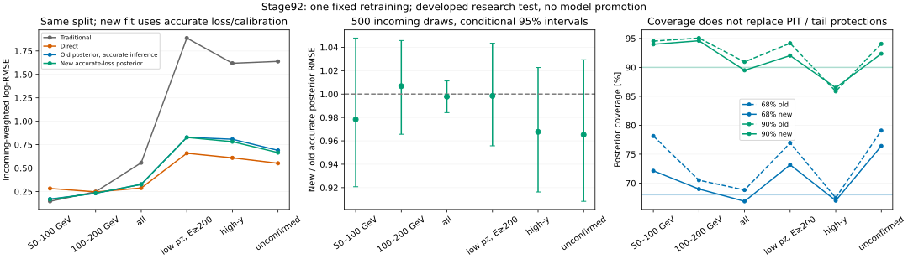

# Stage92：原posterior准确loss单次重训、全cal校准与完整准确评价

日期2026-11-04，起点`006329f`；依据路线§73、信息预算§53及stage91固定合同。主任务为一次原posterior从头150epochs、原完整cal一次b/T优化，继而完整准确cal/test配对评价。继续现有部署，不按test选seed、结构、先验、校准或checkpoint；新test是已有研究池对本次fit的留出角色，不是新的blind/独立确认。

## 1. 输入、边界和唯一实验

现有stage55/56原审计readout＋stage70/81/82/83 new-only支持，按stage87保存split复原89033兼容记录，而非重新分割。目标角色train46575/cal11612/test13189与17657quarantine，唯一incoming37556/10811/12125，原group/key/weight及全部1016K支持保持；缺失21/6/5保留。重建代码只写stage92，原输入和stage87不改。真实data/ROOT、生成、重建和新样本均0；不恢复用户解除的K生产限制。

一次方动量仅pz0，允许px/py、q/p和弯折；41观测族及train-only median/IQR、NaN flag、wave/fit/Calo flag构成85维网络输入，与原normalization逐项比较。raw11、typed NaN、合法负raw、非负变量负占位、Calo缺项总NaN和pz>50GeV/全部困难侧不变。原62维缓存通过audited_features.build/check_x，不能把fitted scintillator charge替换回来，也不引入p0/p1/pz1或对数动量比。

原CPU1线程float32网络2×64SiLU、seed2026110387初始化、numpy permutation、Adam lr.001默认/无weightdecay、batch1024/150epochs、clip10、incoming归一权重和原float32 truth监督张量保持；从头初始化，无warm-start、pilot optimizer、early stopping或扫描。只将marginal GH32换成stage91已认证的固定GL32 score float64积分，训练点b0/T1，loss−joint−.25marginal和raw training prior不变；nominal prior只用于后续推断。网络/joint/optimizer留CPU，GPU执行积分并跨设备返回float32 head梯度，禁AMP/TF32。

## 2. 启动QA、预执行修正与执行合同

固定40身份＝全部21train missing＋6cal missing＋stage90固定train前13；无风险挑选。初始化值/head梯度与未改stage90自适应score比较，误差传播估计为vector_quad_error/density×(1＋|参考gradient|)，要求precision flag0、值误差加参考误差≤1e−6、梯度差加参考误差≤1e−4＋1e−3|参考|。不是重算9384独立双步差分，也不是全训练轨迹数学证明。初始化及每25epochs在同40条核验；所有batch density/loss/梯度和tail准入必须有限，失败保留身份/head/资源并停，不能删事件、退回GH32、选部分checkpoint或自动重训。

本地Tesla T4，LCG109_cuda/torch2.10.0/CUDA12.5，原40条全部通过：最大值差2.220446049e−16、梯度差6.661338148e−16，含参考误差/容差最大1.952236297e−7；CPU/GPU完整网络参数梯度差0、loss差8.881784197e−16，0optimizer step。原head权重初始化为0，故初始body梯度为0，不能把这个完整网络QA声称为所有学习后body梯度的认证。自适应score部分1.210749CPU秒/1.300038wall秒，startup函数1.371347CPU秒/1.553835wall秒，peak1077.121094MiB；含模块/环境启动的外层计量另列，不重复相加。初次系统Python3.9 AST不支持starred subscript语法而报SyntaxError；LCG Python可执行且QA通过，之后改成普通concatenate并重新实际包QA，没有数值/目标变化。

唯一GPU作业9667316.0提交后、NumJobStarts0时，复核发现权重先cast float32再归一化与原实现的浮点顺序不同。明确hold同一未启动作业，改为原NumPy float64归一再cast float32，并补齐梯度/resource失败时的当前batch head保留；更新冻结protocol，重新实际包40QA通过后release，没有重提或optimizer尝试。旧/新行和hold证据在preexecution_correction.json/condor_fit.txt；应如实记录这次主动hold，不能称完全无hold。最终实际包45,510,659bytes，源码与包逐字核对，无SHA。

初始GPU合同为≤1Condor，2CPU/6000MB/1兼容GPU、MaxRuntime5400秒；收到用户提供CERN GPU/ML文档并授权Kubeflow后，改用该服务的batch Job，未启动Condor9667316.0先hold再删除（NumJobStarts0）。模型、实际训练包和进程CPU soft/hard7000/7100秒、worker wall5300秒、训练内CPU6900/wall5200秒保护保持。Kubeflow按GPU flavor自动配置CPU/内存，实际分配22CPU/63G/1个H100 MIG3g.47gb，torch仍CPU单线程；分配量不能冒充实际资源消耗。先完成重建和零optimizer QA，再原150epochs，不缩短轮数。完整cal11612唯一L-BFGS-B从(0,1)、原b[-.2,.2]/T[.5,2]/maxiter100和其他原默认，准确raw NLL/解析b/T梯度；记success/nit/nfev/终点梯度，并在6个固定cal缺失身份初始/终点核数值，禁止多起点。保存最终模型和全部active head后才校准，不因后续报告问题重复fit。

训练后≤40固定cal准确推断实际包计时，再准入≤2CPU Condor（各完整cal/test），每任务1CPU/3000MB/CPU与wall10800秒，并发≤2；含QA/报告阶段CPU封顶32400秒，紧凑最终≤20MB。参考stage89原模型8937remote CPU秒，但新模型成本未测前不当作保证。主推断沿用**未改stage88/89 Reference自适应CDF/quantiles**、newbT、原nominal prior/median；本实验同时修正训练marginal和cal目标的积分，旧准确posterior仍使用原GH32目标得到的b/T；因此旧→新是完整数值修复流程比较，不能单独归因训练积分或cal积分。旧准确后验quantiles仅作求根初始猜测，Reference维持bracket并认证残差，不能用GH32主评价宣布收益。

## 3. 实际训练与校准

实际在Kubeflow context `ml-prod`、namespace `xcheng`，Alma9镜像`registry.cern.ch/mlops/lxplus-like:9`＋CVMFS LCG109_cuda运行。成功Pod `nu-mu-energy-stage92-fit-9tjpz`，节点`ml-004-h100-001-uusckqrqfxt3-node-0`，GPU **NVIDIA H100 NVL MIG3g.47gb**，torch2.10.0/CUDA12.5/driver590.48.01。只使用既有认证，没有复制或输出令牌。成功Job完成后保存证据并删除Job/Pod释放GPU。

重建89033行、原normalization/prior逐项完全一致，.951217 CPU秒/.961966 wall秒，peak752.394531 MiB。原划分和missing21/6/5完整保留。固定QA40来自stage55 38条、stage82/83各1条，π/K/charm各20/18/2；truth E 62.579001–1982.100029 GeV，pz 56.003066–2298.444500 GeV，包含所有train/cal missing，并不覆盖整个能区或全部训练轨迹。

唯一实际fit完成**150epochs/6900 optimizer steps**，最终模型reload完全一致，71376个active head已保存。每25轮测得的训练目标（无量纲）：

|epoch|25|50|75|100|125|150|
|---|---|---|---|---|---|---|
|train loss|3.819538898|3.743086890|3.702413284|3.668432253|3.645791900|3.623436926|

初始化＋六个checkpoint，共280事件检查/4760个导数坐标比较（4200 head坐标）全部通过。最大值差5.329071e−15、梯度差7.105427e−14，最大(误差＋参考不确定度)/容差=.001184538；没有删行、GH回退或选择中间checkpoint。**只保留中间检查的逐事件value/reference和最大梯度差汇总，没有另存完整中间head/所有坐标数组**；初始、最终head保留，因此不能声称可从保存文件重建全轨迹每个坐标。

在学习后的最终40 head另做零optimizer核验：680坐标通过，CPU/CUDA完整网络参数梯度差0、loss差0，body梯度L2=16.146001816（非零）；小batch40与原保存batch2048 head差0。耗1.443245 CPU秒/1.648214 wall秒，peak1070.445313 MiB；弥补初始化body梯度为0的局限，仍不是每个训练batch的独立认证。

完整cal11612唯一L-BFGS-B成功，9次迭代/12次目标评价，**b=.008897185083，T=1.041332484110**，终点梯度(−3.845830e−6,+4.052400e−7)，raw training-prior logE NLL=−.098529363513。耗.607430 CPU秒/.612032 wall秒；6条固定cal missing在初始/终点数值核验通过。完整Reference目标闭合由下一节完整推断独立检查；参数优化成功不等同物理收益。

含重建、QA、唯一fit和cal的内部总计56.607858 CPU秒/73.801175 wall秒/peak1183.371094 MiB；外层worker子进程含import实测**58.361691 CPU秒/88.516238 wall秒/1211772 KiB peakRSS**，exit0。两者嵌套，不重复相加。成功Job起止102 wall秒，含平台启动/结束；GPU allocated/physical peak因`nvidia-smi`权限限制**未测量**，不以flavor47GB或CPU RSS代替显存实测。

## 4. 完整cal/test风险与数值认证

完整cal11612/test13189均首次exit0、NumJobStarts1，无重试。**24801/24801数值认证，missing6/5完整保留，precision flags=0**；最大quad误差7.872539e−11、尾界1.167684e−22、root残差1.999806e−10，CDF端点和单调性通过。471219个保存数值finite检查通过。两角色共6832项报告独立算术核验，含2044项原基线值复现，最大差4.263256e−14；全部500次component/incoming抽样multiplicity独立复现。完整cal Reference raw NLL=−.09852936350783348，与优化器目标差**4.738487e−12**，原1e−6门槛通过。

以下为test incoming加权log-RMSE（无量纲），传统/direct为原缓存，旧posterior也是准确推断；新/旧为500次条件配对95%区间：

|层|记录数|传统|direct|旧准确posterior|新准确loss posterior|新/旧 [95%]|
|---|---:|---:|---:|---:|---:|---|
|50–100 GeV|183|0.145661|0.282644|0.169296|0.165630|0.978351 [0.920776, 1.047893]|
|100–200 GeV|856|0.247937|0.246329|0.231281|0.232842|1.006750 [0.965658, 1.045774]|
|全体|13189|0.557190|0.287491|0.326783|0.326058|0.997783 [0.984147, 1.011207]|
|E≥200 GeV|12150|0.578219|0.290487|0.334911|0.334085|0.997535 [0.983659, 1.010977]|
|pz 50–100 GeV|659|1.275310|0.498966|0.597693|0.597293|0.999331 [0.963708, 1.039077]|
|低pz且真E≥200 GeV|297|1.887790|0.658177|0.828213|0.826918|0.998436 [0.955764, 1.043473]|
|high-y|385|1.618799|0.609395|0.807754|0.781673|0.967711 [0.916322, 1.022684]|
|未确认|468|1.638613|0.551305|0.688945|0.665024|0.965279 [0.908334, 1.029336]|
|输入缺失|5|0.253034|0.203231|0.226801|0.290567|1.281151 [0.935570, 2.879922]|
|3200–6400 GeV|264|0.995785|0.683271|0.758477|0.756072|0.996829 [0.976251, 1.023601]|

**最低能仍失败**：50–100相对传统条件上95=1.411172>1.05；100–200上端1.001808≤1.05通过，但不能替代两层联合目标。all/direct上端1.155451>1.01，≥200/低pz/低pz真高E/high-y/未确认上端1.172372/1.247662/1.325036/1.337601/1.257544，均未达1.03。新/旧最低能、all、high-y等条件区间均含1，不能称显著改善。

最低能median bias旧+8.109339%→新+7.209845%，R68 9.895555%→9.657278%，但正tail50 2.732240%→3.278689%，负tail0；核心变窄不代表尾部共同改善。低pz真高E新median bias−33.435078%，R68=55.765137%，正/负tail50=12.916544%/34.237688%，direct对应11.501032%/24.329106%。相对direct该层total/positive/negative tail50差条件上端+16.822348/+4.816155/+14.337707 pp；high-y为+19.436880/+6.998513/+14.151549 pp，远超+2pp。全体tail保护通过，但困难侧失败不能被平均掉。完整七层及额外低pz真高E见[gates.tsv](stage92_energy_ml/test/gates.tsv)。

|test层|新68% coverage [条件95%, %]|新90% coverage [条件95%, %]|mean PIT [条件95%]|
|---|---|---|---|
|全体|66.862 [65.977, 67.707]|89.494 [88.943, 90.016]|0.527490 [0.522613, 0.532034]|
|50–100 GeV|72.131 [66.859, 78.373]|93.989 [90.648, 97.348]|0.329238 [0.297152, 0.361679]|
|100–200 GeV|68.978 [65.891, 71.760]|94.595 [92.938, 96.106]|0.388673 [0.368886, 0.404909]|
|低pz且真E≥200 GeV|73.164 [68.257, 77.943]|92.038 [88.925, 94.866]|0.633521 [0.609310, 0.658971]|
|high-y|66.985 [61.659, 71.332]|86.484 [82.817, 89.923]|0.620643 [0.592468, 0.648327]|
|未确认|76.417 [72.143, 80.214]|92.358 [90.046, 94.471]|0.564689 [0.540654, 0.590163]|
|输入缺失|0.000 [0.000, 0.000]|22.222 [0.000, 74.205]|0.587287 [0.080361, 0.993844]|
|3200–6400 GeV|18.785 [14.289, 24.111]|51.901 [45.942, 58.284]|0.895383 [0.878268, 0.911264]|

全体68/90 coverage由旧68.819244%/90.951065%变为66.861856%/89.494433%，条件下限超过名义−5pp，但meanPIT区间排除.5；high-y的68/90下限61.659419%/82.816629%未达63%/85%。最低能PIT显著偏低，低pz真高E偏高，符合低能过修正和困难高能低估并存的状态混合，不能直接归因为缺样或噪声。高端264记录coverage18.784722%/51.901042%，欠覆盖没有消除；missing5例log-RMSE .290567、coverage0%/22.222222%，稀少不认证。缺失例没有删除。

test全体名义NLL旧−.043037457→新−.047697998；两低E −.682167177/−.494935047→−.716715094/−.529362547，high-y 1.581630703→1.456875045，而高端1.612080079→1.702362459、missing .621212429→1.181357474变差。没有对NLL变化另作不确定度认证，不以点值下降替代RMSE/coverage。新全体mean ESS fraction=.999532537，低pz真高E=.997971702，**名义prior轻微重权没有明显质量ESS损耗，却不能据此排除训练谱先验效应**。十箱PIT、五quantile可靠性、宽度与ESS详见完整coverage/PIT_reliability/quantile_reliability/scores表。

cal全体新log-RMSE .309272884（旧.311413637）、两低E .243608440/.223666724（旧.235912479/.223852298）；最低能方向与test不同，进一步限制小幅点值改善的外推。cal coverage67.399716%/90.241421%，meanPIT=.514534310；名义NLL−.098128224475。cal用于校准，不是独立性能确认。



**阶段结论：准确loss从头训练＋准确全cal校准可执行且全链数值通过，但没有恢复最低能/全体/困难侧的联合目标；继续现有部署。** 本实验同时改变训练和校准求积，不能分别归因；一个seed不认证重训方差，数值认证不是信息极限或response真实闭合。每角色仅3个连通块，source95未测量，研究池test已开发；500条件区间不含source/parent/refit/calibration/response/研究选择。准确CRPS、flat/pressure准确prior stress、本轮真实响应/interaction/FSI/材料/Calo/接受度/背景和独立确认均**未测量**。旧GH32 stress不能冒充新模型准确结果。

## 5. 命令、资源、失败与产物

```bash
# 环境：LCG109_cuda x86_64-el9-gcc13-opt，BLAS/torch CPU单线程
python ml/retrain_accurate_posterior.py prepare-qa
python ml/retrain_accurate_posterior.py submit-fit
# 预执行hold/release及最终包修正见本节证据，不是再提交fit
# fit结束后，先固定40cal计时，再冻结/提交完整CPU推断
python ml/evaluate_retrained_posterior.py qa
python ml/evaluate_retrained_posterior.py submit
```

实际执行还包括：`kubectl --context ml-prod -n xcheng apply -f AnalysisZipFramework/submission/ml_retrain_kubeflow.json`；调用的wrapper为`run_ml_retrain_kubeflow.sh`，最终核验`python ml/validate_retrained_posterior.py`，回收完成后`python ml/closeout_retrained_posterior.py`。提交指令仅说明本次执行，**不得再次运行submit/fit**。

平台失败逐项保留：手动CPU/内存字段被Kyverno拒绝（未创建Pod）；auto fullH100 Job资源不足未调度；改用文档列出的MIG3g.47gb后首个容器验证torch成功，但镜像缺`/usr/bin/time`导致exit127，归档证明没有`started.txt`或optimizer执行；只将外层timer改为stdlib subprocess/resource，实际数值源码和原训练包逐字不变，随后一次fit成功、restart0。共4次Job对象申请、2个启动容器，**不是4次fit，也不是“从无平台失败”**。相关证据见platform_amendment、kubeflow_admission_correction、fullGPU_unscheduled、timer_failure、completion各JSON，原Condor取消证据另存。平台preflight/认证sidecar CPU未完整计时，失败容器冷启动116 wall秒不计成fit。

训练后的40cal准确推断QA40/40认证，16.096056 CPU秒/16.325043 wall秒，peak97.527344 MiB；反向CDF差2.775558e−15、log-density差2.074768e−10。按实测均值投影完整test5307.272168 CPU秒，×1.2＋120秒报告裕度低于10800秒后冻结原算法/源码并提交Condor9667339.0(cal)、.1(test)，各1CPU/3000MB/10800秒；投影不替代最终实测。EOS物理网络I/O、部分metadata/文档/监测/静态检查未完整计量，逻辑包大小不冒充实际I/O。原stage54五项工作只读、不暂存，prompt从stage54 marker开始逐字保留；路线和信息计划仅追加。每阶段报告先行，再本地Conventional Commit，不push，不自动启动下一阶段。


## 6. 最终资源、交付与下一阶段

两CPU作业外层cal **9036.86 CPU秒/9339 wall秒/168424 KiB peakRSS**，test **9409.56 CPU秒/9513 wall秒/184040 KiB peakRSS**，均低于各10800秒；worker内部包含checkpoint/报告，9035.330081/9408.341353 CPU秒，不重复相加。科学推断内部cal 9008.116356 CPU秒/9307.728367 wall秒，test 9381.057823 CPU秒/9483.685114 wall秒，40cal的test投影5307秒低估实际成本，因此不再把该均值投影用于保证后续预算；原裕度充足、实际完成。完整阶段已计外层CPU **18575.201691秒**，含local QA/打包/回收/收尾和远端worker，低于32400秒；最终逻辑字节约**17.68 MB**，包括完整新文档和清单自身，精确值以[resources.json](stage92_energy_ml/resources.json)/[storage.json](stage92_energy_ml/storage.json)为准，分别封顶32400秒/20000000 bytes。EOS物理网络I/O、preflight/sidecar等未完整计量，未以包/逻辑大小冒充物理I/O。

保留最终模型/head于`ml/artifacts/stage92/`，完整预测、角色输入和最终40梯度QA于`ntuples/energy_ml_stage92/`（全部忽略、不入Git）；中文报告/协议/训练和平台证据/数值表/完整风险与配对表/图入Git。实际包字节核对通过后才删除本阶段重复传输/结果archives，无ROOT/xAOD副本，无修改旧模型/缓存。原stage54五项只读不暂存，prompt后缀逐字保留；路线/信息计划只追加。命令包括`python ml/closeout_retrained_posterior.py`、AST、bash -n、strict JSON、表/数组全finite/全flags和git diff --check；完整验证见complete_validation/precloseout_source_validation/final_validation。

**唯一下一stage93：按stage85 Phase C和stage87事前固定的training/flat/lowE×4三个prior，做当前保存head的准确prior敏感性；0训练/校准优化/网络forward/新ROOT。** 数值修复仍未联合恢复风险，名义PIT在真低E/低pz真高E方向相反，原GH32 stress未认证，故先量化谱先验权衡；不继续随机补样/seed/结构扫描，也不因两层方向相反就硬按pz切换传统估计。

输入为本轮完整cal/test角色输入、准确F和raw training-prior density、最终head/bT、原stage87 prior.json/split/weights、传统/direct/bounded预测。主结果仍固定nominal，不允许看test后选谱。复用保存准确F，以各原ratio计算bin mass/PIT/NLL/ESS并核training/nominal闭合，三prior quantile必须沿用未改Reference求根，可共享每事件积分cache，不用未认证GH。先≤40固定cal（含6个missing、按身份顺序补足，非风险选择）实际包QA/数值闭合与成本计时，再冻结并准入≤2CPU Condor各1CPU/3GB/CPU与wall≤19800秒，阶段QA/报告总CPU≤43200秒/最终20MB；这是拟议上限，成本/收益未测，若实际投影不能准入就交已有准确bin/PIT/NLL/ESS和具体缺口，不能声称完整median风险完成、不能自动加资源/删事件。

验收：cal11612/test13189身份全保留、三prior准确quantile/PIT数值认证，原两低E/全体/困难/七层双向tail与coverage/PIT门槛原样比较、500incoming条件区间/稀少与source95限制完整报告。禁止新ratio/连续扫描、test拟合/调校、自动晋升或把p(x|E)不变当已证。即使任何stress单层变好，也只回答先验敏感性，不能选新部署；如权衡仍存在，下一阶段另冻response/可辨识目标而非续谱网格。本阶段不自动执行stage93。
