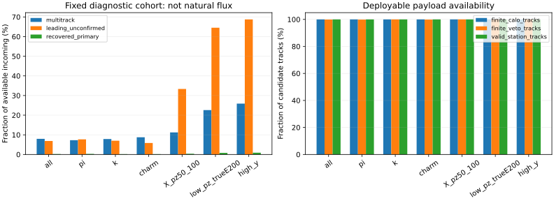

# Stage95：轨迹候选与外推关联的信息可用性测量

日期2026-11-04，起点`f1b8853`，执行路线§76、信息计划§56和stage95 Prompt。本轮确认了可部署的轨迹候选及共同参考面的外推几何，并发现真实的hitSet数组不对齐。候选替换的已确认支持较少；这不等于次级轨迹对中微子能量无信息，也不构成信息极限证据。0能量fit、0test事件载荷、0新MC/重建，无模型晋升。

## 1. 设计、输入与来源缺口

原stage87的89033兼容池、46575train/11612cal/13189test、17657隔离、incoming权重及全部1016新增K保持。只从train/cal按source、component和观测pz/状态冻结2048个不同incoming，每个只取一个重建视图，不把同粒子的多次重建当独立粒子。seed2026110495，每component最多8个source，强制覆盖已有增补origin和train/cal，source内X分桶轮转并精确incoming去重；不用真E/y或模型误差选取。**这是来源/低pz/状态覆盖的诊断队列，不是完整池或真实flux的自然频率估计。** 队列及QA身份见[identities.tsv](stage95_energy_ml/identities.tsv)，原路径见[sources.tsv](stage95_energy_ml/sources.tsv)。

|component|冻结incoming|train / cal|50<pz0<100 GeV|status_other|实际可读 / 不可读|轨迹数 / 两两边数|
|---|---:|---:|---:|---:|---:|---:|
|π|716|512 / 204|192|98|688 / 28|747 / 70|
|K|682|510 / 172|52|160|585 / 97|635 / 54|
|charm|650|491 / 159|40|137|650 / 0|728 / 103|
|合计|2048|1513 / 535|284|395|1923 / 125|2110 / 227|

24个source视图中22个实际PHYS可读，各原文件10000entries。stage70的`70:0`临时PHYS和stage82的`82:2`临时PHYS已按历史清理政策删除，分别对应冻结队列28/97个身份。stage82旧metadata中的bck路径不是缓存实际使用的临时RDO→reco→ntuple产物；首次QA沿该路径因缺`truth_barcode`失败。核对`run_ml_k_support.sh`、stage82 production validation/cleanup后纠正实际来源，**冻结身份不变、125行保留为载荷不可用，没有替换样本或恢复重建**。见[provenance_correction.json](stage95_energy_ml/provenance_correction.json)。已有K摘要和整个模型训练支持没有删除。

只对冻结的已知源读取eventID标量完整身份索引（合计220000entries）；track/truth载荷只对请求的单entry读取，压缩basket可以覆盖相邻entry，但不解释额外事件。原source/run/eventID/input_entry/native-MeV incoming四元组、leading pz、raw11/status、真E/y/leading确认与原缓存逐项闭合，不凭重复run/eventID跨来源匹配。

一次方动量只用各候选pz0，允许原px0/py0；不引入p0/p1/pz1或动量比。保存全部已写入PHYS的候选，无新增质量/动量过滤、去重或截断。正域非法值、几何-999/±999999及非有限值转typed NaN；charge的−1、module_eta的−1等合法离散值保留。scintillator只核raw11/status，合法负raw保留，不以fitted charge填回；本轮并未重新定义既有62摘要。truth/matching与可部署候选/边分表保存。

## 2. 物理语义与程序原因

### 2.1 hitSet不是共享hit身份，且实际确有不对齐

读取匹配原生产的Calypso Git对象`d32b0ff3:PhysicsAnalysis/NtupleDumper/src/NtupleDumperAlg.cxx`，不改/重建Calypso。`Track_hitSet`是24位station/layer/side覆盖掩码，bit号`23-(station*6+layer*2+side)`，没有cluster/strip唯一ID。其push在“三下游站命中”和端点有效性筛选之前，Track状态在这些筛选之后写入，因此可能不等长。

小QA的37个可读事件中未见不等长，但完整队列有**52/1923=2.704108%**，条件95%区间[2.052782,3.328133]%。不能用小QA无异常宣布全量对齐，更不能截断强配。全部1923可读事件的hitSet取值均在24bit范围内。真实共享hit率和真实重复粒子率**未测量**，不能把掩码交集、同truth barcode或几何接近直接当共享hit/重复轨迹率。

### 2.2 外推是共同平面几何，不是通道响应或匹配显著性

同一源码确认VetoNu参考面z=−3112 mm、Timing/Trig z=0 mm、Calo参考面z=2760 mm。前两者从upstream端点反向传播，Calo从downstream端点正向传播；使用μ传播假设，失败写999999。传播初始化中的单位对角协方差不是测得的逐轨迹拟合协方差，不能据此构造物理显著性。Calo面还是估计的前表面，坐标有限不代表打中某通道或观测到淋浴。

`x0/y0/z0`与`x1/y1/z1`来自首末TrackParameters，不保证不同候选的端点z相同；`delta_x0_y0_mm`只是端点横向距离，不叫共同平面距离。共同面的Calo/Veto距离与方向差是可部署的关系输入。raw电荷仍是事件读出，本轮没有建立逐候选到scintillator/Calo脉冲的可靠分配。完整语义见[source_semantics.json](stage95_energy_ml/source_semantics.json)。

### 2.3 真值确认与oracle的适用范围

primary μ按原incoming衰变顶点和PDG唯一定位；确认要求每轨迹的`t_pdg/t_barcode`及parent PDG/barcode同时匹配。标签来自原track truth matching工具，不把“未确认”直接叫错选或把未找到标签叫物理上没有μ。truthHitRatio=hitCount/(nDoF+5)另作诊断，不用于筛选或输入：2110条全部有限且在[0,1]，1796条primary确认轨迹最小0.6、中位1；314条非primary确认轨迹中位仍1，说明高纯度匹配到其他粒子与primary确认是两回事。低于0.5的10条全部未确认。真实共享hit与matching工具的独立效率仍未测量。

## 3. 小QA、资源冻结与实际执行

固定QA40个不同incoming覆盖全部24source、origin55/70/81/82/83、低pz和异常状态：π/K/charm=10/10/20，低pz9，实际可读37、不可读3；43条轨迹/6条两两边。QA低pzK为0，完整冻结队列低pzK为52，不为补小QA而扩大不同身份数或重选队列。2个原input_missing身份中1个实际可读、1个来自已删除的stage82；整个批量仍保留这2个身份。

最新串行QA实测9.938698 wall秒/9.598762 CPU秒，peak RSS142.570312 MiB，实际Uproot逻辑请求**19966193 bytes/125 requests**，源接口实际read返回**16639947 bytes/2247 calls**，byte cache hits343。见[QA.json](stage95_energy_ml/QA.json)。64MiB/进程的精确字节范围LRU复用压缩basket；decompression/interpretation均TrivialExecutor，BLAS每进程1线程。与原未缓存同40身份四张数据表逐字一致，原wall11.498039秒、缓存一次10.456599秒；OS/后端缓存状态不同，**不是完整任务加速比**。物理EOS网络字节未测量。

实际生产tar解包后以同40身份跑8进程提取和报告，四表与串行逐字相同；37可读/43轨迹/6边闭合，0新身份/fit/test载荷。该QA包外层9.55 wall秒/13.89 CPU秒，8进程提取段1.430948 wall秒/9.571555 child CPU秒；外层和内部不可相加。资源准入投影2245.217814 CPU秒仅用于判断阶段21600 CPU秒上限，不替代实测。见[package_QA.json](stage95_energy_ml/package_QA.json)、[admission.json](stage95_energy_ml/admission.json)。

HTCondor **9667502.0**申请8CPU、8000MB、MaxRuntime1800秒，无自动重试；CERN最终ad将8CPU对应内存上调到24000MB，不把分配量当使用量。单次start/首次exit0，等待83秒，remote wall48秒、Condor记164CPU秒。worker实测外层44.02 wall秒/164.13 CPU秒，单进程最大RSS131644 KiB，非8进程同时总峰。提取段37.848114 wall秒、parent .312542 CPU秒、child159.512283 CPU秒，平均使用**4.214537核**（child/提取wall），不是8倍加速证明；实际载荷吞吐50.808344事件/秒。按source分片共22可读文件，8进程中每文件只打开一次，source wall6.749–19.553秒，I/O与分片尾部限制了占用。

批量Uproot逻辑请求933784306 bytes/2011 requests；字节缓存后源接口read返回84402917 bytes/12864 calls，cache hits116176。两层请求定义不同，不相减当物理网络节省；FUSE/OS/EOS物理流量未测量。完整单核基准/GPU加速未测量，这类稀疏I/O提取不占GPU。

随后只对已保存的小表补原stage94 cal定义的X分组和独立汇总；补充任务及实际资源见resources.json。固定40保存表QA首次因numpy int64不能JSON序列化失败，改成显式Python int后同身份实际包QA通过，未读新PHYS或拟合。完整补充统计任务9667503.0申请1CPU/8000MB，站点实际上调为3CPU/9000MB，首次exit0；外层4.07 wall秒/2.01 CPU秒，remote wall9秒/Condor 3CPU秒。原8核主任务和补充任务外层共166.14 CPU秒，嵌套段不可再加；交互准备/所有小表核验未逐项计时，不给整个会话CPU总量。EOS FUSE一度不能stat已上传返回包，从同一已知XRootD路径取回成功，没有重跑作业。

主要执行命令如下；LCG CPU环境为`LCG_109/x86_64-el9-gcc15-opt`，交互QA使用已匹配的`LCG_109_cuda/x86_64-el9-gcc13-opt`及单线程环境。

```bash
bash /tmp/stage91_python.sh ml/track_candidate_information.py prepare
bash /tmp/stage91_python.sh ml/track_candidate_information.py qa
condor_submit -terse AnalysisZipFramework/submission/ml_track_candidates.sub
# worker内：
python ml/track_candidate_information.py worker --processes 8
python ml/report_track_candidates.py
# 原stage94 X标签，不重新估边界：
python ml/closeout_track_candidates.py prepare
condor_submit -terse -append 'candidate_action = closeout' \
  -append 'candidate_package = energy-ml-track-candidates-stage95-closeout.tar.gz' \
  -append 'candidate_cpus = 1' AnalysisZipFramework/submission/ml_track_candidates.sub
# 仅保存表上的嵌套oracle核算：
python ml/closeout_track_candidates.py oracle
```

返回归档按预期stage95路径逐文件解包；重复metadata/cohort/数据表均逐字闭合，见collection.json/closeout_collection.json。生产包可由以下明确输入重建；包内相对路径与仓库一致，AFS的worker.sh由已提交wrapper复制。补充包额外包含closeout工具、X_groups/profiles和四张已保存表，不需要再读PHYS。最终补充工具新增的`oracle`动作仅计算已保存表，原`report`代码和批量数据未改变。

```bash
tar -czf software/energy-ml-track-candidates-stage95.tar.gz \
  ml/track_candidate_information.py ml/report_track_candidates.py \
  ntuples/energy_ml_stage95/cohort.json \
  workbook/stage95_energy_ml/admission.json workbook/stage95_energy_ml/QA.json \
  workbook/stage95_energy_ml/bytecache_QA.json \
  workbook/stage95_energy_ml/sources.tsv workbook/stage95_energy_ml/cohort_support.tsv
cp AnalysisZipFramework/submission/run_ml_track_candidates.sh \
  /afs/cern.ch/user/x/xcheng/nu_mu_stage95/worker.sh
```

## 4. 详细结果、统计依据与限制

### 4.1 候选分母与备选支持

各行以**实际可读事件**为候选/确认率分母，括号中为冻结数/可读数，均一incoming一视图、不额外重权。真E/y分层仅为诊断，不是部署选择。完整来源和组别见[profiles.tsv](stage95_energy_ml/profiles.tsv)，条件区间见[conditional_intervals.tsv](stage95_energy_ml/conditional_intervals.tsv)。

|组|冻结 / 可读N|多轨迹N（%）|leading未确认N（%）|leading未确认但备选确认N|
|---|---:|---:|---:|---:|
|全体|2048 / 1923|153（7.956318）|132（6.864275）|4|
|train|1513 / 1388|108（7.780980）|86（6.195965）|2|
|cal|535 / 535|45（8.411215）|46（8.598131）|2|
|pz50–100 GeV|284 / 276|31（11.231884）|92（33.333333）|1|
|status_other|395 / 359|52（14.484680）|46（12.813370）|1|
|真E50–100 GeV|85 / 81|0（0）|1（1.234568）|0|
|真E100–200 GeV|152 / 148|3（2.027027）|11（7.432432）|0|
|低pz真E≥200 GeV|128 / 124|28（22.580645）|80（64.516129）|1|
|high-y≥.8|122 / 112|29（25.892857）|77（68.750000）|1|
|原leading未确认|141 / 132|40（30.303030）|132（100）|4|
|原input_missing|2 / 1|0（0）|0（0）|0|

全体多轨迹率7.956318%的固定来源/X配额条件95%区间[6.760270,9.127665]%；π/K/charm为7.267442[5.377907,9.156977]、7.863248[5.811966,10.004274]、8.769231[6.615385,10.769231]%。全体备选恢复确认率4/1923=.208008%，条件区间[.052002,.416017]%；在leading未确认者内4/132=3.030303%，区间[.737689,5.952012]%。leading确认1791/1923，任意候选确认1795/1923=93.343734%，仍有128个事件没有确认primary候选。

重抽为500次，每个冻结source×观测低pz×status分桶内按incoming有放回抽样。真值组分母随draw变化；它不是source/parent/生产系统、重训或研究选择的覆盖区间，source95未测。零成功项的bootstrap区间退化为[0,0]，**不能用它证明总体概率为0或给总体上限**。missing仅1个可读身份，无鲁棒性认证。原X组及cal子组见[X_profiles.tsv](stage95_energy_ml/X_profiles.tsv)，边界直接复用stage94，不重新挑组。cal的pz50–100/100–200/≥200 GeV支持85/65/385，多轨迹11/4/30；Calo EM能量三分位边界.153645029/2.174562295 GeV，三组N174/160/201、多轨迹7/4/34；SpacePoints边界16/56，三组N146/144/245、多轨迹0/6/39。cal的Calo/activity缺失组均0，不给其百分率或区间。

### 4.2 几何可用性、歧义与typed缺失

2110条候选中Calo外推2110有效，VetoNu2108有效（99.905213%），Timing2109有效（99.952607%）；全部station flags有效且三下游站均有标记，module域错误0。候选pz0/px0/py0、端点、charge、质量和module均有限；几何失败的2条VetoNu、1条Timing保留NaN，没有补0或丢候选。空集合在已选择的1923可读事件中0；这不能解释为全PHYS没有空轨迹事件，因为原选择要求leading pz>50GeV。

全部153个多轨迹事件都有至少一对Calo面分离≥1mm的候选。定义“几何接近”为端点横向距离<1mm且Calo面距离<1mm，本轮227对中0对满足；它不是重复判据或共享hit率。22个source均有多轨迹支持，1个事件有2条primary确认候选；仅同barcode不能区分track clone、分裂或真实身份歧义。Calo面227对距离中位86.447689 mm、范围4.193260–211.337942 mm；VetoNu面224/227对有限，中位19.074310 mm；方向斜率差中位.017611032（无量纲）。具体距离分位见[pair_distributions.tsv](stage95_energy_ml/pair_distributions.tsv)。

raw11逐通道与原缓存完全一致：21153个通道读数中无本合同判为raw无效者，**1265个合法负raw读数保留**。status_other涵盖旧fit/Calo等异常，不等于每次raw坏。原input_missing也不能一概说raw缺失。缺源125行继续有availability=False，不与真实空集合/0轨迹合并；本轮无法测已删除PHYS内的轨迹信息。

### 4.3 oracle与物理解释

在任意候选已确认primary的1795事件上，leading到真μ的pz log-RMSE=.316374174，truth匹配候选中最佳的绝对log误差为.316023272，仅2个事件数值改善。该“best matched”不是任意候选的最佳数字匹配，更不是ν能量oracle；匹配到正确μ也不保证其重建pz误差小于误配leading。

另用保存表定义严格嵌套的诊断：每事件取leading与已确认primary候选之间**最小的真μpz绝对log误差**，无确认者保留leading。在全部1923可读事件上，leading .483590902→oracle .483329547，仅2例改善。见[muon_oracle_bound.json](stage95_energy_ml/muon_oracle_bound.json)。这给出了该有限“正确候选替换＋允许不替换”操作的实测μ-pz误差改善上限，不给ν能量预测收益上限，也不包含未保存的重建候选/击中。真实部署无truth oracle，模型能否辨认这2例未测量。

**最低真能量81例全是单轨迹**，说明本次覆盖内仅靠换leading无法解释或修复低能损失；端点、外推及与摘要联合仍可能带来信息，不能据此否定该分支。低pz真高能和high-y有更高多轨迹率，却分别仍有79/76例缺确认primary；“已有正确轨迹但挑错”的已确认机会分别只有1例。低μ动量、接受度/三站保存筛选、重建效率、truth matching不完备均可能有关，本轮没有把它们分离，不能选其中一个当已证原因。几何分离的额外轨迹也可能描述带电次级/相互作用拓扑，值得一次直接能量消融，不能只围绕4个恢复例训练gate。

### 4.4 独立闭合与产物

批量报告独立复算2048行身份/角色、候选计数、n(n−1)/2边数、leading pz及标签、681个距离值；最大leading pz差0 GeV、oracle绝对log误差差2.775558e−17，全部通过。补充closeout用Counter重新聚合轨迹/边/多轨迹等全体计数，不沿用报告masks；完整X标签逐row联结。见[validation.json](stage95_energy_ml/validation.json)、[closeout_validation.json](stage95_energy_ml/closeout_validation.json)。有限候选表示图见下：



事件/candidate/relations/truth表与完整冻结cohort保留在忽略的`ntuples/energy_ml_stage95/`，truth分表不进入features；只提交紧凑身份manifest/schema/聚合表图、代码及报告。最终保留3833769 bytes（3.656167 MiB），低于20MB上限；资源和逐文件字节见[resources.json](stage95_energy_ml/resources.json)、[storage.json](stage95_energy_ml/storage.json)。原source/共享缓存和stage54五项工作树保留，回收临时传输包及重复返回archive；无ROOT/xAOD副本。实际表级读写不是物理EOS流量。

## 5. 阶段结论与下一具体任务

本轮成功核实**22维候选节点＋5维leading关联几何**的新载荷，冻结`track_candidates_leading_geometry_v1`，见[representation.json](stage95_energy_ml/representation.json)。候选按有效pz0降序、原index稳定打破同值；无效pz保留并带掩码；无截断/去重。当前保存表仍以原index存储，排序由后续消费者实施。最小拓扑为leading到其余候选的稀疏边，完整两两表仅诊断；不引入hitSet或truth。节点之外保留availability/真实空集合/各值缺失的不同状态。没有证明GNN或关系模型的能量收益，没有证明已达信息极限。

**下一stage96：冻结一个最小候选集合模型，恰两fit做同结构/目标/后处理的新增信息消融。** 输入为原stage87角色、权重/全部K及困难样本、stage94的62 typed摘要/原cal_select-post、已核可用PHYS源与本轮节点/边合同。先≤40固定train/cal核全源schema差异、typed缺失与空/缺集合、节点重排不变性、梯度及实际GPU/CPU成本，再将提取扩展至原完整角色；不可读源保留整个事件的摘要及显式缺候选状态，不丢K或重建替换。test候选载荷只能在两格模型/协议冻结后作为输入准备，不看test诊断调方案。

两格参数量/初始化/训练预算完全相同：A在新增候选分支全部置常数（含availability/count/掩码），B输入真实节点及leading边；二者均保留同62摘要。共享小节点编码器＋masked mean/max及leading表示、边池化后接2×64点回归，weighted log-MSE；不引入truth gate、GNN/attention大扫描或更多seed。train-only typed变换，原pz0/raw/NaN合同、完整风险层与双向尾保持。固定一个seed、原cal_select早停和cal_post单log-offset；复用旧传统/direct/stage92/stage94预测，不能因看test增候选或改阈值。验收包括全角色原样本计数/缺源掩码、学习曲线、配对风险/500incoming条件区间、参数与实测成本、最低能及困难组无删减；未过原联合要求仍不晋升。

QA后再冻结批量资源：有独立源分片时8CPU、内线程1；拟议阶段CPU≤21600秒、GPU任务累计wall≤7200秒/1GPU并发、紧凑最终≤20MB。新全池提取/两fit成本和收益均未测量；用实测准入而不机械外推本轮小队列。资源不准入就交真实缺口与已完成输入，不缩成有利子集或加预算。GPU拟合通过用户已授权的batch/GPU平台，令牌失效时按现有授权改用可用Condor GPU，不把平台可用性当训练结论。本轮不执行stage96、不push，真实response、interaction/FSI/材料/Calo/接受度/背景与最终未开发确认仍待完成。
