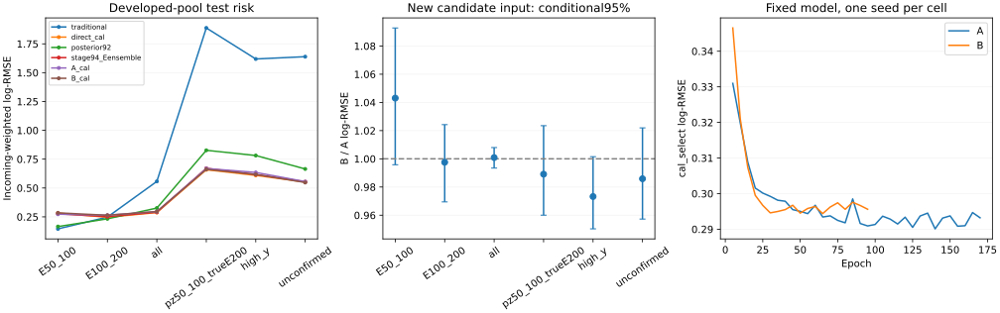

# Stage96：同结构候选几何输入的两格能量消融

日期2026-11-04，起点`073242d`。执行修订路线§77、信息计划§57及stage96 Prompt，完成恰两次GPU拟合和完整原cal/test评价。**新增候选/leading几何没有带来可确证的总体或最低能改善，两格均未通过联合门槛，不晋升。** 预定义多轨迹test组有小幅条件增量，但不能外推为总体收益或主要μ替换效果。以下记录实际数值、资源、缺口和下一项有界实验。

## 1. 固定输入、两格设计和研究边界

复用stage87的89033兼容池与原隔离17657，实际train/cal/test=46575/11612/13189，总71376条重建视图；同incoming全部视图总权重1，原全部1016新增K、missing21/6/5和困难侧保持。cal沿stage94 source/incoming不交的select5443、post5746，423条退出select仍全cal报告。不重分角色、不新生成/重建、不以缺候选删事件。

280个已知source视图中276个实际PHYS路径可读。stage70的一源28条π与stage82三源1016条K的临时PHYS已删除，故这些1044条保留原62摘要和显式candidate_available=False；不将缺源当空集合或用旧bck路径冒充当时生产。train/cal/test已知缺源345/343/356，全部K摘要继续参与。源清单见[sources.json](stage96_energy_ml/sources.json)，角色/component/低pz/缺失支持见[input_support.json](stage96_energy_ml/input_support.json)。只遍历既有清单，无EOS递归扫描。

两格共同声明结构、23809参数、seed2026110496。A保留62 typed摘要，但新增分支输入固定为一个全0 dummy节点、valid mask、全0 masked边和固定meta[1,0,0,0]；没有实际数量、缺源或padding形状泄露。B保留同摘要并输入所有真实候选与leading-to-other几何，分开availability、available-and-empty、train-standardized log1p(count)、has_edges四个事件量。A的常数分支不能使用与B相同的有效函数容量，不以相同声明参数量声称所有容量因素完全隔离。

节点22值＋22逐值missing mask，共享44→32SiLU→32SiLU，masked mean/max和leading embedding共96维；边5值＋5mask，共享10→16SiLU→16SiLU，masked mean/max共32维。联合127维原62摘要表示和4个事件量，259→64SiLU→64SiLU→1输出logE。空/全mask池化为0而状态显式，无候选截断/去重；有效pz0降序，原index稳定处理同值。保留原端点可不同z的语义，Calo/Veto距离是共同参考面几何，不称通道匹配或显著性。

一次方动量只用候选pz0，允许px/py和既有q/p/弯折，不加p0/p1/pz1或动量比。保留raw11/status、合法负raw、typed NaN和Calo缺项。新增pz0正域log，非负质量/计数/距离log1p，signed连续asinh，charge/module/station等离散identity；尺度是train候选的medianabs、变换后median/IQR，缺值用train中位并带mask，无截断。摘要直接复用stage94 C的train-only typed状态。hitSet、truth matching、真E/y都不作为输入、排序、候选gate或结构选择。

两格weighted log-MSE、Adam lr.001/default betas/no decay、clip10、batch1024、每epoch同seed NumPy一次permutation；最多300epochs，每5轮按原cal_select加权点MSE严格最小取checkpoint，patience30epoch。不增加模型或seed。原cal_post各一次全局weighted mean(logtruth−point)偏移；raw/offset完整报告。先冻结模型/协议才准备test候选，两个fit及偏移固定后才产生新test预测/打开目标诊断。当前test为已研究池对本次fit的留出，不是新blind或最终独立确认。

## 2. 小QA、资源准入与执行合同

固定40个不同train/cal incoming，按origin、component、低pz、missing和已知source事前选定，不按truth/误差/候选多寡选择。覆盖36个source和origin55/70/81/82/83，不能逐一QA全部280来源；每个生产源仍独立核schema/数组长度/身份联结。实际38载荷可读、2缺源，41节点/3条leading边。QA身份见[QA_identities.json](stage96_energy_ml/QA_identities.json)。原source/run/eventID/input_entry/incoming native-MeV四元组、leading pz、raw11/status逐项核对；track payload只解读请求单entry，完整eventID标量索引用于身份查找。

串行QA含每源初始化12.520066 CPU秒/16.465800 wall秒，单进程peak155.285156 MiB；逐载荷平均.053748547 CPU秒、每可读源固定成本平均.304924256 CPU秒。源接口read18613870 bytes，Uproot逻辑请求20570828 bytes；它们不是物理EOS网络流量。64MiB/进程精确范围LRU、Uproot解释/解压TrivialExecutor、BLAS内线程1。实际生产tar解包后，同40身份8进程输出与串行逐数组相同，wall2.076687秒/child12.505042 CPU秒，没有新增fit或test载荷。见[extract_package_QA.json](stage96_energy_ml/extract_package_QA.json)。

本地Tesla T4上0optimizer QA：A/B各23809参数，batch1024反向计时（重复同40身份）.004045835/.004401985 wall秒；非零head用于检查完整body/节点VJP，不作为训练warmstart。B节点首层梯度范数.001523828，A首层输入权重梯度0符合恒定0 dummy；两格候选重排最大logE差0，缺源/空集合全mask池化前向反向finite。破坏实际候选内容后A分支逐数不变，控制无新信息泄露。见[model_QA.json](stage96_energy_ml/model_QA.json)；声明参数相同不表示有效容量完全相同。

以实际“逐entry＋固定源”分离成本，2×(完整预期可读70332条×逐载荷CPU＋276源×固定CPU)+300，提取投影8028.803823 CPU秒；最慢T4 batch F/B×46×300×2×5+180，拟合投影787.473942 wall秒。另预留2000CPU秒，准入阶段21600CPU秒/1GPU并发/GPU任务wall7200秒/最终20MB。它们是保守投影，不是实测全量保证。协议在新test候选载荷前冻结，见[protocol.json](stage96_energy_ml/protocol.json)、[admission.json](stage96_energy_ml/admission.json)。生产包QA在完整输入padding尺寸下重复同40身份，再核实际GPU成本准入，不调结构或超参。

评价的固定40保存表QA只用train/cal身份、确定性合成点预测，0fit/0新PHYS。串行与8进程8个分层任务结果完全相同；以事件空间draw×error独立复算配对区间，最大差2.220446e−16。这仅核统计接线，不是模型物理表现，见[report_QA.json](stage96_energy_ml/report_QA.json)。

## 3. 全量提取、训练与实际资源

### 3.1 全量载荷、缺失与独立几何检查

HTCondor **9667511.0**首次start、exit0、无重试，按source分片，8进程各只打开本分片文件一次。276个可读源的所有预期必需/可选分支均存在；4个删除PHYS的source保留显式缺源。原始逐源schema经无损往返检查合并为2种schema（完整/无载荷），从1886488 bytes降为27582 bytes，源与原QA/main次序仍可逐项恢复，见[schema_catalog.json](stage96_energy_ml/schema_catalog.json)。原source列表、[performance.json](stage96_energy_ml/performance.json)及完整逐source风险支持表保留。

|角色|原记录N|实际可读 / 缺源N|单 / 多候选记录N|候选节点 / leading边N|
|---|---:|---:|---:|---:|
|train|46575|46230 / 345|43750 / 2480|49274 / 3044|
|cal|11612|11269 / 343|10633 / 636|12048 / 779|
|test|13189|12833 / 356|11983 / 850|13898 / 1065|
|总计|71376|70332 / 1044|66366 / 3966|75220 / 4888|

实际可读空候选数为0；缺源1044条不计作空。最大10候选/9边，无人为截断。原提取JSON的`test_payload_records=13189`实际计的是**请求的test输入行，包含356个缺源**，实际打开test载荷12833条。保留原执行日志，在[bookkeeping_audit.json](stage96_energy_ml/bookkeeping_audit.json)明确更正；代码输出改用`test_requested_records`与`test_available_payload_records`两个字段。这是生产完成后的计数命名修复，未修改输入、预测或拟合；另补首次prepare创建输出目录、空层复核格显式写`not_applicable`以避免TSV尾空白，均不改数值实现。正式包QA逐字一致记录描述的是当时执行版本。

原生提取leading pz与旧缓存最大差**0 GeV**。紧凑float32节点与float64参考最大绝对差.151999999769 GeV、最大相对差5.91258515935e−8，发生于极大重建动量，不是身份错配；未以float32绝对差作事件删除。独立用保存节点重算4888×5=24440个边值，五维最大差分别7.371306e−6、1.280282e−5、3.505974e−5 mm、8.138287e−9、0，全部通过量化容差；排序、空/缺源和NaN对应通过，见[input_validation.json](stage96_energy_ml/input_validation.json)。

75220节点中VetoNu外推x/y各8个NaN、Timing x/y各3个，其余22节点列本批缺值为0；这不等于摘要或将来输入没有缺失。正域/非负域中非法负数残留0，几何−999/±999999残留0。合法charge=−1保留48982个，module_eta=−1保留37708个，px/py负值分别37641/37538个。signed连续变量不凭“负数”或无来源证据的−999猜测删值；raw/reduced charge继续按原status语义处理，不以拟合失败屏蔽仍合法的raw积分。原input_missing完整21/6/5仍在训练/评价。

### 3.2 两fit及冻结后推断

实际fit包先以原40身份padding到全池10节点/9边，T4两格batch1024 F/B .004035938/.004007528 wall秒，资源投影736.959453 wall秒通过后提交Kubeflow。只用已授权、当时有效的令牌，未保存凭证。Job `nu-mu-energy-stage96-fit`、Pod `nu-mu-energy-stage96-fit-d4xdl`，节点`ml-004-h100-001-uusckqrqfxt3-node-0`，**NVIDIA H100 NVL MIG3g.47gb**。首Pod、restart0、exit0/Succeeded，容器16:37:31Z–16:38:13Z，42 wall秒；平台自动分配22CPU/63G，torch/BLAS实际1线程，分配量不当作核占用。证据见[GPU_execution.json](stage96_energy_ml/GPU_execution.json)。

|格|实际epochs / best epoch|optimizer steps|最佳cal_select log-MSE|当时train log-MSE¹|fit wall / CPU秒|GPU allocated peak MiB|
|---|---:|---:|---:|---:|---:|---:|
|A 常数新增分支|170 / 140|7820|.084153369|.063284087|22.115186 / 19.318370|122.735352|
|B 实际候选/几何|95 / 65|4370|.086662434|.065642130|10.287473 / 10.226193|231.593262|

¹ train列是该epoch训练过程中逐minibatch目标的加权汇总，不是best checkpoint重新扫全train。两格同seed、初始化/每epoch permutation规则及停止规则；各自early stop，训练长度不相等，不能说相同更新轨迹。共**2fit、12190steps**，没有补seed、重训旧控制或按test改checkpoint。[learning_A.tsv](stage96_energy_ml/learning_A.tsv)/[learning_B.tsv](stage96_energy_ml/learning_B.tsv)保留完整每5epoch曲线，fit JSON保留参数及峰值。

原cal_post5746记录/5539incoming的单次offset：A=.01512920662615514、B=.017684194672280034 logE。[before_test.json](stage96_energy_ml/before_test.json)记录两fit及offset均已完成后才新算test预测。随后原40train/cal checkpoint replay的A/B最大raw logE差均4.768372e−7，小于3e−6准则；不重复拟合、不新增test预测，见[checkpoint_QA.json](stage96_energy_ml/checkpoint_QA.json)。

### 3.3 CPU并行、实际成本和I/O

完整评价走HTCondor **9667549.0**，首次start/exit0、无重试。提取/评价都申请8CPU/8000MB/MaxRuntime1800秒，站点ad均改为8CPU/24000MB；等待150/53秒，Condor记remote wall714/15秒、CPU4924/24秒。脚本外层与站点统计的范围和取整不同，不相加。

|不重叠外层worker范围|wall秒|CPU秒|最大单进程RSS KiB|
|---|---:|---:|---:|
|完整提取，含其子进程|708.583553|4922.910304|176560|
|两fit、输入重建/导入/预测|41.040673|33.277536|1777312|
|完整评价、导入/表图|9.690446|23.686382|223900|

提取内层706.455452 wall秒/4917.975626 child CPU秒，child平均**6.961480核**，实际可读载荷吞吐约99.56条/wall秒；每源固定成本与I/O仍在此范围。源接口read **748107242 bytes/89042 calls**、byte cache hits3642464；Uproot逻辑请求29795851543 bytes/71436 requests。两者定义不同，不能相减称物理网络节省。EOS/FUSE/OS实际网络流量**未测量**；完整单核基准/同时总RSS峰**未测量**，表中RSS为最大单进程而非8进程合计。

评价8进程、78个role/stratum任务，child CPU19.148239秒；从启动pool至表图/独立复核结束窗口4.673613秒，对应child/window4.097096核，不是已测8倍加速或纯pool运行时间。空层包括cal/test各自的≥6400 GeV、available empty及activity缺失，记录分母0，不制造风险/区间。有效输出1728条指标、1008条配对比较；完整单核比较仅小QA，不扩成全任务单核重跑。

三个外层worker及七个各自独立GNU-time QA范围共**5043.784222 CPU秒**，远低于21600秒准入；内部fit/子进程时间不能再次加。manifest/freeze、部分metadata/传输、审计和图像检查等未全计时，不宣称精确全会话CPU总量。GPU任务42容器wall秒低于7200秒上限，allocated峰非GPU物理context总峰，详见[resources.json](stage96_energy_ml/resources.json)。无生产平台失败或重试；轻量图像审阅首次临时wrapper漏存SVG导致read-back报错，补存临时SVG后同保存表render通过，0fit/新事件/新评价。

主要实际命令如下，按依赖顺序执行；**下列训练命令仅为复现记录，本阶段已经执行，不再重跑**。`/tmp/stage91_python.sh`设置PYTHONNOUSERSITE/PYTHONDONTWRITEBYTECODE及OMP/OPENBLAS/MKL线程1，source `LCG_109_cuda/x86_64-el9-gcc13-opt/setup.sh`再exec python。CPU worker用`LCG_109/x86_64-el9-gcc15-opt`；未改C++，不重新build。

```bash
bash /tmp/stage91_python.sh ml/prepare_candidate_ablation.py prepare
bash /tmp/stage91_python.sh ml/prepare_candidate_ablation.py qa
bash /tmp/stage91_python.sh ml/train_candidate_ablation.py qa
bash /tmp/stage91_python.sh ml/train_candidate_ablation.py freeze
bash /tmp/stage91_python.sh ml/qa_candidate_report.py
bash /tmp/stage91_python.sh ml/package_candidate_ablation.py extract
condor_submit -terse AnalysisZipFramework/submission/ml_candidate_ablation.sub
python3 ml/collect_candidate_ablation.py extract --cluster 9667511
bash /tmp/stage91_python.sh ml/validate_candidate_input.py inputs
bash /tmp/stage91_python.sh ml/package_candidate_ablation.py fit
kubectl apply -f AnalysisZipFramework/submission/ml_candidate_ablation_kubeflow.json
python3 ml/collect_candidate_ablation.py fit
bash /tmp/stage91_python.sh ml/validate_candidate_input.py replay
bash /tmp/stage91_python.sh ml/package_candidate_ablation.py report
condor_submit -terse -append 'candidate_mode = report' \
  AnalysisZipFramework/submission/ml_candidate_ablation.sub
python3 ml/collect_candidate_ablation.py report --cluster 9667549
bash /tmp/stage91_python.sh ml/summarize_candidate_ablation.py
```

三个实际包都有原40身份QA，非新trial fit；`package_candidate_ablation.py`只做打包/QA，不训练。collector按预期返回路径和逐文件字节一致检查，extract/fit/report分别10/19/32个已有文件一致，新增5/13/9个文件。使用结束后删除三个软件tar、三个返回tar及可由原缓存重建的raw/status manifest；不删共享旧缓存。紧凑schema合并是无损重排；最终只留候选/QA、模型/预测、必要紧凑证据，实际保留约**8.90 MB（十进制）**，保守计入三份共享文档全文；精确字节及逐文件清单见[storage.json](stage96_energy_ml/storage.json)，≤20000000 bytes。NPZ/PT/ROOT/tar不入Git，不保存xAOD。原stage54五路径工作树/后缀和既有缓存只读保持。

## 4. 完整风险、配对区间和独立闭合

### 4.1 全体、低能和困难侧

以下均**incoming加权**、自然对数log-RMSE无量纲，能量单位GeV；传统为log(pz0/.8)，direct沿原stage87同split预测，posterior92为既定名义prior/准确median，C/E为stage94已保存预测及原offset。A/B的raw与offset全部在[metrics.tsv](stage96_energy_ml/metrics.tsv)按incoming/record两种权重交付，未以test回选后处理。

|test组|记录 / incomingN|传统|direct|posterior92|stage94 C / E三seed|A offset|B offset|
|---|---:|---:|---:|---:|---:|---:|---:|
|真E50–100|183 / 183|.145661|.282644|.165630|.278092 / .276027|.272854|.284603|
|真E100–200|856 / 851|.247937|.246329|.232842|.270090 / .251510|.264460|.263812|
|all|13189 / 12125|.557190|.287491|.326058|.299024 / .289843|.295567|.295826|
|真E≥200|12150 / 11091|.578219|.290487|.334085|.301460 / .292797|.298177|.298321|
|reco pz0 50–100|659 / 659|1.275310|.498966|.597293|.523870 / .508218|.510062|.506054|
|同低pz、真E≥200|297 / 297|1.887790|.658177|.826918|.689558 / .671125|.669305|.662025|
|high-y≥.8|385 / 384|1.618799|.609395|.781673|.634970 / .616675|.634876|.617898|
|leading未确认|468 / 466|1.638613|.551305|.665024|.569016 / .554151|.555370|.547524|
|真E3200–6400|264 / 192|.995785|.683271|.756072|.678371 / .658846|.694453|.706800|
|input_missing|5 / 5|.253034|.203231|.290567|.381194 / .312064|.362109|.298571|

missing仅5例，所有数值均来自保存表，不作稳定认证。

A raw/offset的最低能.262356/.272854、总体.296639/.295567；B分别.271740/.284603、.297078/.295826。单全局offset改善总体、加重最低能的模式仍存在；这不是按真E组可部署校准的证据，也不许从test挑raw当赢家。最低能B中位相对bias+18.313606%，正tail12.568306%、负tail0%，传统+14.060708%、tail0%；低能仍被部分高估事件拉宽，不能把组内均值/中位偏移当完整原因。

完整cal对应A/B：最低能.287359/.303217（N183）、100–200为.267024/.274006（N904）、all .285794/.287668（N11612）、低pz真高E .615990/.612502（N284）、high-y .604319/.611309（N328）、未确认.536387/.545930（N421）。cal上的B/A最低能1.055186 [1.001428,1.113938]，第二低能1.026150 [1.002068,1.054073]；test的对应区间含1，不混为独立重复证实。cal含选择与后处理记录，不能当未开发确认。

### 4.2 主要新增信息配对及观测组

500次component内incoming条件重抽；同incoming多重建视图一并移动，每个incoming总权重1。不是按record独立抽样。区间不含source/parent/重训/offset估计/response或研究选择不确定度；每角色只有3个连通块，source95**未测量**。单seed、很多预定义组的边缘结果不称经多重比较控制的发现。完整数值见[paired.tsv](stage96_energy_ml/paired.tsv)。

|test组|B/A offset风险比|条件95%区间|B−A总tail上95，pp|
|---|---:|---:|---:|
|真E50–100|1.043060|[.995833,1.092824]|+3.617160|
|真E100–200|.997551|[.969431,1.024229]|+.951367|
|all|1.000876|[.993406,1.007993]|+.251220|
|真E≥200|1.000481|[.993039,1.007830]|+.264772|
|低pz|.992142|[.967894,1.018866]|+2.734151|
|低pz真高E|.989123|[.960046,1.023514]|+5.829625|
|high-y|.973258|[.950323,1.001535]|+2.898053|
|未确认|.985873|[.957261,1.021955]|+2.818565|
|高端3200–6400|1.017779|[.993626,1.043604]|+5.541667|

|预定义观测组，test|N / incoming / source|A / B offset log-RMSE|B/A条件95%|
|---|---:|---:|---:|
|候选可用|12833 / 11769 / 40|.295639 / .295308|.998879 [.991903,1.005881]|
|候选不可用|356 / 356 / 1|.293168 / .312471|1.065842 [.999671,1.135015]|
|单轨迹|11983 / 11104 / 40|.288593 / .289400|1.002796 [.996087,1.010181]|
|多轨迹|850 / 834 / 40|.385150 / .371944|.965712 [.935322,.999559]|

多轨迹组约3.43%点风险下降，条件区间上端仅略低于1；cal同组636/631incoming的.344052→.337383，比.980616 [.929429,1.026926]含1。**有局部增量迹象，无全体/最低能恢复证据**。候选不可用test仅一个K source，A/B参数整体训练耦合、B有availability状态，不能把差值全归因于缺源或外推为K物理效应；保留此组不删K。π/K/charm全test A→B分别.266669→.264923、.311137→.312755、.348165→.348652，B/A区间均含1。

B相对stage94 C的all .989306 [.982810,.996443]、低pz真高E .960071 [.936821,.984678]、high-y .973113 [.949263,.998624]、未确认.962231 [.935374,.990158]，但相对E三seedall 1.020644 [1.013559,1.027611]。这些跨stage比较同时改变seed/结构/训练轨迹，不能用它代替本轮B/A新信息效应。共同cal_post处理的direct对照，B all比1.029107 [1.021410,1.037392]，不足以把基线差解释为后处理不一致。

### 4.3 冻结联合门槛与双向尾部

RMSE比的条件上95门槛沿原协议，两低E对传统≤1.05，all对direct≤1.01，≥200及困难对direct≤1.03。尾部统一对direct，事件定义为(Epred/Etrue−1)>+.5或<−.5；分别核总/正/负tail差上95≤+2pp，不能只核净tail或以条件区间当系统学覆盖。完整八层两格见[gates.tsv](stage96_energy_ml/gates.tsv)。

|test门槛组|RMSE上95 A / B（上限）|总 / 正 / 负tail差上95，A pp|总 / 正 / 负tail差上95，B pp|
|---|---:|---:|---:|
|50–100|2.202756 / 2.283229（1.05）|2.778635 / 2.778635 / 0|3.285620 / 3.285620 / 0|
|100–200|1.156217 / 1.157432（1.05）|3.068513 / 2.964223 / .358445|3.002919 / 3.022765 / .348950|
|all|1.036907 / 1.037263（1.01）|.997715 / .772509 / .324536|.905945 / .663333 / .389725|
|≥200|1.035905 / 1.035684（1.03）|.923661 / .729740 / .347022|.878972 / .584644 / .417069|
|低pz|1.052851 / 1.038786（1.03）|3.135344 / 2.472093 / 1.625030|3.189659 / 2.328740 / 1.804140|
|低pz真高E|1.053551 / 1.033521（1.03）|4.653023 / 3.206652 / 3.123706|5.315375 / 3.400113 / 3.934854|
|high-y|1.077750 / 1.043053（1.03）|6.383523 / 2.264684 / 5.496667|5.580052 / 2.494731 / 4.914126|
|未确认|1.044501 / 1.022223（1.03）|3.252780 / 1.812059 / 2.946209|3.304566 / 2.347284 / 2.329626|

A所有8个RMSE门槛失败，B仅未确认RMSE门槛通过；两格只有all/≥200的三向tail全通过。B低pz真高E总体tail36.773813%、正11.501032%、负25.272781%，direct35.830139%/11.501032%/24.329106%，不能以平均误差略降忽略困难负尾。联合通过两格均False；不晋升、不按test增加seed/微调cut/gate。

两格仅点回归，无新density/PIT/coverage/NLL概率结论。保存的旧概率模型只作为点控制，不能沿用它的coverage给新模型背书。真E/y分组是点风险诊断，后验PIT的解释仍按stage93修正。

### 4.4 程序与独立算术复核

每个非空任务以独立`bincount`与主`np.add.at`复算incoming的各策略平方误差，最大差0；配对点比另以直接weighted MSE核算。原40合成点值的独立事件空间draw验证、串行/8进程等价均通过，不用test决定统计实现。完整保存表中**6496个旧控制指标全部复现、最大差0**，最佳checkpoint确为学习曲线严格最小，每格epochs−best=30，steps=46×epochs；cal_post偏移独立重算、raw＋offset逐值闭合。验证见[validation.json](stage96_energy_ml/validation.json)、[independent_checks.tsv](stage96_energy_ml/independent_checks.tsv)。这些检查排除已测联结/聚合/后处理接线问题，不证明样本、truth matching或探测器响应系统学都已完备。



## 5. 阶段结论与下一具体任务

本轮回答了新增集合/几何在一个固定小模型中的实际增量：**总体未改善、最低能仍明显差于传统，局部多轨迹增量不足以晋升**。低pz真高E/high-y点风险下降但B/A区间含1、困难尾门槛仍失败。原stage95的少量primary恢复机会不是ν能量oracle，本轮亦未分解primary替换与次级几何、metadata、表示及优化的贡献。不归因于单一数据量瓶颈，不宣称候选信息无用或达到信息极限。

程序上当前节点与边**分别编码后独立池化**，没有逐备选保留“这个候选的状态对应这条leading边”的联合消息。leading单独embedding并不弥补这个关联丢失；有多个备选时，一组节点与另一组边的不同配对可能给同一池化表示。两候选情形也可比较先联合非线性再池化的归纳偏好，但不能声称在那里新增了信息。原模型未使用真实hit身份/通道电荷分配/实测协方差，这些缺口没有因本轮负结果而消失。

下一**stage97恰两fit**，只检验同一既有输入下的显式候选—leading边联合编码，不扩新ROOT/重建/新MC、不扫模型网格。两格都保留stage96 B的真实摘要、节点/边独立pool与metadata；额外增加同声明80→32SiLU→32SiLU消息模块（leading32＋备选32＋对应边16），masked mean/max后接原2×64 head。A消息分支固定dummy、不泄露实际联合配对，B逐备选使用正确配对；原独立pool继续给两格全部边际输入。空/缺源真实消息pool为0并保留既有状态。冻结seed2026110497、train-only变换、原cal_select/post、同weighted log-MSE/Adam/earlystop/单offset；声明参数量与有效容量限制如实报告。这是**既有输入的有限表示/容量消融**，不称再次购买新探测器信息，也不把收益全归因于关系的物理因果。

方法依据已于本轮在线核阅Battaglia等[Interaction Networks, arXiv:1612.00222](https://arxiv.org/abs/1612.00222)：在聚合前对关联对象和关系联合建模。该论文研究物理模拟，不是FASER能量重建精度承诺；这里只采用小型关系编码思想，不加入模拟器预训练或大型attention。成本与收益未测量，不能用本轮GPU速度替代新包QA。

具体所需输入：本轮`candidates.npz`/原40 QA、stage94摘要预处理/cal分区、原stage87 split/兼容缓存、所有旧预测/offset。验收先≤40原train/cal身份0optimizer QA核排序/leading-to-other对齐、共同置换不变、改变配对时B联合表示可变、A无联合信息泄露、缺源/空集合finite、梯度和实际GPU/CPU成本；没有物理事件需重提取。两格同时保留同已知特征，不加数据、seed或事后gate。再经已授权GPU batch≤1并发执行≤2fit，8CPU Condor完整评价，交全体/两低能/困难/缺源/单多轨迹/高端/missing、原8个RMSE与双向尾门槛、500incoming条件区间及成本。拟议CPU7200秒、GPU任务累计wall3600秒、最终20MB，QA后准入；不达预算不删困难样本、不自动延长。若仍无联合收益，交明确表示诊断及真实关联输入缺口，不续关系深度/宽度/seed扫描。

本轮未执行stage97。继续既有部署；真实response、interaction/FSI/材料/Calo/接受度/背景、source95及真正未开发确认仍未测。报告、实现/批量配置、紧凑证据与追加路线/信息计划本地Conventional Commit，不push；stage54原五路径与逐字后缀保持。
