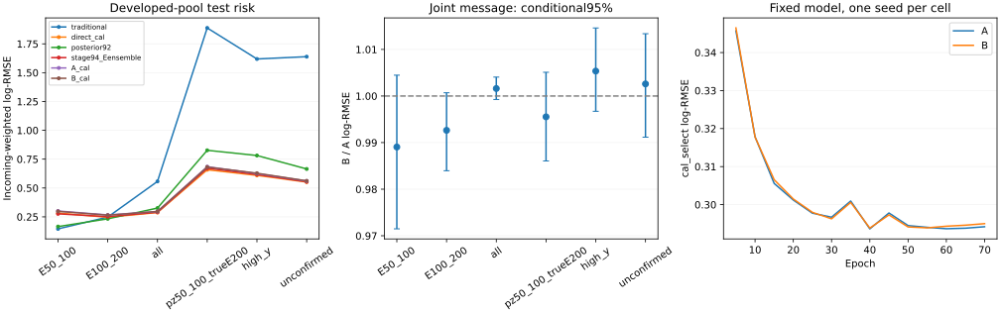

# Stage97：同输入候选—leading边联合编码的两格消融

日期2026-11-04，起点`5499517`，执行修订路线§78、信息计划§58及本轮Prompt。已完成恰两fit及完整原cal/test评价：相同真实边际输入下新增逐候选—对应边联合消息未确证总体/最低能或多轨迹收益，两格均无联合通过，不晋升。不扫模型/seed，本轮未执行stage98；以下区分实际结果、预算投影和未测量项。

## 1. 原输入、对照与解释边界

复用stage87的89033兼容池与17657隔离，原train/cal/test=46575/11612/13189记录、37556/10811/12125个incoming。跨角色incoming不交，各incoming全部重建视图权重和1。原stage94 source/incoming分离cal_select5443、cal_post5746、冲突423仍全cal报告；不重新划分、选择来源或删除困难者。全部1016新增K保持train317/cal343/test356；原input_missing21/6/5不变。主体reco pz0>50 GeV，一次方动量仅pz0，保留px/py/q/p/弯折；raw11/status、合法signed负数、typed NaN与Calo缺项保持。

直接读取stage96紧凑cache，不再读ROOT/新MC/重建。280source中276可读；70332可用载荷、1044候选缺源（train345/cal343/test356）保留原摘要和availability。缺源是stage70的一源28条π和stage82三源全部1016K临时PHYS已删除，不能当空集合或丢K。实际75220节点、4888leading边，最多10节点/9边，可读空集合0。单/多候选记录train43750/2480、cal10633/636、test11983/850。原生leading及几何证据沿stage96；本轮独立重算24440边坐标仍通过、最大差为7.371306e−6/1.280282e−5/3.505974e−5 mm、8.138287e−9及0。见[input_audit.json](stage97_energy_ml/input_audit.json)。

正/非负域非法负值和几何−999/±999999残留0，合法charge=−1的48982值、module_eta=−1的37708值保留。节点外推缺值、摘要raw/status规则按stage96，不能把所有负数当占位。全部特征不含scintillator fitted charge；VetoNu reduced_charge沿原生raw时间窗积分语义，不是拟合电荷。原41/62输入中已移除p0/p1/pz1及其动量比，本轮不加回。完整typed状态直接复用stage96 train-only的节点/边/count和stage94 summary127维归一化，不按新cal/test refit，无截断/去重/hitSet/truth输入。

两格均使用stage96 B真实边际分支：节点44→32SiLU→32SiLU，mean/max与leading共96维；边10→16SiLU→16SiLU，mean/max共32维；原summary127＋96＋32＋meta4=259维。新增消息为leading节点32＋对应备选节点32＋对应边16=80→32SiLU→32SiLU，mean/max后64维；联合323→64SiLU→64SiLU→1 logE。**两格均31553声明参数**，A新增消息仅一个固定零输入/有效dummy，恒定且不受实际配对/count/padding影响；B用正确逐边配对，缺源/无边pool=0，原availability/empty/count/has_edges仍保留。A原边际输入始终真实变化，不声称它没有候选信息。

这是既有输入的有限表示/有效容量消融，不是新探测器信息或完全容量隔离。A常数分支的有效函数容量与B不同；原模型独立池化可能丢多备选配对，而两轨迹时非线性联合编码也可改变归纳偏好，不能把增益全叫“找回丢失信息”或primary替换。参照[Interaction Networks, arXiv:1612.00222](https://arxiv.org/abs/1612.00222)的聚合前对象/关系联合编码思想，该论文的物理模拟精度不迁移为FASER承诺；stage96已在线核阅，本轮没有新架构文献网格。

两格seed2026110497，incomingweighted log-MSE，Adam lr.001/default betas/no decay、clip10、batch1024，max300epochs/每5轮原cal_select weighted MSE strict min/patience30。每epoch同seed一次NumPy permutation，各自earlystop；head正式初始weight=0/bias=train加权mean logE，不继承QA权重。原cal_post各一次全局weighted mean(logtruth−point) offset，raw/offset完整交付。两fit和offset固定后才算新test预测；旧test为已研究池留出，不是新blind。旧stage87/92/94/96预测直接复用。

## 2. 固定40 QA、实际包及资源准入

复用stage96的同40不同train/cal incoming，36source/origin55/70/81/82/83，38候选载荷可用、41节点/3边；不按新能量误差/候选多少挑事件。所有QA为0optimizer、0新fit/test预测。head暂用固定非零权重只核body及关系VJP，正式训练重新初始化。

CPU1线程和本地Tesla T4检查：同声明参数/初始化逐值相同，CPU/GPU max logE差4.768372e−7，共同置换备选节点和对应边的max差0；空/缺源全mask前向反向finite。A消息首层输入weight梯度0符合恒定零输入；B norm3.458773e−5。原40没有足够物理多备选时，用这些相同张量构造一个3节点/2边代数probe，仅打乱边配对，A联合表示差0、B CPU/GPU差.001773760/.001773767，验证代码可使用配对；**不是新增物理样本或收益测量**。

同40重复成batch1024、padding全池10节点/9边，1次warmup＋3次计时中位数包含输入转换/传输、同步、forward/backward及结果copy：

|格|CPU1线程wall秒|T4 GPU wall秒|CPU/GPU速度比¹|GPU输入传输wall秒|GPU allocated peak MiB|
|---|---:|---:|---:|---:|---:|
|A|.035677882|.006249038|5.709340|.001029925|34.194336|
|B|.058159055|.006980168|8.332043|.001032263|40.747070|

¹同机器/固定QA/小batch重复的端到端比例，不是完整训练加速比。输入全训练驻GPU时的实际拟合成本另报；allocated峰非物理context总峰。见[model_QA.json](stage97_energy_ml/model_QA.json)。最慢GPU计时×46×300×2×5+180投影1143.263143 wall秒；加1000CPU预留共2143.263143秒，只作准入预算，不是实测保证。冻结阶段CPU7200秒、1GPU并发/累计任务wall3600秒/最终20000000bytes，见[admission.json](stage97_energy_ml/admission.json)/[protocol.json](stage97_energy_ml/protocol.json)。

正式fit包静态闭包21个Python文件逐字与仓库一致，解包再以同40身份跑0optimizer QA，GPU投影1089.204002 wall秒通过；包41729912bytes（临时传输，不是最终留存）。没有调用训练动作。评价QA仅原40train/cal保存身份和确定性合成点值，8任务串行/8进程完全一致，直接事件空间draw×error与分组区间max差2.220446e−16，见[report_QA.json](stage97_energy_ml/report_QA.json)。不拿QA合成分数声称物理改善。

## 3. 实际两fit、批量评价与资源

### 3.1 GPU执行、checkpoint与单次偏移

Kubeflow Job `nu-mu-energy-stage97-fit`、Pod `nu-mu-energy-stage97-fit-jbqzl`，节点`ml-004-h100-001-uusckqrqfxt3-node-0`，**NVIDIA H100 NVL MIG3g.47gb**。首Pod、restart0、exit0/Succeeded，容器2026-11-04T18:14:40Z–18:15:05Z，共**25 wall秒**。平台自动分配22CPU/63G，torch/BLAS1线程，不把资源分配当实际核占用，见[GPU_execution.json](stage97_energy_ml/GPU_execution.json)。

|格|实际epochs / best epoch|optimizer steps|best cal_select log-MSE|该epoch训练中目标¹|fit wall / CPU秒|GPU allocated peak MiB|
|---|---:|---:|---:|---:|---:|---:|
|A 新消息常数|70 / 40|3220|.086214975|.068677005|10.255440 / 9.958454|235.513184|
|B 正确联合消息|70 / 40|3220|.086336553|.068386771|9.953476 / 9.886869|251.047363|

¹ train列是该epoch逐minibatch训练目标的加权汇总，不是best checkpoint全train重扫。两格同初始参数/permutation/停止准则，本次恰同best40/停止70，但不能外推任意数据均有同训练长度。共**2fit、6440steps**，无额外seed、warmstart、重试、重训旧控制。完整每5epoch曲线保留[learning_A.tsv](stage97_energy_ml/learning_A.tsv)/[learning_B.tsv](stage97_energy_ml/learning_B.tsv)。

cal_post5746记录/5539incoming的单次offset为A **.005846731675601077**、B **.015895662835822146 logE**。两fit与offset固定后才算新test预测，见[before_test.json](stage97_energy_ml/before_test.json)。`preprocessing.json`与原stage96文件**9685 bytes逐字相同**，没有refit变换。原40train/cal checkpoint重放A/B最大raw logE差均4.768372e−7，低于3e−6准则，0新fit/test预测，见[checkpoint_QA.json](stage97_energy_ml/checkpoint_QA.json)。

### 3.2 8CPU统计与实际外层范围

完整评价HTCondor **9667612.0**，申请8CPU/8000MB/MaxRuntime1800秒、无自动重试；站点实际ad8CPU/24000MB。等待47秒，首次start/exit0，Condor remote wall19秒、CPU26user＋6sys=32秒。站点统计与脚本外层范围、取整不同，不相加。

|独立外层worker范围|wall秒|CPU秒|最大单进程RSS KiB|
|---|---:|---:|---:|
|两fit＋输入重建/导入/预测|24.334654|23.460535|1774664|
|完整评价＋导入/表图/独立实际区间复核|13.175484|31.090866|312700|

GPU内部worker21.890547wall/21.519389CPU秒，内层两fit、预测、重建均已包含，不重复加。评价78个role/stratum任务、8进程，每进程BLAS1线程，fork共享只读原输入及500incoming draws；2016条点指标、1296条配对结果、280个source风险支持行。child CPU23.515661秒，从pool启动到全部聚合/独立复核/表图结束窗口7.526824wall秒，平均**3.124248核**；窗口不是纯pool时间，不能称8倍加速。任务较短、分片不均及串行复核限制占用；未为提高表面核占用无必要地重复统计。完整单核速度比**未测量**。

两个外层worker与七个独立GNU-time QA范围共**85.851401 CPU秒**，低于7200秒准入；GPU容器25秒低于3600秒累计任务上限。最初一次同40QA在新增CPU/GPU输出一致性检查前的时间被后一次同名计时覆盖，未进入这项加和；freeze/metadata/收取/部分审阅与清理等未全计时，**不是精确全会话CPU总量**。见[resources.json](stage97_energy_ml/resources.json)。GPU allocated峰不含全部物理context，RSS是最大单进程而非多进程同时总峰；后者、物理EOS网络字节均**未测量**。本轮ROOT读取0，无提取I/O，不复制旧候选/兼容缓存。

正式report包在增加“实际预测的独立事件空间区间复核”前后各做一次同40合成点QA；前包未提交，计时保留`report_package_pre_audit.time`，重新打包/QA后才提交最终包25483769bytes。该改动不触及两fit或选模，0新预测；实际包21代码文件逐字一致。无生产失败或重试。轻量收尾初次用系统Python解析UTC末尾Z时报版本兼容错误，改成显式+00:00后元数据验证通过，未重跑拟合/统计。返回归档按预期stage97路径逐文件检查，fit已有4个文件/新增13个、report已有19个/新增9个，全部已有文件逐字一致。日志/平台证据不含令牌。

### 3.3 执行命令与紧凑保留

交互QA使用`/tmp/stage91_python.sh`：PYTHONNOUSERSITE/PYTHONDONTWRITEBYTECODE及OMP/OPENBLAS/MKL线程1，source `LCG_109_cuda/x86_64-el9-gcc13-opt/setup.sh`后exec python；CPU Condor用`LCG_109/x86_64-el9-gcc15-opt`。本轮未改C++/Calypso，不build。下列worker训练命令已经完成，仅作复现记录，**不得再次执行两fit**。

```bash
/usr/bin/time -v -o workbook/stage97_energy_ml/model_QA.time \
  bash /tmp/stage91_python.sh ml/train_joint_candidates.py qa
bash /tmp/stage91_python.sh ml/train_joint_candidates.py freeze
bash /tmp/stage91_python.sh ml/qa_joint_report.py
bash /tmp/stage91_python.sh ml/package_joint_candidates.py fit
kubectl apply -f AnalysisZipFramework/submission/ml_joint_candidates_kubeflow.json
bash /tmp/stage91_python.sh ml/audit_joint_inputs.py
python3 ml/collect_joint_candidates.py fit
bash /tmp/stage91_python.sh ml/train_joint_candidates.py replay
bash /tmp/stage91_python.sh ml/package_joint_candidates.py report
condor_submit -terse AnalysisZipFramework/submission/ml_joint_candidates.sub
python3 ml/collect_joint_candidates.py report --cluster 9667612
python3 ml/closeout_joint_candidates.py
```

收尾仅保留新模型/预测、必要数值表图/协议证据；两个软件传输tar和两个返回tar用后删除，原stage96候选/QA及旧模型等共享缓存只读保留。最终保守计入三份共享文档全文的实际逻辑大小约**2.99 MB（十进制）**，精确逐文件字节见[storage.json](stage97_energy_ml/storage.json)，≤20000000 bytes；物理EOS占用/压缩块未测量。NPZ/PT/ROOT/tar不入Git，不保存REC/RDO/xAOD副本。最终语法、JSON、文档链接、只追加历史及stage54逐字后缀检查见[final_validation.json](stage97_energy_ml/final_validation.json)。原stage54五路径工作树保持，未提交到本阶段。

## 4. 完整风险、配对、门槛及独立复核

### 4.1 低能、全体与困难侧

以下均为incoming加权自然对数能量log-RMSE（无量纲），能量/pz单位GeV。传统=pz0/.8，direct是stage87同split旧预测，posterior92准确median、stage94与stage96既有输出/offset原样复用；不重训对照。完整[metrics.tsv](stage97_energy_ml/metrics.tsv)同时保留raw/offset和incoming/record权重，不能根据test回选raw或偏移。

|test组|记录 / incoming / source N|传统|direct|posterior92|stage96 B|stage97 A|stage97 B|
|---|---:|---:|---:|---:|---:|---:|---:|
|真E50–100|183 / 183 / 31|0.145661|0.282644|0.165630|0.284603|0.300780|0.297487|
|真E100–200|856 / 851 / 40|0.247937|0.246329|0.232842|0.263812|0.266358|0.264396|
|all|13189 / 12125 / 41|0.557190|0.287491|0.326058|0.295826|0.296267|0.296744|
|真E≥200|12150 / 11091 / 41|0.578219|0.290487|0.334085|0.298321|0.298364|0.299070|
|reco pz50–100|659 / 659 / 41|1.275310|0.498966|0.597293|0.506054|0.519571|0.517705|
|同低pz真E≥200|297 / 297 / 41|1.887790|0.658177|0.826918|0.662025|0.684707|0.681645|
|high-y≥.8|385 / 384 / 41|1.618799|0.609395|0.781673|0.617898|0.624909|0.628254|
|leading未确认|468 / 466 / 41|1.638613|0.551305|0.665024|0.547524|0.560423|0.561879|
|真E3200–6400|264 / 192 / 25|0.995785|0.683271|0.756072|0.706800|0.705386|0.707278|
|input_missing|5 / 5 / 4|0.253034|0.203231|0.290567|0.298571|0.252518|0.286907|

最低能A raw/offset **.296519/.300780**、B **.286233/.297487**；all A **.296619/.296267**、B **.297952/.296744**。单次全局offset改善全体、加重最低能仍存在，不能按真E校准或从test选raw。最低能A/B中位bias+19.469857%/+18.399435%，正tail14.754098%/14.207650%、负tail0；传统中位bias+14.060708%、tail0。最低能183个incoming支持有限，不能把整体训练目标或少数离群解释成已测唯一原因。

cal A/B的最低能.309266/.302373（N183）、100–200 .274830/.273389（N904）、all .286798/.287122（N11612）、低pz真高E .634998/.634938（N284）、high-y .604858/.604677（N328）、未确认.542713/.544375（N421）。cal最低能B/A .977714 [.966357,.988497]有条件下降，但test .989053 [.971480,1.004474]含1；cal包含选择/偏移记录，不当独立确认，不据此追加seed或改停止准则。

### 4.2 本轮配对及预定义观测组

500次component内incoming条件重抽，同incoming全部重建视图一起移动，incoming总权重1；不是逐record独立bootstrap。区间不含source/parent/重训/offset估计/真实response或研究选择，source95未测；每角色3连通块不是只有3个独立incoming。单seed/预定义多组比较仍不能充当独立发现，见[paired.tsv](stage97_energy_ml/paired.tsv)。

|test组|B/A offset风险比及条件95%|B−A总 / 正 / 负tail差上95，pp|
|---|---:|---:|
|真E50–100|0.989053 [0.971480,1.004474]|1.216001 / 1.216001 / 0.000000|
|真E100–200|0.992634 [0.983954,1.000695]|0.814105 / 0.892138 / 0.000000|
|all|1.001610 [0.999258,1.004056]|0.320412 / 0.250893 / 0.125155|
|真E≥200|1.002365 [0.999971,1.004857]|0.343155 / 0.257562 / 0.146398|
|reco pz50–100|0.996408 [0.988045,1.003838]|1.580979 / 1.285534 / 0.791086|
|同低pz真E≥200|0.995528 [0.986057,1.005101]|3.583776 / 2.510895 / 2.137768|
|high-y≥.8|1.005352 [0.996721,1.014611]|2.739929 / 1.904435 / 1.540508|
|leading未确认|1.002598 [0.991165,1.013376]|2.392753 / 1.876192 / 1.134321|
|真E3200–6400|1.002682 [0.993481,1.011825]|2.809866 / 0.000000 / 2.980518|
|input_missing|1.136187 [0.722958,1.658150]|0.000000 / 0.000000 / 0.000000|

|预定义test观测组|记录 / incoming / source N|A / B offset log-RMSE|B/A及条件95%|
|---|---:|---:|---:|
|候选可用|12833 / 11769 / 40|0.295696 / 0.296212|1.001744 [0.999378,1.004151]|
|候选不可用|356 / 356 / 1|0.314557 / 0.313834|0.997701 [0.978573,1.017676]|
|单候选|11983 / 11104 / 40|0.289958 / 0.290221|1.000909 [0.999072,1.002707]|
|多候选|850 / 834 / 40|0.370382 / 0.373821|1.009286 [0.992612,1.025452]|

多轨迹test850条/834incoming的B/A **1.009286 [.992612,1.025452]**，cal636条/631incoming为1.003883 [.979078,1.025503]，本轮未验证新增联合消息收益。不可用test356条来自一个K source，B/A .997701 [.978573,1.017676]，不能认证该来源泛化；5条input_missing的B/A区间宽，不能认证缺失鲁棒性。π/K/charm A→B为.264193→.265094、.314335→.314561、.346347→.346539，完整source/component和原X组仍交表，不删表现不佳来源。

相对旧stage96 B，stage97 B全体1.003104 [.997440,1.008189]，最低能1.045271 [1.006042,1.081686]、低pz真高E1.029636 [1.005031,1.055104]、未确认1.026218 [1.001359,1.051247]；未显示跨stage升级。跨stage同时改变seed/结构/训练轨迹，不能把变差全部归因于消息机制。相对stage94 E三seed全体1.023812 [1.016561,1.030739]；相对共同cal_post处理direct全体1.032302 [1.024814,1.040799]，基线差不由后处理不一致解释。

### 4.3 原8层RMSE及三向尾门槛

低E对传统的风险比条件上95≤1.05、all/direct≤1.01、≥200和困难/direct≤1.03；总/正/负tail分别对direct差上95≤+2pp。tail是相对能量误差>+.5或<−.5，正负不可净抵，完整[gates.tsv](stage97_energy_ml/gates.tsv)。

|test组|RMSE上95 A / B（上限）|A总 / 正 / 负tail差上95，pp|B总 / 正 / 负tail差上95，pp|
|---|---:|---:|---:|
|真E50–100|2.425382 / 2.421954（1.05）|5.275320 / 5.275320 / 0.000000|4.372910 / 4.372910 / 0.000000|
|真E100–200|1.169467 / 1.158933（1.05）|3.092263 / 2.804859 / 0.597747|3.139917 / 3.054779 / 0.488924|
|all|1.039118 / 1.040687（1.01）|0.646976 / 0.390378 / 0.379158|0.768333 / 0.484639 / 0.416924|
|真E≥200|1.035275 / 1.038183（1.03）|0.524546 / 0.269489 / 0.386155|0.672761 / 0.377014 / 0.440583|
|reco pz50–100|1.068128 / 1.065561（1.03）|2.334475 / 0.915829 / 2.508317|2.635091 / 1.093939 / 2.552777|
|同低pz真E≥200|1.072880 / 1.071228（1.03）|3.112294 / 0.000000 / 4.658389|4.691867 / 1.019066 / 5.135451|
|high-y≥.8|1.053627 / 1.060751（1.03）|4.654958 / -0.584704 / 6.079853|5.096668 / 0.000000 / 6.249211|
|leading未确认|1.050268 / 1.055037（1.03）|2.280093 / -0.703420 / 4.346311|3.230961 / -0.103430 / 4.685130|

**两格8个RMSE门槛均失败，仅all/≥200的三向tail全通过；联合通过均False，不晋升。** B低pz真高E总/正/负tail36.537894%/10.085520%/26.452374%，direct35.830139%/11.501032%/24.329106%；虽然正尾较少，负尾和总尾仍不合格。high-y负tail21.358760%对direct18.069130%，其差上95+6.249211pp，不能只看总体误差。高端B负tail32.309028%（192incoming），全高端输入/事件保留，不声称高能恢复。

两格只有点回归，不报告虚构PIT/coverage/NLL概率量；旧posterior只作点控制，旧coverage不能赋予新网络。真E/y分层仅作点风险诊断，后验PIT解释继续沿stage93修正。

### 4.4 联结、模型与实际区间独立闭合

完整每个非空role/stratum以独立`bincount`复算主`np.add.at`incoming平方误差，最大差0；点风险比另用直接weighted MSE闭合。实际预测上对cal/test各10个固定组、B/A与B/direct两配对，用事件空间draw权重独立重算风险区间及三向tail区间，共**320个区间端点**，最大差**3.552714e−15**。原40合成QA的串行/8进程和区间独立检查通过，没有用test调统计实现。

**8512个旧控制指标全部复现、最大差0**，包括原stage94/87控制及stage96 A/B；两个best确为每5epoch曲线strict min，steps=46×epochs=3220，停止best+30；原cal_post偏移独立重算、raw＋offset逐值一致。各角色记录完整、全部K和incoming权重闭合，预处理逐字不变，checkpoint40重放通过，见[validation.json](stage97_energy_ml/validation.json)/[independent_checks.tsv](stage97_energy_ml/independent_checks.tsv)。空层为cal/test各自≥6400 GeV、candidate empty、activity缺失，分母0，不构造风险/区间。这些核验排除已测聚合/联结/后处理错误，不认证全部物理response或truth匹配系统学。



## 5. 结论、限制与唯一下一任务

本轮在全真实边际输入保持的条件下，完成了预注册的联合候选—边消息方案比较：**没有确证总体、最低能、困难侧或多轨迹的联合收益，两格均不晋升**。QA证实B消息能响应配对且梯度非零，程序联结与实际区间已核验；负结果不能说成模型完全没用到该分支，也不证明关系方法家族无效或信息极限。相同声明参数不隔离有效容量，单seed和分布/优化波动仍在。最低能仍明显差于传统，当前输入和目标未给出联合改进，不把未知原因写成“只是缺数据”。

stage95已确认hitSet是24位层/面覆盖而非击中ID，且52/1923载荷与保存轨迹长度不对齐；现有外推用了单位协方差，并非逐轨迹拟合误差。stage96/97只交几何/状态，没有真实track→cluster/spacepoint引用或实测协方差；现有GNN式消息没有自动补出这些观测。**结束当前几何消息的深度/宽度/seed扩展，不继续该网格。**

唯一下一**stage98**转向“原生重建中真实轨迹—cluster/spacepoint关联及协方差的可部署信息测量”，**0能量fit、0新MC/重建、0test载荷/风险**。输入只从stage95已冻结2048个不同train/cal incoming、一视图/24source及已知production元数据开始，先沿精确PHYS→原始REC/ESD生产链核对应，不能猜merge文件序号、按hitSet位交或zip等长假配。只查询冻结来源的已知production目录/日志，不递归扫EOS；不存在的临时PHYS及无法定位native来源保留分母和明确缺口，不恢复旧K时限或删除原K摘要。

先在≤40固定train/cal身份核schema、run/event/native incoming与原track筛选/index、单位、实际TSOS/measurement/cluster Identifier及SP组成引用、track covariance来源/正定性/外推条件和I/O成本。优先已有匹配Calypso构建，仅新导出源码确需修改时才编译。冻结一种最小摘要：逐轨迹关联cluster/SP计数、实际ID可核时才给共享cluster比例、事件未归属活动及其分母；有可核协方差再给传播几何尺度/误差，否则标未测，不用单位协方差造pull。不能将未归属活动认定纯noise，不要求无SDO/无primary当物理无μ，不构造truth输入或硬Calo电荷分配。

QA通过后才对原2048队列在可核native来源中紧凑提取；逐条保留原身份/角色/来源及不可用状态，交真实可用率、各component/观测pz/单多轨迹/缺源支持和关联/误差分布。既有truth仅另表核身份及研究诊断，禁止按真E/y/现有误差挑队列/关联。批量必须HTCondor，独立source足够时8CPU/内线程1，最多2并发，建议累计CPU14400秒/输入实际读取≤10GB/最终20MB，小QA后实测准入；不保存REC/RDO/xAOD或逐hit点云副本，不因预算缩成有利事件。验收实际交付一份可部署紧凑关联合同和有数据分母的测量，或完成所有可做测量并列出精确缺失collection/源/身份映射；不是单交metadata清单。新输入收益与成本仍未测量，不提前训新模型。

继续既有部署。真实response、interaction/FSI/材料/Calo/接受度/背景、source95及真正未开发确认仍需证据；本轮**未执行stage98**。中文报告、实现/配置、紧凑证据和追加路线/信息计划本地Conventional Commit，不push；stage54原五路径/逐字后缀保持。
