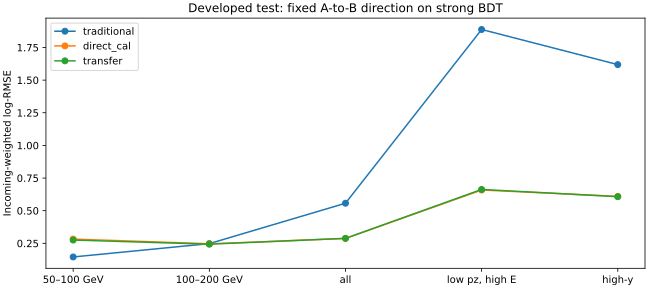

# Stage110：强 BDT 锚定的固定关系差转移——最低能有局部收益，共同验收未通过

日期：2026-11-05。执行更新路线 §91、Stage109 §4 和当前 Prompt 的唯一固定方向实验。**本阶段实验和预定评价已完成；项目最终能量/尾部及真实物理确认目标仍未完成。**

## 1. 阶段目标与实际执行范围

保留 Stage87 强 `direct_cal`，仅检查 Stage108 已学到的 A→B 功能变化是否还能改善其错误：

`d = geometry_available × (B_raw − A_raw)`，`fα = direct_cal + αd`，`0≤α≤1`。

输出均为自然 `ln(Eν/GeV)`，差和风险系数无量纲。几何缺源时显式复制原 BDT；α=0 也逐位返回原点。差包含关系、标量重学习和优化轨迹，不是纯几何因果效应或正交残差。

只做一个 cal_select 解析系数；0 新网络训练/optimizer step/forward/checkpoint/head/ROOT/SP/原生读取/offset/T/积分/生成/重建/GPU。未读取 C 或 cal 版本来换方向。未扩展 α 范围、增加局部系数、裁输出、按 truth/pz gate，或按 test 选择策略。

## 2. 输入、角色、QA 与程序验证

实际输入为以下原有缓存，没有重新构建事件或模型：

- `ml/artifacts/stage108/predictions.npz`，仅取 row、A_raw、B_raw、geometry_available。
- `ml/artifacts/stage87/predictions.npz`，保留原 direct_cal 和既有 offset。
- `ntuples/energy_ml_stage94/{evaluation_input,cal_partition}.npz`。
- `ntuples/energy_ml_stage87/split.npz`；旧控制数值来自 `workbook/stage94_energy_ml/metrics.tsv`。

[输入联结验证](stage110_energy_ml/input_validation.json)核 89033 兼容记录、17657 隔离、71376 active 全部原 row；逐项对齐 key_id/role/weight/origin/origin_row/component/group/block，并与 BDT 的 role/weight/truth/pz 对齐。全部 1016 个新增 K 保留。

|原角色|记录数|唯一 incoming|标量缺失|几何缺源|
|---|---:|---:|---:|---:|
|train|46575|37556|21|345|
|cal|11612|10811|6|343|
|开发 test|13189|12125|5|356|

cal_select/post 为 5443/5746，唯一 incoming 为 5272/5539；另 423 条退出 select，仍在完整 cal 中。两个子角色使用原 subrole 归一权重；完整 cal/test 使用原 incoming 权重，每 incoming 所有视图权重和为 1。最低能 select/post/test 为 85/97/183 条。没有删除困难者、高端、未确认、missing 或正负尾。

pz0>50 GeV，一次方动量仅 pz0，原 px/py、q/p、弯折允许；raw11/status、typed NaN、合法 signed 负值和 Calo 缺项政策保持。本阶段只组合旧输出，不添加变量或改变清理定义。几何不可用的 1044 条均保留，全部预测输出仍有 71376 行。

同一批任务先做 [40 个确定性 cal 身份 QA](stage110_energy_ml/QA.json)：包含全部 6 个标量缺失、5 个几何缺源及 select/post，不按新误差选例。α0 与几何 fallback 逐字节相同；小样本直接平方误差与 C+2αD+α²A 的最大差 **2.0816681711721685e−17**。交叉、相切、无额外改善、线性、常数、活跃线性/二次保护 7 个解析例通过；额外核空区间、下界和消减敏感根，最大 α 误差 **2.7755575615628914e−17**，稳定根残差 **2.220446049250313e−16**。未做新的模型接线或梯度 QA。

[独立统计检查](stage110_energy_ml/report_validation.json)：主区间独立 record-space 展开差 **0**；40 个 test RMSE/三向尾区间最大差 **1.7763568394002505e−15**；840 个旧控制标量最大差 **1.4210854715202004e−14**。点表原子保存/回读逐字节相同。原始输入与实际运输包的 18 个文件全部逐字节核对，无 SHA。最终产物逐项验证见 [final_validation.json](stage110_energy_ml/final_validation.json)；首次汇总完整性检查误要求 cal_post 缺几何层非空，依据原任务只跳过空层的逻辑与已完成 92 个任务修正为显式列零支持，没有重跑数值任务或重新拟合。

## 3. 唯一解析求解：α=1，上界活跃，保护约束不活跃

[事前合同](stage110_energy_ml/protocol.json)在读取事件数组前保存。cal_select 每层计算 C=E[(f0−t)²]、D=E[(f0−t)d]、A=E[d²]；最小化两低能 R(α)/C 的最大值，all/其余五层 RMSE 对 f0 保护分别 1.01/1.03。冻结 absolute 风险/可行性容差 1e−10、目标并列容差 1e−12，并列取较小 α。

交凸二次可行区间后，只枚举端点、目标顶点及交点，未用 SLSQP/网格/多起点。唯一 [selection.json](stage110_energy_ml/selection.json)保存并回读后才计算全角色差和 test 风险。

|cal_select 层|C|D|A|
|---|---:|---:|---:|
|50–100 GeV|0.0664627640665|−0.00524909559625|0.00181546806649|
|100–200 GeV|0.0830573729012|−0.00149805177957|0.00125302208729|
|all|0.0817863452891|−0.000536836827703|0.000902989034694|
|≥200 GeV|0.0819480594560|−0.000368598235711|0.000856045328742|
|50<pz0<100 GeV|0.227222600114|−0.00461788463751|0.00325466531818|
|低 pz 且真 E≥200 GeV|0.338285497998|−0.00554224331498|0.00503415185097|
|high-y|0.385807867543|−0.00934404503587|0.00374392318880|
|未确认|0.332304807077|−0.00689943568877|0.00409035112312|

实际可行区间 **[0,1]**，六个开发保护均不活跃；候选为 α=0、1，另一目标交点 **9.966461926797495** 在域外。选中 **α=1**，最坏归一 MSE 从 1 降至 **0.979013525097458**，两组分别 **0.8693595843030996/0.979013525097458**。这是本次固定一维问题的全局选择，不能据上界活跃就事后扩 α 或宣称所有函数的最优。

完整 select 各诊断层系数见 [select_coefficients.tsv](stage110_energy_ml/select_coefficients.tsv)，cal/post/test 各层系数、解析与实际风险变化见 [risk_coefficients.tsv](stage110_energy_ml/risk_coefficients.tsv)。

## 4. 主比较未过；开发 test 最低能存在局部收益

主 cal_post 两低能 **max(RMSE_new/RMSE_f0)=1.0012495421450176 [0.9887913304373466,1.0271199077902056]**，上端未<1，**没有支持共同低能增量**。

两 cal_post 单组比分别 **0.987593 [0.948642,1.027120]**、**1.001250 [0.983901,1.019162]**，均含 1。最低能 RMSE 0.330275→0.326177，第二低能 0.237913→0.238210。总体 new/f0 **1.007421 [1.003666,1.011621]**，有条件退步证据。完整 cal 最低能比 **0.968611 [0.936162,0.997998]**，第二低能 **0.994883 [0.984995,1.007440]**；完整 cal 含拟合部分，不能替代主留出统计。

下表是唯一冻结 α 在开发 test 的完整八层 log-RMSE；区间是 new/direct_cal 的 500 次配对 incoming 条件区间。

|test 层|原强 BDT|本次新点|new/BDT [95%]|
|---|---:|---:|---:|
|真 50–100 GeV|0.282644|0.274991|0.972924 [0.948277,0.995675]|
|真 100–200 GeV|0.246329|0.243557|0.988748 [0.972972,1.004560]|
|all|0.287491|0.288039|1.001906 [0.999313,1.004233]|
|真 ≥200 GeV|0.290487|0.291380|1.003073 [1.000412,1.005465]|
|50<pz0<100 GeV|0.498966|0.500130|1.002334 [0.991953,1.011437]|
|低 pz 且真 E≥200 GeV|0.658177|0.662660|1.006811 [0.994655,1.017513]|
|high-y|0.609395|0.607190|0.996383 [0.986494,1.005240]|
|未确认|0.551305|0.554082|1.005036 [0.994498,1.014279]|

最低能有局部条件收益，第二低能和总体区间含 1；≥200 层有小幅退步证据。低 pz 真高能中央值变差但区间含 1，不宣称该侧显著恶化。

最低能传统仍为 **0.14566138607809218**；新点 **0.2749913537520492**，没有恢复到传统附近。该层正尾从 BDT **13.114754%** 降至 **12.021858%**，传统为 **0%**，new−BDT **−1.092896 [−2.734825,0] pp**。完整 [points.tsv](stage110_energy_ml/points.tsv)保留 cal/post/test 的 log-RMSE、median/mean bias、R68、总/正/负 tail50 和支持；[paired.tsv](stage110_energy_ml/paired.tsv)保留对传统及 direct 的配对区间，含高端、missing、geometry_missing、confirmed_low_transfer 和 X 层。共 92 个非空角色/层任务。[support.tsv](stage110_energy_ml/support.tsv)显式列出全部 99 个角色/层支持；cal_post 的 geometry_missing 为 0（原 cal 的 343 条均在 select），无事件层风险标注“未测量”，不伪造区间。



## 5. 最终门槛与物理/程序解释

[全部八层最终 gates](stage110_energy_ml/gates.tsv)保持原要求，联合 **False**：

- 两低能相对传统的 RMSE 比上95分别 **2.262071713/1.059345213**，均超过 **1.05**。第二组中央比 0.982335 不能替代区间通过。
- all/direct 上95 **1.004232891≤1.01**；其他五层 RMSE 上95均≤1.03。
- high-y 总/负尾差 direct 的上95 **+2.975030/+3.013768 pp**，超过 **+2 pp**。负尾从 **18.069130%→19.356377%**，差 **+1.287247 [−0.141702,+3.013768] pp**；未认证尾保护，不称已证明增加超过 2 pp。其余七层三向尾保护通过。

cal_post 第二低能 D=−0.000511510893633、A=0.001164564567095，α1 时交叉收益不足以抵消新增平方项，实际 ΔMSE=**+0.000141542779829**；test 同层 ΔMSE=**−0.001357814796885**。cal_post all ΔMSE=**+0.001094654575428**，test all **+0.000315393282167**。同低 pz 真高能 cal_post/test ΔMSE=**+0.007557527378473/+0.005920915913708**。系数可解释具体风险取舍及校准支持变化，但不能唯一归因训练不足、读出错误或数据量。

程序方面，身份/权重、raw 差定义、缺源 fallback、α 冻结顺序、解析算例与风险展开均通过，没有发现本次算术或接线错误。也不据此排除所有潜在程序问题，或把有限函数方向当 Bayes 界。新点确有最低能局部收益；主比较和最终共同恢复未达，按约定结束本方向，**不晋升**，继续原部署。

区间沿原 component 内 incoming 定义：cal/post seed2026110389，test2026110390，500 次共同抽样，逐 draw 先取两低能最大值；未保存 draw 副本。旧 cal/test 已反复开发；A/B checkpoint 及 f0/offset 有历史 cal 用途。条件区间固定旧模型、来源、offset 和本 α，不覆盖 source/完整 parent、refit、参数估计、研究选择或真实系统，不能称新 blind 或全流程联合95%认证。

## 6. 命令、实际资源、存储与交付

所有事件数组和数值计算在唯一 HTCondor CPU 任务 **9668033.0** 中；首 start、exit0、无重试。源码使用原统计/层定义，仅新增解析求解与已存点表组合。提交目录 `~/condor/nu_muAnalysis/stage110/`。

```bash
python3 ml/package_stage110.py package
bash -n AnalysisZipFramework/submission/run_ml_stage110.sh
condor_submit -dry-run ~/condor/nu_muAnalysis/stage110/dryrun.ad AnalysisZipFramework/submission/ml_stage110.sub
condor_submit AnalysisZipFramework/submission/ml_stage110.sub
condor_wait -wait 45 ~/condor/nu_muAnalysis/stage110/logs/9668033.0.log
python3 ml/package_stage110.py collect
```

worker 使用现成 `/cvmfs/sft.cern.ch/lcg/views/LCG_109/x86_64-el9-gcc15-opt/setup.sh`，在 scratch 中运行 `/usr/bin/time -v ... timeout ... python -u ml/stage110_transfer.py`。初次本地标准库打包命令使用 `python` 但终端无此别名，未执行；改为 `python3` 后成功，没有因此恢复环境或重复物理任务。数值入口未在本地执行。

申请 **4CPU/6000MB/0GPU**，站点请求/分配为 **4CPU/12000MB/0GPU**；4 个 worker、OMP/BLAS/MKL 内线程1，共享 fork 只读数组和每角色同一 draw，无额外模型副本。依 GNU 外层，CPU **11.29+4.10=15.39 s**、wall **7.96 s**、RSS峰 **283924 KiB**；均远低 CPU/wall 各900秒预算。内部计时 wall **6.103357 s**、self/child CPU **2.996823/11.219111 s**、pool wall **2.909437 s**，是嵌套口径，不与外层相加。QA **0.002524 CPU/0.002551 wall s**。Condor history job wall **14 s**、采样 RSS **175000 KiB**，与 GNU 峰口径不同。单核加速比、物理 EOS 流量及全会话/平台 CPU 均**未测量**。

包 **14980195 bytes**，18 个文件均核实际原字节；成功收集后删除本阶段包/结果运输副本，原输入不动。最终紧凑证据见 [storage.json](stage110_energy_ml/storage.json)，不保留中间 ROOT/xAOD/SP 或 draw。唯一新点表 `ntuples/energy_ml_stage110/points.npz`（71376 row/transfer）忽略于 Git；图、系数/风险/门槛、QA、资源和程序保留。资源证据见 [resources.json](stage110_energy_ml/resources.json)、[condor_history.json](stage110_energy_ml/condor_history.json)和 time.txt。Stage54 五项原资产和 Prompt 历史后缀保持。

## 7. 阶段结论与下一步

本次低成本检验已直接交付物理结果：已有 A→B 功能差在强 BDT 上仍有最低能局部用途，但未支持两低能共同增量，最终低能与 high-y 尾要求仍未达。**结束这个固定一维方向，不自动 Stage111，不扩 α、不加 C/局部系数、不重训 Stage108 或另加 residual 训练。**

后续按 Stage109 保留具体输入需求，不提交未授权新生产：

1. 新独立 source/parent、生成接口及实际提议密度/纳入概率；按 Eν、transfer、z/材料/几何覆盖真50–100/100–200、同低 reco pz 真≥200/high-y及自然高端控制。先 pilot 记录每格真实 selected 产额、选择失败分母和 ESS，验收无旧池重复并保留困难者；当前路径/产额**未交付、未测量**。
2. 相同生成及输运历史、可联结身份、有数据尺度的有效 mask/读出/校准变体，需历史 IOV/DAQ/quiet 校准；另行匹配 incoming/靶核/顶点的 generator 比较，不能混成同末态或正式1σ。实际变体**未交付**，Stage85 条件活动不能反求纯噪声。
3. 真正未开发 locked 来源与谱系，及 interaction/FSI/材料/Calo/接受度/背景依据，用原最终八层三向尾和能量要求确认。当前完整确认**未完成**。

只有明确新输入或另冻科学合同后才推进下一实验；本阶段阴性不否定所有可训练残差、不证明数据充分或信息上限。报告先写，再连代码/配置/紧凑证据本地 Conventional Commit，不 push。
