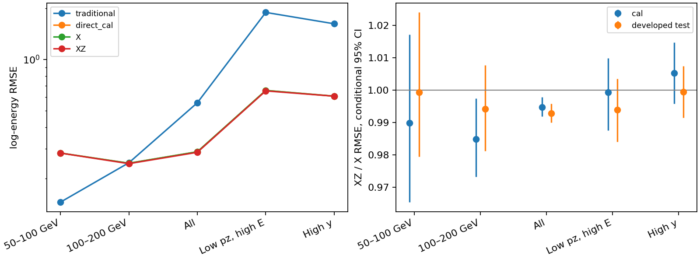

# Stage124：原规模原生 tracker 关联与能量对照

日期：2026-11-06；起点 `7fc136e`，分支 main。本阶段执行 [Stage123方案](2026-11-06_stage123_native-observables-and-sample-strategy.md) 和路线§105。科学读取、ROOT、提取、训练、预测、统计及作图全部在 HTCondor；本地只编辑代码、读文本结果、用 stdlib 打包/核对运输和提交。没有新 G4、GENIE 或数字化生产，没有开放 Stage119 reserved。

## 1. 目标、输入与冻结政策

主问题是同一完整原队列、同一强学习政策下，真实 strip/cluster/SP/track 关联 Z 是否降低 Eν 风险；不是再给旧点云换网络。扩样支线区分记录、incoming 代理、完整独立 GENIE 家族和重复响应视图。secondary/time 支线有界处理，不作为主实验的串行前置。

输入为 `ntuples/energy_ml_stage119/old_input.npz` 的原89033行，来自Stage55/70/81/82/83；[来源表](stage124_energy_ml/source_inventory.json)列280个精确REC/RDO，全部实际存在。Stage55通过PHYS实际eventID header定位entry，其他来源沿已认证input_entry，不由event号推entry。[准备账](stage124_energy_ml/preparation.json)：CPU71.66456043 s、wall172.152939017 s、header请求22682910 B、RSS248280 KiB。

原 train/cal/开发test/隔离=46575/11612/13189/17657；全部1016新增K保留，隔离不预测，reserved零预测。incoming同角色总权重1，原角色不重划；incoming只是已有代理，不是完整GENIE家族。一次方动量仅pz0，允许px/py、q/p、弯折；保留raw11/status/typed NaN/合法signed/Calo缺失、pz>50 GeV和正式fitted/reduced-charge cuts。没有以坏关联/缺输入/大残差删事件。

[事前特征合同](stage124_energy_ml/feature_contract.json)冻结X62与X+Z119：每站13项真实唯一raw/cluster条带、cluster宽度、010/011时序、未知资源、SP复用与leading/other/shared/unused PRD，加缺链/协方差和q/p拟合不确定度，再加availability，共57新增维。实际104维native审计并不全部输入模型。用真实对象/Identifier和原生联结，不以坐标近邻/hitSet代替ID、不truth清洗、不硬判共享PRD为噪声。SCT三拍不是ADC、dE/dx或精密TOF。

两臂各固定3 seed×400轮、depth5/eta.04/minchild20/λ10/hist/nthread1，继承Stage87；train一次拟合、cal一个全局log offset，无参数/特征/seed网格，不从两臂择赢家。主端点为cal和开发test两个低箱XZ/X的配对95%区间上端<1；原八层RMSE及三向tail保护另行全部检查。相对传统1.05仅非劣效容忍，不表示优于传统。

## 2. 原生读取、错误修正与占位/异常值

使用固定d32b0ff3官方runtime，显式OFLP200/data21/FASERNU-04/OFLCOND-FASER-06，tracker-only PoolRead+官方MergeTrackCfg；只取SCT_RDOs、SCT_ClusterContainer、SCT_SpacePointContainer、CKFTrackCollectionMergeWithoutIFT及Identifier helper。先小QA，后同run每8来源一批、实际ROOT entry元数据累计跨文件偏移，全37批、每批2CPU/6GB，内事件串行，冻结合CPU上限60000 s/每任务wall7200 s/紧凑保留200 MB。实际大批资源见§6。

首次pilot9669689失败于旧REC waveform aux缺trigger_time，observer未执行；[修正记录](stage124_energy_ml/pilot_amendment.json)换为tracker-only，没有更改X/切选。第二pilot成功但旧QA误要求invalidStrip=0，9669692/9669694据此退出；这是实现验收错误，不是新观测阴性，也不是删宽cluster的理由。

定向诊断[8条真实ID](stage124_energy_ml/invalid_cluster_diagnostic.txt)解码为strip1008–1015且wafer不一致，与Stage85已记录的short相对偏移溢出类别相符。未通过wrap/几何猜回身份。最终保留父、cluster总数、真实宽度列表长度和SP/track联结；受影响站唯一cluster-strip数为NaN，异常strip计入未知time/RDO资源分母。合法负offset未一概删除。相同raw strip同time去重、冲突time标未知，不OR造新pattern。[说明](stage124_energy_ml/invalid_ID_amendment.json)先于新拟合冻结。

最终40例[pilot QA](stage124_energy_ml/pilot_validation.json)：run/event一致、leading pz最大差0 GeV、四站cluster/SP/longTracks计数逐例相同；SP→cluster16794联结、缺链0；track measurement756、缺PRD0；invalid raw0、invalid cluster-strip8，全部父保留。最终native GNU CPU70.32 s、wall165.48 s、RSS1946848 KiB、ROOT请求3474094 B；初始化支配，未按40例线性外推全量成本。

跨文件批0实际2384行/8来源，GNU CPU115.32 s、wall481.48 s、RSS1915580 KiB、ROOT请求87766750 B；[跨文件准入](stage124_energy_ml/cross_file_admission.json)在已处理1400行、跨过四个完整来源边界且逐例run/event/pz通过后，提交其余36批。完整PHYS计数仍在任何拟合前全行核对。

37个初始批次中20号在source125/run200089/event135794（cal row40738）退出：原缓存pz83060.584 GeV、REC leading84494.216 GeV，未放宽3e−7/3e−5 GeV容差。[修正合同](stage124_energy_ml/leading_ID_amendment.json)先于任何拟合：另做单例PHYS/REC候选诊断，只补跑失败批次；父和X完全保留，无法认证的leading PRD/排除leading的计数、leading TSOS及q/p协方差量标NaN。一般strip/cluster/SP关系仍保留。任何全站cluster/SP/longTracks计数不闭合将标整组Z未知并保留X，不以缺Z删行。具体核验见[定向诊断](stage124_energy_ml/native_mismatch_audit.json)与[身份例外表](stage124_energy_ml/native_identity_exceptions.tsv)。这类程序/持久化接口差异不当作低能物理原因。 单例实测当前PHYS与原缓存pz相同；PHYS/REC均1条long track，位置差x=−9.918212890625e−5 mm、y=.00121307373046875 mm、z=0 mm，χ²=55.116470337/55.116500854、nDoF均13。它不是简单丢了整个事件；精确原始measurement/producer历史仍不足以认证相同拟合状态，未猜定差异原因。

## 3. 全队列原生覆盖与能量结果

全89033行原生对象可读，四站cluster、SP、longTracks与原X计数全部闭合；无count-mismatch整组缺Z。89032行leading pz在冻结容差内，1行cal的leading专属量未知，train/test无该接口未知。完整[覆盖表](stage124_energy_ml/native_coverage.tsv)与[动态范围](stage124_energy_ml/feature_dynamic_range.tsv)保留。全池SP→cluster联结43557974、缺链0，track measurement1686057、缺PRD0；invalid cluster-strip10688条、涉及510行（active6830条/343行），父均保留。没有重复cluster compact ID。raw/time资源未匹配92328条包含无RDO/冲突/invalid，不等同噪声或全部坏条带。

station0 raw唯一strip范围0–11868、cluster唯一strip0–10038，SP共享cluster至2796、额外复用联结至18305；noIFT leading/other/shared track在station0自然全0。原生关联有真实动态范围；SP/track缺链率与leading TSOS缺cov率则为0。q/p标准差为4.99508169014e−5–.00500158080831 GeV⁻¹（active已知71375行）；不据此添加新的动量一次方变量。

固定X重训与原Stage87 f0的最大绝对log预测差**0**，两臂每seed reload预测逐值相同；不是弱基线。两臂train incoming37556、cal11612行，cal offset X=.025193690596001274、XZ=.02462801928757244。模型拟合CPU26.986310693/39.331575974 s、wall27.178218292/39.612999888 s，[拟合账](stage124_energy_ml/fits.json)保留。

**总体有小幅改善，两个低箱没有共同可复现改善，原最终目标失败。** 下表为开发test自然对数能量RMSE，无量纲；原X恰等于f0。详细bias/R68/三尾见[全风险表](stage124_energy_ml/metrics.tsv)。

| 层 | 传统pz0/0.8 | X=f0 | X+Z |
|---|---:|---:|---:|
|E50_100|0.145661386|0.282644343|0.282478340|
|E100_200|0.247936985|0.246328767|0.244916238|
|all|0.557189970|0.287491236|0.285423231|
|E200_inf|0.578219425|0.290487172|0.288344135|
|pz50_100|1.275309885|0.498965866|0.496227177|
|pz50_100_trueE200|1.887789515|0.658177334|0.654152163|
|high_y|1.618799491|0.609394510|0.609067333|
|unconfirmed|1.638613231|0.551305420|0.549367684|

[500次配对区间](stage124_energy_ml/paired.tsv)使用role内incoming、component内共同multinomial抽样；模型/来源/研究选择和真实系统固定，不当独立确认或联合95%保证。

| 层 | cal XZ/X [95%] | test XZ/X [95%] |
|---|---:|---:|
|E50_100|0.989880411 [0.965469369, 1.017138519]|0.999412677 [0.979539244, 1.024001700]|
|E100_200|0.984864903 [0.973322587, 0.997476103]|0.994265678 [0.981327591, 1.007733216]|
|all|0.994784396 [0.991888570, 0.997919845]|0.992806720 [0.990084548, 0.995835898]|
|pz50_100_trueE200|0.999344563 [0.987607066, 1.009885118]|0.993884367 [0.984137311, 1.003546549]|
|high_y|1.005286860 [0.995832124, 1.014760524]|0.999463112 [0.991460272, 1.007513150]|

cal第二箱及all有小幅条件改善，test只有all跨过1；test最低箱比.999412677、第二箱.994265678，区间均含1。四个低箱区间下端均>.95，只在本固定管道/开发支持及条件抽样下未支持5%级RMSE降幅；不排除更小效应、其他原生表示或真正独立扩样，不是理论信息界。

test最低箱mean bias X/XZ=+25.302980307/+25.346674886%，R68=18.178848455/16.951296266%，正tail50=13.114754098/12.568306011%，传统正tail为0；R68变窄没有修复持续正偏差。第二箱正tail7.755581669→6.815511163%，但低pz真高E负tail24.329106458→24.918902978%、high-y负tail18.069129917→18.212157330%，仍有局部取舍。

原八层保护全部交付：[门槛表](stage124_energy_ml/gates.tsv)。两低箱参照传统，其余参照f0；下表tail列为三向差上端最大值，单位pp，逐方向原值见paired.tsv。

|层|RMSE参照|cal上端|test上端|cal max三尾上端pp|test max三尾上端pp|
|---|---|---:|---:|---:|---:|
|E50_100|traditional|2.310440029|2.249762092|1.759803922|1.152913428|
|E100_200|traditional|1.220073128|1.076429914|0.807969187|0.000000000|
|all|direct_cal|0.997919845|0.995835898|0.109456418|0.068865979|
|E200_inf|direct_cal|0.998965630|0.995609470|0.094120156|0.074876501|
|pz50_100|direct_cal|1.003878127|1.002912775|0.807199007|0.844738992|
|pz50_100_trueE200|direct_cal|1.009885118|1.003546549|0.369651821|1.879822621|
|high_y|direct_cal|1.014760524|1.007513150|1.013530073|1.241307327|
|unconfirmed|direct_cal|1.007032973|1.006251083|0.559199897|0.958204436|

cal/test两低箱相对传统均未过1.05；all和其余五层RMSE、八层三向tail全部过原保护门。X和XZ的cal/test joint均False，无晋升。test低pz真高E负tail差上端+1.879822621 pp，虽过+2 pp但接近阈值，不说所有困难尾改善。

[run方向诊断](stage124_energy_ml/source_direction.tsv)亦不支持最低箱普遍增量：test200082的X/XZ=.231400771/.223703885，200083=.268070751/.276905524，200093=.324338719/.328350406。后两者反向，各仅17/63代理；200100仅1条，不能凭其符号做结论。不同run与原source-connected相关仍未消除，不能称独立来源复现。

[规划表](stage124_energy_ml/planning_support.tsv)的cal条件正态近似对5%RMSE效应给94/123 incoming；它用已拟合固定管道的配对损失方差，既不是训练饱和判据，也不是含source/refit/八层尾的充分确认N。

独立验证作业9669710首start/exit0，另写行空间公式而不调用主evaluate：1936个实际标量（cal/test RMSE、bias、R68、三向尾及配对区间）最大差2.842170943040401e−14；原角色/无incoming跨角色/隔离与reserved零预测通过。[验证摘要](stage124_energy_ml/validation_summary.json)/[明细](stage124_energy_ml/independent_validation.tsv)。CPU6.843159272 s、内部wall7.269371642 s、RSS336620 KiB。

## 4. 独立扩样：支持已量，接近2N尚未执行

[有效规模表](stage124_energy_ml/sample_scale.tsv)按原角色和incoming总权重给记录ESS，未将代理认证为完整独立家族。旧训练支持为：

| 层 | 记录 | incoming代理 | 记录ESS | Stage119新增train记录/代理 |
|---|---:|---:|---:|---:|
| 真50–100 GeV |940|926|933.053318825|52/52|
| 真100–200 GeV |4245|4100|4172.078593588|180/180|
| pz50–100、真E≥200 GeV |1086|1079|985.266667458|57/57|
| high-y |1315|1304|1160.187176744|89/89|
| 全体 |46575|37556|41586.261748729|1428/1414|

原cal/test最低箱183/183记录、182/183代理；第二箱904/856记录、899/851代理。新reserved最低箱仅6代理，保持0预测。重复响应和输运变体不增加独立N。本阶段实际无新增训练家族、无新的N→2N风险，不能称原规模饱和或已完成2×2。

[精确入口/schema与决策](stage124_energy_ml/sample_strategy.json)只读Stage120已知五EVNT：epos-pi-0/-1、epos-k-0/-1、powheg-pythia-charm-central，基址`/eos/experiment/faser/gen/MC24/Genie/2025_flux_files/24_crossing_angle_distribution/fasernu_100_iab_downstream_samples/`。CollectionTree实际条目1945829/1948419/1777049/1757298/1263234；含McEventCollection_p6_BeamTruthEvent、EventInfo_p4_McEventInfo。合schema请求7670730 B；此任务CPU2.24829509 s、wall3.251750571 s。没有读取event内容/认证完整末态、EVNT旧曝光交集或完整新G4成本；这些数量不是可新增独立selected产额。

因此先完成本阶段原规模匹配关联实验。接近2N仍需从开始记录完整GENIE最终态、parent/entry与旧曝光、角色/确认隔离、纳入概率和真实完整链成本；不重跑9→36小曲线，不把已结束的旧metadata补证升级为所有科学前置。当前可认证新增完整独立家族数为“未认证”，不是证明新输入不存在。

## 5. secondary与极晚时间工程支线

[安全积分表](stage124_energy_ml/secondary_safe_closure.tsv)/[摘要](stage124_energy_ml/engineering_summary.json)覆盖固定source51:4386、54:7875、57:8429：每父原视图+16重复，共51视图，14个含secondary（其中1原视图），37个无secondary控制。保留所有hit/视图，明确按channel4/5且非secondary的primary积分，拒绝重复primary channel歧义；与Stage122定义的安全first-two积分最大差0 pC。MC时间差27.21/51.41 ns、积分窗35 ns、float32计算及边界语义保持。首次脚本只拼原3视图，之后修正成完整51，不把首次3视图声称全闭合。0新fit/forward、正式cuts未改。

官方长度2数组对secondary的越界行为不模拟、不认证，不用安全定义相同来取消Stage122原生选择未知区间；历史两条未知视图与[.875,1]概率界保持。该工具交付的是有定义的primary/channel修复及回放验证，并非已部署上游producer版本。

[有界时间解释](stage124_energy_ml/time_interpretation.json)与[固定源码证据](stage124_energy_ml/producer_source_excerpts.json)：ScintHit的m_meanTime为float，匹配p1a converter复制该字段；历史max4.315339342423439e35 ns是已持久化有限值，不凭数值大认定sentinel或可DAQ恢复。FaserPhysicsListSvc动态注册PhysicsOptions/PhysicsDecay，NeutronTimeCut源码默认0且仅>0时发timeLimit命令；默认不证明source36/45/49真实HITS配置。实际constructors/终止/过程祖先仍未认证，不自动删大值、不称中子因果。没有重扫旧库存；新两父G4也不能认证旧producer，因此本轮未启动该可选pilot。

## 6. 执行、性能、存储与验证

专用提交目录`~/condor/nu_muAnalysis/stage124/`。原生按37来源批并行；两模型臂并行、各nthread1；统计/验证独立批任务。没有使用GPU，本阶段未测GPU加速比，不为固定hist政策变更算法。所有失败、校验诊断和重复视图拼装修正均计成本，不只报成功作业。

[Scheduler账](stage124_energy_ml/resource_jobs.tsv)/[GNU账](stage124_energy_ml/resource_GNU.tsv)/[资源摘要](stage124_energy_ml/resource_summary.json)：实际52作业、52次start、48 exit0、4 exit1、0 pending/removed。4次失败为首waveform接口、两次零invalid误验收和1次leading-pz严格检查；不计为物理阴性。整作业累计**5305 CPU s**（scheduler整数秒）、聚合execute wall **14176 s**；后者为并行作业之和，不是会话时长。现存50份GNU日志的单进程最大RSS2062360 KiB，不是并发整树总峰；物理网络/全进程树并发RSS/GPU加速比未测。

37份最终成功原生提取[内部计时](stage124_energy_ml/native_cost.tsv)合89033行、CPU4104.378237341 s、聚合内部wall12106.951590239 s、ROOT文件读取4166752125 B；包含初始化/多文件metadata，不当逐事件线性成本或物理网络。失败批次读取字节未获完整counter，不把这4.1668 GB称所有尝试的总I/O。内部CPU/GNU已包含在scheduler，不再相加。fit GNU CPU129.24 s、wall104.27 s、RSS903996 KiB；验证GNU CPU7.18 s、wall7.79 s。

prepare/support申请4CPU8GB、站点4CPU12GB；初pilot两任务2CPU8GB、站点3CPU9GB；最终pilot/native/repair/定向诊断2CPU6GB；fit2CPU6GB、两臂各1线程；验证1CPU3GB。两次早期小QA/engineering idle资源调整见[记录](stage124_energy_ml/idle_resource_amendment.json)，未取消重挑输入。实际总CPU远低于冻结native60000 s预算，最终事件缓存+模型约73523751 B<200 MB。

存储去重[新运输账](stage124_energy_ml/cleanup.json)/[早期运输核对](stage124_energy_ml/earlier_transport_cleanup.json)/[软件包](stage124_energy_ml/software_cleanup.json)/[输入字节去重](stage124_energy_ml/input_deduplication.json)：49份返回运输合228609936 B、13份临时软件包227550377 B、原input重复21464808 B，共删除**477625121 B**。运输逐member核对；早期完整合同只增加批次/资源字段，原requests逐值保持。事件缓存65126529 B、模型8397222 B；完整native合同另约13 MB，未入Git。缓存保留comparison_input和全部原生紧凑记录；原输入与Stage119 old_input逐字节相同，故删重复副本。若要重放原提交清单，先执行`cp ntuples/energy_ml_stage119/old_input.npz ntuples/energy_ml_stage124/input.npz`恢复，无需重新读取ROOT。

可复现入口：`python3 ml/stage124_submit.py prepare /tmp/stage124_prepare_files.json --cpus 4 --memory 8000`；pilot4与native提交用`/tmp/stage124_pilot_files.json`；固定37批索引见[batch表](stage124_energy_ml/batch_inventory.json)，其余批作业9669703.0–35对应index1–36。每phase真实打包清单/descriptor在本目录`*_package.json`/`*_submission.json`；不依赖临时manifest存活。`python3 ml/stage124_collect.py native --ready`仅stdlib运输并逐字节核对；`fit`和`validate`用各自清单在Condor执行。

代码为[原生observer](../ml/stage124_native.py)、[C++真实关联](../ml/stage124_native.hxx)、[冻结拟合/风险](../ml/stage124_fit.py)、[独立统计验证](../ml/stage124_validate.py)、[扩样账](../ml/stage124_support.py)、[安全积分](../ml/stage124_engineering.py)。最终缓存位于`ntuples/energy_ml_stage124/`，模型位于`ml/artifacts/stage124/`，全部ignored；不提交ROOT或事件payload。完整事例合同也ignored。日志、紧凑统计表和图保留，无xAOD中间件返回；只在本阶段目录去重运输，不触碰其他项目/作业或Stage54五项资产。

本地`python3 -m py_compile ml/stage124_*.py`、`bash -n AnalysisZipFramework/submission/run_ml_stage124.sh`和`git diff --check`通过；470个本地链接目标存在，路线/预算历史前缀及旧入口完整后缀逐字保持，Stage54无tracked变更，见[文本核验](stage124_energy_ml/text_validation.json)。中文报告与相关代码/配置/小表/图同一次Conventional Commit，不push。

## 7. 阶段判断、缺口与下一步

本工作包交付实际原规模能量对照及扩样规模账，不只字段/匹配AUC。[逐项审计](stage124_energy_ml/completion_audit.tsv)区分完成的计算、阴性端点和未认证物理输入：新Z在all有约0.5%–0.7%条件RMSE增量，但最低能正偏差未解，两个低箱没有共同可复现的实质改善。当前57维摘要＋固定树组合结束；保留原f0，不追加邻域/GNN/seed/树/特征子集网格。它没有否定所有原生测量关联，也没有检验原规模独立N饱和。

下一阶段具体任务：

1. 优先可追溯新ν父支持与成本，输入为本阶段五个精确EVNT、Stage119旧曝光合同和官方生成/重建链；不再泛扫已结束旧日志目录。另事前冻结有限完整末态pilot，实际辨别EVNT内容是否含完整GENIE相互作用；若只有入射粒子，必须从生成开始记录parent/entry/seed/末态和旧曝光去向，不能由schema猜完整末态。按低能、过渡、同pz高y/高E及自然高端记录纳入概率，确认家族另锁，reserved不开放。
2. 对需要的新步骤实测完整G4/reco CPU、I/O、峰内存、选中与低箱/困难侧产额，再在同一工作包决定接近旧支持的N₀→约2N₀是否可负担。验收为可核家族/ESS与角色、原生覆盖、成本和固定组成学习对照；只新增52条、文件条目或两父响应图均不能算这一任务完成。新家族数、产额、成本、效果本轮未测，不宣告数据足够或全部扩样不可做。
3. 有新完整过程/祖先和紧凑敏感沉积记录时，测下游μ/非μ谱系及固定边界初次外穿能流，再评估部署代理与能量/尾；没有祖先不造标签，也不把H/Eν当新观测oracle。历史time/单例PHYS–REC差异只在取得精确producer/持久化证据后有界核因，不再挤占主科学工作包。

最终目标仍要求两个真低箱优于传统、all/direct上95≤1.01、其余五层≤1.03、两低箱/传统≤1.05及八层总/正/负tail50差上95≤+2pp；1.05只是非劣效。当前开发test不是blind，incoming条件区间不含source/refit/研究选择/真实response系统；未知父家族、真实data–MC/材料/interaction/FSI/Calo/接受度/背景和独立确认均仍缺。不会以一次有限树模型阴性声称理论信息界，也不以局部改善晋升模型。
