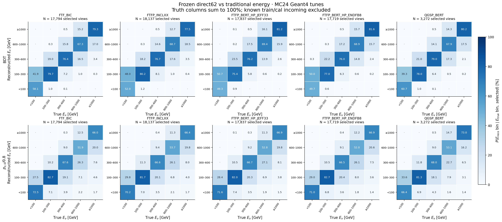
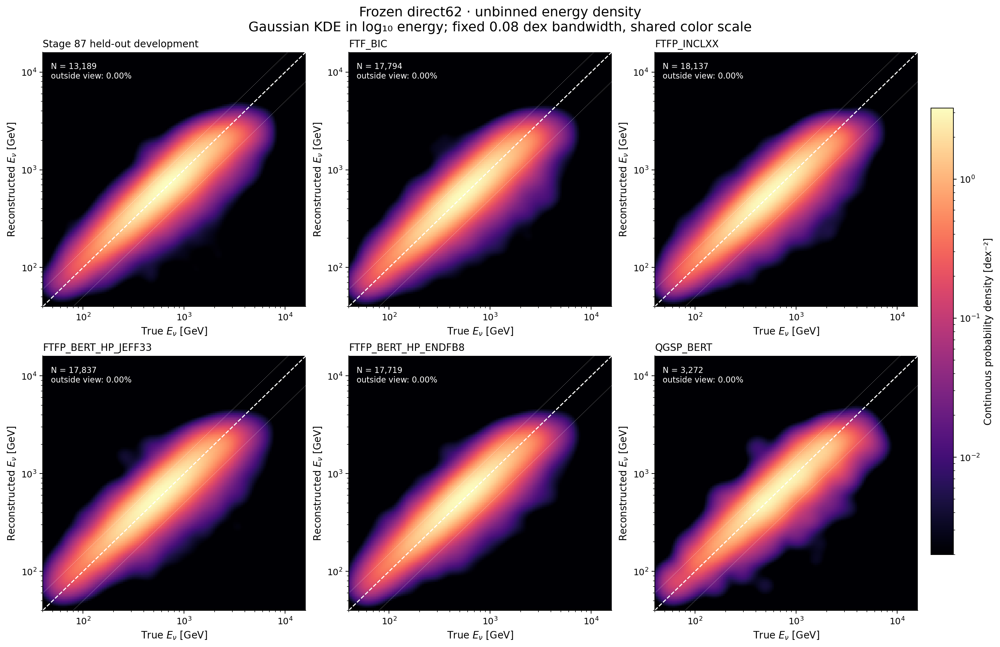
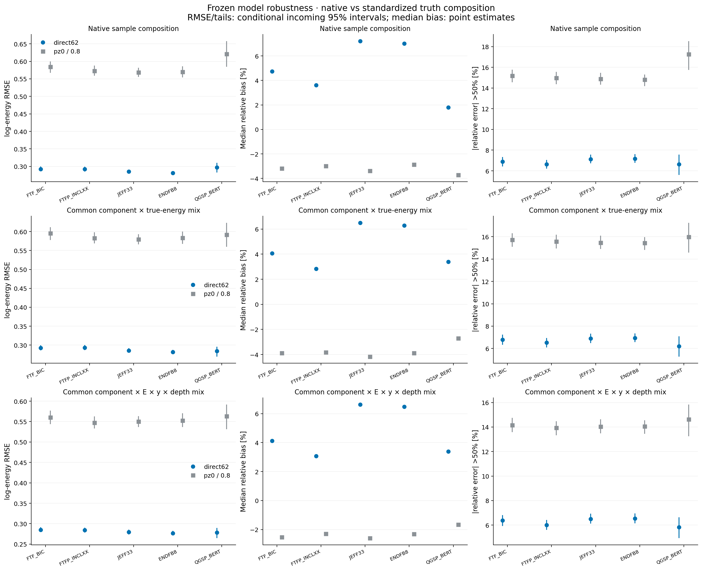
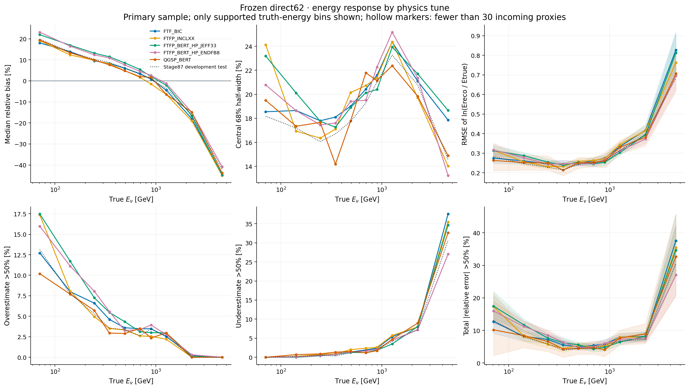
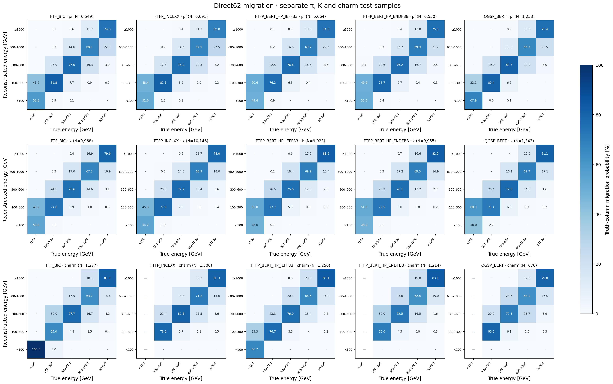

# Stage125：冻结 Stage87 direct62 的 Geant4 tune 性能评估

日期：2026-11-06。工作模型固定为 Stage87 direct62 三 seed ensemble；本轮不改善、训练或重新校准 BDT。本阶段已完成兼容生产、固定模型推理、独立统计验证及图集。

## 阶段目标

使用用户指定的 15 个 run（FTF_BIC、FTFP_INCLXX、FTFP_BERT_HP_JEFF33、FTFP_BERT_HP_ENDFB8、QGSP_BERT，各含 π/K/charm）检验现有模型的能量响应、偏差、分辨率和大尾，并将样本组成变化与相同粗真值条件下的响应变化分别量化。

## 冻结模型与表示

模型：`ml/artifacts/stage87/direct_2026110255.ubj`、`direct_2026110256.ubj`、`direct_2026110257.ubj`，每 seed 400 轮。先把每 seed 的 float32 logE 预测提升到 float64，再求均值，最后加原固定 log 校准 **0.025193690596001274**；没有对新 tune 拟合 offset。性能采用与 Stage87 一致的 incoming 总权重1口径，未将所列10 ab⁻¹标称曝光直接用于绝对率；QGSP额外纳入已知文件采样概率。独立生成曝光和完整 GenWeights/截面归一化不在本轮测量范围。使用原 62 维 `F7_pz0_raw_v1`，raw/status、合法 signed 值、typed NaN 和 Calo 缺项传播均沿用原实现。传统参照为 `pz0/0.8`。完整原 active 预测已逐元素与 Stage87 缓存核对。

## 输入、采样和兼容生产

起始仓库为 `730a0a0`；工作期间其他任务在共享仓库提交 Stage126 `0ce821e` 和 Stage127 `b09aead`，本阶段不修改或纳入这些任务内容。输入基址 `/eos/experiment/fasernu-data0/faser/sim/mc24/genie`。合同、实际路径和固定采样见 [protocol.json](stage125_energy_ml/protocol.json)。前四组共 **604** 个 PHYS/RDO 来源全部纳入；现成 PHYS 是 backward 表示，不能直接喂给 merge/noIFT 模型。统一采用既有官方 d32 Calypso 构建，RDO→reco→merge/noIFT，不重新编译。仅以原真值 νμ/pz>50 GeV/r<100 mm/z 的保守超集减少重建 I/O，不按重建质量、能量误差或预测筛输入；父分母和原全部选择保留。

QGSP 三 run 没有电子 RDO/REC/PHYS，只有 HITS。固定 seed **2026110625**，π/K/charm 各均匀无放回抽 **100** 个完整 HITS 文件，原池分别 **560/760/190** 文件，纳入率 **0.1785714286/0.1315789474/0.5263157895**。每个文件完整数字化，随后真值超集稀疏重建；不使用已被 Stage119 证明改变噪声流的稀疏数字化捷径。两类共 **904** 个正式作业，不把不同采样率混成未经校正的总体谱。用于真值清单的 PHYS 与抽中 HITS 文件逻辑大小合计 **997515635063 B**，不包含配套 RDO 的文件大小，也不是实际读出/网络字节测量。

每 run 读取实际 COOL 01/03-LG payload，验证 native `E/q=330/charge_ref`，按 payload 比一次转换到模型的 01-LG 表示，无 truth/residual 拟合缩放。复用 Stage119 已验证的选择、单位、身份和 62 维提取实现。15 run 各 **40 父事件** pilot 已全 exit0；typed62、run/event/incoming 精确关联和校准检查通过。π/K 的 QGSP pilot 最终选择均为0，charm为1，不据此换源；前四组各 pilot 选择1。详见 [pilot_audit.json](stage125_energy_ml/pilot_audit.json)。

制作日志 [producer_evidence.json](stage125_energy_ml/producer_evidence.json) 记录每个 run 首份模拟日志显示：各成分五 tune 使用相同路径的 GENIE EVNT 输入，几何 FASERNU-04、模拟 global tag OFLCOND-FASER-04。前四组原模拟提交 `54a9026b`，QGSP 为较早 `b7436487`；本轮统一下游重建不能消除全部上游版本/数字化差异。因此结果是现有物理样本的稳健性检查，不自动等于只改变 physics list 的随机干预。

## 统计定义和图表约定

主样本排除与 Stage87 实际 train/cal 任一 incoming `(PDG,px,py,pz)` native-MeV 精确匹配的事件，包括跨 tune 匹配；同时保留 all-selected 诊断。一个 tune 内同 incoming 的多响应视图合计一单位，再乘对应成分的文件纳入率倒数。精确 incoming 是依赖代理，不是完整 GENIE 末态、顶点或祖先认证。原 test 也属已曝光开发参照，不称全新 blind。

固定真能箱 × π/K/charm 单元，以五 tune 归一化质量的逐单元最小值构造共同分布，未支持单元不外推。该标准化只控制粗 E/成分，不消除单元内能谱、y、深度和制作版本变化。另报告共同 selected incoming 的配对响应及覆盖，不将其当选择效率。补充匹配事前冻结在 [secondary_matching_protocol.json](stage125_energy_ml/secondary_matching_protocol.json)，沿用 Stage119 的 y=[.2,.5,.8]、z=[−2200,−1950] mm 边界，在 E/成分之外控制粗 y/深度；未知 y 单列保留，不用缺标签删事件。该补充在任何 Stage125 新模型前向/风险观察前冻结，不改变原主样本与原 E/成分对照。

自然 log-RMSE、相对偏差 median、R68=(q84−q16)/2、总/正/负相对误差>50% 尾率均保留困难侧及高能端。500 次共同 incoming Poisson bootstrap 在 tune 间共享 multiplier；区间仅条件于固定模型、校准及已提供的响应混合，不含完整 source/parent、重训、研究选择或全物理系统学。source/incoming 连通结构另测，不将文件数或权重 ESS 当作独立生成数。共同分布权重在 bootstrap 中固定，区间不含匹配目标/权重估计误差；全部95%区间为逐项区间，不具有全图同时95%覆盖。

迁移矩阵横轴真 Eν、纵轴重建 Eν，按真值列归一化，参考 [PRD §VI.C Eqs.(9–10)](../docs/Electronic_2D_measurement_PRD-2.pdf) 和 [internal note §7.2](../docs/Electronic_2D_measurement_internal_note-6.pdf) 的条件概率归一化；具体方格及投影区别如下。绝对能量方格采用 [0,100,300,600,1000,∞) GeV，并补细能箱；它是能量响应投影，不是原论文的 signed inverse-energy × rapidity 30×30 unfolding 矩阵。∞ 溢出保留，无支持列与真实零概率区分。

无能量 bin 的热力图用所有事件在 log10(Etrue),log10(Ereco) 中的 Gaussian KDE，所有 tune 固定 **0.08 dex** 带宽；栅格只是连续密度的数值显示，共享色标，不把它冒充 2D 分箱计数。另交付全部事件散点，不抽稀、不平滑；绘图范围外权重明确记录，全部事件仍参与性能指标。

## 实际结果与物理解释

正式 **904** 个来源全部返回，非零退出 **0**；最终 selected **201,874** 条，剔除已知 Stage87 train/cal incoming 响应 **127,115** 条后，主样本 **74,759** 条。原 Stage87 active 三模型 raw/cal 逐元素复现；原开发 test 的 direct log-RMSE **0.287491236**。以下数值全部来自实际缓存/输出，没有新拟合。

| tune | 主样本行 | 唯一 incoming 代理 | 已知 train/cal 重叠行 | 已知原 test 重叠行 | E/成分匹配 ESS | E/成分/y/z 匹配 ESS |
|---|---|---|---|---|---|---|
| FTF_BIC | 17794 | 10860 | 30536 | 11657 | 13705.1 | 13252.9 |
| FTFP_INCLXX | 18137 | 10993 | 30770 | 11855 | 13880.9 | 13428.8 |
| JEFF33 | 17837 | 10876 | 30160 | 11654 | 13730.0 | 13303.7 |
| ENDFB8 | 17719 | 10810 | 30285 | 11640 | 13635.8 | 13168.0 |
| QGSP_BERT | 3272 | 2953 | 5364 | 1859 | 2666.0 | 2616.5 |

### 原样本组成，按 incoming/纳入率加权

| tune | direct log-RMSE [条件95%] | 传统 log-RMSE | direct median bias % | direct R68 % | direct 总尾 % | direct 正/负尾 % |
|---|---|---|---|---|---|---|
| FTF_BIC | 0.2922 [0.2859,0.2996] | 0.5844 | 4.74 | 21.97 | 6.89 | 4.25 / 2.64 |
| FTFP_INCLXX | 0.2921 [0.2855,0.2991] | 0.5725 | 3.61 | 22.10 | 6.63 | 3.74 / 2.89 |
| JEFF33 | 0.2853 [0.2793,0.2911] | 0.5683 | 7.21 | 22.37 | 7.13 | 5.01 / 2.11 |
| ENDFB8 | 0.2812 [0.2758,0.2868] | 0.5698 | 7.01 | 22.32 | 7.17 | 4.92 / 2.25 |
| QGSP_BERT | 0.2975 [0.2825,0.3102] | 0.6210 | 1.80 | 22.43 | 6.64 | 3.22 / 3.42 |

### 共同 E × 成分分布

| tune | direct log-RMSE [条件95%] | 传统 log-RMSE | direct median bias % | direct R68 % | direct 总尾 % | direct 正/负尾 % |
|---|---|---|---|---|---|---|
| FTF_BIC | 0.2926 [0.2863,0.2996] | 0.5953 | 4.07 | 22.13 | 6.79 | 4.03 / 2.75 |
| FTFP_INCLXX | 0.2934 [0.2866,0.3005] | 0.5829 | 2.82 | 22.23 | 6.52 | 3.49 / 3.03 |
| JEFF33 | 0.2855 [0.2795,0.2919] | 0.5798 | 6.50 | 22.33 | 6.90 | 4.66 / 2.23 |
| ENDFB8 | 0.2818 [0.2766,0.2875] | 0.5838 | 6.28 | 22.43 | 6.94 | 4.57 / 2.37 |
| QGSP_BERT | 0.2841 [0.2697,0.2960] | 0.5919 | 3.39 | 21.41 | 6.21 | 3.49 / 2.72 |

### 共同 E × 成分 × y × 深度分布

| tune | direct log-RMSE [条件95%] | 传统 log-RMSE | direct median bias % | direct R68 % | direct 总尾 % | direct 正/负尾 % |
|---|---|---|---|---|---|---|
| FTF_BIC | 0.2849 [0.2792,0.2916] | 0.5602 | 4.12 | 21.71 | 6.37 | 3.81 / 2.56 |
| FTFP_INCLXX | 0.2841 [0.2781,0.2904] | 0.5474 | 3.07 | 21.81 | 6.01 | 3.24 / 2.77 |
| JEFF33 | 0.2794 [0.2738,0.2855] | 0.5501 | 6.64 | 21.95 | 6.50 | 4.42 / 2.08 |
| ENDFB8 | 0.2765 [0.2713,0.2823] | 0.5527 | 6.47 | 21.93 | 6.54 | 4.33 / 2.21 |
| QGSP_BERT | 0.2783 [0.2645,0.2897] | 0.5630 | 3.39 | 21.19 | 5.82 | 3.29 / 2.53 |

E/成分共同 overlap mass **0.873094**；再控制 y/深度后 **0.814557**。这两个量衡量匹配前共有归一化质量，不是事件选择效率或独立样本比例。

### 低能与困难侧

| tune | true50–100 direct/传统 log-RMSE | true100–200 direct/传统 | 低pz真≥200 direct/传统 | high-y direct/传统 | unconfirmed direct/传统 |
|---|---|---|---|---|---|
| FTF_BIC | 0.2745 / 0.1474 | 0.2603 / 0.2547 | 0.5828 / 1.8556 | 0.5953 / 1.5462 | 0.5437 / 1.5747 |
| FTFP_INCLXX | 0.3140 / 0.1732 | 0.2559 / 0.2524 | 0.5963 / 1.8166 | 0.5773 / 1.4753 | 0.5410 / 1.5176 |
| JEFF33 | 0.3128 / 0.1527 | 0.2871 / 0.2444 | 0.5375 / 1.7809 | 0.5430 / 1.5081 | 0.4971 / 1.5219 |
| ENDFB8 | 0.3161 / 0.1504 | 0.2775 / 0.2441 | 0.5504 / 1.8024 | 0.5440 / 1.5160 | 0.4810 / 1.5234 |
| QGSP_BERT | 0.2628 / 0.1520 | 0.2520 / 0.2655 | 0.5849 / 1.8854 | 0.5874 / 1.6173 | 0.5007 / 1.5961 |

### tune 差异的相关区间

| 组成控制 | tune / JEFF33 | direct log-RMSE 比 [条件95%] | direct 总尾差 pp [条件95%] |
|---|---|---|---|
| primary | FTF_BIC | 1.0239 [0.9978,1.0517] | -0.24 [-0.76,0.33] |
| primary | FTFP_INCLXX | 1.0238 [0.9979,1.0507] | -0.50 [-1.07,0.04] |
| primary | ENDFB8 | 0.9854 [0.9623,1.0095] | 0.04 [-0.54,0.62] |
| primary | QGSP_BERT | 1.0425 [0.9867,1.0888] | -0.49 [-1.60,0.58] |
| standardized | FTF_BIC | 1.0248 [0.9993,1.0519] | -0.11 [-0.66,0.44] |
| standardized | FTFP_INCLXX | 1.0277 [1.0026,1.0542] | -0.38 [-0.92,0.17] |
| standardized | ENDFB8 | 0.9871 [0.9650,1.0109] | 0.04 [-0.47,0.58] |
| standardized | QGSP_BERT | 0.9951 [0.9451,1.0383] | -0.69 [-1.77,0.28] |
| fully_standardized | FTF_BIC | 1.0196 [0.9932,1.0465] | -0.13 [-0.64,0.40] |
| fully_standardized | FTFP_INCLXX | 1.0169 [0.9893,1.0430] | -0.49 [-1.04,0.04] |
| fully_standardized | ENDFB8 | 0.9896 [0.9666,1.0126] | 0.04 [-0.49,0.59] |
| fully_standardized | QGSP_BERT | 0.9961 [0.9493,1.0416] | -0.68 [-1.72,0.27] |

JEFF33 只是事前固定的比较基准，不是宣称其为 Stage87 的训练物理模型。区间跨1/0代表本条件统计下未分辨该差异，不是等效性/非劣认证。多个能区与指标的区间未作全局同时覆盖修正，探索性逐项显著不能单独升级为全局系统学结论。

### 选择与组成

| run | tune | 成分 | 实际父条数 | fiducial CC νμ pz>50 条数 | selected | fiducial 选择效率 % |
|---|---|---|---|---|---|---|
| 200104 | FTF_BIC | pi | 559607 | 79676 | 19157 | 24.04 |
| 200105 | FTF_BIC | k | 752808 | 83123 | 25804 | 31.04 |
| 200106 | FTF_BIC | charm | 180947 | 10575 | 3369 | 31.86 |
| 200107 | FTFP_INCLXX | pi | 559607 | 79675 | 19401 | 24.35 |
| 200108 | FTFP_INCLXX | k | 752808 | 83123 | 26032 | 31.32 |
| 200109 | FTFP_INCLXX | charm | 180947 | 10575 | 3474 | 32.85 |
| 200110 | JEFF33 | pi | 559607 | 79674 | 19171 | 24.06 |
| 200111 | JEFF33 | k | 752808 | 83123 | 25465 | 30.64 |
| 200112 | JEFF33 | charm | 180947 | 10575 | 3361 | 31.78 |
| 200113 | ENDFB8 | pi | 559607 | 79674 | 19000 | 23.85 |
| 200114 | ENDFB8 | k | 752808 | 83123 | 25652 | 30.86 |
| 200115 | ENDFB8 | charm | 180947 | 10575 | 3352 | 31.70 |
| 200213 | QGSP_BERT | pi | 100000 | 14175 | 3425 | 24.16 |
| 200214 | QGSP_BERT | k | 99000 | 10922 | 3395 | 31.08 |
| 200215 | QGSP_BERT | charm | 96947 | 5775 | 1816 | 31.45 |

[selection_yields.tsv](stage125_energy_ml/selection_yields.tsv) 的分母先于任何 BDT 与重叠排除，使用原累计真值条件；是制作视图效率，不是完整生成家族独立二项效率。QGSP 采样、空文件、原文件末尾不足1000/10000事件均按实际父计数保留。

### 有数据支持的阶段结论

1. **现有模型在五组样本上均保留整体收益，但尚不能认证全物理鲁棒性。** 原组成 direct log-RMSE 范围 0.2812–0.2975，传统法为 0.5683–0.6210。共同 E/成分/y/深度组成下，全部非基准 tune 的整体 log-RMSE 比值区间覆盖1；这只说明当前条件统计未分辨整体差异，未预设容许误差的等效性检验没有进行。

| tune | 绝对能量方格 direct 同箱率 % | 传统同箱率 % |
|---|---|---|
| FTF_BIC | 75.23 | 67.06 |
| FTFP_INCLXX | 75.17 | 66.95 |
| JEFF33 | 74.92 | 67.03 |
| ENDFB8 | 75.16 | 66.83 |
| QGSP_BERT | 76.37 | 68.27 |

同箱率使用所示[0,100,300,600,1000,∞) GeV绝对能量方格、主样本原组成和 incoming/纳入率权重；它依赖分箱和入射谱，不是无条件选择效率或完整30维 unfolding 的精度。

| tune | 50–100 GeV incoming 数 | 50–100 GeV median bias % | 共同 E/成分/y/z 下50–100 log-RMSE / JEFF33 [条件95%] | 3200–6400 GeV incoming 数 | 3200–6400 GeV median bias % |
|---|---|---|---|---|---|
| FTF_BIC | 291 | 18.06 | 0.8701 [0.7722,0.9935] | 86 | -44.74 |
| FTFP_INCLXX | 294 | 19.11 | 0.9874 [0.8994,1.1132] | 84 | -45.01 |
| JEFF33 | 289 | 21.96 | 1.0000 [1.0000,1.0000] | 85 | -44.81 |
| ENDFB8 | 288 | 23.17 | 1.0408 [0.9252,1.1689] | 82 | -40.84 |
| QGSP_BERT | 49 | 19.39 | 0.7376 [0.6063,0.8741] | 45 | -43.83 |

2. **低能区仍有正偏与 tune 依赖，高能端有负偏。** 在所选50–100 GeV样本中，所有 tune 的 direct log-RMSE 均劣于传统法（见低能表）；整体收益不能外推为每个能区的收益。原选择包含重建 pz0>50 GeV，该低能比较条件于这一选择，不能直接外推全生成低能总体。上表低能差异在进一步控制粗 y/深度后仍存在，因此只用总体平均或粗 E/成分差异不足以解释全部观测。能量估计包含 μ 子与强子淋浴信息，强子级联、低能中子与可见能量响应变化是物理上可能的机制；本轮没有逐粒子能量账本，不能将某一机制确认为原因。3200–6400 GeV高能负偏在五组均出现，与现有模型的能区响应压缩一致；≥6400 GeV在主样本没有支持，性能未测量。超出训练能区和非线性响应各自贡献未测量。QGSP 的低能 incoming 数较少，不能据单个能区排序宣称某 physics list 更正确。

3. **程序与物理制作差异需分别看待。** 62维表示、实际 payload 转换、原预测复现和逐行身份验证排除了本轮已检查的表示/校准错误；它们不能消除原模拟提交不同、顶点/种子与 GENIE 完整末态未认证等混杂。相同 incoming 的配对图只约束该代理，保留两侧选择条件，不能单独解释选择损失。

4. **统计精度有明确边界。** source/incoming 图中 π、K、charm 各仅一个连通块，不能把904文件当904个独立生成块。完整 source/parent 稳健95%区间、全物理系统学与匹配估计误差均为**未测量**；本报告区间仅为固定模型、固定匹配目标下的 incoming 条件区间。

原 Stage87 已曝光 test 参照中，50–100 GeV的 median bias 为 **19.88%**，3200–6400 GeV为 **-42.01%**。两端偏差在原模型参照中已存在，不能全部归因于新 tune；能量曲线保留该参照作直观比较，不把两组不同组成的点估计当作配对因果差。

用户清单 run200104 标称560154事件，实际可用父记录为 **559607**，相差 **547**；按实际记录报告，没有把该差异当效率损失或擅自补到标称曝光。

## 图集与实际验证

完整浏览入口：[完整图集](stage125_energy_ml/index.html)。每图提供 PNG/PDF，固定色标、真值横轴、重建纵轴；PDF可直接用于讨论/汇报。











其他产物包含传统法连续密度与能区曲线、细箱迁移、全部事件散点、tune 差异矩阵、正负尾、selection、stability/purity、62列输入响应/缺失率及分成分响应。逐图定义见 [figure_catalog.json](stage125_energy_ml/figure_catalog.json)。

独立验证 [independent_validation.json](stage125_energy_ml/independent_validation.json)：通过 **True**；主样本 train/cal incoming 交集 **0**；行空间点值与聚类计算最大差 **4.62e-14**，95%区间边界最大差 **7.3e-13**；全部有支持的真值列概率和为1。训练模型和校准参数保持原值。

新样本三模型总推理 wall **6.014261 s**、吞吐 **33565.88 selected events/s**（含三模型读取和 DMatrix；4线程CPU，无GPU）；整个评估 Python process CPU **74.678 s**、wall **77.249 s**、峰 RSS **775732 KiB**。

| 正式步骤 | 逐步 CPU 秒合计 | 逐作业步骤 wall 秒合计 | 最大单步骤 RSS KiB |
|---|---|---|---|
| reco | 408151.11 | 432550.09 | 1361888 |
| ntuple | 95284.13 | 99013.72 | 1099184 |
| extract | 10869.24 | 14717.58 | 662060 |
| parent | 33291.83 | 59147.81 | 1779208 |
| digi | 221617.54 | 230578.81 | 2049464 |

整作业 Condor 账本 [condor_resources.json](stage125_energy_ml/condor_resources.json)：历史 **925** 条、移除 **2** 条、当前队列 **0** 条；整作业总 CPU **788967.0 s = 219.157 CPU h**，wall逐作业之和 **923873.0 s**。它包含 pilot/重跑/统计等已结束任务；不与上表再相加。完整实际网络字节、全集群同时峰内存、GPU加速比和全物理系统误差 **未测量**。

最终 **16** 组图采用4进程计算独立 KDE，图集内部计时 **419.074 s**。两种能量方法各有64个查询点逐值复算，与并行结果完全相同。903来源预览串行绘图计时494.58 s；最终输入和图数略有增加，此比较仅为工程计时记录，不是严格同输入加速比。GNU整进程计时与峰RSS见 [plot_time.txt](stage125_energy_ml/plot_time.txt)。保留紧凑 NPZ/审计和最终图表，生产 ROOT/xAOD 临时文件均由 worker 退出清理；缓存目录不提交Git。

实际紧凑产物：904份 selected/审计来源压缩包共 **69159234 B**，三个可复用 NPZ 共 **58162365 B**，最终 PNG/PDF 共 **7597547 B**。已回收的 preview/evaluate/plot 传输包不作为额外事件副本保留；回收文件清单保存在 transfer.json 中。

最终迁移图直接从已独立验证的 [matrices.tsv](stage125_energy_ml/matrices.tsv) 汇总表渲染；无支持列使用灰底短横线，真实零概率保留概率色标。最后的迁移矩阵与能量曲线汇总表绘图属于本地小规模可视化检查，另记 [matrix_render_time.txt](stage125_energy_ml/matrix_render_time.txt) 和 [profile_render_time.txt](stage125_energy_ml/profile_render_time.txt)，未重新处理事件，不计入上面的 Condor 账本。相同 incoming 的配对响应见 [paired_response_shift.pdf](stage125_energy_ml/paired_response_shift.pdf)，其中色带为事件中央68%离散范围，不是置信区间。

## 复现与下一步

```bash
python3 ml/stage125_inventory.py
python3 ml/stage125_submit.py pilot
python3 ml/stage125_submit.py production --indices {0..603}
python3 ml/stage125_submit.py production --indices {604..903}
# 正式作业完成后：
python3 ml/stage125_report_submit.py evaluate
python3 ml/stage125_report_submit.py evaluate --collect
python3 ml/stage125_report_submit.py plot
python3 ml/stage125_report_submit.py plot --collect
python3 ml/stage125_resources.py
python3 ml/stage125_report.py
```

提交目录为 `~/condor/nu_muAnalysis/stage125/`。903来源工程预览统计/绘图为 **9670210.0/9670212.0**，最终904来源统计及独立验证为 **9670239.0**，最终全图绘制为 **9670240.0**。正式 cluster **9670195.0–603**、**9670197.0–299**，pilot **9670194.0–14**。两个位于相同worker的原任务在>30分钟内仅6/2 user CPU秒，疑似主机/CVMFS/I/O停滞，已移除并以相同输入、相同原冻结包在其他worker重交为 **9670203.0–1**；不是物理失败或换源，见 [host_stall_recovery.json](stage125_energy_ml/host_stall_recovery.json)。每生产任务 1 CPU/3000 MB/7200 s；归并/统计及最终绘图提交描述请求4 CPU/6000 MB，调度器实际 `RequestMemory` 为12000 MB（见最终资源账本），全部大规模事件工作在 Condor。GPU 未用于本轮，GPU 相对加速未测量；native 读出/重建为当前主要工作量。

本阶段验收：904 来源全部有父分母和明确退出状态；全原模型预测逐行复现；主样本 train/cal incoming 重叠为0；独立行空间验证加权点值与 bootstrap 区间；所有迁移列归一化；审阅实际 PNG/PDF；完成中文测量报告及一次 Conventional Commit。

后续具体任务（本阶段未启动，不改变冻结BDT）：

1. 核对跨 tune 的完整生成末态、顶点及 Geant4/数字化随机种子。所需输入为原 EVNT、HITS event metadata 和制作配置；验收标准为逐事件关联表，并明确哪些响应可以作为只变 physics list 的配对，哪些仍有版本/种子混杂。
2. 为低能区建立可见能量账本。所需输入为上述已认证配对事件的 μ 子、强子、中子、不可见能量及探测器读出真值；验收标准为能量闭合数值及50–100、100–200 GeV偏差差异的物理/程序分解，未解释部分继续标明未知。
3. 如需更精确的 QGSP 低能结论，按事前固定的文件纳入规则扩充剩余现有 HITS，沿用相同模型、重建和选择；验收标准为报告新增 incoming 数、区间宽度和对当前低能差异的稳定性，不按表现挑源，不重拟合模型或校准。
