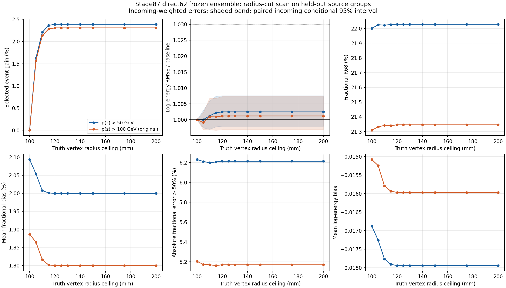
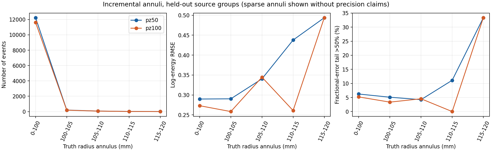

# Stage126：固定 stage87 direct62，扫描 truth 顶点半径 cut

日期：2026-11-06。起点提交 `730a0a0`。本阶段按用户要求研究分析选择对能量重建的影响，不重新训练模型。

## 1. 阶段目标与结论

**对当前 nominal MC 的整体分析，推荐将 `Truth dec r < 100 mm` 放宽到 `r < 125 mm`。** 120 mm 是几乎等价的较紧工作点。保留其他 cuts 时，125 mm 已取得几乎全部可获得的统计增益，继续增加到 140 mm 或完全去掉半径上限只增加 1 个事件。

按原分析的 truth/reco 双 `pz > 100 GeV` 选择，全样本通过数 **77,298 → 79,089，增加 1,791（2.3170%）**。对未用于本模型参数拟合的来源组测试样本，通过数 **11,617 → 11,885，增加 268（2.3070%）**；incoming 加权 log-RMSE **0.273002 → 0.273326，增加 0.1189%**，配对条件 95% 区间为 **−0.3117% 到 +0.7301%**。核心 fractional R68 **21.3087% → 21.3460%**，绝对分数误差大于 50% 的尾部 **5.2051% → 5.1706%**。

这支持“统计量略有增加，整体能量重建代价很小”，但不是所有子样本都已获相同精度保证。charm、铅块区域的分层统计尤其有限，详见第 6 节。当前物理样本没有变成新的独立盲测；来源相关性、真实接受度和背景系统误差未测量。

本阶段产出扫描与建议；生产配置中的默认 100 mm cut 保持原值。研究配置单独位于 `workbook/stage126_energy_ml/scan_cuts.yaml`。

## 2. 固定模型、输入与选择

模型为 `ml/artifacts/stage87/direct_202611025{5,6,7}.ubj`，即三个 400-round direct62 BDT 的 log-energy 预测取均值，再加原 stage87 的固定校准 **0.025193690596001274**。特征及 typed cleaning 完整沿用 `ml/configs/audited_features.json` 和 `audited_features.build`；没有新拟合、重新校准、改 seed 或调模型参数。

读取现存 stage55/56 nominal PHYS 的 **254 文件、2,521,976 个输入事件**。输入位于仓库 `ntuples/merge_mc24_master_d32b0ff3/<run>/*PHYS.root`（与 `/eos/user/x/xcheng/FASER/nu_muAnalysis/` 同一项目）；精确路径和来源分组见 [protocol.json](stage126_energy_ml/protocol.json) 与 [sources.tsv](stage126_energy_ml/sources.tsv)。

| run | 文件数 | 组件 |
|---|---:|---|
| 200082 | 48 | pi |
| 200083 | 65 | k |
| 200089 | 16 | charm |
| 200093 | 47 | pi |
| 200094 | 63 | k |
| 200100 | 15 | charm |

使用现成 `build/analysis`（源码未变，无需重新构建），以原生 C++/YAML 定义进行选择和 snapshot，再以原工具建立 audited62 特征。只有 truth 半径条件改为有限值检查 `std::isfinite(truth_dec_r)`；原 cut 名在原生 cutflow 中保留，但扫描配置记录了真实表达式。`truth_dec_r = sqrt(truth_dec_x[0]^2 + truth_dec_y[0]^2)`，单位 mm；不是径迹在 IFT/VetoNu 的半径。

同时报告两个选择：

- `pz50`：stage55/87 的 truth/reco 双 `pz > 50 GeV` 选择，其他 cuts 原样保留。
- `pz100`：将上述 truth/reco 两个动量阈值同时恢复到原来的 `>100 GeV`，供用户原 cut flow 的直接比较。

扫描半径为 **100、105、110、115、120、125、130、140、150、175、200、250、300、425 mm**。425 mm 覆盖既定 truth box/lead 区域的全部有限半径；实际最终通过事件的最大半径为 **133.528048 mm**。

本阶段扫描 nominal 样本。stage87 训练中的 stage70/81/82/83 支持仍属于被冻结模型的训练历史，但没有把这些支持的原有 selected 缓存当作新增半径覆盖，也没有宣称本结论适用于所有替代生成器或 data。

## 3. 分区、权重与指标

沿用 stage87 来源组分配：178 train 文件、38 cal 文件、38 test 文件；cal/test 分别各 19 个 canonical group。测试组在扩展半径后有 12,527 条记录，其中 **4 条** incoming 与冻结模型的 train/cal 记录相同，排除这些重叠后保留 **12,523** 条。cal 原有 12,785 条，排除与冻结 train/test 及扩展 test 的 incoming 重叠后保留 **10,704** 条。隔离仅依据身份和角色，未按能量误差删除事件。

同一 native-MeV incoming `(pdg,px,py,pz)` 在每个评价选择内总权重为 1。通过事件数按记录计数；误差主表按 incoming 加权，同时在 `scan.tsv` 另存 record-weighted RMSE。全样本表包含训练记录，只用于描述产额与 cut flow，能量重建结论主要取 test。不能用全样本较低的 RMSE 代替留出结果。

定义 `e = ln(Ereco/Etruth)`，log-RMSE 为 `sqrt(<e²>)`；fractional R68 为 `[(Ereco/Etruth−1)84% − (Ereco/Etruth−1)16%]/2`；尾部为 `|Ereco/Etruth−1|>0.5`。表中的相对误差增幅是 **RMSE 的相对变化**，不是分数能量误差增加若干百分点。

用 **500 次 incoming-key Poisson 配对重采样**，各嵌套阈值共享同一批 key multiplier，seed `20261106126`。区间条件于现有来源和响应混合；没有声称估计 source/systematic 95% 区间。分层区间亦未做多重比较校正。

工作点规则为：在 cal 上分别要求 RMSE 比值的条件 95% 上界不超过 **1.01、1.03、1.05**，尾部增加上界不超过 **2 个百分点**；在合格点中最大化通过数，同产额取最小半径。三个预算均选到 **125 mm**，test 总体也满足相同预算。这个规则只处理整体误差预算；不等价于每个物理子层都满足 1% 上限。

## 4. 半径扫描实测

下面能量指标均为 test、incoming 加权；全样本通过数是 254 个 nominal 文件的记录总数。

### 原分析的双 pz > 100 GeV

| r 上限 (mm) | 全样本通过数 | 相对 100 mm 增益 | test 通过数 | test log-RMSE | test fractional R68 | test >50% 尾部 |
|---:|---:|---:|---:|---:|---:|---:|
| 100 | 77,298 | 0 | 11,617 | 0.273002 | 21.3087% | 5.2051% |
| 105 | 78,516 | 1.5757% | 11,799 | 0.272764 | 21.3322% | 5.1743% |
| 110 | 78,966 | 2.1579% | 11,865 | 0.273259 | 21.3418% | 5.1704% |
| 115 | 79,081 | 2.3067% | 11,882 | 0.273241 | 21.3402% | 5.1628% |
| 120 | 79,088 | 2.3157% | 11,885 | 0.273326 | 21.3460% | 5.1706% |
| **125** | **79,089** | **2.3170%** | **11,885** | **0.273326** | **21.3460%** | **5.1706%** |
| 140 / 无上限 | 79,090 | 2.3183% | 11,885 | 0.273326 | 21.3460% | 5.1706% |

125 mm 取得可新增 1,792 个事件中的 **1,791 个（99.9442%）**。120 mm 比 125 mm 只少 **1 个**全样本事件，二者 test 完全相同。125 mm 相对 100 mm 的平均 fractional bias **+1.8867% → +1.7998%**；尾部变化 **−0.0345 pp**，其条件 95% 区间 **[−0.0864,+0.0295] pp**。独立 incoming 数 **10,580 → 10,844**。

原始输入事件为共同分母时，通过比例 **3.06498% → 3.13599%**，增加 **0.07102 个百分点**。这是本批 MC 的选择通过比例，没有 luminosity/flux 归一化，不能直接当作 data 预期产额或截面效率。若只按记录数估算理想计数统计误差，其比例约为 `sqrt(77298/79089)=0.9886`，收益约 1.14%；真实能谱测量总误差未测量。

### stage87 对应的双 pz > 50 GeV

| r 上限 (mm) | 全样本通过数 | 相对 100 mm 增益 | test 通过数 | test log-RMSE | test fractional R68 | test >50% 尾部 |
|---:|---:|---:|---:|---:|---:|---:|
| 100 | 81,313 | 0 | 12,231 | 0.289756 | 22.0007% | 6.2292% |
| 110 | 83,159 | 2.2702% | 12,501 | 0.290107 | 22.0231% | 6.1975% |
| 115 | 83,290 | 2.4313% | 12,520 | 0.290398 | 22.0272% | 6.2052% |
| 120 | 83,297 | 2.4400% | 12,523 | 0.290470 | 22.0290% | 6.2123% |
| **125** | **83,299** | **2.4424%** | **12,523** | **0.290470** | **22.0290%** | **6.2123%** |
| 140 / 无上限 | 83,300 | 2.4436% | 12,523 | 0.290470 | 22.0290% | 6.2123% |

125 mm 新增 **1,986 条**全样本事件，取得可增加统计量的 **99.9497%**。test 增加 **292 条（2.3874%）**，独立 incoming 数 **11,167 → 11,455**；RMSE 增幅 **0.2465%**，条件 95% 区间 **[−0.2051%,+0.7546%]**。尾部变化 **−0.0169 pp**，条件 95% 区间 **[−0.0827,+0.0481] pp**。

以共同 truth parent（CC、nu_mu、box/lead、truth pz>50，半径无上限）**618,779** 条为分母，通过比例 **13.1409% → 13.4618%**。输入 raw 为分母则为 **3.22418% → 3.30293%**。分母固定，避免放宽分母后把相对效率变化混淆为事件损失。



完整逐阈值指标与 CI：[scan.tsv](stage126_energy_ml/scan.tsv)；与传统 `pz/0.8` 的同时评价：[traditional.tsv](stage126_energy_ml/traditional.tsv)。

## 5. 为什么增益饱和，外圈是否更难重建

[原生 cutflow 对照](stage126_energy_ml/cutflow_comparison.tsv) 直接显示：放开半径后的额外候选在后续径迹几何选择中大幅减少。下面均为双 pz>50 的累计通过数差（无半径上限减去原 100 mm）：

| cut 后 | 额外候选数 |
|---|---:|
| truth pz >50 GeV | 325,376 |
| 至少一条 long track | 105,140 |
| track pz >50 GeV | 96,189 |
| chi2/ndof <15 | 91,252 |
| track 最大半径 <95 mm | 23,446 |
| track IFT 半径 <95 mm | 5,889 |
| track VetoNu 半径 <120 mm | 3,268 |
| track theta <25 mrad | 2,702 |
| 两个 VetoNu reduced-charge cuts 后 | 1,987 |

所以 truth 半径放松并不产生相应面积比例的最终产额增益。其后还要求径迹落在中心接受区；本次数据中 120–140 mm 已基本到达最终产额平台。这是 cutflow 实测支持的程序与几何原因，不能把 `truth r <100` 和 `track r <95` 当成相同条件互相替代。

外圈本身存在响应变化。原 pz>100 测试选择中，新增 `100≤r<125 mm` 的 **268 条**（264 incoming）log-RMSE 为 **0.286033**，高于内圈的 **0.273002**；其平均 log-bias 为 **−0.051502**，内圈为 **−0.015081**。更外侧 `105≤r<125 mm` 的 **86 条** log-RMSE 为 **0.337053**、平均 fractional bias 为 **−6.3747%**。但外圈占比很小，因此整体误差变化很小。

新增外圈的高 y 比例为 **23.6742%**，内圈为 **11.6342%**；unconfirmed 比例反而为 **0.7576%**（内圈 **2.0747%**）。这支持外圈存在不同的能量转移/运动学组成，不能把误差变化直接归因于主 muon 匹配变差。量热泄漏、径迹外推相关性等独立因果分解未测量。

另外固定原 100 mm 真能量谱组成（50、100、200、400、800、1600 GeV 分界）后，pz>100 test 的 log-RMSE **0.273002 → 0.273789，增加 0.2884%**；pz>50 为 **0.289756 → 0.290907，增加 0.3971%**。总体小幅变化并非完全来自能谱组成变化，但能谱混合确实会部分掩盖同能量层的退化。



新增环带有些只有 3、17、19 条事件，其点估计只作描述；所有事件保留，没有因离群事件删除分支或改 cut。详见 [annuli.tsv](stage126_energy_ml/annuli.tsv)、[added_response.tsv](stage126_energy_ml/added_response.tsv)。

## 6. 分层稳定性与适用边界

125 mm 对比 100 mm，test、incoming 加权：

| 选择与子层 | N100 → N125 | log-RMSE 相对变化 | 条件 95% 上界 |
|---|---:|---:|---:|
| pz>50，Eν=50–100 GeV | 170 → 176 | −1.3097% | −0.3341% |
| pz>50，Eν=100–200 GeV | 777 → 817 | +0.7233% | +3.2209% |
| pz>50，reco pz=50–100 GeV | 614 → 638 | +0.3140% | +1.7336% |
| pz>100，Eν=100–200 GeV | 613 → 644 | +0.3380% | +2.2498% |
| pz>100，reco pz=100–250 GeV | 2,248 → 2,345 | +0.3997% | +2.0733% |
| pz>100，高 y | 1,396 → 1,459 | +0.2376% | +1.7209% |
| pz>100，pi | 4,400 → 4,510 | −0.2196% | +0.1916% |
| pz>100，k | 6,541 → 6,679 | +0.0180% | +0.5616% |
| pz>100，charm | 676 → 696 | +1.9510% | +8.1630% |
| pz>100，nu box | 11,090 → 11,357 | −0.0092% | +0.5715% |
| pz>100，lead block | 527 → 528 | +2.9480% | +10.7942% |

因此“整体 RMSE 的条件上界小于 +1%”不能扩展成每个组件和材料区域同样受控。lead block 只新增 1 条事件，charm 只新增 20 条，保留它们并报告不足，不据此终止分支，也不将未知物理原因写成结论。若最终分析要求每个组件/区域单独达到 +1%，目前样本不足以认证 125 mm。完整分层点估计和 CI 见 [strata.tsv](stage126_energy_ml/strata.tsv)、[stratum_paired125.tsv](stage126_energy_ml/stratum_paired125.tsv)。

当前未测量：真实 data 上的可观测 fiducial 替代、各背景的接受度、r 相关 detector/interaction/FSI/flux 系统变化、完整 source 相关区间、未曝光样本确认、最终能谱或截面总不确定度。truth 半径本身不可直接用于 data；本阶段结果属于 signal-MC truth fiducial/接受度研究。

## 7. 执行、验证、资源与产物

实际执行入口（从仓库根目录）：

```bash
source setup_env.sh
export OMP_NUM_THREADS=1 OPENBLAS_NUM_THREADS=1 MKL_NUM_THREADS=1 ROOT_RDF_SNAPSHOT_INFO=0
/usr/bin/time -v -o workbook/stage126_energy_ml/pilot.time \
  python -u ml/stage126_radius.py --pilot 4 --workers 1
python3 ml/stage126_submit.py
# 上一条已提交 9670199.0–15；无需为重画图再次提交。
export OMP_NUM_THREADS=4 OPENBLAS_NUM_THREADS=4 MKL_NUM_THREADS=4
python ml/stage126_report.py
python ml/stage126_diagnostics.py
python ml/stage126_plot.py
python ml/stage126_validate.py
python3 ml/stage126_resources.py
```

小样本：source 4 全文件 **10,000** 输入事件；100 mm 通过 **360**，无上限 **370**。360 条的身份及 62 维特征逐项精确一致。pilot 外部 wall **54.47 s**、CPU **10.83 s**、最大单进程 RSS **676,776 KiB**。

正式工作通过 HTCondor：**16 个作业，每作业 4 核/4 worker，worker 内线程 1**，提交目录 **`~/condor/nu_muAnalysis/stage126/`**。16 个作业均正常 exit 0；未触碰 stage125 等其他队列。BDT 固定 CPU 推理，不涉及适合大 GPU 批量训练的任务，本阶段未使用 GPU/Kubeflow。

正式 254 文件累计分析 wall（各作业 wall 求和）**871.29 s**，累计 CPU **2,427.89 s**，相对 4 核分配的利用率 **69.66%**；各文件 worker wall 之和 **2,626.905 s**。对应输入吞吐量按累计作业 wall 为 **2,894.53 事件/s**，按累计 CPU 为 **1,038.75 事件/CPU-s**；这些是资源归一化吞吐量，不是包含排队的端到端吞吐量。Condor execute 时间求和 **909 s**；Condor 记录的最大 MemoryUsage **583 MB**。完整事件和 GNU time 见 [resources.json](stage126_energy_ml/resources.json)，并区分了 Condor MemoryUsage 和单进程 RSS。

uproot 请求字节合计 **1,017,147,388 bytes（约 970.03 MiB）**；ROOT 原生读取字节与物理网络字节 **未测量**，不将 uproot 数字当作总 I/O。原生选择仅保存临时 scalar snapshot，结束即删除；没有新 xAOD、重建或生成。读取现有编译器/ROOT 环境后直接使用现有 build。

验证：

- **81,313 条**原 100 mm nominal 事件身份、真能量与 62 维特征逐项一致。
- **63,656 条**stage87 有效原样本记录的 raw/calibrated direct62 预测均精确一致。
- 确认研究配置只改变半径 cut；所有阈值的通过数单调、100 mm 的配对 RMSE 比值区间严格等于 1。
- 独立实现 incoming 分组算术，核对两个 pz 选择、cal/test/全样本、100/120/140/425 mm 共 **24 项** RMSE/尾部计算；验证通过。
- 结果归并后从紧凑缓存重放报告，再执行独立核查；没有额外 ROOT 读取或模型推理。

代码：`ml/stage126_radius.py`、`stage126_submit.py`、`stage126_report.py`、`stage126_diagnostics.py`、`stage126_plot.py`、`stage126_validate.py`、`stage126_resources.py`；现有 `extract_alternative_support.extract` 只增加可选 cuts 路径和线程数，默认行为不变。worker 为 `AnalysisZipFramework/submission/run_ml_stage126.sh`。

最终逐事件紧凑预测：`ntuples/energy_ml_stage126/predictions.npz`（约 5.0 MiB，不入 Git）；身份、半径、真能量、冻结预测和评价角色齐全。各文件元数据集中为 [extraction_metadata.json](stage126_energy_ml/extraction_metadata.json)，表格与可导出的 PNG/SVG/PDF 均在 `workbook/stage126_energy_ml/`。只清理本阶段已归并验证的 254 个 source NPZ 和 16 个返回 tar；保留资源审计，详见 [storage.json](stage126_energy_ml/storage.json)。报告重放支持直接使用归并缓存，不需要重新批量推理。

## 8. 阶段性结论与下一步

当前 nominal MC 支持 **125 mm 作为兼顾整体产额与能量误差的工作点**；120 mm 在实际产额上几乎等价。阈值超过此范围的统计收益已饱和，+3% 或 +5% 的更宽整体 RMSE 预算也不会带来额外有意义产额。严格的逐组件/材料约束需要额外证据，不能由整体结果替代。

下一步具体任务、输入与验收：

1. 若进入正式 fiducial 选择，先将 125 mm（或近乎等价的 120 mm）与 data 可观测的径迹/顶点接受度定义对接。输入为匹配版本的 signal/background PHYS、data 可观测量和系统变化；验收为明确共同分母的 signal 效率、背景产额与接受度变化表，而非只看 signal RMSE。
2. 扩充或复用可确认独立的 charm、lead-block 与外圈响应支持；固定现有 direct62，不因单个事件改阈值。验收为报告各层新增独立 incoming 数、来源结构与误差区间，并依据最终分析所需容忍度判断，不能先承诺 1% 精度。
3. 在固定工作点上重建能量响应矩阵并评估目标能谱测量总不确定度，使用物理 flux/组件归一化、统计和 detector/background 系统 nuisance。验收为相同测量任务下 100/125 mm 的总不确定度比较；在此之前不将简单记录增益称为物理灵敏度增益。
