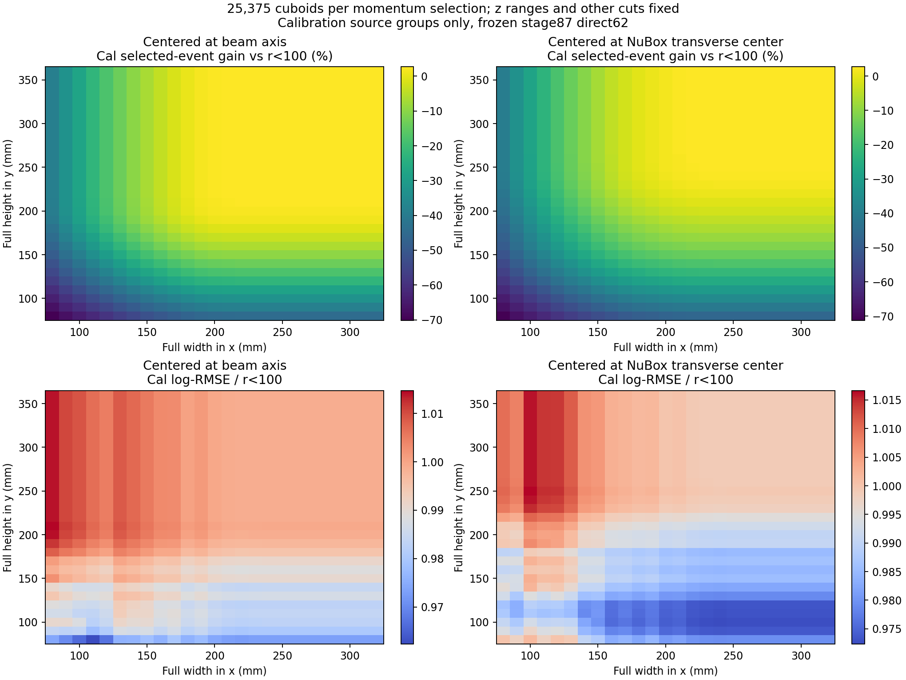
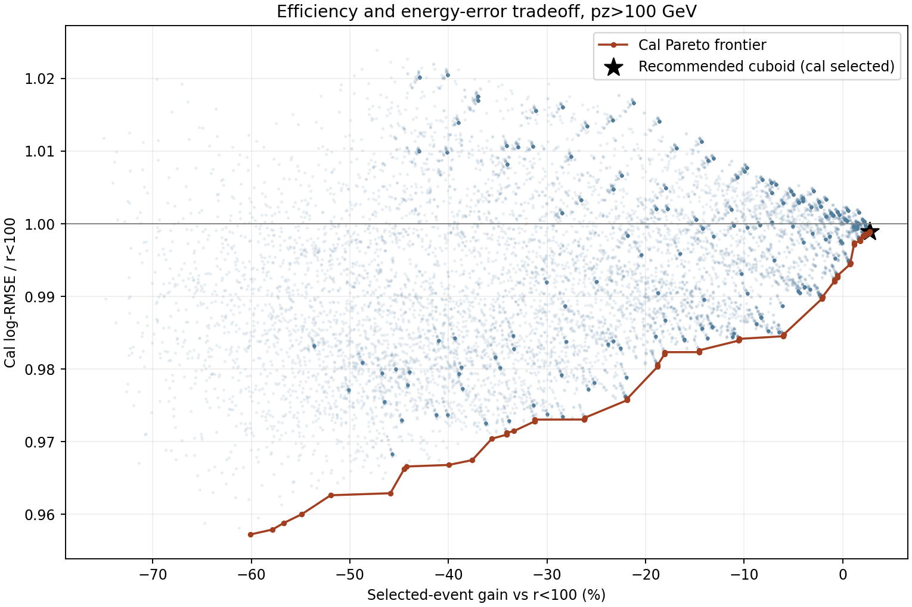
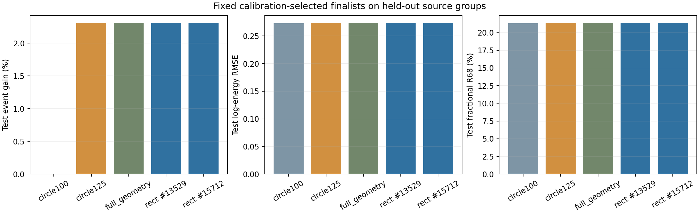
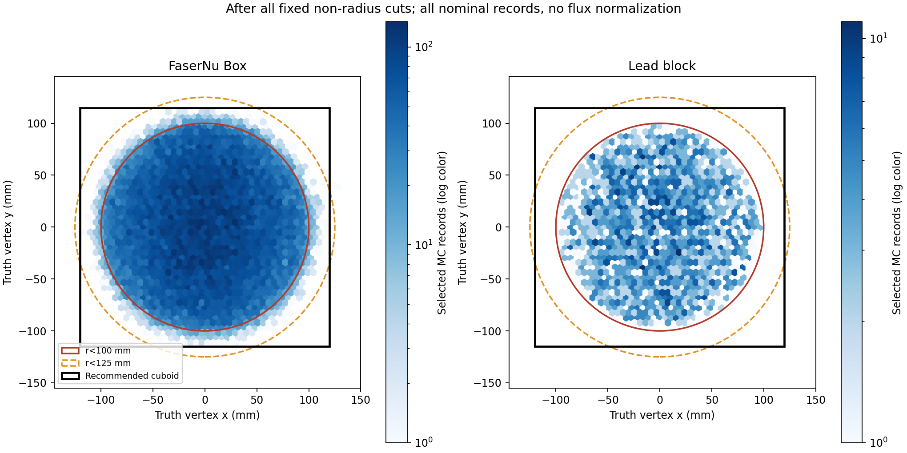

# Stage127：固定 direct62 模型的长方体 truth 顶点选择优化

日期：2026-11-06；起点提交 `0ce821e`（stage126）。

## 1. 阶段目标与结论

将 `Truth dec r < 100 mm` 替换为可调长方体，保持 `In Faser Nu Box or Lead Block` 和后续重建 cuts，研究横截面尺寸、宽高比与中心位置对产额和能量误差的影响。冻结 stage87 direct62，不训练、不重新校准。

**推荐工作点：中心 (0,0) mm，宽 240 mm、高 230 mm，宽高比 1.043478；即 `−120<x<120 mm`、`−115<y<115 mm`，与原 Box/Lead 几何取交集。** 在本次 25,375 个候选长方体中，它是达到校准组产额平台的最小面积选择，再以中心位移最小破同分。每个动量选择均有 **2,520 个**候选达到最高 cal 产额，不能将这个工作点解释为唯一的连续全局最优。

原分析双 `pz>100 GeV` 下，全样本通过数 **77,298→79,089（+2.3170%）**；test log-RMSE **0.273002→0.273326（+0.1189%）**，fractional R68 **21.3087%→21.3460%**。配对条件 95% 区间允许整体 RMSE 相对变化 **−0.3224% 到 +0.6715%**，支持当前样本中小幅增加统计量且整体重建代价很小。

重要的实测结果：推荐长方体与 stage126 的 **`r<125 mm` 在全部 83,300 条缓存记录上逐事件完全相同（XOR=0）**。因此矩形表达没有测到超出半径 125 mm 工作点的新收益。这个等价性仅针对当前样本，几何上两者并不相同；新样本、背景或系统变化不能沿用逐事件等价假设。

## 2. 输入、冻结模型与几何定义

模型沿用 `ml/artifacts/stage87/direct_202611025{5,6,7}.ubj` 的三个 400-round direct62 BDT，取平均 log-energy 加固定校准 `0.025193690596001274`。特征定义保持 audited62。本阶段直接复用 `ntuples/energy_ml_stage126/predictions.npz`，**新增 fits=0，新增模型前向计算=0**。

输入为原 nominal PHYS 的 **254 文件、2,521,976 个事件**，六个 run：200082/200093（pi）、200083/200094（k）、200089/200100（charm）；路径位于 `ntuples/merge_mc24_master_d32b0ff3/<run>/`，每个文件、来源分组与输入路径见 [protocol.json](stage127_energy_ml/protocol.json)。此为既有项目 MC，未引入其他生成器支持作为新几何覆盖。

用 truth 首个中微子的顶点，单位 mm；不是径迹外推位置。原材料几何的严格边界为：

| 区域 | x (mm) | y (mm) | z (mm) |
|---|---|---|---|
| FaserNuBox | (−115,135) | (−171,129) | (−3000,−1950) |
| LeadBlock | (−300,300) | (−300,300) | (−1769.65,−1619.65) |

最终条件为 `(InFaserNuBox || InLeadBlock) && InCuboid`。推荐长方体的 z 边界为 **(−3000,−1619.65) mm**，原 union 仍排除两材料间的空隙。本阶段固定 z，不裁剪或优化两材料的长度和混合比例。NuBox 内实际 x 范围被原几何进一步截为 **(−115,120) mm**。这是一个共同长方体与原材料 union 的交集，而不是把材料间隙填满。

扫描：cx={−20,−10,0,10,20} mm，cy={−40,−30,−21,−10,0,10,20} mm；半宽 40–160 mm、半高 40–180 mm，步长各 5 mm。共 **25,375 个几何点×2 个动量选择=50,750 行**。同时扫描方形、长扁矩形、接近原 NuBox 中心 (10,−21) mm 的窗口。所有边界均为严格不等式。

两个动量选择：主结果为原 truth/reco 双 `pz>100 GeV`；补充结果为 stage87 低能选择双 `pz>50 GeV`。除几何替换及这两个明确的动量版本外，其他 cuts 保持原样。

## 3. 统计方案与选择规则

完全复用 stage126 的 evaluation_role 和 incoming 隔离：原来源按 train/cal/test 分组，cal/test 各 38 文件、19 个 canonical group。stage126 已按 incoming 身份剔除与冻结训练及其他评价组重叠的记录；这里没有按误差大小排除事件。全样本含训练记录，仅用于产额描述；能量性能结论以 test 为主。这些来源及 test 在历史分析中已经暴露，当前是探索研究，并非新的盲测确认。

每个选择内，相同 native-MeV incoming `(pdg,px,py,pz)` 的记录总权重归一到 1。通过数 N 是记录数，不能当成独立事件数。定义 `e=ln(Ereco/Etruth)`，log-RMSE=`sqrt(<e²>)`；fractional R68 为分数误差 `(Ereco/Etruth−1)` 的 (q84−q16)/2；bias 为平均分数误差；尾部为绝对分数误差 >50% 的比例。

只在 cal 上扫描全网格，构造 151 行 Pareto 前沿，再对固定短名单 **27 行**作 **500 次 incoming-key Poisson 配对 bootstrap**，seed `20261106127`。各策略共享 multiplier。目标为 RMSE 比值条件 95% 上界 ≤1.01/1.03/1.05、尾部增加上界 ≤2 个百分点，在合格点中最大化 N，再最小化横截面积和中心位移。两个动量选择、三个预算均给出同一个推荐几何。cal RMSE 比值上界分别为 **1.002718（pz100）和 1.003342（pz50）**。

另考察最大 `N_incoming/log-MSE` 作为统计代理，最终固定 **4 个 finalist（每选择两个）**才查看 test，未在 test 全网格搜索。这个代理不等于物理测量的 Fisher 信息。所有区间均条件于当前来源与响应混合；没有 source/systematic 或多重选择的同时覆盖保证，cal 区间还受选择影响。

## 4. 尺寸、宽高比和中心扫描结果

下表为主 `pz100` 选择。误差为 cal、incoming 加权；全样本记录数和 truth parent 是描述量。后者要求 CC、nu_mu、原 Box/Lead、truth pz>100 且在窗口内，尚未施加 reco cuts。

| 宽×高 (mm) | 中心 (mm) | cal N | cal log-RMSE | 全样本 N | 窗口内 truth parent | 窗口内通过率 |
|---|---|---:|---:|---:|---:|---:|
| 180×180 | (0,0) | 9,519 | 0.261326 | 75,133 | 283,368 | 26.5143% |
| 200×200 | (0,0) | 10,006 | 0.262079 | 78,522 | 340,419 | 23.0663% |
| 220×180 | (0,0) | 9,758 | 0.260861 | 76,831 | 333,513 | 23.0369% |
| 180×220 | (0,0) | 9,859 | 0.262308 | 77,360 | 339,325 | 22.7982% |
| 220×200 | (0,0) | 10,041 | 0.261820 | 78,747 | 366,947 | 21.4600% |
| 200×220 | (0,0) | 10,063 | 0.262095 | 78,833 | 370,147 | 21.2978% |
| 220×220 | (0,0) | 10,098 | 0.261837 | 79,058 | 399,094 | 19.8094% |
| **240×230** | **(0,0)** | **10,105** | **0.261888** | **79,089** | **436,247** | **18.1294%** |
| 240×240 | (0,0) | 10,105 | 0.261888 | 79,089 | 452,540 | 17.4767% |
| 260×260 | (0,0) | 10,105 | 0.261888 | 79,090 | 497,835 | 15.8868% |
| 240×230 | (10,−21) | 9,994 | 0.261588 | 78,401 | 436,282 | 17.9703% |
| 240×280 | (10,−21) | 10,104 | 0.261853 | 79,087 | 514,543 | 15.3703% |

同面积窗口的朝向会改变产额：220×180 与 180×220 mm 的 cal N 为 9,758 与 9,859；但误差差异不足以宣称某一朝向普遍更好。接近正方形、接近束流轴中心的窗口能达到当前产额平台。220×220 mm 是更紧的可选点，仅比推荐少 31 条全样本记录；继续到 260×260 mm 只多 1 条，test 无新增。

纯追求 cal 最小 log-RMSE 会选中心 (−10,−10) mm、120×80 mm，cal N=3,923、log-RMSE=0.250944（比 r100 低 4.2766%），但损失 **60.124%** cal 记录，统计代理相对 r100 仅 0.42636。pz50 最低误差点为中心 (−10,0) mm、120×80 mm，N=4,221、log-RMSE=0.265702，损失 59.429%。这说明只最小化单事件误差会严重牺牲统计量；这些是 cal 描述结果，没有再据此调 test 工作点。





完整数据：[cal_grid.tsv.gz](stage127_energy_ml/cal_grid.tsv.gz)、[代表点](stage127_energy_ml/representative_windows.tsv)、[决策](stage127_energy_ml/decisions.json)。

## 5. 固定推荐点的 test 性能与效率

| 选择/指标 | r<100 mm | 推荐长方体（本样本也等于 r<125 mm） |
|---|---:|---:|
| pz100 全样本记录数 | 77,298 | 79,089（+2.3170%） |
| pz100 test 记录数 | 11,617 | 11,885（+2.3070%） |
| pz100 test 独立 incoming | 10,580 | 10,844 |
| pz100 test log-RMSE | 0.273001815 | 0.273326442（+0.1189%） |
| pz100 test fractional R68 | 21.3087% | 21.3460% |
| pz100 test fractional bias | +1.8867% | +1.7998% |
| pz100 test >50% 尾部 | 5.2051% | 5.1706% |
| pz50 全样本记录数 | 81,313 | 83,299（+2.4424%） |
| pz50 test 记录数 | 12,231 | 12,523（+2.3874%） |
| pz50 test 独立 incoming | 11,167 | 11,455 |
| pz50 test log-RMSE | 0.289756090 | 0.290470314（+0.2465%） |
| pz50 test fractional R68 | 22.0007% | 22.0290% |
| pz50 test >50% 尾部 | 6.2292% | 6.2123% |

pz100 配对 RMSE 比值 95% 区间 **[0.996776,1.006715]**，尾部差 **[−0.08612,+0.02449] pp**；pz50 比值 **[0.998373,1.007454]**。推荐点对 r125 的配对 RMSE 比值区间严格为 [1,1]、尾部差为 0，因事件集合完全一致。与 stage126 的区间末位不同来自新 seed 的有限 bootstrap，不是模型或事件改变。

共同 truth parent 在几何扫描前固定，pz100 为 **581,501**，pz50 为 **618,779**。因此主选择整体接受率为 **13.29284%→13.60084%**（+0.307996 个百分点）；补充选择为 **13.14088%→13.46183%**。推荐长方体内的 truth parent 分别为 **436,247/462,249**，相应窗口内 reco 通过率 **18.12941%/18.02037%**。

窗口内通过率和固定分母接受率回答不同问题：扩大窗口纳入大量最终不能通过 reco 几何的 truth parent，前者可能下降而最终 N 增加。不能用表中较小窗口的 26.5% 直接宣称它有更高的总产额效率。以上均为 MC 记录计数比例，无 flux/luminosity 归一化。stage126 的 pz100 辅助接受率若使用 pz50 分母，不可直接与本阶段新测 pz100 分母百分比比较。



指标与分层原表：[evaluation.tsv](stage127_energy_ml/evaluation.tsv)、[paired.tsv](stage127_energy_ml/paired.tsv)、[分层 CI](stage127_energy_ml/stratum_paired_recommended.tsv)。

## 6. 物理原因、程序检查与结论边界

相对 r100，主选择新增 **1,791** 条记录，没有移除原记录。新增 test 为 **268 条、264 个 incoming**，平均 truth E=704.43 GeV、平均 reco pz=417.62 GeV；原 test 平均 E=902.40 GeV、reco pz=971.69 GeV。新增部分 log-RMSE=0.286033，略大于原 0.273002；high-y 比例 23.674%，原为 11.634%。能谱和反应成分改变是整体指标变化的一部分，不能只归因于顶点远离中心。固定原能谱标准化后主 test log-RMSE=0.273789，相对基线约 +0.2885%，仍为小幅变化。

几何放大后产额饱和与后续径迹几何约束一致（stage126 的原生 cutflow 已验证），当前缓存全部通过事例仅 1 条位于推荐窗之外。顶点散点图直接显示剩余事例的横向范围。没有通过少数离群事件删除分析分支；更大窗口仍纳入网格和表格。



分层误差尚不能获得与整体同等的保证：主 test charm **676→696 条**，RMSE 比值 **1.01951**、条件 95% 区间 **[0.99185,1.07055]**；LeadBlock **527→528 条**，比值 **1.02948**、区间 **[1.00000,1.10121]**。NuBox 则 **11,090→11,357 条**、比值 **0.99991**。铅块只新增 1 条的差异不能支持普适退化结论，也不能忽略其不确定性。当前推荐仅针对整体 nominal 权衡，不宣称每个子样本都满足 1% 上限。

程序闭环：逐文件身份/run/eventID、半径与坐标精确匹配；83,300 条坐标与缓存一致，旧选择 **81,313 条**坐标逐值一致。truth parent 的二维直方图在扫描边界用 nextafter 构造严格下边界，直接 mask 与积分计数精确一致。独立 incoming 聚合重新计算 test RMSE 和尾部，和主结果一致。两份交付配置只替换几何项，其他 cuts 和原配置直方图经结构比较一致。

现成 `build/analysis` 原生 C++ 小样本 source4 核对：偏心 pilot 窗 (−90,110)×(−141,99) mm 通过 **338 条**；推荐窗通过 **340 条**，两者均与 Python 逐 eventID 精确一致。推荐窗 native wall **10.8718 s**。源码未变，未重新编译。

真实 data 对应的可观测 fiducial cut、背景、其他生成器/探测器系统变化、物理 flux 加权效率以及最终能谱测量总误差均**未测量**。几何 truth cut 不能直接在 data 上使用。本阶段完成的是固定模型的 MC 选择研究与可运行配置交付。

## 7. 执行、资源、验证与产物

环境：`source setup_env.sh`；批处理内部 `OPENBLAS_NUM_THREADS=1 OMP_NUM_THREADS=1 MKL_NUM_THREADS=1`，避免进程内线程超配。只读取所需 ROOT 分支、复用冻结预测，最终不保存新 ROOT/xAOD。

小样本、批处理和重放命令（仓库根目录）：

```bash
source setup_env.sh
python ml/stage127_coordinates.py --pilot 4
python ml/stage127_native.py --source 4
python ml/stage127_submit.py coordinates
# HTCondor 全部完成后：
python ml/stage127_collect.py
python ml/stage127_submit.py scan
# scan job 完成后回传的结果包：
tar -xzf ntuples/energy_ml_stage127/scan_result.tar.gz -C .
# 最终缓存也可直接重放：
python ml/stage127_scan.py
python ml/stage127_native.py --write-configs
python ml/stage127_qa.py
python ml/stage127_validate.py
python ml/stage127_diagnostics.py
python ml/stage127_plot.py
python ml/stage127_native.py --source 4 --final
python ml/stage127_resources.py
python -m py_compile ml/stage127_*.py
bash -n AnalysisZipFramework/submission/run_ml_stage127_coordinates.sh
bash -n AnalysisZipFramework/submission/run_ml_stage127_scan.sh
```

批量扫描实际通过 HTCondor 执行，上面直接运行 scan 的命令供缓存重放；大规模新扫描仍使用 submit。提交目录 `~/condor/nu_muAnalysis/stage127/`，坐标 cluster **9670213.0–7**、每 job **4 CPU**；扫描 cluster **9670238.0**、**8 CPU**。九个 job 均 exit0，结束后对应队列为空。

| 阶段 | GNU CPU (s) | analysis wall 总和 (s) | 分配核利用率 | 最大 Condor memory (MB) |
|---|---:|---:|---:|---:|
| 8 个坐标 job | 216.02 | 130.32 | 41.44% | 388 |
| 扫描 job | 51.35 | 22.20 | 28.91% | 608 |

总批量 CPU **267.37 s**；坐标读取量 **305,290,644 bytes（291.15 MiB）**为 uproot source 请求字节，物理网络流量未测量。扫描内部 wall **19.8457 s**，低于整个 GNU time wall，后半段汇总/报告为串行，因此未达到 8 核满载。不宣称相对单核加速倍数，未做对应单核计时。工作负载是小缓存上的统计计算，无新推理，未使用 GPU/Kubeflow。

最终坐标缓存 `ntuples/energy_ml_stage127/coordinates.npz` **749,310 bytes**；原 stage126 预测复用。清理本阶段重复传输包、分片和已合并 JSON，共 **4,958,643 bytes**；254 文件审计统一保留于 `coordinate_validation.json`，逐 job `.time` 保留。anchor/pilot 小缓存留作坐标闭环重放。清理后全扫描、诊断、图表仍可从最终缓存重放；collect 需要重新生成各 job 分片。数据缓存按忽略规则不进 Git。

运行时配置：

```bash
source setup_env.sh
./build/analysis --isMC -r 200082 -j 4 \
  --cuts-config "$PWD/AnalysisZipFramework/config/cuts_cuboid.yaml" \
  -o /tmp/stage127_cuboid_check.root
```

实际输入列表按对应 run 的 file config 解析；可像 native 核对一样显式加 `--file-config`。主交付 [cuts_cuboid.yaml](../AnalysisZipFramework/config/cuts_cuboid.yaml) 保留普通 cutflow 直方图，双 pz>100；[ml_cuboid_cuts.yaml](../AnalysisZipFramework/config/ml_cuboid_cuts.yaml) 为双 pz>50 的 ML 版本。原默认文件保留作为历史基线，通过显式 `--cuts-config` 使用推荐点，无需重新 cmake。

审计：[coordinate_validation.json](stage127_energy_ml/coordinate_validation.json)、[QA.json](stage127_energy_ml/QA.json)、[independent_validation.json](stage127_energy_ml/independent_validation.json)、[native_final.json](stage127_energy_ml/native_final.json)、[resources.json](stage127_energy_ml/resources.json)、[storage.json](stage127_energy_ml/storage.json)。图同时保存 PNG/SVG/PDF，表保存 TSV/压缩 TSV。

最终验证全部通过：10 个 stage127 Python 文件编译检查、两个 worker 的 bash 语法检查、精确小样本 QA、独立统计聚合和两套交付配置的几何替换/直方图保留检查。未运行无关的全仓库构建或重训。

## 8. 下一步计划与验收标准

1. 用独立来源和替代响应/生成器输入固定两种窗口（r125、推荐长方体），不再按 test 调边界；验收：各能段、charm/LeadBlock 分层的配对性能区间、事件迁移和来源差异均可复算。
2. 用真实 data 及对应背景 MC，把 truth 窗映射到可观测的径迹/顶点 fiducial 选择；验收：信号接受率、背景泄漏、data/MC 分布及物理归一化一起比较，明确相同 MC 事件集合是否继续成立。
3. 输入通量/曝光、响应矩阵及探测器与生成器系统变化，比较最终能谱/截面总误差；验收：在明确的能段、背景和系统协方差下验证 240×230 mm 或更紧备选点的实际统计收益。当前单事件 log-RMSE 权衡不能替代该测量。
