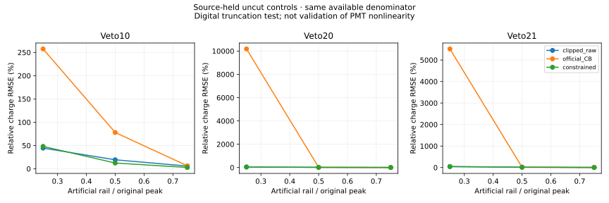
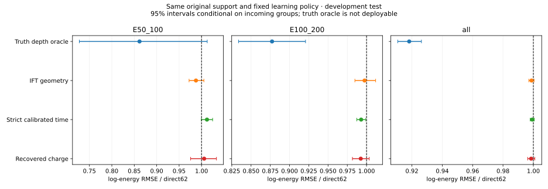

# Stage129：饱和恢复、严格时序与材料深度的同支持能量实验

日期：2026-11-07。起点：`main`，`6b9d101`。本阶段全部371个调度尝试已终态；资源和未完成项见末尾完成审计。

## 1. 目标与当前结论

执行 [Stage128 §9](2026-11-07_stage128_vertex-timing-saturation-research.md) 的三个观测工作包，并推进完整生成父的扩样、响应压力与能谱评估。**已经完成的可部署候选均未恢复最低能箱相对传统方法的优势，不晋升模型。** 不能把电荷测量改善、真值深度 oracle 改善或单一低箱改善称为达到项目目标。

本阶段区分三种证据：人工 ADC 截断检验电荷测量；相同原支持上的固定学习政策检验能量增量；真实 EVNT 全链检验新支持的工程成本。人工重复、粒子枪和同父重放都不增加独立 ν 相互作用数。

## 2. 输入、选择、特征与角色

原输入 [old_input.npz](../ntuples/energy_ml_stage119/old_input.npz) 共 89,033 行：train 46,575，cal 11,612，开发 test 13,189，隔离 17,657。原角色、全部 1,016 个新增 K、incoming 权重、pz0>50 GeV 及原 fitted/reduced charge 正式 cuts 保持。隔离和 Stage119 reserved 均零预测，开发 test 不称新 blind。

原 X62 保持 [audited62 契约](../ml/configs/audited_features.json)：一次方主动量仅 pz0，px/py、q/p、弯折量仍允许；闪烁体保留 raw11，signed 量不因负数被误删；typed NaN 和 Calo 缺失保持。没有重新引入 p0/p1/pz1 或 ln(p0/p1)，没有把不可靠 fitted charge 替换回特征。

新增原生输入沿用 Stage124 精确 `(row, run, event, entry, incoming)` 合同，280 个来源全部回接，每个原父恰好一次。首轮 70 批中 69 成功；第64批的备用 PHYS leading 不闭合与合法无 track 分别修复为 track 缺失，未放宽容差或删父。source257 没有 PHYS：356 个父的 ADC/X 保留，scalar/time/track 未知；source258/259 的备用 PHYS 无法认证同一 leading，track 置 NaN。

完整 ADC 的 `present` 独立保存。uint16 的 65535 仅为运输 padding，不是实际 ADC，不能当零电荷或零时间。实际缺通道 103,016 个 channel-view，未知 scalar 1,780 个。硬件 channel 4/5/14/6/7 分别为 VetoNu0/1、Veto10/20/21。

## 3. 一项实测定义修正：raw 是有限窗积分

官方逐波形回放认证本批五路 raw 的窗口为 **780–980 ns，含端点，samples390:491**。不能沿用 Stage56/Stage128 对本批 raw“整600点采集积分”的表述。整600点积分与原 PHYS raw 曾差至 100.949 pC；官方同窗 replay 则闭合。此处新增实证修正，历史报告不改写。

source0 pilot 的 raw 最大差 8.789×10⁻⁵ pC、fitted charge 最大差 0.000703125 pC、status 差0；三来源完整闭合见 [official_replay_closure.tsv](stage129_energy_ml/official_replay_closure.tsv)。p0 不持久化 range/trigger_offset；2 V/0 是官方 transient 默认，不能写成逐事件实测值。仅重建 primary，未调用历史 secondary 越界路径。

## 4. A：受约束饱和恢复及其验证

### 4.1 模型、失败诊断与必要修正

仅从原 train 的真实未饱和、status0 波形建立 run/channel≥50 的模板，否则 pooled-channel；固定均值+2PC，幅度非负，PC在±3训练SD范围，内部平移仅−2…+2 samples。保留未截断观测，只补隐藏顶部。AR(1) 电子噪声、基线不确定度、单侧同时 Gaussian tube 和 profile Δχ²=3.8414588 均事前冻结。

这不是精确多元删失似然。两边各至少2个>5σ观测点、至少8个未截断点、优化收敛、χ²/ndof≤10、上下 profile 有界才可用；失败置 NaN，保留父和原 raw。非0 hit 的内部平移不作为到达时间，也不改原 status。

初版 v1 全部 122,769 条实际触顶波形均不可用：122,651 个 template mismatch、118 个优化失败。没有把它当信息界。独立测量审计查到：实测训练形状在2PC外仍残留幅度的1.95%–3.12%，rail幅度对应305–488 ADC，但 v1 仅赋予约3 ADC电子噪声，χ²/ndof 的p05已达265–1702。**遗漏模板测量不确定度是程序/测量模型问题。**

修正保持同一均值、2PC、平移网格和质量阈值，仅用原 train 测完整残余 shape covariance；每个 shift 固定3次 feasible GLS covariance 更新，以 Cholesky 白化。profile 加入隐藏顶部的 shape 积分不确定度。它仍是 plug-in covariance 近似，需留出 coverage 认证，不能声称精确 likelihood 或保证95%覆盖。

修正后全量 **83,228/122,769 条触顶波形有界可用**。其余保留为缺失，没有删事件；各批原因与成本见 `recovercov_*_summary.json`。实际批次 children CPU 合计27,849.516879 s、批次 wall 合计7,150.892824 s，二者不是端到端耗时。与 v1 和 pilot 成本的关系见最终唯一 scheduler 账，不能将嵌套计时再相加。

### 4.2 人工截断与源留出区间

原 cal/test 每来源每通道按 entry 取前8个未饱和、status0、peak>20 ADC 控制，共1,968个 parent-channel control、865个唯一父，固定75%/50%/25%三个rail，共5,904 views。人工整数 pedestal shift 后再clip ADC0；只是数字截断，不是高幅 PMT/放大器非线性真值。

正式 v2 有5,711/5,904 views 可用，名义 profile coverage=0.9728593942。各方法以**同窗官方原始 raw**为目标，比较截断 raw、原官方 CB 和受约束恢复。简单75点基线积分与官方目标仍有最大0.41771484375 pC差异，未将其忽略为严格等价。

区间只用 role2：先对同一个 control-parent 的三个 rail 取最大有向误差/相应侧 halfwidth，再取 `ceil(.95*(ncontrols+1))` 顺序统计量，floor1；至少20 controls，否则不交区间。避免把三个重复 views 当独立校准父。固定通道14/6/7膨胀因子为 **1、1.0269900570、1.2232410769**，在能量fit前锁定。role3按来源 bootstrap500给条件 coverage 区间；未认证 source exchangeability，不声称精确 conformal 保证。

role3、50% rail、共同可恢复分母：

| 通道 | N | 截断raw RMSE / pC | 官方CB RMSE / pC | 恢复 RMSE / pC | 校准后coverage |
|---|---:|---:|---:|---:|---:|
| Veto10 | 309 | 68.701493 | 142.084356 | 50.797682 | 0.944984 |
| Veto20 | 313 | 68.662135 | 56.551204 | 53.166861 | 0.955272 |
| Veto21 | 313 | 61.458396 | 49.774102 | 48.330922 | 0.980831 |

完整三档、单/多峰、all-controls 与 common-available、失败数、bias、RMSE、coverage和来源区间见 [chargecov_comparison.tsv](stage129_energy_ml/chargecov_comparison.tsv)。不能只选可恢复分母来隐瞒失败率。没有实际独立低增益 Veto 参考来验证模拟饱和；channel15 未在历史readout持久化，不能当双增益。



### 4.3 全支持能量三臂

X62；V74=X+三通道各 present/rail/two-edges/available；Q89=V+各通道恢复Q、校准后下/上halfwidth、rail样本数、χ²/ndof。未饱和的新Q保持NaN，原raw保留；没有通过挑选恢复成功父构造更容易的测试集。两新臂同 Stage87 三seed×400轮、depth5、incoming 权重和一个全局cal offset，不扫seed/特征/窗口。

| Q/X，95%条件区间 | cal | 开发test |
|---|---|---|
| E50–100 GeV | 0.984563 [0.959385,1.012283] | 1.005784 [0.975636,1.033263] |
| E100–200 GeV | 0.981586 [0.966883,0.993849] | 0.992483 [0.981652,1.003456] |
| all | 0.995923 [0.992835,0.998745] | 0.998541 [0.996254,1.000967] |

test Q/V 两低箱为1.009655 [0.981715,1.035022]、0.996049 [0.984975,1.007318]，尚未建立连续恢复量超出缺失标记的稳定低能增量。Q/传统两低箱为1.951644 [1.641962,2.308189]、0.986046 [0.915702,1.060131]，原1.05非劣效门仍失败。cal最低箱相对f0的总/正尾差 upper95=+2.612149 pp，也未过+2 pp；不能只报test零尾变化。

详细八层、困难侧、高端、bias/R68/总正负tail及原门见 `saturation_{metrics,paired,support,gates}.tsv`。X精确复现原f0，最大log预测差0；cal/test所有joint False。电荷层成功没有自动变成ν能量改善，本固定表示不继续追加网络/seed网格。

## 5. B：严格 status0 时序

两端必须实际存在、有限且原 status==0；再要求官方 replay status==0，范围内 μ 校准可用才输入连续Δt。512/1/16一律没有时间，未重标，也未更改原cut。所有无时间父保留。

固定四pair：VN0−VN1、Veto20−Veto21、VN0−Veto20、VN1−Veto20。固定 μ 模型是常数、平均x/y、两端1/√Q；偶entry校准、奇entry验证，至少100/100、rank5、cond<10⁶、|median|<0.25 ns、abs95<2 ns。仅应用到控制的电荷/位置范围内，不向弱ν hit外推MIP timewalk。

真实data run7729首PHYS是0事件，未偷换成有数据文件；run8006读4096条，2998条μ控制。旧MC100012读4096，3612条控制。未校 VN0−Veto20 median 分别−32.4773 ns（data8006）、−27.2128 ns（旧MC），不能移植offset。

另外从精确100012 HITS首1024个μ，用 pinned d32、FASERNU-04、OFLCOND-FASER-06重放匹配producer；control-only，不增加ν N。认证五平面z为−3122.5、−3101.5、−1790.4、−1620.4、−1598.9 mm。当前MC digi已减centre.z/c，prompt残差期望为 `Δz*(sqrt(1+tx²+ty²)-1)/c`；不能再减一次完整Δz/c。data使用自身full TOF和独立offset。

四pair匹配MC验证abs95约0.04742/0.05745/0.04788/0.04800 ns；data8006约1.7553/0.7277/1.8305/1.3863 ns。它们认证prompt控制，不是迟到中子标签或高幅饱和电荷真值。

开发test原strict→校准范围覆盖：VNpair2560→27、下游6788→6457、两cross1946→68及2091→111。不能把上游弱信号大多不在MIP范围的本次阴性说成完整上游时间无用。

X62 / V74（三pair状态×4）/ T78（再加4个校正Δt），固定政策。test T/X 两低箱1.012131 [0.999666,1.024731]、0.992937 [0.987270,0.999008]，all0.999247 [0.997936,1.000577]；cal两低箱分别1.00215/1.00135，没有两箱跨角色稳定改善。T/V第二箱0.991952 [0.985833,0.997920]，最低箱区间仍含1。joint全False，不晋升。

## 6. C：深度/material oracle 与实际 IFT 几何

### 6.1 当前全支持 oracle

先做X62 / Z63=X+真实interaction-z。test Z/X 为：最低箱0.861718 [0.727559,1.012691]、第二箱0.877265 [0.833756,0.920750]、all0.918212 [0.910661,0.926282]，低pz真高E0.895898 [0.853427,0.934593]、high-y0.885175 [0.848412,0.918589]。真实深度有条件增量；最低箱统计范围仍宽，oracle本身也未通过原joint，不能部署真值。

实际pinned几何中心轴box-ray z[−3200,−1300] mm认证2962 intervals，最深材料唯一分段；钨区[−2987.39,−1945.68] mm，X0=3.5043401535 mm、λI=103.1173983298 mm。4305行 [material_segments.tsv](stage129_energy_ml/material_segments.tsv) 保留其余材料。它只是中心轴box诊断，不是实际shower path。

M=X+true-z决定的中心轴剩余λI/X0。test M/X两低箱0.857732 [0.724767,1.001124]、0.879102 [0.835380,0.921337]，all0.918324 [0.910626,0.926773]；M/Z all1.000122 [0.999063,1.001054]。材料坐标主要是同一真z的重表示，没有制造独立新观测。

### 6.2 实际 IFT covariance 与能量代理

原TrackCollection的PlaneSurface协方差经Jacobian映射成全局x/y/tx/ty的4×4 covariance；只用stationmask1、≥5 PRD、ndof>0、正定有限协方差的真实Segments，互不共享PRD最多6段。短段名义100 GeV的pz明确置NaN，不当强子动量，也不作单μ/LOS交点顶点。

原全量70批保留全部89,033父，提取内部CPU6455.431231 s、ROOT读取2,928,680,415 B。最多6段按固定χ²/ndof/PRD排序，64个事前z trial点[−3000,−1950] mm；实际协方差GLS common x/y，中心轴材料Highland broadening分别保留固定1/10/100 GeV nuisance假设。输出score z/width、minχ²/ndof、剩余λI/X0、compatibility共18量，加3个availability/count标记。它们是**条件几何score，未经校准的vertex posterior**。

开发test只有1434/13189父有≥2个互不共享的可用IFT段；最低箱6/183、第二箱78/856。p10假设的条件z RMS分别359.114/264.848/388.608 mm，score width平均123.540/203.969/137.941 mm；score width不能直接当实际z误差，尤其不能当覆盖已校准的posterior。完整覆盖表从缓存重建为 [trackmaterial_observable_support.tsv](stage129_energy_ml/trackmaterial_observable_support.tsv)，修正原被通用risk support同名覆盖的问题，未重训。

G=X+3flags+18score；V=X+3flags。test G/X 两低箱0.987561 [0.972177,1.005281]、0.997421 [0.984846,1.011793]，all0.998786 [0.997012,1.000475]。G/V最低箱0.981225 [0.965933,0.997775]有条件局部收益，第二箱区间含1。G/传统两箱upper95=2.22265/1.06668，原joint全False。

真值深度收益尚未转为稳定可部署收益。覆盖稀少、cascade secondary不必指向ν primary、未知短段动量和中心轴材料近似都是实际局限；不能称几何信息界。



## 7. 响应压力与真实控制的边界

波形压力事前冻结在 [pressure_protocol.json](stage129_energy_ml/pressure_protocol.json)：每32个留出control取1个，共62 controls，固定50% artificial rail，13变体共806 views；gain±5%、宽度±10%、baseline ramp±3 ADC、时间平移±1 ns、正rail10/30 ADC的正确/错认0条件。目标仍是变化后真实未裁波形的同窗Q；baseline ramp的目标为无ramp原脉冲。没有把负ADC或人工rail称为真实硬件。

完整测量压力见 [wave_pressure.tsv](stage129_energy_ml/wave_pressure.tsv)。这些变化没有概率标定，不是1σ系统误差。真实μ只闭合prompt timing，不能替代高幅PMT独立参考。MC数字截断控制也不能证明真实PMT非线性已经解决。

固定Q模型另测恢复Q/halfwidth的±5%标定变化，保持原X不变；固定T模型测上游组或Veto20 offset±0.25/1 ns，以及严格原status0内部的peak/RMS≥4/6σ保守失效。后者不是DAQ threshold变化，绝不升级原非0 hit。没有重训或重校准offset。完整八层和三尾见 `saturationstress_*`、`timingstress_*`，已补齐每一变体相对固定Q/T的配对。test恢复Q增益±5%的两低箱RMSE比范围为[0.999650,1.001146]/[0.999005,1.001146]；Veto20 offset±0.25/1 ns则使两低箱相对T升至1.09518–1.13939/1.04819–1.06701。上游组覆盖稀少，变化较小不能解释为上游时间天然稳定。时间值对下游offset有明显敏感性，没有真实校准误差约束便不能部署或称系统已过。

压力复核发现旧提取缓存的peak/noise列顺序为4/5/6/7/14，而质量veto消费端曾假定4/5/14/6/7。主测量、主时序始终按channel ID正确联结；只影响4σ/6σ两个附加压力变体，现已显式映射并仅重算这两个固定前向，未重训。原错误子表保留诊断，新表和 [映射验证](stage129_energy_ml/quality_channel_mapping_validation.json) 记录修正。

Stage125五G4仍仅是response压力，不能混称GENIE/FSI或全系统置信区间。本轮新增特征实验不改原cuts；新校准若进入正式选择，必须另交背景/接受度迁移，本阶段未测量该完整改变。

## 8. 已量化的能谱收益与尚缺的物理输入

使用原cal的incoming加权response和开发test的谱组成，固定真箱[50,100,200,400,800,1600,3200,∞) GeV、重建箱[0,50,100,200,400,800,1600,3200,6400,∞) GeV。七个谱分量、六个自由simplex坐标，归一化多项式likelihood，无任意pseudocount。Nselected=1000时，固定已知response的条件Fisher精度如下；这些数不是实际data测量误差。

| 表示 | E<200 GeV份额的条件σ / pp | cal response→test谱的closure偏移 / pp |
|---|---:|---:|
| 传统 | 1.452040 | −0.160795 |
| direct62 | 1.212661 | −0.004583 |
| 饱和恢复Q | 1.218927 | +0.082273 |
| 严格时序T | 1.215837 | +0.246321 |
| IFT材料G | 1.208959 | +0.166696 |
| 真z oracle | 1.125717 | +0.234652 |

七分量在本条件模型下rank6。完整分箱支持、精度与closure见 [spectrum_precision.tsv](stage129_energy_ml/spectrum_precision.tsv)、[spectrum_bins.tsv](stage129_energy_ml/spectrum_bins.tsv)。已量化已有读出相对传统的条件统计收益，同时没有把新表示的微小差异或oracle称完整物理收益。

静态核查仓库 `spectrum_hardness.py`、`joint_response.py` 的现有谱代码是选中MC条件模板方法，不能补出新观测下真实data/背景/接受度。完整物理目标还缺：被拒绝父的同条件真E接受度、实际data曝光/GRL和背景模板、受外部数据约束的gain/rail/PMT/timing nuisance、GENIE/FSI/flux/材料相关系统、finite response MC与重训/选择传播、认证独立确认家族。本阶段这些项目明确为**未测量/未认证**，没有用已知response的Fisher下界冒充完整精度。见 [spectrum_scope.json](stage129_energy_ml/spectrum_scope.json)。

## 9. 完整 EVNT、真实全链与独立扩样

五个精确已知EVNT实际读取完整粒子/顶点，HepMC动量MeV、长度mm。它们含完整末态，不只是入射ν；但一个星形vertex已flatten原GENIE FSI mother/process hierarchy，不能由此恢复FSI因果。event_number可全为0，身份必须包含EVNT路径+entry。先读每源16，再按每源首2048扫描，共10,240条，并与旧89,033及Stage119 metadata做精确float32 incoming排重，不预测reserved。

每源/stratum前3个fiducial且truth μpz>50 GeV的候选，固定取第一个形成21个全链工程case。它不是随机选择效率样本，不能把selected比例当全体产额。原GENIE种子和完整旧曝光仍未认证。

真实全链执行 installed pinned d32 `faser_simulate.py`→官方digitization→reco→ntuple→原typed62/cuts，conditions06、FASERNU04、FTFP_BERT、显式seed，run990129。只保留compact selected及每cut结果，不返回HITS/RDO/xAOD。

工程中已实际定位：

1. 旧G4LEDATA指向未挂载EOS，引发em0003；改为CVMFS匹配Geant4-10.6数据，逐变量路径落盘。
2. 下一次G4已成功处理1事件并Athena finalize，但Python shutdown `free(): invalid pointer` 返回134。仅把installed脚本最终 `sys.exit(int(sc.isFailure()))` 改为stdout/stderr flush后 `os._exit(int(sc.isFailure()))`；没有忽略run失败。另起进程认证HITS恰好1事件，再允许后续链。
3. 首完整链9673375耗203.908571 s，incoming精确闭合，原选择0/1：θ与r_atMaxRadius失败，其他cut结果完整保留。它认证工程链，不能计新增train。
4. 细查发现该次Cling缺RawWaveform typeinfo，使显式波形种子/状态接口返回空串；没有将它写成种子认证成功。已加载实际库并强制before/after序列化状态非空，再单父重跑；旧attempt的compact结果保留。随后发现非空状态仍全部before=after：配置同时创建public和algorithm-private工具，种到的是未使用public clone。改由IAlgManager和owner-qualified ToolHandle取得实际private工具，在AthBeginSeq.execute内设种子；9673391完整链成功，wall173.604947 s，Calo/Veto/Trigger/Preshower实际状态推进，VN无hit不推进。修正后21/21固定工程case均成功完成全链，3例通过原选择（case4/16为100–200 GeV、case6为过渡区），最低箱两个case均未通过；这是非随机工程队列，3/21不是无偏选择效率，0/2也不足以停止低能分支。canonical wall合计3292.524973 s，包含case0的重复数字化验证，不是全部尝试成本。跨独立数字化进程，run990129/event8的Calo/Veto/Trigger/Preshower各4路共9600个ADC采样逐值相同，实际private RNG的before/after状态也重现；VN没有hit。见 [fullchain_outcomes.tsv](stage129_energy_ml/fullchain_outcomes.tsv) 与 [fullchain_pilot_adc_repeat.json](stage129_energy_ml/fullchain_pilot_adc_repeat.json)。这些selected没有加入训练或前向，新增独立训练N=0。

本机日志实测 `/physics_engine/neutron/timeLimit 150 ns`；不能拿Stage124源码默认0替代当前native runtime，更不能称已模拟完整迟发中子响应。

独立N仍按完整生成父与响应家族认证，incoming只是依赖代理。原train最低箱940行/926 incoming/ESS933.053319；现有小曲线9/18/36和52新增train不能检验该规模饱和。**N₀→约2N₀仍是明确未完成任务，不能用本报告的三线消融或工程case替代。** 新EVNT census每源固定下一65,536条，共80个不重叠4096-entry区间、327,680条，完整排旧incoming11,150条；fiducial候选两低箱272/1,059、低pz真高E517、high-y157、过渡3,032、自然高端1,050。低/困难候选纳入率1，过渡/高端entry mod8纳入率1/8，保留原计数；真实重建选择前272这一上限也不足940增量。内部CPU合计5,732.066095 s。见[evnt_census_support.tsv](stage129_energy_ml/evnt_census_support.tsv)。五EVNT fullmetadata的TagInfo全部为空，没有原GENIE随机种子/完整旧生产历史认证，见[generator_independence_gap.json](stage129_energy_ml/generator_independence_gap.json)。这不是“新输入不存在”，也不是N饱和证据。

## 10. 独立验证、实际命令与产物

独立验证不导入主评估的指标聚合：直接展开每个incoming draw到原始record权重，重算cal/test全部配对RMSE及总/正/负tail。12,792个配对标量最大差2.8421709430×10⁻¹⁴，中心RMSE比最大差8.8817841970×10⁻¹⁶；所有X对原f0最大log差0。角色保持、隔离/reserved零预测、严格时间规则、输入无−999或inf通过，结果见 [independent_validation.json](stage129_energy_ml/independent_validation.json)。条件bootstrap不包括完整source/GENIE/refit/多阶段选择和真实系统。

62列domain独立审计中，positive/nonnegative/count变量非法−1为0，有限sentinel与inf残留为0；signed负值保留，特别是LeadTrack_charge的合法−1共有60712条，不能全局替换所有−1。Calo缺模块total仍为NaN，失败恢复的Q和区间仍为NaN。见 [feature_domain_audit.tsv](stage129_energy_ml/feature_domain_audit.tsv)。

科学提取、拟合、统计均走HTCondor；本地以stdlib打包/字节回读、读文本表和文档为主。代表性实际命令：

```bash
python3 ml/stage129_submit.py recovercov /tmp/stage129_recovercov_files.json --indices -1 1 2 3 4 5 6 7 8 9 10 11 12 13 14 15 16 17 18 19 --cpus 4 --memory 6000
python3 ml/stage129_collect.py recovercov --ready
python3 ml/stage129_submit.py chargecheck /tmp/stage129_chargecheck_files.json --indices 1 --cpus 2 --memory 4000
python3 ml/stage129_submit.py saturation /tmp/stage129_saturation_files.json --indices 0 --cpus 4 --memory 8000
python3 ml/stage129_submit.py validate /tmp/stage129_validate_files.json --indices 0 --cpus 2 --memory 6000
python3 ml/stage129_submit.py spectrum /tmp/stage129_spectrum_files.json --indices 0 --cpus 2 --memory 4000
python3 ml/stage129_submit.py energystress /tmp/stage129_energystress_files.json --indices 0 --cpus 4 --memory 8000
python3 ml/stage129_submit.py evntrange /tmp/stage129_evntrange_files.json --indices 0 --cpus 1 --memory 4000
python3 ml/stage129_resources.py
git diff --check
```

临时manifest均可由 `*_package.json` 的files恢复；正式精确合同含逐事件身份，放在ignored缓存而非作为data提交。运行设置和返回归档见 [worker](../AnalysisZipFramework/submission/run_ml_stage129.sh)、[submit](../ml/stage129_submit.py)、[collect](../ml/stage129_collect.py)。worker只返回解包后新建/更新产物，避免重复返回180 MB ADC输入；xrdcp取回逐member字节回读，非SHA。

持久事件缓存 `ntuples/energy_ml_stage129/`、模型/预测 `ml/artifacts/stage129/` 均ignored；紧凑数据表、协议、计时、图和审计在 `workbook/stage129_energy_ml/`。提交目录固定 `~/condor/nu_muAnalysis/stage129/`。未修改Stage54五项原无关资产，未push。

## 11. 完成审计与下一步验收

371个唯一attempt全部终态，371 starts，11失败，1主动取消冗余工程任务。scheduler CPU **60633 s（16.8425 CPU h）**，aggregate execute wall **58634 s**，0 GPU。全尝试含程序修正、pilot和重试；子进程/GNU计时是嵌套核对，不重复累加。主动取消9673377的CPU92 s/wall1945 s已纳入。见 [resource_summary.json](stage129_energy_ml/resource_summary.json) 和逐作业 [resource_jobs.tsv](stage129_energy_ml/resource_jobs.tsv)。恢复两代scheduler CPU32168 s，相对原30000 s预算超2168 s（7.23%），没有隐去失败开销。

全部终态并核对队列引用后，已逐member字节回读核验并删除冗余运输/不可变包 **1762170218 B**；280个提取JSON合并并逐字典回读，141份非canonical0完整原生日志无损合并并逐文本核验。保留事件缓存232115250 B和模型/预测59440984 B，均ignored；共享pinned Calypso软件包保留。home根无本项目nu_mu_stage*旧提交目录，没有删除其他项目目录。见 [storage_cleanup.json](stage129_energy_ml/storage_cleanup.json)。

[完成审计](stage129_energy_ml/completion_audit.tsv)区分已完成实验与未满足的科学目标：饱和、严格时序、深度/材料oracle、真实IFT协方差、压力、条件谱、独立复算、完整21例全链、固定EVNT census均完成；三种可部署表示的联合门均未过，保留原direct62。不存在“全部研究规划已完成”的结论。

下一步按 [执行合同](stage129_energy_ml/next_execution_contract.json) 推进：

1. 已知五个下游EVNT固定框最低箱只有272个重建前候选，继续有界核查原nominal run200082的retained生成/模拟日志，取得完整深度生成输入的精确路径、entry/seed和实际几何证据。新发现另立Stage130，不重做已结束的12个alternative RDO metadata门。
2. 有可追溯完整深度父后，先测双低箱/困难侧原选择产额及全链CPU/I/O，再在看新风险前冻结接近N₀→约2N₀的嵌套训练规模、固定组成、纳入概率/家族ESS和新确认隔离。不能用本次3个selected、9→36小曲线或响应重复替代这项任务；原reserved保持关闭。
3. 完整谱精度仍需真实data曝光/GRL、背景、被拒父接受度、外部响应nuisance、GENIE/FSI/flux/材料与finiteMC/refit传播和独立确认。已有条件Fisher收益不能替代这些未测输入，原逐事件双低箱胜传统、all/困难层及八层三尾要求不降低。
4. 原固定饱和/时序/IFT表示不追加seed/网络/几何网格。联合前向模型的“至少一族稳定可部署能量增量”门未满足，不以oracle增量启动联合大模型。
