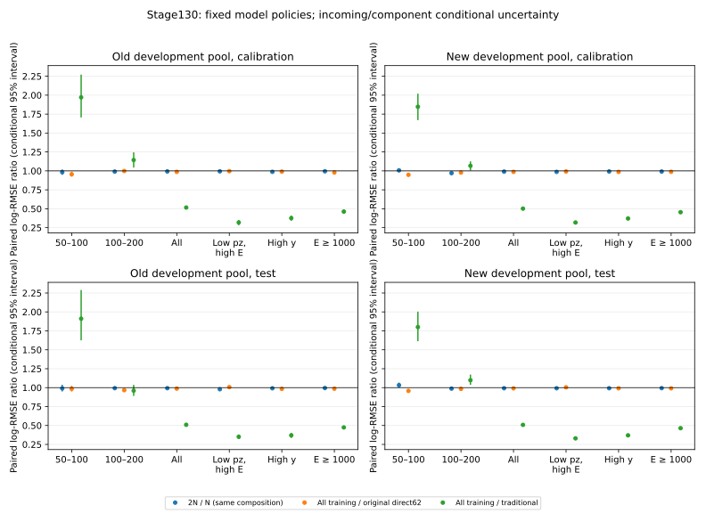

# Stage130：完整深度替代 flux 扩样与原规模数量对照

日期：2026-11-07。起点：Stage129 提交 `a73185f`。**本阶段计算完成：原规模 N→2N 已实际测量；最低能仍劣于传统，三项固定政策均不晋升，保留 Stage87 direct62。整体物理目标尚未完成。**

## 1. 阶段目标与固定边界

接续路线§108与Stage129执行合同，完成原940条最低能训练支持附近的数量实验，结束用9→36小曲线推断原规模饱和的缺口。一次方主动量仍只用pz0，允许px/py、q/p与弯折；维持raw11、typed NaN、合法有符号负数、Calo缺失、pz>50 GeV及原正式fitted/reduced charge cuts。原train/cal/开发test/隔离46575/11612/13189/17657和全部1016新增K保持，历史locked-test与原reserved不开放。

固定三项政策：同一合并池/同一粗组成的嵌套N₀、2N₀；以及old-full train＋全部合格new train的augmented。每项原三seed、400轮、depth5、hist、原初始化/权重政策，只用原cal拟合一个全局log offset。合计9次fit，无网络/seed/参数网格。N→2N检验同组成数量效应；augmented与原f0同时改变数量和flux组成，不能将两者混为纯数量效应。

## 2. 精确输入、pilot与全来源完成情况

有界读取nominal run200082 retained模拟日志，实际找到完整深度EVNT；随后只沿用户授权200080–200101共22个run读取首/末日志及一层RDO/PHYS目录，找到22个实际存在的EVNT，覆盖22/23和24 crossing-angle、SIBYLL/EPOS/QGSJET/PYTHIA前向π/K、POWHEG/PYTHIA charm min/central/max。不是Stage129五个downstream-only EVNT。[source_protocol.json](stage130_energy_ml/source_protocol.json)保留路径、目录和实际producer日志证据；G4 seed offset不是原GENIE seed证书。

继承Stage87 canonical source-group角色，排除files.tsv历史locked-test组：eligible920来源，alternative-only666来源，原始来源角色train/cal/test=470/101/95。没有因产额重分角色或删除K。

先用200084/85各40个PHYS父工程验证：请求1/8、选中0/2，run/event/incoming及全部请求行闭合；实际Calo03 charge/E公式与COOL01/03快照通过。9673419为2核、CPU98 s、wall124 s、exit0。再以seed2026110730每alternative run均匀固定1个完整文件，共16来源、2个8核任务9673427.0/1，wall1441.404952/1364.125406 s，154877父、4714 selected，排已知曝光后3624条，两个低箱57/278条。步骤CPU13433 s是nested计时，不另加到scheduler CPU；单文件/run的HT最低箱总点估计2554，不当实际训练N或方差估计。逐来源纳入概率/ESS见[pilot_support.tsv](stage130_energy_ml/pilot_support.tsv)。

32份精确模拟边界日志认证pilot对应EVNT块/skip；随后原生完整末态读取发现同incoming可对应多个entry。独立9673444逐例验证 **4714/4714 selected的eventID==EVNT entry且incoming精确相同**，最大ν能量差约9.095×10⁻¹³ GeV。[父entry验证](stage130_energy_ml/parent_event_entry_validation.json)与[范围证据](stage130_energy_ml/parent_range_proof.json)保留。稀疏原生pilot又实测91/91相同，CPU49.977765 s、wall69.260436 s、ROOT请求1650960 B、RSS1602184 KiB。HepMC3实际units枚举为MEV=1、MM=0，不把字符串“1/0”当错误单位。完整末态不恢复flattened GENIE FSI因果谱系。

看任何新模型风险前冻结[production_contract.json](stage130_energy_ml/production_contract.json)：复用16 pilot，650新来源分82批提交9673446，每批8核/24000 MB。来源纳入率1、truth保守超集内父纳入率1，不按产额过滤。没有应用timeout，scheduler MaxRuntime86400 s，见[parentmap修订](stage130_energy_ml/production_parentmap_amendment.json)；保留原合同14400 s历史，不静默覆盖。每来源官方d32/FASERNU04/conditions06 RDO sparse reco→merge/noIFT ntuple→原cuts/typed62，实际Calo03→01 payload ratio只转换一次，随后实际读取完整selected EVNT并要求entry/incoming相等。

并发按12→32→64有界提高，CPU总预算不变；32批实际运行且140来源0失败后才提高到64。最多申请512核，最终调度区间峰值54作业/432请求核，不称512核实测线性加速。[并发修订](stage130_energy_ml/production_concurrency_amendment.json)保留两次qedit命令与当时证据。较慢K批9673446.48实测8个Python子进程CPU96.7–97.8%、RSS989000–1020960 KiB，随后6个官方ntuple、2个extract仍推进，见[实时快照](stage130_energy_ml/production_live_health.json)；没有因慢停止K。

最终 **666/666成功，π259、K358、charm49来源全部完成**。PHYS父6606398条，selected222515条，**222515/222515实际EVNT entry/incoming闭合**。650 production与16 pilot完整分母均保留。[完成清单](stage130_energy_ml/production_sources.tsv)、[紧凑source证据](stage130_energy_ml/source_evidence.json.gz)包含cutflow、标量校准、原执行命令、时间和身份汇总；逐entry证据在ignored缓存parentmaps.json.gz。原GENIE seed/完整未持久生产史仍未认证，不将这些新开发样本称blind独立确认。

## 3. 去曝光、角色与实际N₀/2N₀

排Stage119七缓存及curve_input全部incoming旧曝光，按native float32 incoming保守成家族；跨新角色按test>cal>train隔离低优先视图。new-only train家族按固定blake2b(person=nuMu130) hash留15%为role4，先于fit冻结，所有视图同角色。active新角色与已知曝光交集为0。

| 新池角色 | 记录数 | incoming代理家族数 | 最低箱记录/家族 | 第二箱记录/家族 |
|---|---:|---:|---:|---:|
| 旧曝光/跨角色隔离0 | 72627 | 42290 | 425/416 | 2229/2060 |
| train1 | 82175 | 65223 | 1578/1559 | 6756/6551 |
| cal2 | 26309 | 24530 | 426/425 | 1797/1789 |
| 开发test3 | 26908 | 25192 | 388/388 | 1810/1799 |
| 新隔离4 | 14496 | 11526 | 262/261 | 1121/1088 |

原17657隔离行、新14496隔离行及原reserved均0训练/forward。角色4只是关闭的保留家族，不因当前研究缺输入而打开。

合并old/new train后，按E粗三箱×crossing-year×flux×成分×high-y/unknown×depth的canonical首视图分cell，整家族所有视图一起纳入，固定seed20261107301。每cell按cap/比例largest-remainder给N₀分配，2N₀为严格嵌套双倍；小于2家族cell只从数量曲线排除，在augmented与评价中保留。成员与[curve_protocol.json](stage130_energy_ml/curve_protocol.json)在新fit前冻结。

| 真能量范围(GeV) | 原train目标家族 | N₀家族 | 2N₀家族 |
|---|---:|---:|---:|
| 50–100 | 926 | 926 | 1852 |
| 100–200 | 4100 | 4100 | 8200 |
| ≥200 | 32530 | 32530 | 65060 |
| 合计 | 37556 | 37556 | 75112 |

N₀为47005记录，2N₀为93878记录；augmented为128750记录/102779家族。原两个低箱940/4245条的incoming代理目标已达到，不再是9→36小曲线；仍不是原GENIE seed层的独立性证书，也不是原nominal分布单纯翻倍。新增train最低/第二箱ESS1568.558245/6653.753482；困难低pz真高E的1894代理、ESS1734.195836，high-y2397代理、ESS2143.861172。此处ESS是重复视图加权后的record-weight ESS，非认证GENIE独立N。详细原/新/两曲线支持在[family_support.tsv](stage130_energy_ml/family_support.tsv)。

## 4. 能量风险：整体有小增益，最低能没有修复

固定500次按成分分层的incoming bootstrap，old使用原native key、new保守float32 key。区间条件于当前来源/响应/嵌套成员，不包含source相关、重抽训练、模型选择、GENIE/仪器系统误差。以下log-RMSE与比值均无量纲。

| 开发test | 真E(GeV) | 2N₀/N₀ RMSE比 [95%] |
|---|---|---|
| old | 50–100 | .989293 [.949647,1.038089] |
| old | 100–200 | .992768 [.977515,1.007337] |
| old | 全体 | .992522 [.989251,.995512] |
| new | 50–100 | 1.032741 [1.001957,1.066115] |
| new | 100–200 | .987132 [.975032,.998509] |
| new | 全体 | .991957 [.989784,.994036] |

同组成翻倍在全体有约0.75–0.80%减幅，最低箱没有跨池稳定改善；新池最低箱反而上升。它是一次固定嵌套实现的条件数量结果，不证明任意更大N均无用，不能称理论信息上界或普适训练饱和。

| 开发test | 真E(GeV) | 原direct62 RMSE | augmented RMSE | 传统RMSE | augmented/传统 [95%] |
|---|---|---:|---:|---:|---|
| old | 50–100 | .282644 | .278325 | .145661 | 1.910765 [1.624369,2.289924] |
| old | 100–200 | .246329 | .238052 | .247937 | .960132 [.890845,1.036248] |
| old | 全体 | .287491 | .283862 | .557190 | .509452 [.492866,.525022] |
| new | 50–100 | .283241 | .271065 | .150615 | 1.799716 [1.612699,2.004210] |
| new | 100–200 | .241633 | .237701 | .216436 | 1.098252 [1.036782,1.172482] |
| new | 全体 | .286529 | .283832 | .558336 | .508354 [.498202,.517535] |

augmented/direct62在old/new全体分别.987375 [.983773,.991493]/.990589 [.987822,.993618]；new最低箱.957011 [.932482,.976482]有条件改善，old最低箱.984717 [.948288,1.025126]未共同复现。由于训练量与flux组成同时改变，不能把该改善都归为数量效应。

最低箱augmented mean bias仍old+24.950226%、new+23.303092%，R68分别18.120667%/15.144221%，正tail50为13.114754%/10.824742%；对应传统正tail50均0。并未仅由总体分辨率的改善恢复低能优势。old第二箱单独满足1.05非劣效不等于显著胜传统，且old cal与new两角色不共同通过。

原两低箱/传统上95≤1.05、全体/direct≤1.01、其余五层≤1.03、八层三向tail差上95≤+2 pp全部保持。三政策×old/new×cal/test共12项joint均False。augmented的六个非低箱RMSE保护在四评价角色均通过，但tail仍有取舍：old test低pz真高E负tail差上95=+3.848277 pp，high-y为+2.625784 pp；new test低pz真高E为+2.375160 pp，均超过+2 pp。没有改门或择赢家。

[old完整配对表](stage130_energy_ml/old_paired.tsv)、[new配对表](stage130_energy_ml/new_paired.tsv)、[old门表](stage130_energy_ml/old_gates.tsv)、[new门表](stage130_energy_ml/new_gates.tsv)保留cal/test及全部保护层、missing、高端两个附加箱。固定[flux诊断](stage130_energy_ml/flux_diagnostics.tsv)另外列出每run/crossing的同一预测，未再fit，不把不同run当独立重复或给source置信区间。



## 5. 变量、程序与独立验证

62列仍为audited_features.json冻结顺序，排p0/p1/pz1等一次方总动量和ln(p0/p1)，保留明确允许的px/py、q/p、弯折。11路闪烁体入模为raw charge；正式fitted/reduced选择不变。正值/非负/计数域非法值、有限sentinel、Inf均为0；缺失为typed NaN，不把合法负号误删。old/new的LeadTrack_charge=-1实际60712/152313条保留；11路raw合法负电荷63302/156526条保留。逐列finite/NaN/negative/-1计数在[feature_domain_audit.tsv](stage130_energy_ml/feature_domain_audit.tsv)。

原f0全部active预测重载逐值相同，最大log差0；九模型保存/重载相同。独立按记录直接加权重算5616个RMSE比、配对区间及三向tail统计，与主流程group聚合最大差3.197442310920451×10⁻¹⁴。原角色、跨角色incoming隔离、active新输入零旧曝光、N₀⊂2N₀及隔离零预测全部通过。[independent_validation.json](stage130_energy_ml/independent_validation.json)给出范围。

额外构造类型检查实测当前LCG109中ak.firsts→fill_none(NaN)→numpy将float32/float64/int32均转float64，几何z沿用C++ float边界，未发现需要修改truth预选的精度问题；此为构造类型检查，不冒称新事件census。语法检查覆盖全部新增Python与三个shell worker；无C++变化，复用匹配现成build，显式传原cuts/definitions/output配置。

## 6. 实际成本、I/O和存储

92个scheduler attempt全部终态、92次start，0失败、1主动移除；**CPU582527 s，aggregate execute wall86622 s，0 GPU**。工程预算931226 s未超。650来源production实际start-to-completion3646 s；这是同批作业日历跨度，不与累计wall相加。请求执行核秒690582，调度区间峰值54作业/432请求核，不等于瞬时硬件利用率。详细[resource_jobs.tsv](stage130_energy_ml/resource_jobs.tsv)与[resource_summary.json](stage130_energy_ml/resource_summary.json)包含所有attempt。

一次错误显式indices提交9673426最初idle快照后立即移除；最终ad实际1 start、4 s wall、0 s CPU、无返回科学产物，不能由idle快照宣称0调度启动。历史快照及最终核对均保留在[提交纠正记录](stage130_energy_ml/preexecution_submission_correction.json)，费用全计。资源脚本也修复了condor_q空队列返回空字符串的JSON解析问题；不涉及能量重算。

成功source步骤nested CPU575424.99 s，其中π163367.72、K379814.47、charm32242.80 s；这已包含在scheduler总CPU内，不重复相加。个别GNU观测峰RSS1820944 KiB，不是并发总内存。[source_step_costs.tsv](stage130_energy_ml/source_step_costs.tsv)给出逐步CPU/wall/RSS。全分析包wall171.71 s；九fit应用计时51.339187 s、整个fit进程wall56.64 s、CPU225.96 s；独立验证wall34.77 s。主要投入是官方CPU生产链，未测GPU加速，未编造GPU性能收益。

实际逻辑读计数：PHYS uproot1397404332 B、selected ntuple uproot501887074 B、650 production EVNT parentmap ROOT3856814604 B。它们是不同读取接口的请求计数；完整RDO/网络物理I/O未测量，不能相加冒充网络吞吐。[source_cost_summary.json](stage130_energy_ml/source_cost_summary.json)保留范围。

所有批量用~/condor/nu_muAnalysis/stage130/，home根旧nu_mu_stage*目录实查0个。全部终态后，Condor已逐数组核对666分片与合并缓存，见[compact_verification.json](stage130_energy_ml/compact_verification.json)，再回读压缩证据、删除重复分片/运输/软件包；精确末态继续保留在ignored缓存。未保存xAOD/HITS/RDO中间件，未改Stage54五项无关资产。最终清理与存储数见本报告末尾。

## 7. 阶段结论和下一步

本轮兑现了原规模同组成N→2N与全来源K使用；数量增加确有小幅整体收益，但没有恢复最低能，也未满足完整保护门。程序与变量检查没有发现足以解释失败的非法占位、错误动量或角色泄漏；不能由此断言不存在其他程序/物理问题。保留Stage87 direct62，不追加同输入模型/seed/数量网格，也不把阴性结果当信息界。

下一工作包按Stage123尚未完成的机制线与[Stage131入口合同](stage130_energy_ml/next_execution_contract.json)推进：利用已认证EVNT path/entry和保留完整末态、Stage129可执行full-chain，先有界核查实际HITS/truth-link/G4接口能否测下游μ谱系、非μ谱系活动和固定边界能流；冻结自然父框与纳入概率，小pilot实测CPU/选择迁移后同工作包冻结匹配支持的X/X+oracle/可部署proxy能量对照。拆分响应只能作人工干预，不当自然ν训练、不假设ADC可相加，不把H/Eν恒等式塞入oracle。若过程谱系仍不可测，报告具体接口和失败，不无限泛扫旧metadata；不阻塞其他可测分支。

真正独立确认仍需可认证的新GENIE配方/种子或其他独立父证据；真实物理精度需要匹配data曝光/GRL、背景模板、接受度及相关flux/材料/相互作用/探测器nuisance。此处未测量，条件风险区间不能替代。原reserved不开放，最终两低箱真正优于传统、独立确认和完整物理精度的项目目标保持。先完成中文报告，再与代码/配置本地Conventional Commit，不push；历史路线与旧入口保留。

最终存储实测：第一轮删除重复406164622 B，第二轮删除132247458 B；16份完整pilot末态逐字节回读后压为8804182 B的`ntuples/energy_ml_stage130/pilot_complete_parents.tar.gz`，可直接tarfile读取或原样恢复，不重跑EVNT。最终事件缓存＋模型逻辑大小93856844 B；source汇总证据407559 B，650份运输审计亦已合并压缩。精确清单见[cleanup.json](stage130_energy_ml/cleanup.json)、[return_compaction.json](stage130_energy_ml/return_compaction.json)、[storage_summary.json](stage130_energy_ml/storage_summary.json)。

## 8. 执行入口与可复核产物

主要执行入口如下；精确indices、打包文件和提交描述符保留于各timestamp `*_submission_*.json`。本阶段已完成并清理，以下为历史执行记录，不应无条件重跑fit。

```bash
python3 ml/stage130_submit.py support --cpus 8
python3 ml/stage130_bulk_plan.py
python3 ml/stage130_submit.py production --cpus 8
python3 ml/stage130_progress.py
python3 ml/stage130_manifest.py
python3 ml/stage130_science.py submit analysis --manifest /tmp/stage130_analysis_files.json --cpus 8 --memory 24000
python3 ml/stage130_science.py collect analysis
python3 ml/stage130_sourcecosts.py
python3 ml/stage130_resources.py
python3 ml/stage130_cleanup.py
python3 ml/stage130_compact_returns.py
python3 ml/stage130_finalize.py
```

analysis job9673452按prepare→supportcurve→fit→evaluate→validate→fluxdiagnostics→plot→compactverify顺序全exit0；seed、轮数、offset和逐fit资源见[fits.json](stage130_energy_ml/fits.json)，任务锁见[analysis_lock.json](stage130_energy_ml/analysis_lock.json)。模型/预测在`ml/artifacts/stage130/`，合并事件与曲线成员在`ntuples/energy_ml_stage130/new_input.npz`、`curve_membership.npz`，均ignored不提交。原始分片保留字段可按source mask从合并缓存恢复，完整pilot末态从tar成员原样恢复；省略中间字段需要按原producer重新生成。最终[完成审计](stage130_energy_ml/completion_audit.tsv)和[阶段摘要](stage130_energy_ml/completion_summary.json)不把未认证输入写成已完成结果。

审计收尾只对compact_verification重复schema去重，并逐来源恢复比对完全一致；91例pilot身份记录逐字节压入ignored gzip，workbook保留汇总。没有重训或改动成员/风险统计。
