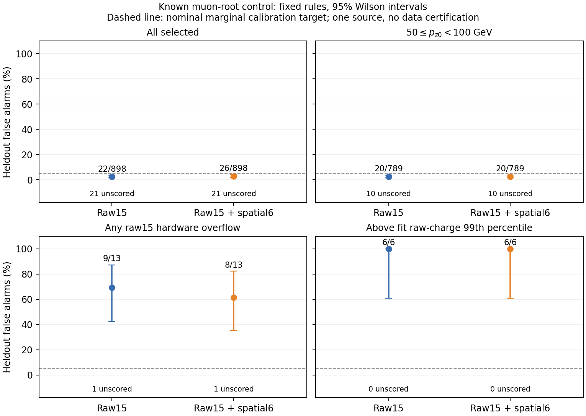

# Stage157：原4096 μ根的联合响应、留出控制与分块非干涉验证

## 1. 阶段目标和结论

执行 [Stage156下一合同](stage156_energy_ml/next_execution_contract.json)，[本阶段protocol](stage157_energy_ml/protocol.json)逐字节相同。完成已知MC100012原HITS前4096个不同entry的当前官方读出、真实簇位置和固定联合响应规则。**加入空间量没有消除μ根控制的overflow／高活动误报；不能把nonleading簇、较大距离或规则报警直接当作其他根／强子能量。** 原始电荷Q15与Q15G6的留出全体报警22/898、26/898，低pz组均20/789；overflow9/13、8/13，高活动均6/6。

这是一个已开发、单来源、固定100GeV初始μ控制，不是总体或data FPR认证，也没有测中微子能量增益。两个规则均只拟合一次，没有根据留出结果调整阈值。原Stage87模型、全部物理风险门及整体“未完成”状态保持。[完整审计](stage157_energy_ml/summary.json)、[响应结果](stage157_energy_ml/response_summary.json)及[独立验证](stage157_energy_ml/independent_validation.json)均已返回。

## 2. 输入、选择和方法

唯一HITS：`/eos/experiment/faser/sim/mc24/particle_gun/100012/sim/s0012/FaserMC-MC24_PG_muon_fasernu_100GeV-100012-00000-s0012-HITS.root`。旧PHYS、Stage146已认证根和Stage156 current06参考路径完整保留于protocol。沿用pinned d32源码、FASERNU-04几何、OFLCOND-FASER-06当前条件；输入输运conditions04、旧release及旧随机流差异仍明确，不要求新旧PHYS raw数值一致。无新G4、独立ν或μ根生成。

先原0–127顺序链和独立64–127 suffix，核首64对Stage156、重叠64对顺序结果；检查run/event、真实根p4／vertex、leading状态、全5×5保存协方差、PRD、四站cluster、SP、longTracks、raw/status/presence及private RNG初末状态。只在HITS EventSelector改变SkipEvents及原entry记账，不改物理种子／tracking政策。通过后固定64个连续64-entry chunks，每4条独立Athena链组成一个4CPU作业，最多4个批作业同时活动，使用只读共享runtime和独立scratch；BLAS/OpenMP线程1。

选择不变：单long track、50<pz0<2000 GeV、有限非负chi2且ndof>0、chi2/ndof<10、至少7层。没有删除未选中父。一次方动量只用pz0，条件模型还允许px0/pz0、py0/pz0；不使用p0、p1、pz1或ln(p0/p1)。实际leading x/y(mm)来自当前reference point，与Stage145旧VetoStation1坐标不同，不把两轮数值作严格同producer比较。

Q15为固定raw11闪烁体加4Calo通道的asinh(rawQ/1pC)，不用闪烁体拟合charge。Q15G6再加站1–3的asinh(candidate_N)和asinh(sumAbsDx/1mm)。空间定义精确复用Stage155/156，只有完整有效的leading实测wafer支持才评分；有效空集合的count和sum为0，但mean/min/max/RMS仍null。未支持、缺失或未知leading保持未知，不借用不明基底协方差作归一化。

原entry modulo4的0/1用于fit、2用于阈值校准、3用于留出；这是同文件开发切分，不是新blind。条件为intercept、log(pz0/GeV)、实际x/y、px0/pz0、py0/pz0。固定多元OLS、响应残差协方差0.9empirical+0.1diagonal、Mahalanobis及95% split-conformal阶次ceil(.95*(ncal+1))；仅完整测量且条件位于fit逐坐标min/max范围内才评分。这里的经验响应协方差不是track误差校准。未评分事例不计作未报警。

## 3. 实测身份、几何及缺失处理

[逐chunk检查](stage157_energy_ml/chunk_checks.tsv)覆盖4096/4096原根身份和current native–ntuple配对。当前有3793条leading，303父无leading；3708父通过原选择，388父未选中。当前selected数与Stage146旧PHYS的3612不同，当前producer／重建链没有完整旧版本迁移认证，不能称效率改善。

65663个COT anchors均真实链接、identifier相等、measurement-detector面相同、实际float32且plane区间兼容；其中65620个有Measurement标记并满足有效anchor条件，43个没有Measurement标记，不修补成有效锚点。旧1e−6mm条件未过45623项，不追认旧门。state往返最大3.256115871121665e−14mm，PRD往返0，独立dx公式最大差2.842170943040401e−14mm，candidate往返0；candidate表示区间宽度最大7.780446424021648e−6mm。

[原生支持表](stage157_energy_ml/station_support.tsv)中的空间计数：

| 分层 | 原父N | 有实际leading N | 任一支持站非空父N | 站1/2/3候选位置N |
|---|---:|---:|---:|---:|
| 全部原父 |4096|3793|2388|2610 / 2294 / 2300|
| pz0[50,100)GeV的leading父 |3240|3240|1994|1988 / 1655 / 1716|
| 任一raw15 status&4 |109|98|65|127 / 114 / 59|

站0及其他wafer仍不属于本固定可观测量，不把缺失当零。该表含全部父／leading支持，**不是下一节经过正式选择、留出及可评分后的分母**；特别不能拿109替换overflow留出13。

选中父modulo0/1/2/3分别924/928/937/919。Q15、Q15G6的有效fit均1831，条件设计rank均6/6；有效cal分别918、916，阈值分别33.43240629539055、40.39977551768194。选中父中raw15+G6完整3655；raw缺失50，其中留出15，其高活动类别保持未知，不宣称没有高活动。Q15G6另有3父空间不完整；不删除父、不换wafer、不放松容差。

typed QA：clean后有限raw占位值−999/−9999/−99999残留0；非0status附带连续timing为0；未知面附带数值candidate_N为0；有效空集合附带数值距离摘要为0。选中raw15中10055个合法负电荷被保留，精确−1的观测数0；不把signed负raw一律当缺失。正值域另按presence／baseline RMS／原track选择处理，不将非法占位值送入拟合。该QA不认证真实响应校准。

## 4. 固定规则的留出报警和统计边界

[完整留出表](stage157_energy_ml/heldout.tsv)报告报警N/已评分N、原分母、未评分原因及Wilson95。下表区间和比例单位为%。

| 分层 | 原留出N | Q15 报警/评分；比例[95%] | Q15G6 报警/评分；比例[95%] |
|---|---:|---|---|
| 全体selected |919|22/898；2.450 [1.623,3.682]|26/898；2.895 [1.983,4.209]|
| pz0[50,100)GeV |799|20/789；2.535 [1.647,3.883]|20/789；2.535 [1.647,3.883]|
| overflow |14|9/13；69.231 [42.369,87.319]|8/13；61.538 [35.523,82.290]|
| 高活动 |6|6/6；100 [60.967,100]|6/6；100 [60.967,100]|

高活动界为fit总signed raw15电荷99th percentile，2614.6749850463143pC，仅由fit计算。这里50–100GeV指重建μ的pz0，不是中微子真E箱。全体未评分21父：Q15缺失15、范围外6；Q15G6缺失16、范围外5。低pz未评分10，分别5+5、6+4；overflow未评分1，分别范围外1和缺失1。两规则共同可评分集合恰相同，但缺失原因不同；不能把相同总数误作逐父报警相同。

[配对报警表](stage157_energy_ml/paired_alerts.tsv)：全体共同898父中两者均报警19、仅Q15报警3、仅Q15G6报警7、均不报警869；低pz共同789父中17/3/3/766；overflow共同13父中8/1/0/4；高活动共同6父全部双报警。没有按这些差异再调阈值，也没有声称两种全体误报率存在显著差异或空间量提高了其他根检出率。



**物理判断：** 在已核μ根及其输运／噪声控制中，确有真实非leading空间活动；两个固定规则仍将大量overflow／高活动父报警。整体边际低报警率没有约束困难条件尾部。不能由6个高活动父认证总体概率，不能从报警直接标其他根或hadronic，不逐cluster归因为辐射／噪声。当前leading粒种与全体过程贡献的逐簇分解未测量；根身份也不等于当前每条track的粒种认证。没有联合原生data manifest，不混旧producer raw与新空间补造data，也没有宽能区／其他来源迁移认证。

**程序判断：** 128 sequential／64 suffix／Stage156首64及全量首128分块对照均通过；actual REC schema逐chunk认证。独立标量重建、Cholesky白化与线性求解验证全部8个分层计数、calibration N和阈值；最大阈值差3.552713678800501e−14、最大二次型差9.947598300641403e−14，无再拟合。独立核验与主计算在同一个Condor审计作业，采用不同数值公式，不冒充独立数据确认。上述尾部不能用已测试的分块／打包／分数公式错误解释；它们也不是所有物理／程序原因已穷尽的证明。

## 5. 程序失败、性能和存储

首次pilot9675026已完成原前128的digi/reco/native，但extract因多拼一层`chains/`路径而FileNotFoundError退出；修复合同路径后，在原1500CPU pilot预算内用9675038重跑。失败输出移到pilot_failed_seq保留，未用于规则拟合。该次185 scheduler CPU秒、218 execute wall秒均计成本。

最终审计9675145增加资源汇总时漏打包16份driver JSON，读batch_00_driver.json退出；该次5CPU秒/9wall秒，没有开始响应拟合。补齐打包清单并增加提交前必须有16份报告的检查，9675153只重跑统计审计，在500CPU秒预留中扣除已花5秒，剩495秒；实际10CPU秒/17wall秒。未重跑物理、未增加预算、未按风险重拟合。

[Scheduler账](stage157_energy_ml/scheduler_accounting.json)：21作业/21starts，19成功、上述2失败，最终0live／0held／0unresolved；累计14526CPU秒、聚合execute wall5296秒，0GPU。不同原entry4096，物理parent executions4416，其中320是pilot／失败／prefix重复，不能增加独立支持。[准入](stage157_energy_ml/full_admission.json)保存当时588CPU秒已用、实际完整pilot GNU188.44/208.74秒、3倍预测40078.08+500预留<59412剩余；这是当时预测，不是全量实测。

[全量资源实测](stage157_energy_ml/resource_summary.json)和[逐链GNU账](stage157_energy_ml/chain_resources.tsv)：

| 项目 | 全量4096实测 |
|---|---:|
| 64链GNU子进程CPU |13791.44 s|
| 每父子进程CPU |3.36705078125 s|
| 16批driver wall之和 |4366.534947012551 s|
| 64条链wall之和 |17081.025211291155 s|
| 链wall重叠比 |3.911803161675705|
| 子进程CPU / (4核×driver wall) |0.7896100779770284|
| 父 / 聚合driver wall |0.9380435630779406 s⁻¹|
| 单子进程最高RSS |2105220 KiB|
| 单链临时ROOT最高 |2370454 B|
| 四链保守临时ROOT和上限 |9481816 B|
| digi / native / extract ROOT计数字节 |2255891652 / 1116863296 / 15898401 B|

含启动/lazyJIT，不能把3.912重叠比称受控串行对照的3.912倍加速；RSS不是同时整作业峰值，ROOT counter不含未记录的reco/metadata全尝试I/O，也不是物理网络流量。两规则fit/score合0.181467577CPU秒、0.198923916内部wall秒；主成本在官方CPU链，本阶段未测GPU收益。总账包含全尝试，不与已包含的GNU／内部CPU重复相加。

[存储清理](stage157_energy_ml/storage_cleanup.json)：实际native/paired/seed文本合并至`ntuples/energy_ml_stage157/event_records.json.gz`，25675927B<32MiB，逐文本回读相同。保留67次链的来源与未知状态；完整RNG仅保留所有pilot及每chunk首末边界，full边界128次。原128配对精确是在丢弃冗余字符串前实测的，其他entry保留实际seed/changed标记，不声称4096条独立全状态重放均验证。源码胶囊716195B，798份链审计胶囊2599749B，331份日志胶囊2551791B，全部回读逐字节相同；合并67份相同metadata，删除251727780B重复事件／运输／提交包，无持久ROOT。原HITS/PHYS、其他阶段和Stage54未动。`~/condor/nu_muAnalysis/stage157/`仅保留必要提交／审计文件；[home核查](stage157_energy_ml/home_submission_audit.json)确认home根目录没有nu_mu_stage*旧提交目录，无需删除。

## 6. 命令、产物和验证

```bash
python3 ml/stage157_submit.py pilot
python3 ml/stage157_monitor.py
python3 ml/stage157_submit.py pilot_retry
python3 ml/stage157_submit.py admission
python3 ml/stage157_dispatch.py
# 重复dispatch仅监控／运输／补足固定16批，不增加事例或候选
python3 ml/stage157_submit.py audit
python3 ml/stage157_submit.py audit_retry
python3 ml/stage157_finalize.py
python3 -m py_compile ml/stage157_*.py
bash -n AnalysisZipFramework/submission/run_ml_stage157.sh
git diff --check
```

所有科学数组、ROOT/Cling、digi/reco、OLS和统计验证都经HTCondor；本地仅文本、scheduler、打包及精确运输／合并。实际逐phase输入清单、descriptor、CPU allowance与job ID在本目录`*_submission.json`；每批返回包由dispatch用xrdcp回读，审计返回以相同方式取回。清理后需恢复逐链输入时，将event_records胶囊中的原相对路径文本写回，再解开`software/stage157/chain_audits.tar.gz`；`source_snapshots.tar.gz`保留每次实际提交代码。重放统计先恢复这些输入及driver报告，不应为重看图重跑物理。

文本／语法、冻结protocol字节一致、原路线历史内容与Stage54 tracked不变、本阶段本地链接核验记录见[文本验证](stage157_energy_ml/text_validation.json)。中文报告先写，再与本阶段代码／小表／图及路线图一同本地Conventional Commit，不push。

## 7. 完成边界及下一阶段

[逐项完成审计](stage157_energy_ml/completion_audit.tsv)区分已计算、物理结论和缺输入。Stage157合同内计算完成；真实空间活动不是经过认证的强子标签，track covariance/pull、联合原生data纯度、宽能区与来源迁移、乳胶、GRL/曝光、背景/接受度、真实相关nuisance和独立确认仍开放。中微子低能改善在本阶段**未测量**，整体目标未完成。

[Stage158冻结合同](stage157_energy_ml/next_execution_contract.json)转原89033行／71376active父的真实新空间能量比较，保留46575/11612/13189角色、17657隔离零forward和全部K。使用原Stage124多REC单次Athena入口降低初始化；先五个origin首源各前40train及已知row40738身份缺失对照，验证旧40参考／独立首4、actual schema／原计数／几何及CPU，再用原37批和实测首事件／steady成本准入，30000累计CPU秒、1600pilot、1000fit/audit预留，不提高预算。

恰三个固定能量臂X62、X62+A3可用性、X62+A3+G6内容，同原baseline种子／400轮和incoming权重；不把μ报警作新部署特征。报告内容相对可用性控制的配对增量和原8层三向尾，独立行空间复核，X62必须精确复现Stage87。已知leading-pz不匹配仍unknown，不放松匹配容差、不删父。原1.05/1.01/1.03及+2pp门、Stage137双低箱cal/test点比≤.95且上95<1扩大门保持；1.05仅非劣效，最终两低真E箱仍须真正胜传统及独立确认。Stage158新成本、覆盖和能量结果本轮未测量，未提交其作业；不自动扩G4／模型网格。
