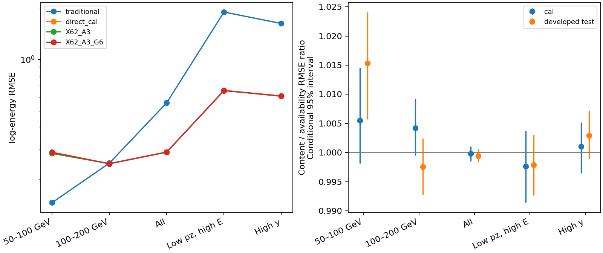

# Stage158：原全队列真实空间内容没有修复最低能风险

## 1. 阶段目标与输入

兑现[Stage157冻结合同](stage157_energy_ml/next_execution_contract.json)，[本阶段protocol](stage158_energy_ml/protocol.json)逐字节复制。问题是：真实非leading簇空间内容是否在raw62和可用性标记之外，改善原全队列ν能量及困难侧尾部？Stage157的μ报警不是其他根标签，本次也不把它当部署特征。

输入`ntuples/energy_ml_stage119/old_input.npz`、`workbook/stage124_energy_ml/native_contract.json`、Stage155/156真实wafer几何和`ml/artifacts/stage87/predictions.npz`。原89033行及角色保持，仅71376活动父读native；没有新G4、digi/reco、新独立ν或隔离forward。复用pinned d32/FASERNU-04/OFLCOND-FASER-06，legacy waveform aux不实例化。全部科学数组、ROOT、fit和统计在HTCondor，本地只作文本、提交/运输及紧凑审计。

| 角色 | 原父N | 三站全部完整N | 任一站完整N | leading身份未知N |
|---|---:|---:|---:|---:|
| train | 46575 | 46573 | 46575 | 0 |
| cal | 11612 | 11609 | 11611 | 1 |
| 开发test | 13189 | 13188 | 13189 | 0 |
| 隔离role0 | 17657 | 未读取 | 未读取 | 未读取 |

实际读取280个REC来源、37条独立Athena链，五origin=55/70/81/82/83；π/K/charm分别34305/31714/5357父，来源数118/131/31，**K确实完整参与**。原pz0-only一次方动量（允许px/py、q/p、弯折）、raw11、typed NaN、合法signed负值、严格status0 timing、Calo缺失、原cuts及角色不变。基线仍是Stage87。

## 2. Pilot、身份及几何实测

pilot实际149父：request0/254/255/260的train分别40/28/40/40，request257没有role1，故为0、不换来源；另request125原row40738仅作身份诊断1父。实际pilot覆盖四origin，不把计划的五origin写成已测。计数149/149闭合，leading148/149及几何148/149支持，已知不匹配保留unknown。Stage155同40及独立首4的geometry/QA精确，全量再次逐条复核149个pilot父全部一致。

首个execute含lazyJIT为62.33374917 CPU秒，保留在成本基底。实测startup与各源首事件合计105.47484122 CPU秒，最大post-first源均值0.01521535633 CPU秒/父；冻结三倍全37批预测14965.74119636 CPU秒，已用223 CPU秒和1000 fit/audit预留在30000预算内，准入True。pilot GNU107.30 CPU秒，内部100.86294 CPU秒/162.33717 wall秒；repeat内部103.684 CPU秒/112.659 wall秒。request125单例不作steady估计。详见[准入](stage158_energy_ml/full_admission.json)。

全量71376/71376计数闭合、71375 leading匹配、71375父至少有一站几何支持；所有实际schema均验证为tlp6→TrackParameters_p2/vector<float>，没有新的anchor失败flag。唯一原row40738/request125/run200089/event135794仍与原leading不符，原rtol3e−7/atol3e−5 GeV保持，不换leading、不删父，其新增量保留NaN。另有五父三站不全；不把缺失当物理零。详情为[覆盖表](stage158_energy_ml/native_coverage.tsv)、[身份例外](stage158_energy_ml/native_identity_exceptions.tsv)、[逐来源schema](stage158_energy_ml/source_schema.tsv)，完整metadata/每事件时序在`software/stage158/native_audits.tar.gz`。

固定A3是站1–3完整支持标记：available且eligibleWafers==measuredWafers、onMeasuredWafer==eligibleCandidates。G6为各站asinh(candidate_N)、asinh(sumAbsDx_mm/1mm)。有效空集合count/sum为0，空距离摘要为null，未知为NaN。各站G6实际支持71372/71373/71375父，合法空计数42609/48621/50769父；真实内容有非零动态范围，并非全缺失或常数。没有covariance归一化、距离cut、关联概率或强子标签。[动态范围](stage158_energy_ml/feature_dynamic_range.tsv)及[62变量typed审计](stage158_energy_ml/typed_feature_audit.tsv)保留。

## 3. 固定三臂及能量结果

仅X62、X62+A3、X62+A3+G6三臂，各原3seed、400轮、depth5/eta.04/hist/nthread1，原incoming权重和独立单一cal offset，恰9个模型，无grid、earlystop或留出风险重试。三臂以fork共享原输入、并发训练；模型reload全部逐值一致，X62预测逐值复现cached direct62，最大log差0。A3控制在本政策下的报告风险比为1，不把罕见缺失标记当新增物理能量。

同500次incoming-within-component配对抽样，seed20261108158+role。以下RMSE指无量纲log-energy RMSE；区间为固定模型/现存来源响应条件95%，不是联合95%保证，不含来源、重训、研究选择或真实相关系统。

| 角色 | 保护层 | N/incoming | 内容臂/可用性控制 RMSE比 [95%] |
|---|---|---:|---|
| cal | E50_100 | 183/182 | 1.005470 [0.998143, 1.014574] |
| cal | E100_200 | 904/899 | 1.004207 [0.999515, 1.009258] |
| cal | all | 11612/10811 | 0.999807 [0.998546, 1.001023] |
| cal | pz50_100_trueE200 | 284/284 | 0.997606 [0.991396, 1.003744] |
| cal | high_y | 328/327 | 1.001017 [0.996484, 1.005188] |
| 开发test | E50_100 | 183/183 | 1.015321 [1.005710, 1.024105] |
| 开发test | E100_200 | 856/851 | 0.997528 [0.992801, 1.002389] |
| 开发test | all | 13189/12125 | 0.999450 [0.998357, 1.000582] |
| 开发test | pz50_100_trueE200 | 297/297 | 0.997892 [0.992652, 1.003043] |
| 开发test | high_y | 385/384 | 1.002903 [0.998945, 1.007179] |

内容臂/传统pz0÷0.8的两个真低能箱：

| 角色 | 真能量箱（GeV） | RMSE比 [95%] |
|---|---|---|
| cal | E50_100 | 2.074562 [1.760512, 2.373817] |
| cal | E100_200 | 1.150017 [1.051926, 1.257231] |
| 开发test | E50_100 | 1.970150 [1.677457, 2.321940] |
| 开发test | E100_200 | 0.991058 [0.916136, 1.068561] |

开发test最低箱183父，传统/X62/内容臂log-RMSE为0.145661386/0.282644343/0.286974826；内容臂mean bias+25.771680%、R68=18.266744%，传统分别+11.570334%、10.330065%。最低箱内容臂总/正/负tail50=13.114754%/13.114754%/0%，传统全为0%；这不是一个孤立离群父造成的现象。第二箱内容臂log-RMSE0.245719835、传统0.247936985，但上界1.068561仍未通过1.05非劣效。全体0.287333006对X62的0.287491236，微小点差区间含1，不能称新增稳定收益。

低pz≠真低E：开发test pz0[50,100) GeV共659父，内容/传统log-RMSE0.498430482/1.275309885；其中真E≥200 GeV的297父为0.656789943/1.887789515，内容相对X的配对区间仍含1。改善低pz相对传统，不等于解决真最低箱。完整RMSE/bias/R68/三尾/ESS见[metrics](stage158_energy_ml/metrics.tsv)、[paired](stage158_energy_ml/paired.tsv)、[support](stage158_energy_ml/support.tsv)，run/component方向见[source_direction](stage158_energy_ml/source_direction.tsv)，未以某来源赢家选模型。



## 4. 原门、尾部与科学结论

原两低箱/传统上95≤1.05、all/direct≤1.01、其余五层≤1.03、八层三尾上差≤+2 pp保持；三臂cal/test原联合门均False。内容臂cal两低箱及test两低箱的RMSE门均失败；cal unconfirmed总尾差点+0.512492 pp、95%[-0.997206,+2.079023] pp，略超+2 pp上界，不能认证安全，也不据此宣称已证明尾部伤害。其他尾及原8层明细见[gates](stage158_energy_ml/gates.tsv)。

Stage137四项cal/test×两低箱的5%增量门False，两低箱区间也没有共同低于1。**本固定六空间摘要没有建立内容特异的低能改善，最低开发test箱还出现约1.53%的相对风险增加。** 结束这组三臂实现，不续seed/tree/loss/空间阈值网格，不晋升模型，不自动扩大模拟。

程序与物理原因分开：schema、身份、原计数、几何、pilot/full、typed清理和baseline都闭合，不支持把阴性归于本轮读错基底/数据未进入；但这也不是全部空间信息的理论无用证明。G6没有测得可校准的μ/其他根归属；Stage157已见μ辐射/噪声控制本身有真实空间活动且困难尾部误报多。这两项有限证据支持停止这一摘要族，不能归纳成所有空间/波形观测均无用。跨来源、材料/响应及真实系统原因尚未识别。

## 5. 独立验证与执行命令

独立row-space脚本重算cal/test所有非空层的RMSE比、配对区间、三向尾及点指标，共3288项标量，最大绝对差3.552713678800501e−14。原角色计数、incoming跨role重叠0、role0预测0、leading例外、全部有限部署预测及合法新增非负量检查通过。详见[独立审计](stage158_energy_ml/validation_summary.json)、[逐层检查](stage158_energy_ml/independent_validation.tsv)和[149前缀检查](stage158_energy_ml/pilot_full_validation.tsv)。原图长轴标签裁切由单独plot作业重排，未重算模型/风险；最终PNG/PDF已目视核对。

```bash
python3 ml/stage158_submit.py pilot
python3 ml/stage158_collect.py pilot
python3 ml/stage158_submit.py admission
python3 ml/stage158_collect.py admission
python3 ml/stage158_dispatch.py  # 每次一轮，保持最多4个作业
python3 ml/stage158_submit.py fit
python3 ml/stage158_collect.py fit
python3 ml/stage158_submit.py validate
python3 ml/stage158_collect.py validate
python3 ml/stage158_submit.py plot
python3 ml/stage158_collect.py plot
python3 ml/stage158_finalize.py
```

提交目录`~/condor/nu_muAnalysis/stage158/`；源码为`ml/stage158_*.py`和`AnalysisZipFramework/submission/run_ml_stage158.sh`，实际阶段输入包及worker源码精确存档，未覆盖历史实现。

## 6. 实测资源与存储

15作业/15starts全部exit0、0live，无失败；唯一scheduler累计**5300 CPU秒/3958聚合execute wall秒**，不是从首提交到结束的时钟时长。提交4核/16000 MB，CERN实际RequestCpus=6/RequestMemory=18000 MB，额外预留不当成科学核心已用。37原生链内部合计4636.617782 CPU秒/10729.843684 wall秒，10 driver聚合3401.623005 wall秒，链wall重叠比3.154331仅描述实测并发，不是受控串行加速比。实际ROOT读取3648817135 B，平均51121.065 B/父、内部0.06496046 CPU秒/父。最大原生RSS2100828 KiB，scheduler最大上报ResidentSetSize=7500000 KiB；MemoryUsage返回未求值ClassAd表达式，未当数值峰值。

fit GNU132.77 CPU秒/72.95 wall秒、最大RSS730712 KiB，三臂子fit合计100.062942 CPU秒；独立验证内部11.043201 CPU秒/11.618213 wall秒。父/子/GNU均嵌于scheduler，不重复相加。GPU作业0：固定hist基线需逐值复现，本次主要成本在现成Athena读取与初始化；没有测GPU加速或声称GPU更慢。逐进程资源见[process_resources](stage158_energy_ml/process_resources.tsv)、[native_resources](stage158_energy_ml/native_resources.tsv)、[总审计](stage158_energy_ml/resource_audit.json)。

所有作业终态后，39份native/pilot/repeat事件文本合并为`ntuples/energy_ml_stage158/event_records.json.gz`，13095013 B，回读文本逐字相等；只保留新增`features.npz`，原数据不复制为新科学输入。事件/新增数组/模型/预测合计25770775 B，小于134217728 B上限。源码、完整原生审计、日志、GNU/driver执行胶囊分别546248/663645/34552/5253 B，逐字节回读相等；65份原GNU/driver文本已精确归档并合并为紧凑资源表及drivers.json，避免散落重复文件。删除448564087 B重复运输包/事件副本/日志副本，无持久化REC/xAOD/ROOT或SHA，原样本、其他阶段及Stage54保持。详见[存储审计](stage158_energy_ml/storage_cleanup.json)。

## 7. 下一步与总体边界

[下一Stage159合同](stage158_energy_ml/next_execution_contract.json)不是能量网格，而是现有实际data配对/支持审计。用已知run15838的`data0/rec/2024/r0022/015838/...00000-r0022-xAOD.root`及`data0/phys/2024_back/r0022/015838/...00000-00049-r0022-PHYS.root`，精确路径已冻结，不广扫新来源。仅REC原前64父、独立前4身份重复，actual metadata/TagInfo/完整branch inventory，再按真实run/event唯一匹配整个合并PHYS身份索引；条目数不同，不按entry混合。记录PHYS匹配父的pz0/质量/计数/raw15支持和低pz覆盖，不读其他一次方动量、不引入fitted charge或timing。

600累计CPU秒/100audit预留、2核/8GB、最多1作业，无G4、重建、ν forward或fit。验收为64父配对/未匹配/歧义完整分母、独立4身份闭合、实际producer/geometry/conditions证据与缺失明确、raw/typed支持和实际成本。身份相同仍不等于native与PHYS producer/状态/raw等价；需后续独立同父原生payload检查，不能直接认证joint calibration或data FPR。缺失/不支持不换来源或强设历史geometry。

Stage132完整目标仍未完成：真实data纯度/联合校准、track误差与关联覆盖、宽能区来源外推、乳胶锚点、GRL/曝光/背景/接受度/有限响应统计/相关nuisance及独立确认仍需实际输入和测量；本轮没有完整物理能谱精度结果。保持Stage87、全部原门及整体goal active。报告先写、再与代码/表/图/路线本地Conventional Commit，不push。
