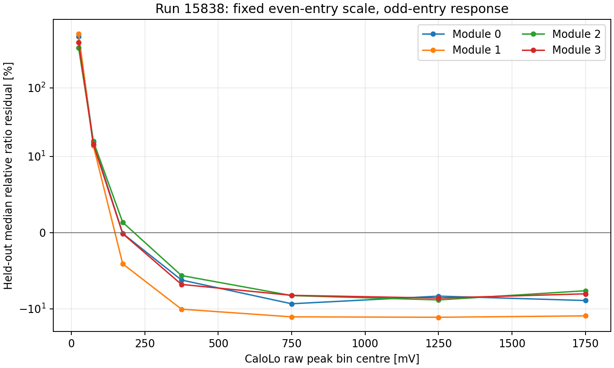

# Stage180：真实普通Ecal双量程覆盖与留出相对响应

## 阶段目标与冻结输入

落实用户Stage172补充方案中普通Ecal双量程方向：先核目标时期是否实际保存两路、同模块映射和幅度覆盖，再判断它能否提供独立高幅参考。[冻结协议](stage180_energy_ml/protocol.json)只读原已知run15838单PHYS：`/eos/experiment/faser/data0/phys/2024_back/r0022/015838/Faser-Physics-015838-00000-00049-r0022-PHYS.root`。原前8192为两4096小pilot，成本过门才整个单文件；不扫描其他run/目录、不复制ROOT、不作ν/隔离/reserved前向。

实际Stage173 CableMapping按相同station/plate/row/module与不同PMT连接CaloLo硬件0–3和CaloHi16–19；分别为(0,16)/(1,17)/(2,18)/(3,19)，不是相邻闪烁体互作幅度真值。[用户技术综述](2026-11-08_stage172_retraining-and-detector-readout-supplement.md)中97%/3%分光说明硬件研究动机，不把该光比例直接指定成电荷gain。已有Stage161同原生4父的raw/peak/RMS/status共128标量float32精确核对；Calo标识在Stage161原字典问题中的支持与其他闪烁体分开，不伪造新历史runtime认证。

本源历史raw为正采样积分，Stage162已测96窗定义闭合；本阶段沿用其原producer raw，不将它说成当前signed raw，也不以fitted charge替代。所有父均在分母，非0status/缺失/负值明确计数；只是log比例控制需要两端status0、有限正Q、有限RMS>0、peak/RMS≥10。未读绝对能量校准值或用track/pz/风险挑选；本文件不认证μ纯度、ν背景或曝光，CaloNu坏设置不能据此一概否定普通Calo。

## 固定相对响应与结果

事前固定每模块一个median log(QHi/QLo)，仅原even entry且≥100个控制拟合；odd entry验证。幅度箱事前为Lo raw peak的0/50/100/250/500/1000/1500/2000mV，不事后选bin/多项式/阈值，不剔大尾。下表区间为留出残差的2.5/50/97.5百分位，**不是置信区间或已认证测量误差分布**；触发、共同光涨落、条件选择、producer整流等未纳入误差模型。

| 模块 | 全父 | 两端status0 | 正Q高SNR重叠 | fit even / heldout odd | Hi/Lo比例 | 留出相对残差2.5/50/97.5百分位 |
|---|---:|---:|---:|---:|---:|---|
|0|780874|15069|5802|2839 / 2963|0.037312992|-0.152930 / -0.003692 / 5.861640|
|1|780874|18600|7489|3751 / 3738|0.038569770|-0.191726 / 0.002150 / 12.018927|
|2|780874|13149|4989|2464 / 2525|0.036550153|-0.129862 / -0.004074 / 0.771636|
|3|780874|15631|5850|2908 / 2942|0.036962594|-0.142567 / -0.005461 / 5.740110|

[全支持表](stage180_energy_ml/full_support.tsv)给Lo非0而Hi Good/高SNR的支持分别155/437/159/173，不能一律称Lo ADC clip。Hi raw peak最大1221.518799/1807.290527/900.628296/843.330444mV；Lo约1900mV峰不是独立ADC code或PMT线性证明。连续字段均有限、raw负值和精确−999均0，与本producer整流定义相容，不据此改变其他signed变量的处理。

实际[固定幅度分层](stage180_energy_ml/full_amplitude_bins.tsv)揭示单一比例的局限：0–50mV Lo箱中位相对残差为+5.611561/+6.145440/+3.813388/+4.586532；500–1000mV为−.093268/−.130578/−.082532/−.082200。1500–2000mV为−.089007/−.126395/−.076172/−.080214，留出各25/34/23/24例。完整尾部和空≥2000mV箱保留，未用inclusive近零中位掩盖幅度依赖，也不将少数离群值当整个方向无信息。



图只绘已验证表格值，symlog纵轴保留低幅极大正残差；每点对应完整固定箱。比例不恒定的原因**未测量**：两路是否同一个有效pulse/窗口、条件选择/整流偏置、增益漂移/真实PMT响应等需要实测区分。不能直接把−8%至−13%指认为PMT非线性、物理校准偏差或修正因子，更不能用该相对比值给整个高幅路绝对真值。没有训练或部署拼接电荷。

## 验证、实际成本与存储

[成本门](stage180_energy_ml/admission.json)完整pilot GNU1.63CPU秒、两chunk读取0.103995832CPU秒，startup/postprocess单独计，三倍全量投影34.317139CPU秒≤800，连预留200audit≤1200。完整780874与pilot原8192逐列精确。

[独立审计](stage180_energy_ml/independent_validation.json)另一Condor作业完整重读同780874，再以Python标量遍历原字段独立重建四模块highSNR/role计数和statistics.median比例，与原full一致；128原生控制标量再次通过。它是独立读取/算法核查，不是新物理独立样本、跨run迁移或校准覆盖认证。

[资源](stage180_energy_ml/process_resources.json)与[调度账目](stage180_energy_ml/scheduler_accounting.json)：3start全exit0、0live，16scheduler CPU秒/86聚合execute wall秒。提交4核8000MB，站点实际4核12000MB；uproot4 worker、BLAS1，无GPU适用训练。full GNU3.74CPU秒/19.40wall秒，实际ROOT请求62064608B、RSS238404KiB；未测受控多核加速比、总物理网络字节或整run曝光。

[存储](stage180_energy_ml/storage_cleanup.json)只留原8192前缀缓存631419B，删1995456B重复运输/日志/spool，先核队列Iwd，Stage54原12文件不动。source_snapshots/execution_audits/worker_logs/terminal_spool在software/stage180逐字节核对归档；原TSV字节另存original_table_format，之后仅LF/引号标准化，parsed cells精确。无全文件数组或ROOT复制，图仅从worker表渲染。

```bash
python3 ml/stage180_freeze.py
python3 ml/stage180_ops.py submit --phase pilot
python3 ml/stage180_ops.py collect --phase pilot
python3 ml/stage180_admit.py
python3 ml/stage180_ops.py submit --phase full
python3 ml/stage180_ops.py collect --phase full
python3 ml/stage180_ops.py submit --phase audit
python3 ml/stage180_ops.py collect --phase audit
python3 ml/stage180_finalize.py
python3 ml/stage180_document.py
# 绘图只读已验证TSV，见stage180_plot.py
python3 ml/stage180_validate_docs.py
```

## 结论与下一步验收

真实普通Ecal确有同模块双读出和高幅区支持，原“是否有第二路”在该固定data源已回答。固定比例有明显幅度依赖与大尾，绝对高幅参考/误差覆盖仍未认证；原ν MC仅四cable、未保存第二路，**不能据此把双量程加入原模型**。这不是所有波形无信息或整条双量程方向结束的结论。

若继续此方向，下一有限任务输入为同精确PHYS/实际4模块/原固定幅度箱，冻结一次strict status0的同pulse/固定窗/通道时间约定核查和必要的少量matched native窗口；不扫窗口或剔尾。验收为解释当前Lo低幅大Hi/Lo以及高幅系统趋势的测量或明确缺口，再决定是否需实际LED/分光/HV控制与匹配模拟。只有真实参考及匹配模型支持后，才新训固定双路/状态对照，保留原所有低能与尾部门。

主线Stage179正在同原12自然父进行实际同窗噪声/clip/S0源干预；S0困难lowpz_highE缺面、真实相关噪声/信号保真/弱信号backscatter、背景效率/加权生成/相关辅助约束、乳胶及独立确认仍需实测。Stage177固定均时表示阴性、Stage87冠军、原全部门/全部K/角色/reserved关闭保持，整体目标未完成。
