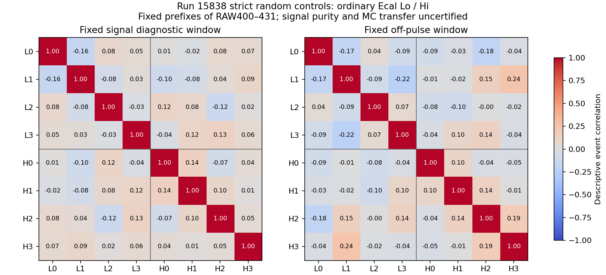

# Stage183：普通Ecal实际随机触发联合控制

## 阶段目标与新协议的依据

Stage179固定同窗MC12表明普通Ecal电荷误差主要来自噪声/基线而非ADC clip，因而按Stage172§7研究跨通道相关项是否值得投入。[本协议](stage183_energy_ml/protocol.json)独立冻结普通Ecal Lo0–3/Hi16–19问题，**没有执行历史Stage172 CaloNu合同**：旧合同原字节保持，CaloNu20–23与clock31只留审计ADC、不参与响应结论；不将run15838 CaloNu坏设置控制迁移为正常CaloNu。

固定实际catalog中RAW400–431每份8192 PhysicsTag前缀，先400/401验证/成本，再其余30文件，最后独立重读原2。字面输入 `/eos/experiment/faser/raw/2024/015838/Faser-Physics-015838-00400.raw` 至 `...-00431.raw`，不新增目录、替换文件、扩全run或按幅度删事件。COOL实际普通Ecal mapping来自Stage173，只核已有IOV，不重开条件接口链。

严格选择沿Stage171：唯一支持、frame/CRC有效的TLB，TAP=TBP=16；事件状态/input bits/GRL/幅度保留，不加信号纯度筛选。每通道测量仅在unique decoded valid非failed板与足够ADC样本时存在；缺/坏通道继续未知。所有strict控制保留至256/file，超过cap明确不认证覆盖。原reader唯一改动是strict ADC保留上限8→256，不改TLB语义；原400全8192元数据及所留全部ADC与Stage171精确相等。非strict前56仅作瞬时reference QA，不持久重复保存。

## 固定测量、单位和统计范围

以每通道ADC[0:40]均值为pedestal，signed残差=pedestal−ADC；signal_diagnostic为[60:140]、offpulse为[180:256]，Python半开区间。所有积分单位为**ADC-code×samples**，方差为其平方；没有给普通Ecal套用CaloNu的pC转换、没有光电增益标定、没有fit charge或arrival time。该raw窗不是Stage179 MC780–930ns窗，不能宣称同窗data–MC迁移。

两窗分别输出8×8 pairwise协方差/相关系数及每pair实际N，complete8另记秩/eigenvalues。每个Lo/Hi四路和方差比定义为 Var(ΣQ)/ΣVar(Q)，分子分母用同一complete4事件；**不反演协方差、不做GLS/降噪器/先验或模型注入**。固定1000次seed20261108183 file-block bootstrap，空文件仍在32块中，报告条件95%百分位区间；前16/后16文件作同定义稳定性描述，无多cell显著性发现声明。

## 实际输入与控制支持

实际32文件/262144条PhysicsTag前缀、116 strict，保留116控制；cap超限文件[]。逻辑RAW前缀读到字节合计2212665383B，不当作实际EOS网络/磁盘传输量，后者未测量。原前缀时间包络1720473060859252–1720474904380367微秒，非连续run曝光。

控制event status计数{'2': 113, '0': 3}；current/next input bits计数{'0/0': 116}，没有根据这些事后删选。实际每通道长度/rail见[hardware_support.tsv](stage183_energy_ml/hardware_support.tsv)，原25硬件保留作审计，分析只8通道。GRL标记逐控制/通道保存[积分表](stage183_energy_ml/integrals.tsv)，inclusive GRL通过不等于纯电子noise；真实quiet/beam污染比例未测量。

| 固定窗 | complete8 N | 协方差秩/8 |
|---|---:|---:|
|signal_diagnostic|116|8|
|offpulse|116|8|

即便秩满，也不自动说明协方差估计足够精确、所有本征方向稳定或可安全反演。每pair有限N、同文件相关及真实共同信号都需要保留在解释中。

## 固定四路和方差比与文件稳定性

| 窗口 | 量程组 | complete4 N | 比值 | 条件95%区间 | 前16 N / 比值 | 后16 N / 比值 |
|---|---|---:|---:|---|---|---|
|signal_diagnostic|ordinary_Ecal_Lo|116|0.93978075|[0.7591086, 1.1229977]|57 / 0.98694115|59 / 0.89451948|
|signal_diagnostic|ordinary_Ecal_Hi|116|1.1368037|[0.86291849, 1.3994703]|57 / 1.1330249|59 / 1.1187659|
|offpulse|ordinary_Ecal_Lo|116|0.75671151|[0.5172317, 1.0293954]|57 / 0.80568832|59 / 0.70953395|
|offpulse|ordinary_Ecal_Hi|116|1.1825313|[0.97025846, 1.4024039]|57 / 1.2956606|59 / 1.0598419|

完整[数值表](stage183_energy_ml/variance_ratios.tsv)保留bootstrap有效次数及方差分子分母；[8×8协方差表](stage183_energy_ml/covariance.tsv)包含每pair N，而不是假设所有通道都完整。图仅从独立通过的表渲染：



四个事前固定比值的95%区间**全部包含1**：当前未取得四路积分有明显共同噪声主导的支持。offpulse Lo点估计小于1而非共同正项，Hi前/后半块点估计也有变化；这既不是已证实反相关，也不能证明无相关/完全稳定。8×8图为描述性，不从128个cell中追显著项。当前证据不足以投入联合降噪器或假定其有Eν收益，本固定控制到此结束，不扩大文件数追显著性。

该方差比偏离1描述这些固定signed观测的协方差合计，不直接等于可去除noise份额。来源可能含电子共同基线、真实共同活动/串扰或其他DAQ条件，尚未分离；不能把共同shower信号当noise扣除。32个前缀/有限控制的区间不是全run、匹配MC或完整系统置信区间。

## 独立验证与成本

[审计](stage183_energy_ml/independent_validation.json)第二次实际读RAW400/401，所有保留strict ADC/metadata精确；原400与Stage171完整8192精确。Python math.fsum独立重算每个通道固定窗积分、128个协方差和4个和方差比，核四组complete支持。全32字面路径核实际旧catalog，独立TLB标量选择核reader strict标志，未把共用官方decoder称独立硬件实现。

独立积分1856个，最大绝对差0ADC-code×samples，协方差与比值逐项在既定算术容差内。

pilot含reader编译和完整Python/子进程GNU合计7.29CPU秒，三倍×32/2=349.92≤1400，已用+投影+600audit≤2400才full。4个文件进程/BLAS1并行；完整30文件GNU47.11CPU/14.82wall秒、主进程RSS70144KiB，单文件子过程RSS在原summary，非受控加速比。

scheduler 3start全exit0、0live，67CPU/52聚合execute wall秒；提交4核8000MB，实际核[4]、内存[12000]MB。GNU与子过程计时嵌套，不再加到scheduler；无GPU、G4/重建/新ν/能量fit或forward。

## 存储、命令和阶段结论

[存储](stage183_energy_ml/storage_cleanup.json)保留1105870B严格控制ADC，低于12MiB；删除5631334B重复运输/日志/spool，独立两文件重复ADC已核解压字节相同并[重联](stage183_energy_ml/control_rejoin.json)到pilot。源版本/所有实际源码/成功日志/GNU及终态spool精确保存software/stage183，清理前核队列Iwd；不留RAW/xAOD副本，Stage54原12资产保持。

```bash
python3 ml/stage183_freeze.py
python3 ml/stage183_ops.py submit --phase pilot
python3 ml/stage183_ops.py collect --phase pilot
python3 ml/stage183_admit.py
python3 ml/stage183_ops.py submit --phase full
python3 ml/stage183_ops.py collect --phase full
python3 ml/stage183_ops.py submit --phase audit
python3 ml/stage183_ops.py collect --phase audit
python3 ml/stage183_finalize.py
source /cvmfs/sft.cern.ch/lcg/views/LCG_109/x86_64-el9-gcc15-opt/setup.sh
python ml/stage183_plot.py
python3 ml/stage183_document.py
python3 ml/stage183_validate_docs.py
```

普通Ecal已有真正的多事件/文件联合控制测量，超越原4控制不能估25维协方差的阶段；这项交付仍是**描述性相关性**。它没有完成真实信号保真、误差/区间覆盖、同条件MC迁移或ν能量收益。不能把数据共同活动扣掉后宣称测量更精确，不自动训练或扩大noise参数网格。

本轮按未获得共同项主导支持结束，不设计新估计器。后续只有regime匹配、纯度/串扰解释和未饱和真实信号支持存在，才另冻少量自由度的联合估计及独立电荷误差/覆盖检验。当前缺实际高幅独立参考/匹配双路MC、弱信号校准与global方向、S0困难侧面/材料细节、全生成加权/背景效率/真实相关辅助约束和独立确认输入；不凭假定补齐，不重复既有能量族或3000谱toys。

具体后续任务与验收如下；各行是条件分支，不要求用无依据的假定一次填完，也不自动提交新作业。

| 后续任务 | 必需实际输入 | 验收/停止条件 |
|---|---|---|
| 真实高幅参考与双量程响应 | 目标设置下逐pulse Lo/Hi及可追溯LED/光学独立参考，实际HV/range/窗口；匹配双路MC或经独立验证的响应 | 同光信号身份、低/高幅覆盖及留出电荷误差/区间覆盖；无绝对参考则保持相对响应，不做校准部署 |
| 联合电荷估计是否需要重开 | 新条件下足量严格控制及真实未饱和μ/信号、实际串扰/共同项解释；源/窗口/硬件匹配 | 先证明稳定且有用的相关项与信号保真，再校准误差覆盖；当前116控制四固定区间含1，不触发该任务 |
| 上游时间候选重开 | 弱信号timewalk独立控制、同父actual track空间与global方向/源支持 | strict时间和全校准联合覆盖通过；不能用当前MIP范围外父或换父填满 |
| S0困难侧机制 | 原缺面父的可认证实际测量状态/材料约定或独立预定困难侧支持 | 不能借9支持父代表原lowpz_highE两父；无面保留未知、不作μ能损加回 |
| 完整物理谱比较 | 逐生成事件物理权重/归一化及处理身份账目、背景模板/选择效率与真实相关辅助约束 | 加权分母和处理闭合，保留弱识别方向；不把历史6606398或EVNT N当物理接受度，不重复Stage140 toys |
| 最终单事例确认 | 可证明独立的生产家族或真实乳胶–电子匹配及误差/选择；冻结确认协议 | 低能真正优于传统并通过原全部门，隔离研究选择；当前reserved/role4不自动打开 |

Stage87、原两低箱/八层三尾与全部保护门、原角色/K/pz>50GeV/pz0-only/raw/typed missingness/signed/strict timing及reserved关闭保持，项目低能优势和完整物理精度目标未完成。
