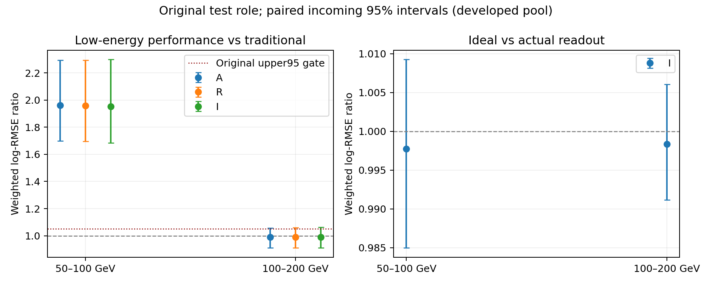

# Stage186：原队列实际／理想同PMT电荷的信息对照

本阶段已完成。原71376 active父、全部K和角色保持，9次新fit及独立审计通过，但理想同窗电荷未提供达到冻结门的双低能增量；实际模型最低箱仍明显弱于传统方法。固定A/R/I表示结束，不晋升、不扩窗或模型网格；整体物理目标未完成。

## 阶段目标与冻结输入

本阶段承接Stage185的物理连接认证，检验原队列上去除同窗噪声和截断后是否存在可学习的低能信息增量。Stage179的12父电荷机制不能回答这个问题。原Stage87、89033身份／71376active、所有K与角色、pz>50 GeV、八层三尾及全部原门保持；不生成隔离或reserved的新特征/预测，不做新G4。

[协议](stage186_energy_ml/protocol.json)承接原下一合同，冻结180000 CPU s：pilot4000、生产168000、fit/audit8000。原Stage184/185预算不改。8核24GB、每job最多8独立reader、最多4 job同时运行，内层线程1。读取POOL/ADC无CUDA实现，固定小CPUhist训练保持原3seed×400round，无GPU提速声明。

原7来源首40train的实际可用数量为40/40/40/28/40/0/40，来源254不足40、257无train/PHYS，保持原身份不替换。[原生产证据](stage186_energy_ml/source_producers.json)显示155来源6d6ab70b，125来源4a0e366b。后者字典新增VetoGm，不能复用旧解码；精确提取其五个字典构成[4a字典](stage186_energy_ml/IdDict_4a0e366b.xml)，原字节空白保留。两版本WaveformDigitisationTool及WaveformReconstructionTool源码diff为空；生产日志与实际stored ID仍逐源核。为认证第二个版本，在任何本阶段科学运行前加入来源129原前2train的语义检查，仍计入4000 pilot原额度，不替换原来源。

## 方法与特征约束

A107=X62+M45；R122=A+15路实际带符号同窗Q的asinh；I122=A+15路理想同物理PMT/同窗正信号Q的asinh，单位均pC。M逐路包括共同可用性、已知fit-invalid、ADC censor/overflow。R/I严格同一可用mask；无ADC不当作测量0，坏fit不自动删有效raw，负raw保留，未读者追加量为NaN。

6d6/4a的RDO生产日志认证digitization，不认证当前PHYS重建版本。首轮检查误把前者视作PHYS重建并假定正部分积分；独立诊断发现当前d32 PHYS实际为带符号全窗积分，已按其真实producer定义纠正新检查代码。6d6原重建的正部分算法不能套给当前PHYS。新R显式使用d32原同窗signed积分，不改原X62/raw11，不使用scint拟合charge替代。pz0是唯一一次方动量，px/py、q/p及弯折保留；不添加p0/p1/pz1、log动量比、truth vertex/S0/出生信息或坏fit物理时间。

原X62中的两项`VetoNu*_reduced_charge`是原ADC参考窗积分，并非拟合charge（[Stage56定义审计](2026-11-02_stage56_model-feature-validity.md)），故不能仅按名字将其误删。原typed清理按正量/计数/带符号量分别处理、结合wave状态与声明占位值；合法负raw、px/py和电荷符号−1不作通用缺失值。新增15路Q沿同一原则处理，未将−999或−1统一作为所有变量的缺失规则。

先通过[原输入控制](stage186_energy_ml/input_controls.json)、[小样本独立验证](stage186_energy_ml/pilot_validation.json)与[完整成本准入](stage186_energy_ml/admission.json)，才可新增cal/test字段。35组按原来源序≤8源共享Athena初始化，实际HITS条数/offset/稀疏身份/incoming/ADC/历史物理PMT与原窗逐父核；原40训练pilot及4父独立重读不按风险/能量改选。每源首2的literal核查使用未改32float32eps界，不用全队列昂贵literal。

三臂共9次从头训练，原weighted base_score、hist/depth5/eta.04等政策；各臂一次role2 ensemble log offset。Stage87仅复用，不新fit。paired incoming500 bootstrap seed20261108186+role；全原八层三尾和两低箱与传统上95%≤1.05、all/Stage87≤1.01、其余≤1.03、三尾差上95%≤2pp。Stage137两低箱cal/test均点≤.95且上95%<1才授权进一步扩展；不把oracle当部署校准或Bayes上限。

## 执行状态与实际数据

首轮pilot9677155 exit1，scheduler83 CPU s/100 aggregate execute wall s；原X62缓存重建已通过，但HITS总条数断言及实际Calo一float32 ULP控制失败，未进入新cal/test或能量训练。原输出包和源码完整保留，固定小诊断在原4000 pilot预算内进行，不调理想积分数值容差或换样本。诊断9677171 exit0，另87 CPU s/112 wall s；两轮共170 CPU s/212 wall s。来源254 HITS=RDO=784（首文件784、另9个空），与Stage70原实测相符，后续offset用实际HITS总数并要求等于实际RDO总数。2530项scint11与230项pz0精确；Calo直除精确866项，来源254重表达的差异需按Stage70原合同复现，不扩大旧容差。旧正部分假设在3202项均不匹配，不能错误地归因校准或噪声，已改查真实d32带符号算术。原失败与诊断原字节及[修正说明](stage186_energy_ml/input_control_repair.json)保留。

小样本修正版9677184 exit0，另261 CPU s/251 wall s；独立重读9677198 exit0，另112 CPU s/224 wall s。pilot阶段终态4start含1失败共543 CPU s/687聚合wall s，未超过4000原额度。230父/7实际来源、192literal最大差1.7762271454557776e-05 pC、最大容差占比0.0009467974048448048，原4父所有标量字段独立重读精确。原source257只有356个test事例而非role0，pilot不读test、full准入后保留该源，以原RDO/HITS身份和缓存raw控制认证。

完整main GNU187.59 CPU s/236.86 wall s、RSS1956552 KiB；内部CPU181.505724007 s/wall228.900301642 s、ROOT requested500633784 B。first execute前38.423550036 CPU s，first execute含冷JIT另58.34601564999999 CPU s；不能只以前者当启动。源后续均值π/K/其他下界0.28931446880269013 CPU s、charm0.5348677489487178 CPU s。成本按35次完整初始化、原71376父源别保守均值、额外源切换和三倍余量，production预测139212.3151894221 CPU s；含已用431、尚未结束audit预留1000及fit/audit8000，总148643.3151894221<180000 CPU s。8reader×1.25 RSS预测19106.953125 MB<24000 MB。ROOT requested外推96366813156.10434 B仅逻辑请求预测，网络量/全队列wall未测量；不是实测加速比。

[准入](stage186_energy_ml/admission.json)通过后提交原序35组/5作业，每组≤8来源/每job≤8进程、最多4个job；各job CPU上限38400/38400/38400/38400/14400 s合计168000，不短截K生产。以下保留当时的执行观察；最终实测结果与结论见后文，不以预算或预期代替结果。

生产首批9677214终态exit1、5099 CPU s/1121 wall s，原8组中7组成功，第3组在额外的“新官方重拟合raw必须等于历史PHYS raw”检查处停止。第二批9677215的8组全部成功。第27组也观察到同类差异；原父不删，未把差异当作物理异常。[舍入检查合同](stage186_energy_ml/baseline_rounding_contract.json)要求逐条实际PHYS身份/raw精确、实际新旧baseline相差至多1 float32 ULP，并分别从同一ADC积分精确恢复两份raw，最后独立有理数审计。当时闭合原因尚未认证，不能仅凭差值接近101采样×1ULP就下结论。新R/M/I及原X62、所有积分容差保持；修复仅使用失败组所属原生产额度的剩余CPU，失败耗时全部计入。

已提交末批9677262（组32–34，包括原source257的K/test）和修复9677266（只组3，原38400−实用5099=33301 CPU s剩余额度）。全部作业遵守最多4 live；成功reader与失败尝试分开记账，不能把35个成功分片称为全部计算次数。最终预算验证按pilot≤4000、每生产家族含修复≤原独立额度、fit/audit≤8000及总≤180000分别核对。

完整35分片最终均通过，修复9677272仅组18/20，9677275仅组27，均使用各原家族余额。四条实际PHYS基线均仅差1 ULP且各自signed积分精确闭合；当前R不改回旧值，原X不改成新值。最终4条均已通过独立有理数audit，重拟合baseline的底层平台原因未作受控定位。所有生产（含失败/修复）共28782 CPU s；加pilot后29325 CPU s，12终态start、10042聚合wall s，无新G4或独立ν。

首训练9677321在import时因官方Calypso Python环境没有`xgboost`而exit1，实用5 CPU s/14 wall s，未生成模型或预测。reader仍使用pinned d32，fit/audit改回原训练的LCG_109 view；修复9677327只可使用原fit3000−5=2995 CPU s。不是新的模型尝试或增加seed/round预算。原失败源码与日志留档，未改原科学协议/角色/特征/门。

## 完整能量对照：两低箱未过原门

9fit/3600轮完成，A107/R122/I122维度和原89033身份精确；role0/1/2/3为17657/46575/11612/13189，无reserved或隔离预测，Stage87无重训。以下为incoming加权log-RMSE比及500次配对incoming 95%区间，数值无量纲；不是独立新样本或完整物理系统区间。

| role | 真Eν箱 (GeV) | N / incoming / ESS | R/传统 | I/传统 | I/R |
|---|---|---|---|---|---|
|cal|E50_100|183 / 182 / 182.501377|2.086520 [1.808002, 2.398177]|2.086825 [1.815976, 2.407062]|1.000146 [0.986440, 1.012752]|
|cal|E100_200|904 / 899 / 901.506972|1.144562 [1.051164, 1.237713]|1.148779 [1.054630, 1.243794]|1.003684 [0.993914, 1.013882]|
|test|E50_100|183 / 183 / 183.000000|1.958185 [1.695659, 2.293622]|1.953742 [1.684532, 2.298903]|0.997731 [0.984972, 1.009262]|
|test|E100_200|856 / 851 / 853.507366|0.990851 [0.912287, 1.061147]|0.989206 [0.909837, 1.062013]|0.998340 [0.991194, 1.006067]|

[完整风险/偏差/R68/三尾](stage186_energy_ml/energy_metrics.tsv)、[所有配对区间](stage186_energy_ml/energy_paired.tsv)、[支持与ESS](stage186_energy_ml/energy_support.tsv)、[原联合门](stage186_energy_ml/energy_gates.tsv)和[决策表](stage186_energy_ml/low_energy_decisions.tsv)保留全部结果。test最低箱R/I/传统的log-RMSE分别0.285231952/0.284584734/0.145661386，正tail50为13.661202%/13.114754%/0%；第二箱分别0.245668616/0.245260755/0.247936985。最低箱问题仍存在，不能将第二箱约1%的点改善称为目标达成。

内容控制test R/A为0.998736/1.001049，I/A为0.996470/0.999387；cal R/A为0.996382/1.001049，I/A为0.996528/1.004737，所有对应两低箱区间均含1。I/R、I/A、R/A均未满足Stage137“cal/test双低箱点≤.95且上95%<1及尾部”扩展门。三臂cal/test的两低箱均未过原非劣效门，6个joint均false；其余6层RMSE保护通过不能替代主门。

另有I的test低pz真高E保护层三尾失败：相对Stage87总尾差上95%=2.912151 pp、正尾=2.344359 pp，均超过+2 pp，负尾上95%=1.116752 pp；原297条、297 incoming、ESS289.316417保留，不删困难父。A与R相对Stage87的三尾保护均通过。I即使是诊断oracle也不晋升，未测到有功效的去噪声/去clip低能内容增量；这不证明所有波形或所有非线性表示的Bayes信息上限。



[同图PDF](stage186_energy_ml/energy_low_bins.pdf)。两幅图均为HTCondor从固定表生成，无本地物理复算。

另按用户关注的**重建pz0=50–100 GeV**单独检查：test659条/659 incoming、ESS651.227510，R/传统log-RMSE比0.391454 [0.363905,0.419994]，I/传统0.391388 [0.363820,0.420548]，I/R0.999833 [0.995079,1.004922]。这里包含真E高的事例，不能将它与真Eν=50–100 GeV箱混同。R相对传统总tail50差−21.460892 pp，但正尾差+13.574661 pp、负尾差−35.035553 pp，需保留三方向迁移，不能只用总尾称全面改善。原低pz保护相对Stage87通过，新的理想电荷在此也未提供认证增量。

## 完整读出支持与程序原因核查

280原来源全部认证，其中155个6d6/125个4a；35成功Athena reader、39完整reader尝试（4次严格控制失败）。原699408项有效缓存raw比较中，4条因实际重拟合baseline差1 ULP而不同，分别以旧PHYS与同ADC精确闭合；其余比较精确。4条独立有理数积分全部通过，理想积分界、原X和新R表示均未改，删除父数0。Gaussian baseline重拟合差异的底层平台原因未隔离，不能写成已证实CPU/JIT因果。

| role | 原N | 15路共同全可用N | 至少一路共同可用N | 不可用通道条数 | signed负raw条数 | censor通道条数 |
|---|---:|---:|---:|---:|---:|---:|
|train|46575|18084|46575|56992|109922|63303|
|cal|11612|4756|11612|13712|26976|16840|
|test|13189|5669|13189|15048|30163|19785|

[分origin/component支持](stage186_energy_ml/energy_readout_support.tsv)给出原π/K/charm与来源全分母。尤其origin82的test356父保留、181父全15路、766条负raw、624条censor；原PHYS缺失未成为删K的理由。censor是通道记录而非独立父，负raw未钳0；不可用新Q为NaN，所有父仍用同一A控制。

## 独立审计、资源与产物

[独立审计](stage186_energy_ml/independent_validation.json)9模型重载、所有active预测/cal offset/Stage87 baseline、合并cohort每项标量及原230 pilot字段精确；独立八层mask/标量和144配对区间最大差均2.842170943040401e-14。[4条舍入记录及有理数核查](stage186_energy_ml/baseline_rounding_validation.json)逐条保留原/新baseline、raw、101采样与ADC sum，不用放宽charge容差。

[最终调度](stage186_energy_ml/scheduler_accounting.json)15终态start、5次exit1、0live，29521 CPU s/10175聚合execute wall s；这是包含程序失败/修复/运输与环境设置的账目，不与子进程GNU重复相加。[逐家族预算](stage186_energy_ml/budget_validation.json)实用pilot543/4000、production 28782/168000、fit/audit196/8000 CPU s，总29521/180000；5个生产家族含修复分别5798/7146/6504/6955/2379 CPU s，各在原额度内。

[成功reader资源](stage186_energy_ml/resource_validation.json)内部CPU27145.638627323 s、聚合reader wall37062.726742174 s、峰单reader RSS2630508 KiB；吞吐2.629372658父/内部CPU秒与1.925816211父/聚合reader wall秒仅描述本次执行，不是受控加速比。8核24GB/每job最多8 reader/最多4 job，ROOT/BLAS内层1；固定CPUhist与原训练一致，无GPU提速声明。实际成功reader ROOT requested134329899007 B，高于pilot逻辑请求预测96366813156 B，说明I/O外推不准确；二者均不是实测网络流量，失败reader的完整ROOT请求量及网络量未测量。逐组/来源资源与尝试表在本阶段目录。

[存储闭合](stage186_energy_ml/storage_cleanup.json)保留新标量/模型35717802 B≤67108864 B，删除629822295 B已核对重复运输、日志和自己的终态spool；Stage54原12资产保持、先核队列Iwd。35个分片、cohort、pilot/repeat和9模型/预测留在`ntuples/energy_ml_stage186/`与`ml/artifacts/stage186/`，不提交事件数组。全部提交版本、失败/成功原日志、GNU及spool分别精确归档到`software/stage186/source_snapshots.tar.gz`、`worker_logs.tar.gz`、`execution_audits.tar.gz`、`terminal_spool.tar.gz`及`native_audits.tar.gz`；同名重跑按phase保存，不覆盖历史失败证据。

```bash
python3 ml/stage186_freeze.py
python3 ml/stage186_ops.py submit --phase pilot
python3 ml/stage186_ops.py collect --phase pilot
python3 ml/stage186_ops.py submit --phase probe
python3 ml/stage186_ops.py collect --phase probe
python3 ml/stage186_ops.py submit --phase pilot_repair
python3 ml/stage186_ops.py collect --phase pilot_repair
python3 ml/stage186_ops.py submit --phase pilot_audit
python3 ml/stage186_ops.py collect --phase pilot_audit
# production_0..4各一次；终态收回后，仅失败组repair_0/2/3
python3 ml/stage186_ops.py submit --phase fit
python3 ml/stage186_ops.py collect --phase fit
python3 ml/stage186_ops.py submit --phase fit_repair
python3 ml/stage186_ops.py collect --phase fit_repair
python3 ml/stage186_ops.py submit --phase audit
python3 ml/stage186_ops.py collect --phase audit
python3 ml/stage186_finalize.py
python3 ml/stage186_validate_docs.py
```

冻结协议原字节不改；其`old_producer_raw`初始重建假设被明确拒绝，以`input_control_repair.json`和实测d32 PHYS/ADC闭合作为执行解释。不能在复现时重新采用已证伪的positive-only控制；全部提交协议/producer证明与归档源版本逐字节核查。静态验证及链接/旧路线全文/用户Stage172文档/Stage54检查见[文档验证](stage186_energy_ml/document_validation.json)。

## 阶段结论与下一步

已回答用户要求的“有意义支持上的同窗理想测量是否值得进一步修电荷”：在当前原队列、固定训练政策及这15路标量表示中，没有达到双低能扩展依据；原单事例最低能目标仍未实现。此固定读出候选结束，不继续窗口/seed/模型容量网格，不将12父电荷改善或oracle当部署收益。统一Q/Q+T仍缺实际新校准和可辨识支持，未测量，不能因此自动开启。

下一[Stage187合同](stage186_energy_ml/next_execution_contract.json)转回已有S0/μ辐射机制的有限能量账目：仅原固定12父、9个既有面/原3个未知，复用保存的主μ逐步端点和Stage179同窗来源，先原50小验证与成本，再全部固定父及独立标量审计。目标是区分实际面前损能、拟合参考残差与面后同窗活动的关系；不把出生能量和charge当损能，不插值过面或重复材料能损，不用缺面两困难父的替代样本。新240 CPU s、零G4/新父/能量fit或forward；端点/关联支持不足就明确结束，不扩重放。具体输入、验收与停止条件在合同。

困难侧S0/材料修正、独立高幅参考/匹配双路MC、实际背景效率/加权归一化/辅助约束、乳胶或新production独立确认仍缺。后续物理模型只能使用实有辅助输入，不能用任意prior替代。Stage87、原所有门/K/角色/reserved关闭与整体未完成保持。
