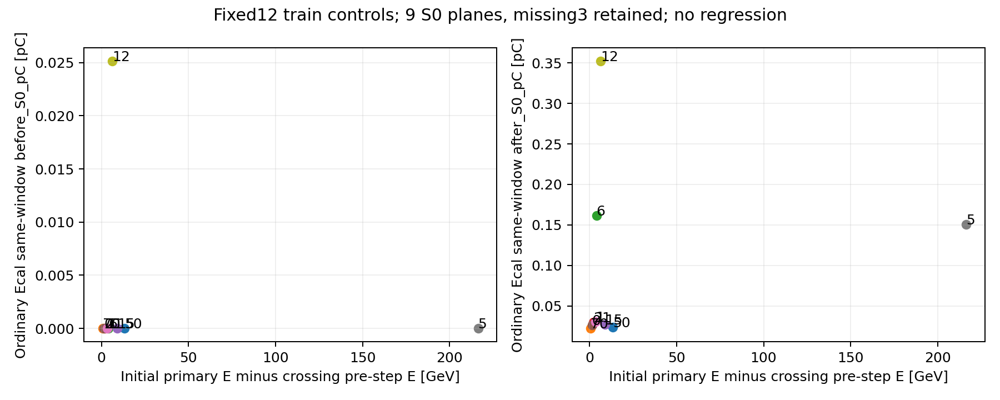

# Stage187：S0主μ能量端点与同窗来源账目

## 阶段目标与冻结输入

Stage186已在有意义的原71376 active支持上完成实际/理想电荷对照且未触发双低能扩展。本阶段按[原合同](stage186_energy_ml/next_execution_contract.json)和[本阶段协议](stage187_energy_ml/protocol.json)复用固定50/70/6/21/8/63/2/15/0/1/5/12自然父，核主μ初始/实际步端点、已有S0面与Stage179同窗源。原12分母、9面和8/63/2缺面保持，不按能量残差或是否选中替换父。

输入为Stage176的50号、Stage178其余11号保存的lineage JSON.gz、原state_boxes/intervals、Stage179最终charge_interventions与parent_diagnostics，以及Stage131原matched_input/cases。旧已认证observer19列明确记录root、前后xyz/总能/动能/时间/方向；本阶段不保存新轨迹数组。全部计算/绘图/审计在HTCondor，LCG_109、2核4GB/最多1job/内层BLAS1，无新ROOT/G4/digitization/reconstruction、父、训练或forward。

主μ“confirmed”沿原唯一primary barcode/pdg与入射母关联，不能单由一个μ候选推断。仅已有有效面且关联确认者比较缓存拟合E与真实μ；pz0是唯一模型一次方动量，诊断用既有px0/py0/pz0计算能量，不生成任何新模型变量。原raw/status/typed缺失与合法signed负值不改，不使用坏fit时间。

## 原50小验证与成本准入

50号4211主μ步，初始89.7286261616183 GeV，S0实际步端点76.43704827720288/76.43697230456947 GeV精确复现Stage176；至两个端点损能13.291577884415412/13.29165385704882 GeV。这里是主μ总能变化，包含所有实际输运过程，**不是纯辐射损能或可加回强子能量**。Calo面前出生源0 pC、面后0.023539577884238477 pC，charge单位不能当GeV。

完整pilot GNU0.48 CPU s/0.78 wall s/RSS43592 KiB，scheduler1 CPU s/6 wall s；余11三倍外推加20 CPU s固定绘图/开销预留为35.84 s≤analysis100，连pilot40/audit100预留总175.84≤240，才提交其余11。[准入记录](stage187_energy_ml/admission.json)的20秒为未测开销预留，非实测速度/加速依据。原各阶段历史预算未提高。

## 实测逐父能量与普通Calo来源

下表损能ΔE=初始主μE−**过面步pre端点E**，拟合残差=缓存float32分量计算Efit−该pre端点E，单位GeV；Q为原同窗模拟信号pC。pre与post均实际测得并在完整表分别保存，不插值成精确过面能量。无S0者前/后分类写未知，不能把源表的空类别0误当作物理测量零。

| frame | 原层 | ΔE至pre (GeV) | 缓存Efit−pre (GeV) | Calo面前源Q (pC) | Calo面后源Q (pC) | 面/主μ关联 |
|---|---|---:|---:|---:|---:|---|
|50|E50_100|13.2915779|-2.998854|0|0.0235395779|有/确认|
|70|E50_100|0.697012204|0.685090141|0|0.0222017842|有/确认|
|6|E100_200|3.95886628|1.26884901|0|0.161743502|有/确认|
|21|E100_200|2.04244382|-0.00841068873|0|0.0297018042|有/确认|
|8|lowpz_highE|未测量|未测量|未知|未知|缺/未确认|
|63|lowpz_highE|未测量|未测量|未知|未知|缺/未确认|
|2|high_y|未测量|未测量|未知|未知|缺/未确认|
|15|high_y|8.99072245|0.683135282|0|0.0271874141|有/确认|
|0|transition|1.36455019|13.806921|0|0.0264029356|有/确认|
|1|transition|3.41562371|-5.97849823|0|0.0302314951|有/确认|
|5|highE|216.430488|776.248435|0|0.150762948|有/确认|
|12|highE|6.24287088|-16.6464369|0.0251198714|0.351925165|有/确认|

[全部能量端点/最终坐标/原train误差/资源](stage187_energy_ml/parent_ledger.tsv)、[五子系统源汇总](stage187_energy_ml/source_ledger.tsv)与[标量JSON](stage187_energy_ml/ledger.json)给完整数值。9面各1次前向过面，9个领先主μ关联确认；原两个lowpz_highE父8/63及high_y父2没有本次重选面，不以其他父替代它们作困难侧结论。

50号与70号同属最低真E层，面前损能分别约13.29与0.697 GeV、缓存拟合残差约−2.999与+0.685 GeV，而普通Calo面前源均为0 pC。5号的面前损能216.430488 GeV，Calo面前源仍0 pC、面后源0.150762948 pC；其缓存拟合残差+776.248435 GeV保留，不裁成更好看的样本。12号Calo面前源0.0251198714 pC、面后0.351925165 pC，也不能从单一量比反演GeV。已观测到的“损能位置”与“同窗下游响应来源”是不同量，不能从总μ根Q直接推出加回量或认定总Q越高越该扣除。

缓存Efit仅由原float32动量分量计算，和原50 native Efit存在约3.1e-6 GeV表示差；本阶段不冒称恢复真实double拟合状态。参考残差正负不一，单一正的材料加回不能解释这些数值；**实际逐track已应用材料修正和残差成因仍未测量**。协方差并非全无记录：[Stage176](2026-11-08_stage176_S0-birth-and-crossing-pilot.md)已保存50号native 5×5矩阵，[Stage149](2026-11-08_stage149_native-covariance-and-raw-control.md)已保存61条μ控制轨迹的完整矩阵；这些已有矩阵尚未认证同面pull或覆盖率。本阶段没有核查其他固定父的native协方差，也没有用上述控制替代原队列或困难侧支持。不把未知归因成已证实材料、散射、拟合或digitizer故障。确认主μ身份也不认证动量精度。

所有12父最后保存的端点实际z=12000 mm，不能把该终点总E称为Calo入口E、测到的Calo能量或全逃逸能流。逐步drop与相邻gap分别记账，初始到最后端点的总变化不替代v→S0损能；不求和次级出生KE作为主μ辐射损失。8号的Calo unknown_S0=0.304313038 pC、63/2号主要其他根响应分别4.487766472/7.165060278 pC，均保留类别语义，不把unknown改成面后。



[PDF](stage187_energy_ml/energy_source_ledger.pdf)。图为9个已支持面的描述，密集标签以完整逐父表为准；原缺3分母明确，不做回归、相关显著性或总体比例。阶段只读取Stage131既有9个train误差，无新模型推理/拟合，也不将它们称Stage186独立test。

## 独立审计、性能与存储

[独立审计](stage187_energy_ml/independent_validation.json)从原raw字段逐步用Fraction验证28746段恒等式：初始−最终=Σ步drop−Σ相邻gap−首次pre与初始之差。相邻非零gap条数0、最大0.0 MeV；12父身份/9个原cross ordinal及端点/9主μ关联、371个来源电荷标量和汇总精度全部通过。S0端点用原box再做有理数面侧核查，缓存Efit平方根仅作4 binary64 ULP前向舍入包络，不改变原Stage178/179物理或float32卷积界。

[调度与预算](stage187_energy_ml/scheduler_accounting.json)3job全exit0、3start、0live，13 CPU s/28聚合execute wall s；pilot/analysis/audit为1/7/5 CPU s，对应原40/100/100，合13≤240。完整analysis GNU6.32 CPU s/6.40 wall s、RSS86036 KiB；audit4.30 CPU s/4.78 wall s、RSS81848 KiB，资源表在[process_resources](stage187_energy_ml/process_resources.json)。2父worker并行，事件格式/小标量运算无GPU适用性；未测受控加速比和网络流量。每父压缩lineage字节数与内部CPU/wall留表，是实际输入文件大小，不是网络I/O。

[存储闭合](stage187_energy_ml/storage_cleanup.json)留标量/图166502 B≤2097152 B、删35534258 B重复运输/log/spool；37个原输入逐字节保持，Stage54原12资产size/mtime保持，先核队列Iwd。没有复制新事件数组。源/各提交冻结协议、原日志、GNU和终态spool精确归档于`software/stage187/source_snapshots.tar.gz`、`worker_logs.tar.gz`、`execution_audits.tar.gz`及`terminal_spool.tar.gz`；提交目录仅留compact execution_index。科学产物在`workbook/stage187_energy_ml/`，ROOT和大中间文件为0。

```bash
python3 ml/stage187_freeze.py
python3 ml/stage187_ops.py submit --phase pilot
python3 ml/stage187_ops.py collect --phase pilot
python3 ml/stage187_ops.py submit --phase analysis
python3 ml/stage187_ops.py collect --phase analysis
python3 ml/stage187_ops.py submit --phase audit
python3 ml/stage187_ops.py collect --phase audit
python3 ml/stage187_finalize.py
python3 ml/stage187_validate_docs.py
```

本地只做文本/源码、提交监控及精确字节归档，未本地读取事件数组或复算物理统计。Python AST/bash、全部提交协议原字节、旧路线全文/用户Stage172文档/旧合同、链接与diff检查见[文档验证](stage187_energy_ml/document_validation.json)。

## 阶段结论与后续输入

原12固定能量账目完成，支持“既有同窗源不能直接当面前主μ损能修正”的有限解释；困难侧未支持、材料/协方差/实际可测伴随量仍未知。这个结论不是整体μ辐射机制阴性、Bayes信息上限或低能性能改善。保留原Stage87、所有门、pz>50 GeV/全部K/角色/reserved与隔离关闭；整体低能优势和完整物理精度目标未达。

按用户Stage172路线，可执行的固定Timing、上游必要时间支持、双量程/相关随机控制、原队列理想读出与现有S0账目均已交付相应有界结果。统一Q/Q+T、真实高幅校准、背景效率与加权归一化及独立确认仍未测量；这些有条件任务需要实际新输入，不能填成“全部完成”。

[下一输入合同](stage187_energy_ml/next_execution_contract.json)列出具体接受项：有身份和误差的乳胶/电子z或新早期track锚点；同父的实际拟合材料/协方差与困难侧S0支持；独立幅度参考及匹配双路MC；明确处理集合的真实背景/效率/GENIE-flux权重与辅助约束；新production或真实匹配的独立确认。任一到位后先核身份/设置/selection与小样本成本，另冻相应有界实验和验收，不自动重开现有失败窗口/模型/seed格点或已有3000toys。不追加无新物理问题的metadata生产或重放。
