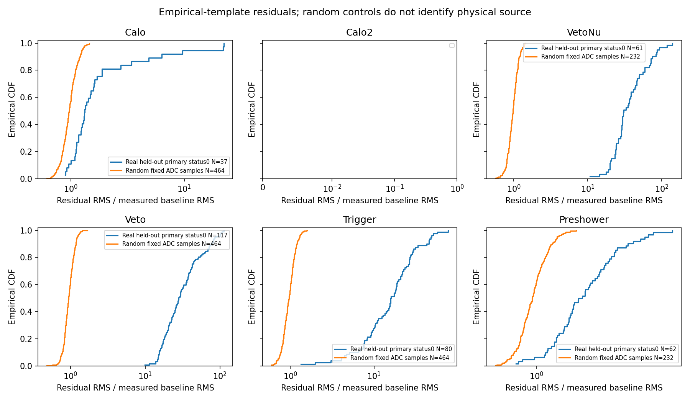
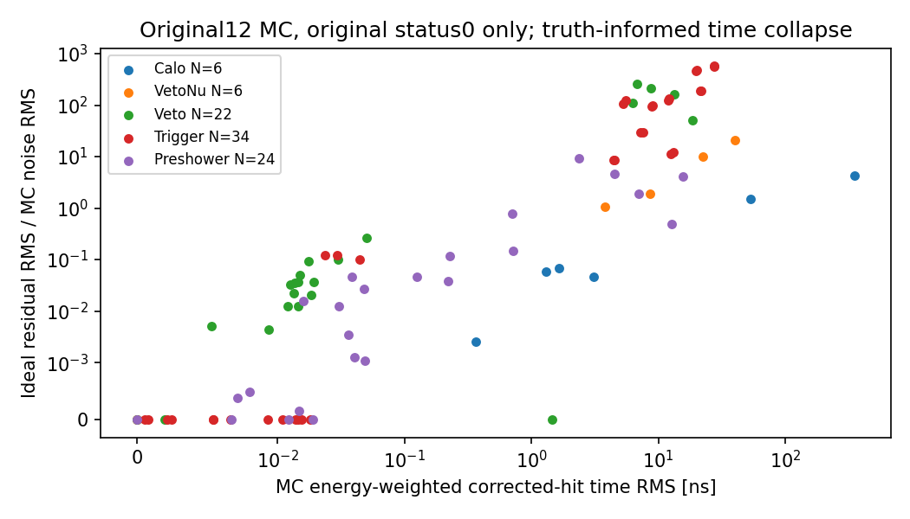

# Stage196：Good Hit波形形状与原生MC时间塌缩对照

日期：2026-11-08。执行[电子观测研究§8](2026-11-08_stage187_electronic-only-observables-research.md#8-波形的剩余可能性来源形状低于上述主线)的有限F路线。目标是在原始Good Hits中检查幅度、常数baseline与**一阶时间平移**之外的形状，并核实已有时分辨MC是否支持这种结构。**真实闪烁体留出波形存在超出固定随机读出控制尺度的经验形状差异；MC也存在不能被本次单脉冲切空间吸收的时间结构。来源和真实误差覆盖尚未识别，能量收益未测量。**

这是一个已冻结的物理可行性对照，不是新的Q/timing估计器，也没有能量fit、energy forward、新G4或新重建。不重开Stage129/177/186或191已经结束的表示、窗口、seed或容量网格。

## 输入、原始分母与冻结

[协议](stage196_energy_ml/protocol.json)及[数值定义](stage196_energy_ml/numerical_definition.json)在pilot之前冻结，起点commit为`05a5a48498b8b9053c1f040e5a0e91560a2f9757`。

- 真实：沿用[原映射](stage162_energy_ml/matched_manifest.json)，run15838原4→64父事件。REC为`/eos/experiment/faser/data0/rec/2024/r0022/015838/Faser-Physics-015838-00006-r0022-xAOD.root`；PHYS及native entry/event身份见映射。原4参考为`ntuples/energy_ml_stage161/event_records.json.gz`。没有按幅度、能量、μ纯度或残差选择新父。
- 随机：仅Stage183已有32文件400–431缓存的116 strict控制，`ntuples/energy_ml_stage183/{pilot_400,pilot_401,full_402…full_431}_controls.jsonl.gz`；前16/后16文件分别57/59控制，没有扩展RAW样本。
- MC：仅Stage179原12父`[50,70,6,21,8,63,2,15,0,1,5,12]`的`ntuples/energy_ml_stage179/parent_<index>_response.json.gz`。先原50/70两父pilot；源类别与未知继承[Stage179协议](stage179_energy_ml/protocol.json)，全部12父保留，不因形状、缺面或困难侧删父。

真实64父共1536条原始记录，原status0为810；非0状态1/513/512/516/16/4分别573/100/35/1/5/12。**只有原status恰为0、primary且不属CaloNu的727条可提取sample/time/localtime**，其余809条上述向量与localtime全部为null，保留原status、角色、原始标量和结构长度。没有以新拟合成功覆盖原status，带额外bit的hit不当Good Hit。直接读persistent-v1以避免既知历史converter问题，不初始化geometry、不重拟合。

原4的384项raw charge/peak/baseline/RMS按float32精确匹配，pilot/full原4前缀及全64独立重读精确。本研究没有修改训练样本中的−999/全正变量−1的typed missing规则；真实sample及signed噪声的合法负值不置零、不当占位，缺失/非有限和无支持明确为null。新形状没有进入能量特征或改变原pz0/raw策略。

## 固定方法及其局限

真实波形以原保存sample最大值对齐，固定相对sample索引−8…32，共41点、2ns采样，即−16…+64ns；必须完全位于原保存窗，不填零或延伸。前32父仅按同detector/channel，至少4个eligible波形后构造逐点median的unit-peak模板。该经验模板混合了实际物理与电子学形状，**未认证为单pulse或MIP**。后32父留出；同一run/REC文件的父事件留出不称跨设置或独立外部确认。

对每个波形最小二乘投影到`span{1, template, gradient(template,2ns)}`，端点用单边差分，报告rank/condition、residual RMS(mV)、residual/原peak和residual/原baselineRMS。它只消掉**线性化平移**；有限相位的二阶项、模板混合、宽度变化和ringing等仍可形成残差。不是任意非线性时间位移后的最优残差，不是校准χ²或已定义的迟发粒子分类器。

随机只用实际hardware0–19内有模板的通道，在固定ADC[60:101]取41点，以ADC[0:40]估pedestal及样本SD；实际2V范围换算`2/16.384 mV/code`，投影至相同模板子空间。**不找随机峰、不估arrival/lag、不提取任何随机timing特征、不报告时间导数系数**；只是固定noise向量的代数投影。116条×16通道=1856投影，同一事件跨通道相关，不当1856个独立事件。没有高维协方差逆或“纯噪声”认证。

MC仅原官方status0 PMT。以原corrected per-hit时间/能量和`ml/stage141_analog.hxx`，同kernel/oversampling复现原理想信号；允许原32float32-eps界，实际55200 ADC样本最大差为**0 ADC**。随后每PMT正输入hit合并到能量加权corrected mean时间，保留总输入能量并逐PMT记录float32转换舍入，不做新digitization/RNG。原理想波形投影到该塌缩脉冲、其导数与常数上，仍取原status0测得raw峰中心的相同41点，必须在原保存窗内；不按truth峰重新择窗。报告corrected hit时间RMS/ns、positive hit数/源类别、residual/MC noise和residual/peak。这个干预是**truth-informed MC机制**，不是可部署的真实信号标定，也不创造独立ν支持。

## 真实留出结果

727个保存窗patch全部支持；16个通道有模板。Calo2前32父合计4条、后32父4条，但没有单通道达到4条模板门，因此这8条保留为无模板，不插补残差。其余719条完成投影，前32为模板开发内结果，后32为357条有模板留出。

下表分位是**经验95th，不是95%置信区间**；同父/同通道相关，未作总体发现显著性、真实误差覆盖或源标签认证。完整所有逐条/支持/condition见[真实表](stage196_energy_ml/full_data.tsv)、[模板表](stage196_energy_ml/full_templates.tsv)和[完整分组](stage196_energy_ml/full_groups.tsv)。

| 探测器 | eligible N/有残差N | median residual/baselineRMS，无量纲 | 经验95th，无量纲 | median residual/peak，无量纲 |
|---|---:|---:|---:|---:|
|Calo|37/37|1.321304929|12.13595792|0.05862307117|
|Preshower|62/62|1.651710811|3.439988503|0.03576206284|
|Trigger|80/80|15.95508792|47.83083545|0.04992479045|
|Veto|117/117|28.16383291|86.16279275|0.028809024|
|VetoNu|61/61|30.57925449|85.82599626|0.05050148945|
|Calo2|4/0|未测量/不支持|未测量/不支持|未测量/不支持|

Trigger/Veto/VetoNu的标准化median约16/28/31，而固定随机控制各通道median约1。其residual/peak约2.9%–5.1%；高SNR下小比例形状变化也能远大于baseline噪声。因此这支持“实际信号形状不是本次固定三维子空间加该随机尺度”的有限描述。**不能由此将残差直接命名为强子迟发、中子、afterpulse或μ辐射；幅度相关shot noise、baseline误差、电子学/宽度、二阶相位和混合模板均未分离。** Calo/Preshower差异较小且有尾，不以少量大残差停止或认证任何一类。



图中随机按探测器汇集通道，N是投影数，不是独立控制数。Calo2无模板为空图。真实baselineRMS与随机first40 SD的定义及条件不同；图是条件benchmark，不是已迁移的MC/data或信号/噪声覆盖检验。

| 模板通道 | 随机文件组 | 控制N | median residual/pedestalSD，无量纲 | 经验95th，无量纲 |
|---|---|---:|---:|---:|
|Calo:1|first16|57|0.9698991545|1.199720879|
|Preshower:12|first16|57|0.9349359256|1.280459454|
|Preshower:13|first16|57|0.971100675|1.288796549|
|Trigger:8|first16|57|0.9307415754|1.228178537|
|Trigger:9|first16|57|0.9973497132|1.290053989|
|Veto:6|first16|57|0.9370308126|1.218655523|
|Veto:7|first16|57|0.9886743402|1.21392912|
|Veto:14|first16|57|0.9149996135|1.186362905|
|Veto:15|first16|57|0.9677789676|1.210063859|
|VetoNu:4|first16|57|0.9999123941|1.226717229|
|VetoNu:5|first16|57|0.9885998422|1.284483879|
|Trigger:10|first16|57|0.9243565304|1.167746112|
|Trigger:11|first16|57|1.004137325|1.311707309|
|Calo:3|first16|57|0.9240355635|1.174084684|
|Calo:2|first16|57|0.943220238|1.184775004|
|Calo:0|first16|57|1.003894302|1.274594991|
|Calo:1|last16|59|0.952670949|1.311596188|
|Preshower:12|last16|59|0.9737644023|1.272092362|
|Preshower:13|last16|59|0.9598669667|1.171938518|
|Trigger:8|last16|59|0.9932242448|1.30884573|
|Trigger:9|last16|59|0.9869973255|1.300563115|
|Veto:6|last16|59|0.9510329216|1.213063245|
|Veto:7|last16|59|0.9232253504|1.255616546|
|Veto:14|last16|59|0.9313012683|1.20007024|
|Veto:15|last16|59|0.9996772914|1.225613795|
|VetoNu:4|last16|59|0.9443621292|1.290680302|
|VetoNu:5|last16|59|0.9898859549|1.259884728|
|Trigger:10|last16|59|0.9654592817|1.264993974|
|Trigger:11|last16|59|0.9180279595|1.211045331|
|Calo:3|last16|59|0.9522293917|1.244363737|
|Calo:2|last16|59|0.9784042162|1.251473664|
|Calo:0|last16|59|0.9820306325|1.317837553|

原116控制两半的量级一致，但没有据此建立任意幅度信号的误差模型。逐控制结果见[随机表](stage196_energy_ml/full_random.tsv)。

## 原生MC时间结构结果

原12父共92个原status0 PMT，92个均有本次投影支持，没有删大尾或对原源类别重新命名。完整见[MC表](stage196_energy_ml/full_MC.tsv)。

| 探测器 | eligible N/有残差N | median residual/MCnoise，无量纲 | 经验95th，无量纲 | median residual/peak，无量纲 |
|---|---:|---:|---:|---:|
|Veto|22/22|0.03588092328|207.4310417|4.69436267e-05|
|Trigger|34/34|8.598927738|509.1540484|0.009669236258|
|Preshower|24/24|0.02110796061|4.497749567|0.0001684367869|
|VetoNu|6/6|1.474181338|18.30974409|0.0163427632|
|Calo|6/6|0.06325754092|3.598997422|0.004272157828|



MC中的原生hit时间分散可造成高于其实际nominal noise参数的残余形状，Trigger尤其明显；不能将全部原生波形视为幅度和一阶平移后的同一个脉冲。Veto等组median很小而尾很大，两者均保留；12个指定父不是总体发生率或能量相关性的代表样本。**MC与真实采用不同模板/定义/设置与baseline单位，表中数值不能直接相除成MC/data分辨率失配。** 时间塌缩改变整个hit时间分布，不是只删除“晚强子”的因果干预，未识别真实data来源。

## Pilot准入、独立验证与资源

所有ROOT/gzip科学数据读取、统计、投影、绘图和独立审计均在HTCondor。本地只源码编辑、返回标量格式化、调度和精确字节归档。总冻结2400CPU秒，pilot/full/audit分配400/1600/400，最多1个4核/8GB请求；CERN实际RequestMemory=12000MB。微小41×3矩阵与I/O不适合GPU，本轮无GPU基准或受控多核加速比。BLAS/OMP线程固定1，避免小矩阵线程开销；不把4核请求称为4倍加速。

pilot原4有96记录/51status0、46eligible。原MC2父16波形/9600理想样本，闭合0ADC。完整GNU raw为17.61CPU秒、统计9.78CPU秒，最慢postfirst raw事件0.055305663CPU秒；三倍full投影203.6050193<1600CPU秒，[准入](stage196_energy_ml/admission.json)才提交full。pilot没有拟合真实模板或按效果大小选择继续。

full raw内部12.2688832CPU秒/25.03515236wall秒、ROOT请求4024288B、RSS768304KiB；统计内部13.40022194CPU秒/41.96140169wall秒、RSS767460KiB，后者不含绘图/进程启动。GNU含完整进程，不能与内部耗时重复相加；[资源表](stage196_energy_ml/process_resources.json)如下。

| 进程 | 总CPU/s | wall/s | peak RSS/KiB |
|---|---:|---:|---:|
|audit_raw_time|15.89|91.8|777776|
|audit_statistics_time|6.45|9.98|722272|
|full_raw_time|16.04|31.79|768304|
|full_statistics_time|22.12|54.81|790000|
|pilot_raw_time|17.61|37.09|769620|
|pilot_statistics_time|9.78|37.95|716880|

[独立审计](stage196_energy_ml/independent_validation.json)重读真实64父，full逐值与pilot前4精确；确认809条不可用记录的sample/time/localtime全null，727条eligible。独立`statistics.median`复核656模板点；两遍再正交modified Gram-Schmidt与`math.fsum`独立投影719真实/1856随机/92MC，最大归一化差2.671891715e-14，小于原`1e-8*max(1,maxabs(input))`界，正交条件通过。76096随机固定sample标量检查、2667逐行RMS/归一化/原始向量、49分组N/median/95th、16个pilot/full MC重叠均通过。MC输入向量独立核对原12父缓存，不把共用native kernel的数值复现称独立真实物理验证。审计内部3.623776125CPU秒/3.649719435wall秒，gzip各只解码一次。

```bash
python3 ml/stage196_freeze.py
python3 ml/stage196_ops.py submit --phase pilot
python3 ml/stage196_ops.py collect --phase pilot
python3 ml/stage196_admit.py
python3 ml/stage196_ops.py submit --phase full
python3 ml/stage196_ops.py collect --phase full
python3 ml/stage196_ops.py submit --phase audit
python3 ml/stage196_ops.py collect --phase audit
python3 ml/stage188_finalize.py 196
python3 ml/stage196_document.py
python3 ml/stage196_validate_docs.py
```

实际3个cluster9678723/9678732/9678741，3start全exit0、103累计调度CPU秒/301聚合execute wall秒、0live，未扩预算。终态队列核对后，原源码/提交worker/descriptor、GNU/log、历史标量及spool逐字节归档`software/stage196/`。紧凑缓存3525206B≤8MiB，删除22055624B重复包/终态日志；无ROOT/xAOD持久副本。缓存含已允许的紧凑status0 patch与审计重读，未对旧输入再编码。Stage54原12资产size/mtime不变，未操作其他项目或用户未跟踪资产。两张PNG/SVG已目视核查；Calo2的空图对应真实无模板支持。

## 阶段结论与下一步

F路线本次获得**真实Good Hit条件形状支持与原生MC时间结构支持**，超过了“是否有可读取波形”的接口结论；但还未得到经过独立信号控制的物理来源区分。本固定可行性包完成，不能把一阶切空间残差当成所有平移已消除的多pulse证据，不据此立即训练一个“迟发强子”能量头。

下一具体任务是取得**同设置独立LED/MIP/已标记信号控制**：原run/file/entry、PMT/channel/HV/gain/range、原ADC/baseline/保存窗/status和饱和/未检测共同分母，以及独立的单pulse/源身份或监测幅度。要求覆盖当前相关信号幅度、真实文件/设置留出，记录控制选择与不确定性。数量、产额和成本本轮**未测量**。这些控制需区分电子学/shot noise/模板混合/有限相位与实际非单pulse结构，不能用同ADC半窗或从本残差事后挑“干净pulse”冒充独立控制。

验收先为：在实际有支持的PMT/幅度域，一个有物理依据的信号与误差模型可预测留出形状/状态，并验证与实际空间或源测量的一致性；相应MC producer与控制设置匹配。若需要精确时间平移，必须另冻有支持的单pulse物理对照，不能在本包事后扫窗/模板阶数。只有来源区分可迁移后，才另冻一个固定形状内容表示、availability及条件打乱对照，从头训练原队列并按原双低能/八层三尾门验收；新增收益未测量。

其他路线按[需求表](stage196_energy_ml/goal_requirements.tsv)保持：A原IFT内容能量阴性及192–194身份解释已完成；B仍需原LOS单位/方向/参考面及真实active条件；D需同设置转换/overlay或测试束身份；E需2025四平面像素实际payload及匹配MC；谱路线需真实完整效率/权重/曝光/背景及相关辅助。没有将缺输入变成未知即结论，也没有把F控制作为所有主线串行前置。

原Stage87、所有K、train/cal/test/reserved/隔离角色、pz>50GeV、pz0-only一次方动量（允许px/py、q/p、弯折）、raw charge/typedNaN/合法负值/严格status0 timing与原所有科学门不变。**低真E优于传统、真实响应校准、完整物理谱及独立确认整体仍未完成**；本阶段没有新的能量结果，不宣称目标达成或理论不可实现。
