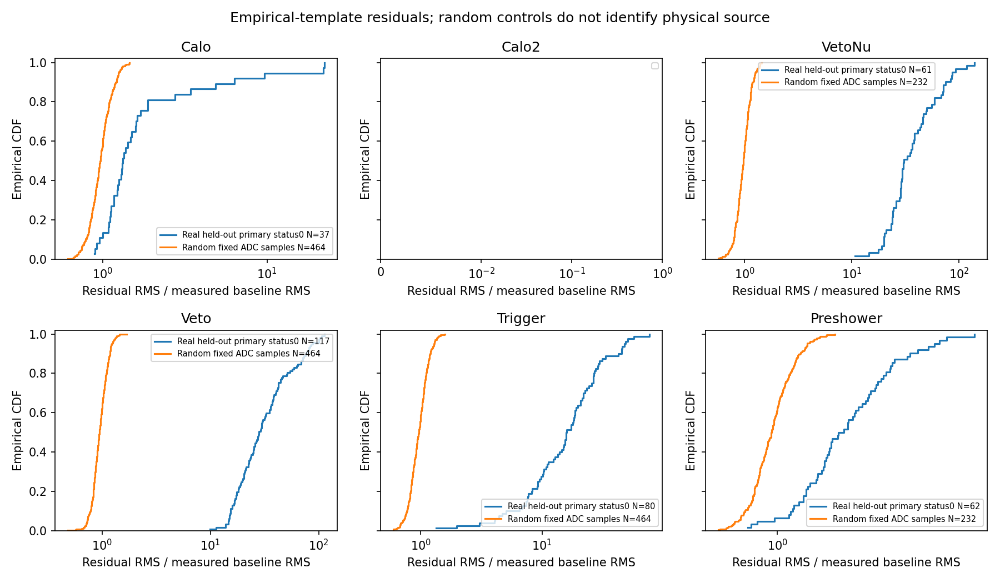

# Stage198：电子观测研究结果综合与待输入后的验收

日期：2026-11-09；起点提交 `7e80d7e`。本阶段执行[研究路线§9](2026-11-08_stage187_post-readout-research-roadmap.md#9-推荐推进顺序与结束条件)允许的“把已有条件方法结果整理成完整研究产物”，汇总 Stage188–197，并保留 Stage186 电荷对照和 Stage140 条件谱基准。**本阶段是研究综合，没有新实验；低真能量优势、真实响应校准、物理谱和独立确认仍未完成。** 用户暂留空的辅助输入保持待补充，不再次询问或搜索替代私有目录。

## 研究问题与统一比较条件

当前问题不是能否继续训练，而是哪个尚未结束的物理对照具备可解释的输入与独立约束。原完整能量队列有280来源、71376 active，保留全部K和原角色；最低两个真Eν箱为50–100与100–200 GeV。开发test分别183/856父，第二箱851 incoming、ESS约853.507366；cal分别183/904父。开发test已用于研究，不能称独立确认。

下表引用原incoming加权的自然对数能量RMSE之比，越小越好，无量纲；方括号为原500次配对incoming条件95%区间。区间不包含重新训练、研究选择及真实相关系统，不对多个实验联合校正。X是各实验的原基线，C是该实验自己的内容表示，I/R分别是同窗理想/实际电荷；各行是不同表示相对各自参考，不能凭比值在行间进行模型排名。

| 已结束的固定实验 | test真Eν 50–100 GeV | test真Eν 100–200 GeV | 已获结论 |
|---|---|---|---|
| Stage186：I/R，同窗去噪声/去clip诊断 | 0.997730906 [0.984971550, 1.009262409] | 0.998339792 [0.991194482, 1.006066591] | 未获双低能内容增量 |
| Stage189：C/X，四个signed raw层间组成 | 1.016564868 [1.007492308, 1.028268646] | 0.998936946 [0.994305943, 1.003965259] | 最低箱恶化，固定包结束 |
| Stage191：C/X，真实未用IFT测量内容 | 1.014804521 [0.989836728, 1.039204196] | 0.986479458 [0.969642752, 0.999367692] | 第二箱有限改善，未满足双低及尾部门 |

直接标量来源：[186配对表](stage186_energy_ml/energy_paired.tsv)、[189配对表](stage189_energy_ml/composition_paired.tsv)、[191配对表](stage191_energy_ml/ift_paired.tsv)。正式决定及全部cal/test/八层三尾分别在[186报告](2026-11-08_stage186_original-cohort-actual-ideal-energy.md)、[189报告](2026-11-08_stage189_signed-charge-composition-control.md)、[191报告](2026-11-08_stage191_original-cohort-unused-IFT-energy.md)；不能用本小表替代完整验收。

最低箱尚有明确问题：Stage186实际R/传统为1.958185 [1.695659, 2.293622]，Stage191 C/传统点值1.969147522；没有新的低能模型可晋升。Stage191最低箱相对Stage87总/正tail差上95%在test为+3.048780 pp，超过原+2 pp保护界；这是保护未获认证，不是总体尾部必然恶化的证明。原低箱上95%≤1.05只是非劣效，不能改称优越；原双低5%内容扩展及其他保护门全部保持。

## 低pz、身份混杂与低真能量需要分开

[Stage186](2026-11-08_stage186_original-cohort-actual-ideal-energy.md)重建pz0=50–100 GeV的test659父中，R/传统为0.391454 [0.363905, 0.419994]，但同一模型在真Eν=50–100 GeV箱明显更差。低pz队列包括高真E事例，传统方法在缺失能量大的事件上可有严重负偏；这一分层现象不能取代最低真能量目标。其总tail差为−21.460892 pp，正尾差却为+13.574661 pp，三个尾方向必须一起报告。

轨迹身份提供另一项实测解释。[Stage188](2026-11-08_stage188_unused-IFT-surface-predictions.md)完成实际surface、完整协方差、场与材料下的未用IFT预测；[Stage190](2026-11-08_stage190_real-data-unused-IFT-control.md)真实run15838原64父有63匹配及起始面支持、442全候选pull RMS=42.37973936。候选相关并含关联歧义，data没有SDO；不能把这一RMS当成主μ动量误差覆盖，也不能与MC条件子集直接相除。

[Stage192–194的实际沉积控制](2026-11-08_stage194_actual-fit-primary-deposit-support.md)在同160父中发现，charm两父原fit的35个clusters全部解析为无直接主μ正权沉积，unknown及无SDO均0；它们占该来源原纯主μIFT候选Σpull²的0.995541388。两父pz0分别52.6450546875/75.412859375 GeV，真Eν分别188.08/875.07 GeV。这支持“条件宽尾的fit身份分母存在混杂”，不支持删掉两父认证覆盖，也没有给出真实data错轨率、全部低能失败的归因或可部署真值选择。

因此，当前证据既没有证明单一电荷噪声是低能失败原因，也没有证明所有轨迹响应问题已校准。下一次响应研究需要独立身份和误差锚点；继续在相同开发test上扫描模型不能提供这些锚点。

## 波形与双量程：结构存在，来源尚未识别

[Stage196](2026-11-08_stage196_good-hit-shape-and-native-time-collapse.md)原64真实父有1536记录、810原status0、727个合格patch；16通道模板，后32父357条有残差。留出Trigger/Veto/VetoNu的residual/baselineRMS中位为15.955087917/28.163832912/30.579254489，固定随机控制各通道约1。相对peak残差仅约几个百分点，高SNR能使其远大于baseline噪声。原12 MC父的92个Good PMT、55200理想ADC样本复现最大差0 ADC；时间塌缩干预也留下原生时间结构。

以上投影仅去掉幅度、常数和一阶平移，尚未分离有限相位二阶项、模板混合、宽度、ringing、shot noise及物理来源。不能把残差标成迟发强子或中子，不能由不同模板/噪声定义得MC/data分辨率比；能量收益未测量。同设置独立LED/MIP或源标签信号控制按用户决定留空。

[Stage195](2026-11-08_stage195_dual-range-rectification-and-error-identifiability.md)在真实780874条中仍见幅度趋势：奇采集块、within2ns、high500–2000减mid100–250 mV相对残差差，四模块依次为−0.0848876529/−0.0869298235/−0.0951835193/−0.0787705839，原条件95%区间均不含0。但全280点L1随机经验界很宽，四模块未知比例的两组95%经验覆盖必要条件均未被排除。不同PMT光收集、信号baseline、整流积分与选择尚未识别；趋势不是PMT非线性认证，未排除也不是噪声解释成功。没有绝对幅度参考，不部署新校准。

## 真实数据与物理谱交付边界

[Stage197](2026-11-08_stage197_real-low-pz-candidate-support-and-aux-gap.md)实读run15838首PHYS前8192条，原谱仪与几何选择后、最终VetoNu veto之前2647条，其中351条pz0=50–100 GeV。这是含穿透μ及未知背景的探测器层支持，不是ν候选或真低能产额。原生PHYS无所需reduced charge，私有aux访问被拒绝；全部2647最终选择未知，confirmed selected0不是测得零产额。三倍full成本投影73046.383125154 CPU秒>原16000 CPU秒门，full未提交，MC交集未测量。用户明确目前没有输入、暂时空置，故本分支保持待补充。

物理谱已有可保留的条件方法成果：[Stage140](2026-11-07_stage140_finite-MC-profile-coverage.md)在固定参数点有限MC工作模型下，nominal Asimov 95%区间宽度为传统5.846968/direct4.859313/联合4.466929 pp；500 toy覆盖数分别482/476/467，即96.4%/95.2%/93.4%。联合较窄但不能据此认证95%覆盖；direct条件精度有价值。这不是实际data能谱，不能代替匹配曝光、背景、完整生成权重/效率、相关辅助和独立确认，也不重新调阈值或追加同点toys。

## 有输入后的具体任务与验收

下表是恢复研究的最小接口，不是要求一次取得所有输入，也不授权现在生产。新收益、所需统计量与新任务成本均为未测量；输入实际到位后，先冻结一个物理问题和小pilot，再按实测成本准入。现阶段没有新证据支持重开已结束模型或启动另一轮通用变换扫描。

| 可恢复任务 | 所需实际输入 | 首个验收结果 |
|---|---|---|
| B：散射平面有符号活动 | 原MC LOS单位/符号/参考面producer证据；真实beam条件和active/badstrip/DAQ支持；原native测量 | 轴与分母可解释；少量固定矩、新训练、availability及条件轴打乱，再验原cal/test双低与八层三尾 |
| A/D：μ响应与身份 | 同时期转换/真实overlay或独立μ控制manifest、selection、误差与条件 | 留出身份/响应/效率闭合；不以MC真值条件pull认证data覆盖 |
| F/双量程：信号结构与误差 | 同设置独立信号/LED/MIP及监测幅度，ADC/PMT/HV/gain/range、status/饱和共同分母和文件留出 | 预测留出形状、状态及二维响应，区分电子学与物理源；支持后另冻内容训练 |
| E：新时期像素 | 2025+实际四平面payload、几何标定、匹配MC及ν共同覆盖 | 独立时期的低能支持与模型验证；旧父不插补像素 |
| 真实最终选择 | run15838可访问aux的tree、run/event、myVetoNu0_rawCharge35及myVetoNu1_rawCharge35 | 核身份/重复/缺失及原reduced/fallback；另冻高效pilot，通过才测最终候选与role2/K MC交集 |
| 物理谱 | 匹配处理/曝光账本、背景、完整生成权重/效率和至少一项真实相关辅助 | 同物理模型的传统/direct/联合参数与退化，适当覆盖及独立确认；无归一化不报绝对flux/截面 |

已有普通Ecal模块/总量与相对μ局部活动并非未试观测：[Stage47](2026-11-01_stage47_ordinary-calo-information.md)已有87项X和四模块敏感沉积oracle；敏感沉积不等于读出能量。Stage187提出的模块边界传播误差仍须真实几何与协方差支持，不能把旧X的重编码或近似象限分配包装成独立测量。该候选保留物理问题，不因此重开模型网格。

## 本阶段工作、验证与执行范围

本阶段只读取已有Markdown/JSON/TSV科学摘要，撰写综合报告、更新两个路线入口并核对引文；没有ROOT/NPZ/gzip事件读取、重新统计、绘图、训练、forward、重建、G4或新HTCondor提交。引用图复用Stage196原图；各原阶段命令、输入、配置、CPU/wall、失败和审计详见所链接报告。本阶段新增科学计算CPU和GPU使用均为0；文档校验实测时间另记于[验证产物](stage198_energy_ml/document_validation.json)，不冒充物理吞吐或加速比。

复现文档核对：`python3 ml/stage198_validate_docs.py`，以及`git diff --check`。校验直接选择原TSV的role/stratum/candidate/reference行核对本报告表格，核对JSON的实际阴性决定、形状来源未识别和最终产额未知；只校验已有返回标量，不重算物理结果。所有相对链接、两个入口的历史字节后缀、Stage54原12资产size/mtime均核对。未变更用户未跟踪资产或清理无关目录。

Stage87、所有K、原train/cal/开发test及reserved/隔离、pz0>50 GeV保持；一次方动量仅pz0，px/py、q/p和弯折仍允许。新增闪烁体特征使用raw charge；−999及正定量中的−1按变量语义转typed NaN，合法signed负值保留，不能全局把负数删去；timing/形状仅原status恰0。Stage197既有选择的fitted-charge阈值未被本阶段更改。整体研究保持未完成，用户暂留输入不解释为整个项目暂停，也不以新的阶段编号制造实验进展。
