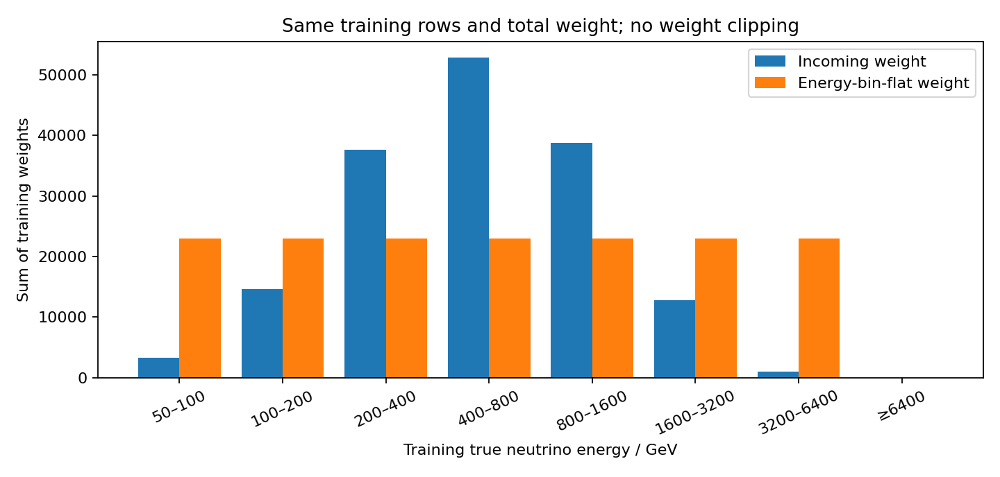
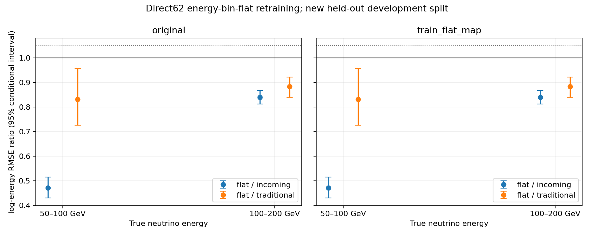

# Stage199：全flux样本的direct62能量分箱展平重训

日期：2026-11-09。用户明确暂停Stage187电子观测路线，要求检查Stage87 direct62 BDT的flat训练权重，使用全部不同flux MC、排除不同Geant4 model、重新划分并重训评估。**Stage87没有能量flat训练权重；本阶段已完成原权重与能量分箱flat权重各三seed，共6个新BDT。** 本报告回答这次权重实验，不把旧路线缺失辅助输入作为本任务前置，也不把开发结果当新盲测或真实data认证。

真Eν 50–100 GeV的test log-RMSE比：flat/incoming=0.471337（95% [0.430021, 0.514845]），flat/传统=0.831342（95% [0.726032, 0.957027]）。 真Eν 100–200 GeV的test log-RMSE比：flat/incoming=0.839610（95% [0.812243, 0.866688]），flat/传统=0.883058（95% [0.839216, 0.921524]）。 主比较对传统的双低箱非劣效门通过，对incoming模型的双低箱收益门通过，全部收益及保护门联合未通过。下文保留原谱/展平谱、cal/test和尾部的完整取舍。

**低真能量改善伴随全谱和困难层退化，不能直接替换全谱模型。** 原谱test总体flat/incoming log-RMSE比=1.102825（95% [1.096641, 1.109690]）；reco pz=50–100 GeV但真Eν≥200 GeV层的比=1.257209，tail50从32.164395%升至44.211007%。这两个结果同时保留，不以低能收益掩盖代价。

## Stage87权重核查与新实验授权

原[Stage87协议](stage87_energy_ml/protocol.json)明确每role同incoming key全部视图总权重1。[准备代码](../ml/resplit_energy.py)按`1/count(key)`赋值，[训练代码](../ml/transfer_posterior.py)将它直接传给direct的DMatrix，没有除以能量箱计数。原报告中的flat-logE是posterior先验变换诊断，不能据此称direct62已经flat训练。

对Stage87起点的Git配置逐项核对，62列顺序及typed规则与当前完全一致，见[特征与权重核查](stage199_energy_ml/stage87_weight_feature_audit.json)。Stage87协议的41列清单用于神经网络的预处理子集；direct训练代码实际读取完整62列，不能把两个分支的输入数量混淆。

新[协议](stage199_energy_ml/protocol.json)起点`cec3fc1`。用户同时确认倍增分箱50/100/200/400/800/1600/3200/6400 GeV及≥6400溢出，全部非空箱等总训练权重，无权重裁剪。此次“全量使用、重新划分”覆盖旧reserved/quarantine及旧禁止重训规则，但只对本新实验生效；原Stage87资产和旧split只读，原Stage187路线保持暂停。

## 全量样本、物理选择与程序支持

实际覆盖runs200080–200101全部1134份现有RDO父来源，每文件纳入概率1；没有只取每run三个文件或只取已有Stage87池。666来源复用完整Stage130 typed62缓存的全部角色/全部记录，304来源来自兼容本地merge withoutIFT PHYS，164来源补做统一官方稀疏重建。共366316条通过原选择的记录，全部来源已验证并纳入；每源见[覆盖表](stage199_energy_ml/source_coverage.tsv)。QGSJET在这里是flux模型，保留其π/K；不同Geant4 model的其他运行号不在本22run范围内。

每run首份排序生产日志共22份均实际读到`Sim.PhysicsList: FTFP_BERT`，原行与路径保存在协议；未逐1134来源重读所有simulation日志。新稀疏重建先从原PHYS仅选原ν类型、pz与fiducial的保守truth超集，省去不可能通过原truth选择的重建；随后仍执行完整原cuts，不按能量残差、loss、charge或产额挑父。实际RDO→sparse ntuple的run/event/incoming逐值闭合，eventID在原generation-range内。不是新G4或新的ν相互作用生产。

复用d32b0ff3现成构建、FASERNU-04/OFLCOND-FASER-06，未重编全框架。历史本地Calo公式为01-LG，新生产03-LG；逐模块检验原E_EM/charge后，按已知COOL常数一次转换至01-LG表示，不由truth或残差拟合比例。原闪烁体选择阈值未悄改，模型11路使用raw charge；typed NaN、占位−999/正定量−1与合法signed负值规则不变，缺模块总能量保持NaN，未全局删除负值。一次方动量仅pz0，px/py、q/p、弯折允许；原truth/reco pz>50 GeV、困难侧和全部K保留。没有新timing或对非0 status提取时间。

## 新划分与泄漏检查

采用seed20261109199按component对完整parent连通家族做约70/15/15训练/校准/测试随机划分，不使用真E箱、loss或预测挑角色。同一实际EVNT path/eventID、同flux跨几何/时期eventID，以及任意flux间重复的float32 native-MeV incoming(PDG,px,py,pz)联合绑定。浮点key保守合并近乎同输入的视图，所有记录保留，**无quarantine删除**。

初稿把所有component内同ordinal都绑定；在任何split/fit之前，依据不同flux是不同EVNT输入，澄清为canonical同flux跨时期绑定，见[事前记录](stage199_energy_ml/prefit_split_clarification.json)。这不是看test性能后的改分区；源生产包保留原字节，数据提取/选择不受影响。

| 角色 | 记录N | parent家族N | incoming key N | K记录N | 原权重记录ESS | flat权重记录ESS |
|---|---:|---:|---:|---:|---:|---:|
|train|256450|156792|161014|138936|200902.334526|56161.109527|
|cal|54936|33597|34487|29692|43067.269165|12048.253797|
|test|54930|33599|34496|29649|43068.444465|11800.758750|

同一source文件可含多个角色，**source-level并不独立**；完整上游GENIE seed谱系仍未认证。独立审计逐行重建incoming、canonical flux/event和EVNT/event的角色集合，均只有单一角色；不能把互斥parent/key夸大成互斥生产系统或未曝光盲测。旧样本池及路线已参与研究选择，本次测试仅对新参数拟合留出。

## Train-only能量展平与固定BDT

先定义每incoming总权重1的base权重w。令训练箱质量M_b=Σ_train,b w、总质量M=Σ_train w、非空箱数B，flat权重为`w × M/(B M_b)`。全部系数只用train计算，cal/test直接应用同一映射，不用各自箱计数重新调权。训练总质量保持M，避免整体权重尺度改变min_child_weight/λ。展平的是等宽log2能量箱总质量，不是线性能量密度、物理flux归一化或每flux成分各自展平。

| 箱序号（从50–100起，最后≥6400） | train记录N | 原箱质量 | train-only系数 | flat箱质量 |
|---|---:|---:|---:|---:|
|0|3401|3336.000000000|6.89508393|23002.000000001|
|1|15539|14609.000000000|1.57450886|23002.000000001|
|2|44694|37643.000000000|0.611056505|23002.000000001|
|3|77146|52898.000000000|0.434836856|23001.999999998|
|4|76604|38791.000000000|0.592972597|23002.000000001|
|5|35093|12777.000000000|1.8002661|23001.999999999|
|6|3973|960.000000000|23.9604167|23002.000000001|
|7|0|0.000000000|0|0.000000000|

实际只有7个非空训练箱，展平后各约23002 incoming权重单位；≥6400 GeV在train/cal/test均无事件，该范围性能未测量。最低箱系数6.895083933，3200–6400 GeV箱系数23.960416667；train记录ESS从200902.334526降至56161.109527。相同总权重不代表相同有效统计支持。



两臂都使用原62列、400轮、depth5/eta.04/subsample.8/min_child20/λ10/hist；三个seed2026110255–257，各臂用自己的weighted mean logE初始化、关闭boost_from_average。未早停或扫描容量/seed，六个模型均重载验证。使用cuda，XGBoost 2.1.3；实际CPU/GPU小样本耗时及GPU型号见[平台实测](stage199_energy_ml/platform.json)。GPU小样本基准不作为全量加速比，两个正式训练臂使用同一device。

模型位于[模型目录](../ml/artifacts/stage199/)的`incoming_<seed>.ubj`与`flat_<seed>.ubj`；完整合并input、split与两臂raw/cal/flatcal预测位于[科学缓存目录](../ntuples/energy_ml_stage199/)。它们是本阶段新资产，原模型与缓存未覆盖。

为区分训练先验和global offset，所有臂同时保存raw、同一incoming加权cal offset（`cal`）、训练映射flat权重cal offset（`flatcal`）。主训练效果比较`flat_cal/incoming_cal`；匹配flatcal作为固定独立诊断，不按test挑校准方式。实际offset为`{'incoming': {'cal': 0.001960082048295947, 'flatcal': 0.07073321122814669}, 'flat': {'cal': -0.033011791837568534, 'flatcal': 0.015079631654613608}}`，单位为自然对数能量。

## 低真能量结果与完整尾部

下表为原incoming混合下log-RMSE比，无量纲、越小越好。role2为cal、3为test，50–100与100–200均为真Eν/GeV。区间由500次component内parent家族配对bootstrap得到，条件于已固定模型/来源混合，不含重训、offset估计、完整source/生成关联、真实系统或研究选择；不是新独立确认。

| role | 真E箱 | 比较 | N | RMSE比 | 条件95%区间 |
|---|---|---|---:|---:|---|
|2|E50_100|flat_cal/incoming_cal|731|0.471257255|[0.442194906, 0.506980459]|
|2|E50_100|flat_cal/traditional|731|0.790215677|[0.715543654, 0.868646108]|
|2|E50_100|incoming_cal/traditional|731|1.676824426|[1.539075436, 1.808147751]|
|2|E50_100|flat_raw/incoming_raw|731|0.513213065|[0.488111728, 0.543896569]|
|2|E50_100|flat_flatcal/incoming_flatcal|731|0.445208548|[0.422974432, 0.470021873]|
|2|E50_100|flat_flatcal/traditional|731|0.901999797|[0.828020167, 0.981391921]|
|2|E100_200|flat_cal/incoming_cal|3382|0.853152843|[0.824003820, 0.876186969]|
|2|E100_200|flat_cal/traditional|3382|0.894186083|[0.859662577, 0.928996898]|
|2|E100_200|incoming_cal/traditional|3382|1.048096001|[1.009390943, 1.091347112]|
|2|E100_200|flat_raw/incoming_raw|3382|0.873208145|[0.847521410, 0.893745870]|
|2|E100_200|flat_flatcal/incoming_flatcal|3382|0.753074498|[0.728629079, 0.773226983]|
|2|E100_200|flat_flatcal/traditional|3382|0.927075228|[0.892546393, 0.962176529]|
|3|E50_100|flat_cal/incoming_cal|787|0.471337181|[0.430021279, 0.514845049]|
|3|E50_100|flat_cal/traditional|787|0.831341823|[0.726031591, 0.957027271]|
|3|E50_100|incoming_cal/traditional|787|1.763794279|[1.643618012, 1.898172660]|
|3|E50_100|flat_raw/incoming_raw|787|0.520211852|[0.482606165, 0.558893187]|
|3|E50_100|flat_flatcal/incoming_flatcal|787|0.453866668|[0.420840365, 0.489849992]|
|3|E50_100|flat_flatcal/traditional|787|0.964684206|[0.867667993, 1.087943740]|
|3|E100_200|flat_cal/incoming_cal|3323|0.839609893|[0.812243330, 0.866687879]|
|3|E100_200|flat_cal/traditional|3323|0.883057949|[0.839215993, 0.921524421]|
|3|E100_200|incoming_cal/traditional|3323|1.051747909|[1.007693102, 1.100679980]|
|3|E100_200|flat_raw/incoming_raw|3323|0.859224053|[0.835348433, 0.883293998]|
|3|E100_200|flat_flatcal/incoming_flatcal|3323|0.741245801|[0.718547636, 0.763383189]|
|3|E100_200|flat_flatcal/traditional|3323|0.915258540|[0.869646603, 0.957614724]|

完整真能量分箱的原谱test比较如下；incoming N记录重复视图去重后的key数，区间仍按parent家族重抽样。

| 真Eν/GeV | 记录N | incoming N | incoming log-RMSE | flat log-RMSE | flat/incoming | 条件95%区间 |
|---|---:|---:|---:|---:|---:|---|
|50–100|787|769|0.260829|0.122938|0.471337|[0.430021, 0.514845]|
|100–200|3323|3114|0.238256|0.200042|0.839610|[0.812243, 0.866688]|
|200–400|9626|8093|0.226743|0.254645|1.123056|[1.107649, 1.138370]|
|400–800|16557|11260|0.245200|0.302011|1.231692|[1.222419, 1.242794]|
|800–1600|16434|8331|0.288378|0.344092|1.193196|[1.184010, 1.203320]|
|1600–3200|7267|2704|0.383472|0.345544|0.901094|[0.885895, 0.916882]|
|3200–6400|936|225|0.616228|0.426259|0.691723|[0.661261, 0.724056]|
|≥6400|0|0|未测量|未测量|未测量|未测量|

50–100 GeV的平均相对上偏从23.025258%降至3.887006%，说明这次固定62输入、相同全量分区下，训练损失权重确实能明显减轻低真能量上偏。中间能区与同低pz真高E层的损失也是真实观察，不能据此声称增加样本已解决所有低动量歧义，或断言观测量已无信息。raw与matching-flatcal的总体/困难层配对比也都>1，故退化并非只由一个全局cal offset造成；各固定校准口径均保留，不按test择优。



图右为冻结train映射加权指标，未在test上重算flat系数。每个真E箱内权重因子为常数时，两种谱下的箱内风险相同；总体指标仍会变化，不能把flat总体收益直接当自然谱收益。

以下为原谱test风险；bias/R68/tail单位为%，log-RMSE无量纲，tail50指|Ehat/Etrue−1|>0.5，正/负方向分别保留。完整raw/cal/flatcal、train/cal/test、原谱/展平谱及每run/flux/component分层都在[指标表](stage199_energy_ml/metrics.tsv)，所有配对区间在[配对表](stage199_energy_ml/paired.tsv)。

| 分层 | 模型 | N | log-RMSE | mean bias/% | median bias/% | R68/% | 总tail/% | 正tail/% | 负tail/% |
|---|---|---:|---:|---:|---:|---:|---:|---:|---:|
|all|traditional|54930|0.523136|20.276073|-0.840216|28.008855|12.887986|3.469497|9.418489|
|all|incoming_cal|54930|0.269101|3.841754|4.184042|20.313127|5.812732|3.620213|2.192519|
|all|flat_cal|54930|0.296771|4.657692|1.982613|21.261527|8.075195|5.668358|2.406837|
|E50_100|traditional|787|0.147879|11.119670|14.289098|10.251136|0.130039|0.130039|0.000000|
|E50_100|incoming_cal|787|0.260829|23.025258|16.421926|17.466720|11.053316|11.053316|0.000000|
|E50_100|flat_cal|787|0.122938|3.887006|2.225460|9.216763|1.300390|1.300390|0.000000|
|E100_200|traditional|3323|0.226533|3.672805|9.148065|16.919245|2.007065|0.176622|1.830443|
|E100_200|incoming_cal|3323|0.238256|15.515576|11.226555|15.680994|7.177264|7.032755|0.144509|
|E100_200|flat_cal|3323|0.200042|2.818624|1.629283|12.661121|3.307643|2.729608|0.578035|
|pz50_100|traditional|2766|1.099055|-30.508362|-24.792190|48.429122|38.255657|0.042933|38.212724|
|pz50_100|incoming_cal|2766|0.439930|9.847003|10.245635|35.404048|20.191084|12.825115|7.365969|
|pz50_100|flat_cal|2766|0.505361|-3.915933|-2.930992|30.331137|19.345004|7.908301|11.436703|
|pz50_100_trueE200|traditional|1259|1.759378|-76.789061|-79.275922|13.475793|95.765772|0.000000|95.765772|
|pz50_100_trueE200|incoming_cal|1259|0.611428|-6.643516|-14.946917|47.644498|32.164395|12.958599|19.205796|
|pz50_100_trueE200|flat_cal|1259|0.768693|-9.268468|-24.427108|56.777699|44.211007|15.657338|28.553669|
|high_y|traditional|1722|1.560235|-68.649673|-77.194600|18.791967|84.017304|0.378595|83.638709|
|high_y|incoming_cal|1722|0.592361|-2.972827|-10.939810|49.144673|33.566932|14.598050|18.968881|
|high_y|flat_cal|1722|0.683263|1.679723|-6.886778|57.066196|39.250818|18.182696|21.068122|
|unconfirmed|traditional|2044|1.558999|-65.871516|-73.614211|21.526306|80.791515|0.438831|80.352684|
|unconfirmed|incoming_cal|2044|0.524553|1.081358|-6.013775|45.017778|26.478186|13.925708|12.552479|
|unconfirmed|flat_cal|2044|0.601401|5.780864|-3.186113|51.842168|32.178955|18.138315|14.040640|
|input_missing|traditional|35|0.887154|44.880279|-2.968287|48.645743|31.547105|14.693172|16.853933|
|input_missing|incoming_cal|35|0.312532|5.564056|1.719796|27.640939|12.964564|7.778738|5.185825|
|input_missing|flat_cal|35|0.374568|12.272983|12.121683|27.054971|12.964564|7.778738|5.185825|

冻结门的全部实际决定见[决定文件](stage199_energy_ml/decisions.json)。下表每一项同时要求cal和test通过；区间按上文条件解释。

| 谱 | 比较 | 双低箱≥5%收益 | RMSE保护 | 三尾保护 | 对传统双低非劣效 | 对传统双低优效 | 联合收益/保护门 |
|---|---|---|---|---|---|---|---|
|original|flat_cal/incoming_cal|通过|未通过|未通过|通过|通过|未通过|
|original|flat_flatcal/incoming_flatcal|通过|未通过|未通过|未通过|未通过|未通过|
|train_flat_map|flat_cal/incoming_cal|通过|未通过|未通过|通过|通过|未通过|
|train_flat_map|flat_flatcal/incoming_flatcal|通过|未通过|未通过|未通过|未通过|未通过|

原双低非劣效上95%≤1.05、内容扩展两低点≤.95且上95%<1、all1.01/其他保护1.03与八层三尾+2pp未放宽。联合门同时要求对传统双低非劣效、对incoming双低收益和全部保护。无论点值如何，都不自动晋升或宣称最终低能优越；同reco pz的改善不能替代真E两箱。Stage87旧缓存没有用于新test对照，其旧模型可能见过新test；本轮incoming对照是相同全量划分上的新训练。

## 独立验证、成本与存储

[独立审计](stage199_energy_ml/independent_validation.json)逐行验证角色互斥与base权重，另用math.fsum复算train箱质量和flat系数，检查全部feature typed域/模型allowlist；13608项来源数组与合并input逐值相等。6个保存模型对所有行重预测，CPU/GPU最大差见审计；校准offset分别独立回算。3360项独立标量RMSE/mean/三尾检查，最大差4.27746727e-12；32个低箱区间端点用另一条row-space计算通过。Stage54原12资产size/mtime保持，用户其他未跟踪工作未操作。

首次数值审计的固定CPU/GPU容差5×10⁻⁷ logE被实测最大差7.62939453×10⁻⁶超过，故该次审计未通过。最终审计用CPU XGBoost 2.1.3对每个事件、每棵树提取叶值，再在float64中独立求和，并用402次float32加法的逐行标准前向误差界核验CPU重放及已冻结GPU集成；六个模型全部通过。最终各臂CPU/GPU最大差为`[7.62939453125e-06, 9.5367431640625e-06]` logE，完整逐seed误差与界保存在审计JSON；不声称CPU/GPU位级相同。校准从实际冻结预测独立回算到2×10⁻¹²精度，未修改任何模型、预测、物理门或区间数据；不能把数值校验修正解释为放宽物理验收。

六pilot原三完整local文件及三重建前1000父均通过；重建π/K/charm selected37/45/13；全量准入的重建成本投影231841.1 CPU秒仅是规划估计，不是全量实测。source生产59个8CPU/24GB任务、最多20并发，没有旧K一小时限制；正式训练使用Kubeflow GPU，prepare/report/audit使用Kubeflow CPU。全部科学ROOT/NPZ读取、统计、绘图和审计在batch；本地只源码/文本/返回标量渲染、调度和精确字节归档。没有为本次有界任务申请外部输入。

Condor实际60start，累计scheduler CPU=123071.000 s、聚合execute wall=26113.000 s；失败记录`[]`，0live。Kubeflow实际Job/Pod、时间与资源单独保存在阶段目录，不将申请8核称8倍加速、不把CPU与wall重复相加。GNU各阶段和各源嵌套计时另见实际归档，不能再加到scheduler总量。

合并最初在HTCondor等待超过10分钟、start=0，随后取消未启动作业9679884.0并转至用户已授权的Kubeflow；这是调度调整，原ROOT生产已全部在HTCondor完成。首次Kubeflow prepare在xrdcp回传时exit54、报unauthorized；其科学退出状态及CPU未成功返回，明确标为未知/未测量，不能计为成功。改用已挂载EOS路径原子发布返回包后，r1回传成功并显示镜像缺`/usr/bin/time`、exit127，Python程序未启动。将现有x86_64 EL9 GNU Time1.9（仅依赖libc）加入作业包后，r2完成实际全量合并；六个能量模型只在成功合并之后首次拟合。两次失败Job/Pod及[执行失败记录](stage199_energy_ml/execution_failures.json)保留，不将失败成本隐藏为零。

GPU首次创建Pod时，CERN admission拒绝手动CPU/内存资源设置，尚未创建任何Pod或开始拟合；按服务策略仅请求同一MIG配额、由平台自动分配CPU/内存后成功执行。原拒绝记录保存在[资源修正记录](stage199_energy_ml/fit_admission_resource_correction.json)。最终CPU后处理请求2核、上限8核，内存请求6 GiB、上限12 GiB；训练实际自动资源及每个Job/Pod起止时间在[平台资源核算](stage199_energy_ml/kubeflow_accounting.json)。失败audit的GNU时间另有保留；前两次prepare失败CPU未测量，故不把已知CPU小计冒称完整跨平台总CPU。

GPU平台实际分配22 CPU、63G内存和1个H100 `mig-3g.47gb`，XGBoost使用8线程。包含Python启动/导入的完整fit进程实测CPU=9.600 s、wall=23.230 s、峰值RSS=1447248 KiB；逐seed计时含训练、保存、全体预测及重载核对，不能把它当纯boosting时间，也没有全量CPU重训加速比。

新处理的468份完整来源共4622700个原始父事件、143801条选中记录；源处理嵌套GNU CPU=121560.560 s，对应38.027959父事件/CPU秒和1.182958选中记录/CPU秒。这些成本不含复用666源此前的处理成本，已包含在本次scheduler总量内，不是串并行加速比。[逐源资源表](stage199_energy_ml/source_resources.tsv)和[资源汇总](stage199_energy_ml/resource_audit.json)保留实际数据；完整重建/analysis总I/O未测量，uproot提取请求字节单独报告。

[存储闭合](stage199_energy_ml/storage.json)记录保留195171001B科学缓存/模型与归档、清理222858343B重复；只处理本阶段已终态且已核对的目录，没有持久化ROOT/xAOD或全文件SHA。保留合并input/split、6模型/预测、协议/原源返回与紧凑日志，后续可重现，不动Stage54或旧模型。

## 执行命令、结论与下一步

```bash
python3 ml/stage199_freeze.py
python3 ml/stage199_ops.py submit pilot
python3 ml/stage199_ops.py collect pilot
python3 ml/stage199_admit.py
python3 ml/stage199_ops.py submit production
python3 ml/stage199_ops.py collect production
python3 ml/stage199_ops.py science prepare --platform kubeflow --attempt 2
python3 ml/stage199_ops.py science_collect prepare
python3 ml/stage199_ops.py science fit --platform kubeflow
python3 ml/stage199_ops.py science_collect fit
python3 ml/stage199_ops.py science report --platform kubeflow
python3 ml/stage199_ops.py science_collect report
python3 ml/stage199_ops.py science audit --platform kubeflow --attempt 1
python3 ml/stage199_ops.py science_collect audit
python3 ml/stage199_status.py
python3 ml/stage199_finalize.py
python3 ml/stage199_document.py
python3 ml/stage199_validate_docs.py
```

本次检查、全量划分、6fit与评估均已完成。结论是：按用户确认的能量箱完全展平能显著改善低真能量log-RMSE，但会损伤原MC混合下的总体及同低pz真高E保护层，所以保存flat模型作为研究产物，未通过全谱替换的联合验收。

下一候选实验（本阶段未启动）是温和展平：只在当前train内部按parent家族分五折，事前固定`base_weight × sqrt(train_bin_factor)`并归一至原总权重，与incoming对照配对验证，当前test不得用于挑α、bin或seed。所需input/split已在本阶段缓存，无需新增MC；验收继续要求真E两低箱至少5%收益、all≤1.01、困难层≤1.03、三方向tail上95%增量≤2pp及对传统双低非劣效同时成立。实际启动前另记独立实验协议与拟合预算；新独立确认仍需新的parent/生成谱系输入，当前曝光数据只能支持开发评估。本阶段不恢复暂停的Stage187辅助输入路线，不重复索要用户暂留空的输入；真实data误差/背景系统与物理谱收益未测量。
