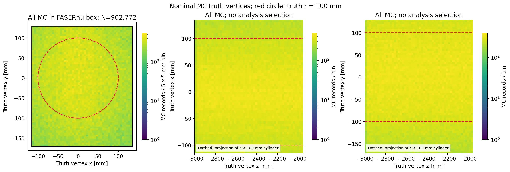
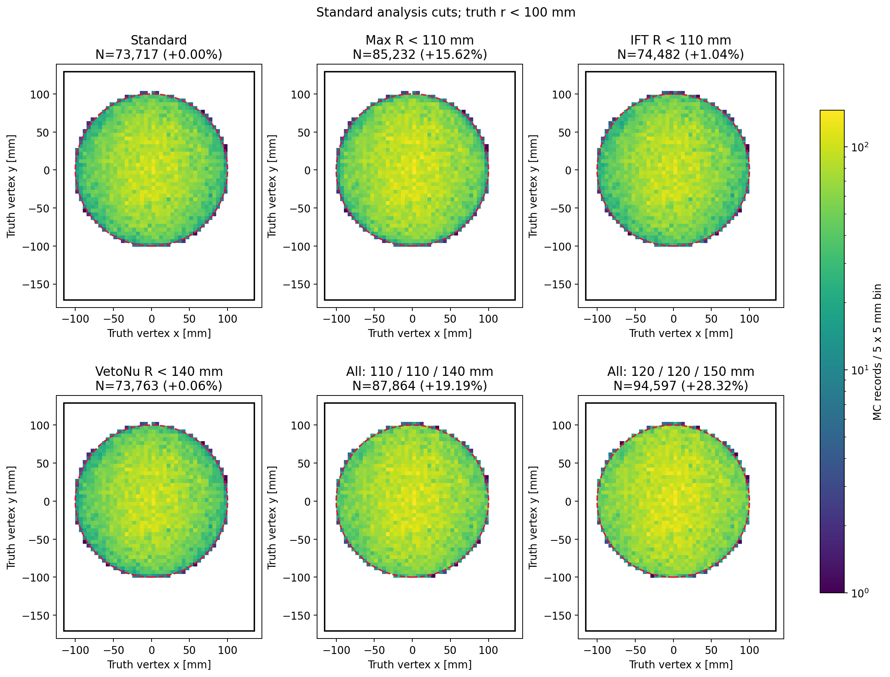
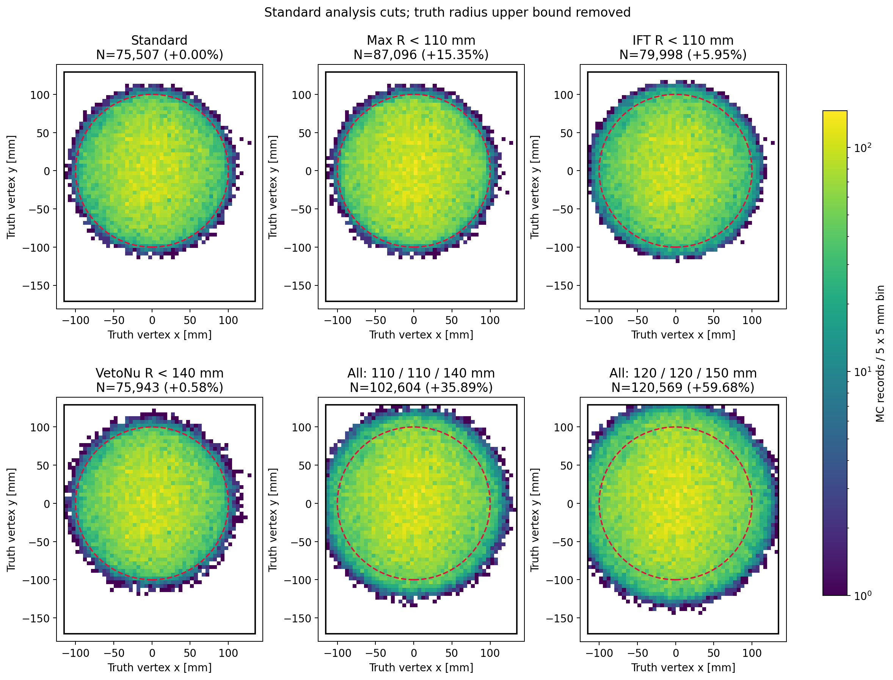
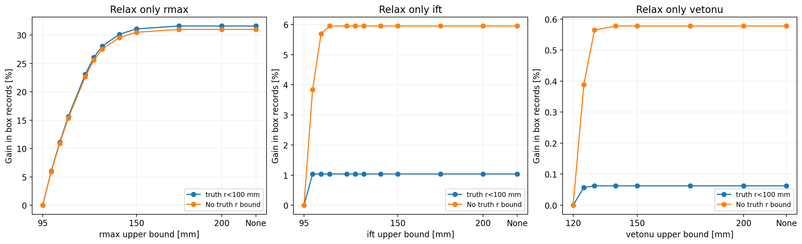
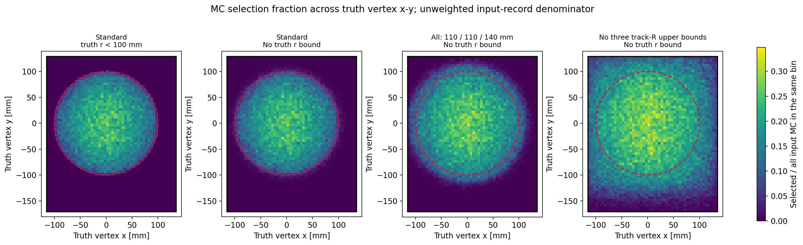
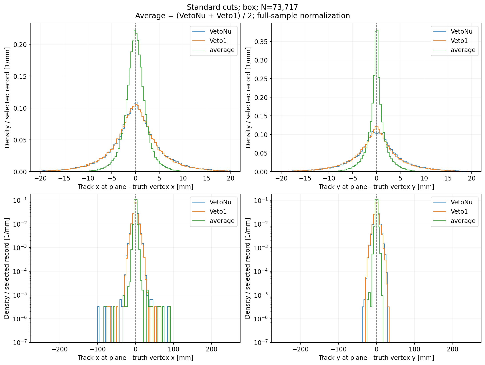
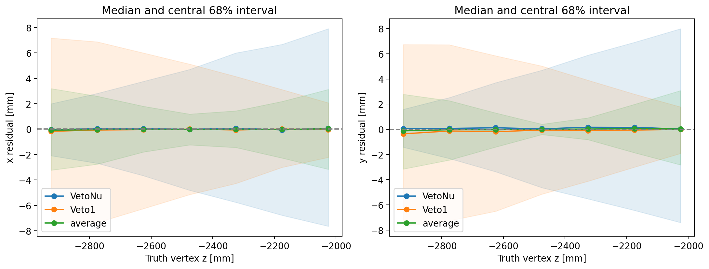
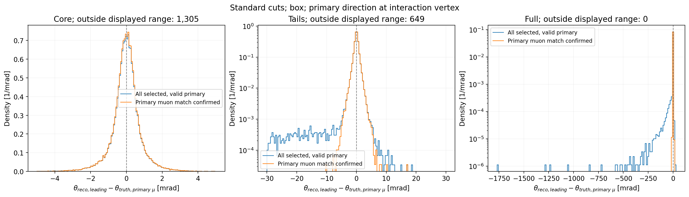

# Stage200：径向 cut 对 truth vertex 分布的影响与位置、角度残差

日期：2026-11-09。起点提交 `cec3fc1ef02d768a1f3f755547976b857816f901`。延续 stage126/127 径向选择研究。本阶段只提取与绘图，无模型拟合、无分析 C++ 源码或生产默认 cut 修改。

## 阶段目标与结论

完成全部 nominal MC 在 FASERν box 内的 truth vertex x-y、z-x、z-y 分布，并标出束流轴中心的 truth r=100 mm 参考。比较三个 reco 径向 cut 的单独、联合、有限阈值放松及完全去掉上限两种极限。标准选择下交付 VetoNu、Veto1、两者平均值的 x/y 对 truth vertex 残差，以及 leading track θ 对反应点初级 μ 子真值方向的残差。

实测：保留 truth r<100 mm，max-radius 95→110 mm 是三个单独改动中影响最大的（box 产额 +15.6205%）；IFT 95→110 mm 为 +1.0378%，VetoNu 120→140 mm 为 +0.0624%。联合 110/110/140 mm 为 +19.1910%。这些是信号 MC 记录数与分布变化，**不是已经完成背景或探测器系统评估后的 cut 推荐**。

标准 box 样本平均位置的 x/y R68 为 1.99383/1.53723 mm，比任一平面单独对顶点作差更窄。它是按题意定义的平面坐标顶点代理性能，包含飞行几何与材料散射。角度核心 R68 为 0.618294 mrad；全样本 RMS=15.742046 mrad 受长尾影响，确认初级 μ 匹配子样本 RMS=0.828209 mrad。所有尾部保留。

## 样本、选择、坐标与统计定义

- 输入：stage126/127 同一批 nominal MC，254 个 `PHYS.root`，共 **2,521,976** 条记录。run=200082/200093（π）、200083/200094（K）、200089/200100（charm）。精确输入路径、来源组及旧 partition 均在 [protocol.json](stage200_vertex/protocol.json)。读取全部来源；本阶段是 MC 描述研究，不是模型留出精度认证。
- “所有 MC”图只要求首个 incoming neutrino 的 truth vertex 位于严格 box 几何：x∈(−115,135)、y∈(−171,129)、z∈(−3000,−1950) mm。**不要求 CC、νμ、动量、重建或 veto cuts**。共 **902,772** 条；r<100 mm 内 **441,558** 条，占 **48.911353%**。
- 标准选择从 `AnalysisZipFramework/config/cuts.yaml` 读取，保留所有适用 MC 条件，包括 CC、νμ、Box OR LeadBlock、truth/reco pz>100 GeV、层数/nDoF/χ²、三个 track 半径、θ<25 mrad、scintillator 与 VetoNu reduced charge 条件。native reduced charge 来源逐文件核对为输入树分支。去掉直方图后的精确标准副本为 [standard_cuts.yaml](stage200_vertex/standard_cuts.yaml)。与 stage87 的 pz>50 GeV 选择不同。
- 原生宽选择只延后 truth 半径及三个 track 半径条件，其他不变；参见 [deferred_cuts.yaml](stage200_vertex/deferred_cuts.yaml)。最终 cuts 在同一紧凑缓存上逐事例求值，比较保留 truth r<100 mm 与去掉 truth r 上限两套图。无上限仍要求对应数值有限；没有把未通过其他 cuts 的事例混入。
- 标准完整 Box OR LeadBlock 为 **77,298** 条，其中 box **73,717** 条、LeadBlock **3,581** 条。主图以 box 为范围；另给完整标准几何残差，避免悄悄丢弃 LeadBlock。没有改成 stage127 推荐长方体。
- Leading track 为 `Track_pz0` 最大的径迹；Veto1 指 `Track_X/Y_atVetoStation1`，不是用于 `rIFT` 的 `VetoStation2`。rIFT 在现有定义中为 VetoStation2 外推 x/y 半径。
- 单位：位置 mm，极角 mrad，θ_reco 为 `LeadTrack_Theta`（最上游 track 动量 θ）。θ_truth=`atan2(sqrt(px²+py²),pz)`，取与 incoming ν 符号相容、生产顶点距中微子 decay vertex 每轴 ≤10⁻⁴ mm 的唯一初级 μ 子。标准两个区域的唯一初级 μ 有效率均为 100%。角度未把 incoming ν 的 θ 当成 μ 子 θ；`theta_incoming_nu` 仅作为表格附加诊断。
- 确认匹配子样本要求 aligned leading `t_pdg/t_barcode` 与初级 μ 一致，且 `t_pdg_parent/t_barcode_parent` 与 incoming ν 一致；未施加 purity cut。主分布保留所有标准事件，匹配子样本只作对照。
- 均为 **MC record 计数、无 flux/luminosity/cross-section 权重**。不同来源混合沿用旧研究，重复 incoming 可能共享生成真值；本阶段不把所有 records 当独立物理实验，不给未测量的显著性或独立事件误差条。数据、背景和替代生成器系统变化未测量。
- R68=(q84−q16)/2，RMS=sqrt(mean(Δ²))；表中均值包含符号。没有高斯拟合、核心裁剪或离群事件删除。归一化分布按完整有限样本归一，放大核心区不会把框外尾部重新归一。

## 全 MC truth 顶点与 cut 影响



红圆为 truth r=100 mm，黑框为原生 box；z-x/z-y 的 ±100 mm 虚线只是圆柱投影边界。box 中心为 (10,−21) mm，不能把它与束流轴中心混同。

以下 N 均只计 box；无 truth r 上限列的增益相对该列自己的标准 track-radius 基线 75,507，而非相对 73,717：

| track 径向条件 | 保留 truth r<100 的 N | 增益 | 无 truth r 上限的 N | 相对同 truth 基线增益 |
|---|---:|---:|---:|---:|
| Standard | 73,717 | +0.0000% | 75,507 | +0.0000% |
| Max R < 110 mm | 85,232 | +15.6205% | 87,096 | +15.3482% |
| IFT R < 110 mm | 74,482 | +1.0378% | 79,998 | +5.9478% |
| VetoNu R < 140 mm | 73,763 | +0.0624% | 75,943 | +0.5774% |
| All: 110 / 110 / 140 mm | 87,864 | +19.1910% | 102,604 | +35.8867% |
| All: 120 / 120 / 150 mm | 94,597 | +28.3245% | 120,569 | +59.6792% |
| No three track-R upper bounds | 103,288 | +40.1142% | 156,925 | +107.8284% |





外圈与核心效应不同：去掉 truth 半径上限但保留标准 track cuts 只新增 box **1,790** 条，r≥100 占 2.37064%；再联合放到 110/110/140 mm 后 box 共 **102,604** 条，其中外圈 **14,740** 条（14.36591%）。相对原始 r100 标准 73,717，联合放松且去掉 truth r 上限增加 **39.18635%**。对比说明 max-radius 也限制内圈，IFT 对外圈有明显额外限制；VetoNu 单独变动较小，不代表在联合选择中完全冗余。

新增事件二维图可以查看总密度图不明显的变化；[added_vertex_r100.png](stage200_vertex/added_vertex_r100.png)、[added_vertex_no_truth_r.png](stage200_vertex/added_vertex_no_truth_r.png)。各图主面板使用共同色标；新增图逐面板独立色标并标明 N。




阈值扫描保持其他 track cuts 不变；完整阈值与计数见 [radius_scan.tsv](stage200_vertex/radius_scan.tsv)。同一事件在不同策略下重复比较，图上点不是独立样本。x/y/z/r 的单位面积形状叠图包含未选择的全部 MC 作为黑虚线：[r100](stage200_vertex/vertex_projections_r100.png)、[无truth半径](stage200_vertex/vertex_projections_no_truth_r.png)。完整记录与 5×5 mm² x-y 分箱总变差距离见 [cut_comparison.tsv](stage200_vertex/cut_comparison.tsv)；总变差为描述量，受分箱影响，不是显著性检验。

选择比例图分母固定为该 x-y bin 的全部 box MC；分子包括所有标准非径向 cuts，因此这是本批混合 MC 的选择记录比例，不是通量加权探测效率。

## 标准 cut 下的位置残差

Δx_VetoNu=x_track,VetoNu−x_vertex；Δx_Veto1=x_track,Veto1−x_vertex；Δx_avg=(x_track,VetoNu+x_track,Veto1)/2−x_vertex。y 同理。三种定义使用完全相同的 73,717 条 box 记录；坐标非有限值与 999999 外推失败 sentinel 均为 **0**，没有删掉异常外推再制造窄分布。

| 残差 | 均值 [mm] | 中位数 [mm] | R68 [mm] | RMS [mm] | 95%绝对残差 [mm] |
|---|---:|---:|---:|---:|---:|
| x_VetoNu | 0.01257 | 0.01198 | 4.66858 | 5.82573 | 12.49899 |
| x_Veto1 | -0.04378 | -0.03664 | 4.56236 | 5.65970 | 12.13966 |
| x_average | -0.01561 | -0.02017 | 1.99383 | 2.56940 | 5.13858 |
| y_VetoNu | 0.14518 | 0.08670 | 4.53910 | 5.64582 | 12.30200 |
| y_Veto1 | -0.16135 | -0.08089 | 4.43368 | 5.50680 | 12.03656 |
| y_average | -0.00809 | -0.00392 | 1.53723 | 2.12325 | 4.71157 |




核心与对数纵轴宽视野同时给出。完整标准 Box OR LeadBlock 对照：[position_residuals_box_or_lead.png](stage200_vertex/position_residuals_box_or_lead.png)。详细统计含匹配子集：[residual_statistics.tsv](stage200_vertex/residual_statistics.tsv)；可重画的 bin counts、underflow/overflow：[residual_histograms.tsv](stage200_vertex/residual_histograms.tsv)。

**平均位置较好有明确几何基础。** 实际生产源码 Calypso `d32b0ff3` 的 `PhysicsAnalysis/NtupleDumper/src/NtupleDumperAlg.cxx:1909,1923`：VetoNu z=−3112 mm，Veto1 z=−1769.65 mm。等权平均近似是在中间平面 z=−2440.825 mm 的直线位置，而非每个事件真实 z 的拟合顶点；本标准 box 样本平均 z=−2439.80541 mm。该接近关系是当前选择的实测值，不是对所有样本的保证。两平面残差相关系数 x=-0.599969、y=-0.710092，相反方向的几何偏移使平均后分布变窄；散射和外推也可贡献。



图中线为每 150 mm 深度区间的中位数，阴影为 q16–q84；分层 N 和宽度见 [residual_vs_depth.tsv](stage200_vertex/residual_vs_depth.tsv)。不能将总体平均位置 R68 直接宣称为任意反应深度的固有顶点重建分辨率。基于可观测量拟合 z、在真实 z 处外推及材料散射分解未测量。

## 标准 cut 下的角度残差及长尾

Δθ=θ_reco,leading−θ_truth,primary μ。box 样本：

| 样本 | N | 均值 [mrad] | R68 [mrad] | RMS [mrad] | 95%绝对残差 [mrad] |
|---|---:|---:|---:|---:|---:|
| all_selected | 73,717 | -1.012279 | 0.618294 | 15.742046 | 2.046876 |
| primary_confirmed | 72,332 | -0.014575 | 0.595793 | 0.828209 | 1.735746 |




核心 ±5 mrad、尾部 ±30 mrad 与完整实测范围同时交付。完整范围为 **[-1761.240208, 18.792633] mrad**；|Δθ|>30 mrad 的 **649** 条中，确认匹配初级 μ 的为 **0** 条。box 内未确认匹配共有 **1,385** 条；保留这些记录并给出匹配子集对照，证据支持大尾部与 leading track 不是已确认初级 μ 的样本关联，不能把全样本 RMS 直接解读成纯径迹方向测量误差。每条未确认事件的具体粒子谱系、散射与生成原因尚未逐一诊断，未知项不当作已知原因。

完整标准几何角度图：[theta_residual_box_or_lead.png](stage200_vertex/theta_residual_box_or_lead.png)。重建 θ<25 mrad cut 本身会影响角度分布；当前性能条件于该选择。局部同 z 真值 track 状态对比、去掉 θ cut 的独立性能、背景角度分布均未测量。

## 执行、验证、性能与存储

使用既有 `build/analysis`，源码未变，未重新编译。只读取 3 个 raw truth vertex 分支生成全部 MC 的投影直方图；宽选择快照在 worker 临时目录中计算残差并立即删除，不保存新的 ROOT/xAOD。批量通过 HTCondor cluster **9679881.0–15**，每作业 4 CPU、4 worker、worker 内 native ROOT 1 线程，BLAS/OMP/MKL=1，内存请求 5000 MB；提交目录 **`~/condor/nu_muAnalysis/stage200_vertex/`**。16 作业均 exit0，结束时对应队列为空；未改动其他任务。

```bash
source setup_env.sh
export OPENBLAS_NUM_THREADS=1 OMP_NUM_THREADS=1 MKL_NUM_THREADS=1
python ml/stage200_vertex.py --init
/usr/bin/time -v -o workbook/stage200_vertex/pilot.time \
  python ml/stage200_vertex.py --pilot 4
python ml/stage200_submit.py
# 16 个作业全部完成后；全量提取已做完，无需为重画图重交：
python ml/stage200_plot.py --collect
python ml/stage200_validate.py
python ml/stage200_plot.py --residuals-only
python ml/stage200_report.py
python -m py_compile ml/stage200_*.py
bash -n AnalysisZipFramework/submission/run_stage200_vertex.sh
# 最终缓存重画全部图：
python ml/stage200_plot.py
```

小样本 source4：10,000 条输入、box 3,745 条、宽候选 669 条、标准 334 条（box 316）。原生标准 cut 与延后再恢复四个径向条件后的 **run/eventID 集合精确一致**。GNU wall=44.78 s、CPU=14.58 s、最大单进程 RSS=662748 KiB。随后直接用原生 C++ 独立核对联合 110/110/140 mm 的 r100/无 truth 半径两套条件，分别通过 390/450 条，均逐 eventID 一致。

全量检查：254 文件无遗漏；与 stage126 的原 r100、去掉 truth r 两个选择**逐文件身份集合精确一致**，全样本分别 **77,298/79,090** 条；原始二维直方图与一维投影计数守恒；平均残差恒等式检查通过。宽候选共 **166,577** 条。见 [validation.json](stage200_vertex/validation.json)、[independent_validation.json](stage200_vertex/independent_validation.json)。

| 资源指标 | 实测 |
|---|---:|
| 16 个 job 的分析 GNU wall 总和 | 837.28 s |
| 分析 GNU CPU 总和（含子进程） | 2289.51 s |
| 相对 4 核×分析 wall 的 CPU 利用率 | 68.362% |
| 输入记录 / 累加分析 job wall | 3012.11 records/s |
| 最大 GNU 单进程 RSS | 666692 KiB |
| 最大 Condor MemoryUsage | 977.0 MB |
| uproot raw 顶点请求字节 | 156,517,967 bytes |
| ROOT native 总读取量、真实网络字节、单核加速比 | 未测量 |

GNU wall 累加不是用户端从提交到完成的延迟；吞吐量是同一批多进程作业的记录率，未测单核基线，不宣称加速倍数。Condor 内存为调度器采样指标，GNU RSS 为最大单进程，均不等于所有进程 RSS 的简单和。逐文件 `child_CPU_s` 为各 pool worker 内累计值，不可相加；上表采用 batch GNU time 汇总。详见 [resources.json](stage200_vertex/resources.json)。

最终缓存 `ntuples/vertex_stage200/vertices.npz` 为 **21,356,356 bytes**，只保存 166,577 条宽候选的必需数值及 raw 投影直方图，无 raw 全量事件复制。原始 MC 输入只读。图同时提供 PNG/PDF/SVG，PDF/SVG 留在本地供导出；PNG、代码、选择配置、紧凑 TSV/JSON 和本报告纳入阶段提交。存储清理以 [storage.json](stage200_vertex/storage.json) 的实际字节审计为准；最终缓存足够重画全部图，`--collect` 需要重新生成已清理的分片。小样本图只是临时 QA，未混入正式图。

## 下一步计划与验收标准

1. 用固定的 rmax/IFT/VetoNu 候选工作点（如 110/110/140 mm）和当前输入来源，加入背景 MC、真实 data 可观测分布及 detector variation。验收：提供信号和背景的绝对归一化产额、共同分母接受度及 x/y/r/z 分层变化；目前不能仅按信号 N 决定放松生产 cut。
2. 区分几何代理和真正顶点外推：输入可观测 track states、材料模型及独立样本，比较 VetoNu/Veto1 均值、固定 z 平面和重建 z 处的拟合坐标。验收：在明确 z 分层下报告 bias/R68/尾部，并禁止用不可观测 truth z 充当可运行 data 算法。
3. 对未确认初级 μ 匹配的角度长尾，输入已有 native matching 与必要粒子谱系，量化 wrong-primary/次级 μ/未匹配/散射等机制；同时用 matched μ 在相同 z 处的 truth state 区分传输与测量误差。验收：覆盖全部尾部事件、保留未知分类及其比例，不因少数离群事件删除分析分支。
