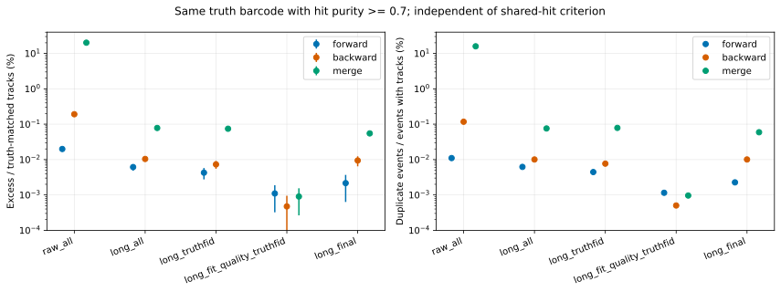
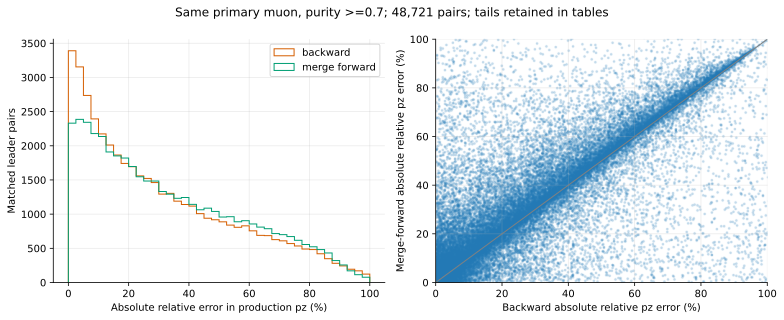
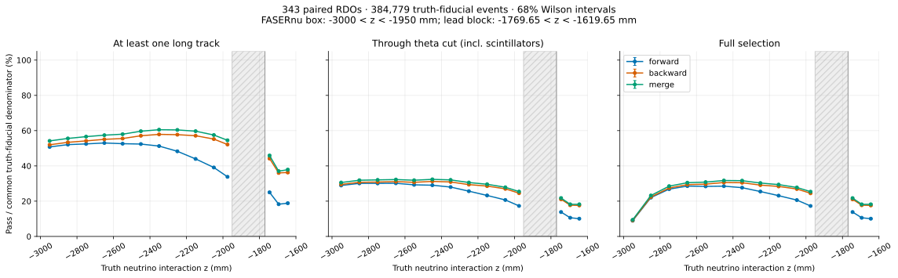

# 阶段 202：旋转几何与隔离 smoothing 的全量 merge / duplicate 复查

本次完整检查已经完成：merge 保持最高选择效率，但仍存在动量选择损失、
短候选阻挡长轨迹及 raw 数值异常；固定旧闪烁体输入后，新版效率仍低于旧版。
Duplicate 主要集中在 raw 短片段，逐候选质量选择后大幅减少。

## 阶段目标与样本

延续[阶段 201](2026-11-13_stage201_georotation-merge-duplicate-check.md)，使用
`/eos/home-x/xcheng/FASER/geoRotation_calypso` 的现成构建重跑原来的完整
forward / backward / merge 检查，并独立测量 duplicate tracks。软件冻结为
Calypso `88c457c1` 加用户本地修改；准确状态见
[provenance](stage201_tracking/software_provenance.json) 和外部源码补丁。
没有修改或重新编译外部 Calypso。

固定 Athena 24.0.41、TI12MC04/FASERNU-04、OFLCOND-FASER-06，without-IFT
比较、无 CaloNu。四套 CKF 都显式启用 `IsolateCandidateSmoothing=True`，
material energy loss / scattering 开启。输入为原 manifest 全部 343 RDO，
3,384,987 events；新旧配对比较只用旧的共同 342 文件，3,374,987 events。
200080 是 SIBYLL 替代样本，报告同时给 all、排除它的 nominal 及逐 run 分组。
计数未加 flux/luminosity 权重，系统误差、真实 data 和完整背景表现未测量。

## 坐标及版本控制

实际内部变换为 `(x′,y′,z′)=(z,y,−x)`，比较时恢复原束流方向后执行原 YAML
最高 pz leading track 和全部 cuts。Acts 拟合位置、动量及官方 `t_*` 坐标
使用旋转坐标；space points 和 SiHit station truth 仍在原坐标。343-event
独立检查确认全部 27 个 detector-coordinate 列新旧逐值相同；逐状态诊断
对拟合状态作逆旋转，scintillator 外推 X 恢复符号。原生 C++ 三模式共 60 行
cutflow 与提取结果精确一致，详见阶段 201 验收记录。

新版本还包含波形重建变化，因此同时报告新版原生选择和固定旧版同事件闪烁体
charge 的对照；后者保留新版轨迹与各自 leader Timing Y。不能把全部新旧
效率差归因于旋转或 smoothing，也没有测量两项修复各自的因果贡献。

## 执行、异常及验收

全量生产 cluster 9717383。原 index 53 在两个节点的 backward maker 均
exit 129，最后 heartbeat 为读取第 3,001 个事件。疑似区间 skip=3000、
nevents=1000 独立运行成功，随后 cluster 9717429 将同一 RDO 分为 10 个
连续、互不重叠的 1,000-event 区间，全部正常完成。区间 ID 对照原 RDO
primitive `mcEventNumber`，合并后精确回读，并经 EOS 上传再回读全部数组。
额外的 skip=3000 区间在两个节点的所有紧凑数组精确一致。恢复文件最终
truth 分母 1,294，完整选择 F/B/M 为 269/274/289 events。
整文件崩溃的精确原因未测量；分段完成不能解释该崩溃，更没有剔除对应事件。
见 [区间审计](stage201_tracking/recovery53_audit.json) 和
[独立重复验证](stage201_tracking/recovery53_repeat_validation.json)。

逐事件空间诊断先完成本地 343-event 和 Condor 单事件试跑，再批量运行。
15-event 混合验收中 61 条 long 官方 truth 匹配核对通过，包含 7 个新版损失和
8 个历史事件。原 89 个事件与新版 backward-only 事件取并集，并单列旧 NaN
事件。少数重叠标签原含逗号，被 Condor 解析成额外字段，物理验收成功后上传
路径错误；已改为 `+` 并重跑受影响的 7 项，不能将其计为物理损失。

EOS 出现目录可见但 FUSE open 暂不可见，最终通过 XRootD 回读到 scratch
后校验；不因挂载缓存问题少算事件。每个 merge 候选都精确对应 forward 或
backward 原候选，逐事件原生非轨迹输入三模式一致，truth/ID 共同验证。

## 旧 NaN 个案与剩余数值问题

原 index 291 已完整恢复 10,000 events，没有该文件旧 NaN 导致的排除。
事件 200094/401649 的新版 forward / merge：15 measurements、9 layers、
nDoF=10、χ²=13.235443，pz=925.750188 GeV，匹配主 μ 的产生 pz 为
586.279375 GeV。新版 backward：5 measurements、4 layers、stations 2/3、
nDoF=0、χ²=4.729342、pz=610.962938 GeV，已非 long。这个事件不满足原
truth-fiducial 选择，因此仅作为数值个案，不能混入共同效率分母。

旧 F/M NaN 在这个个案恢复为有限值，但不能声称所有 raw 数值异常均消失。
完整计数见 `numerical_quality.tsv`，151 条 χ²/pz 非有限记录见
`nonfinite_raw_tracks.tsv`；nDoF 异常按 measurements 汇总于
`nonpositive_ndof_by_measurements.tsv`，完整逐候选值保存在压缩 NPZ。源码 `CreateTrkTrackTool` 使用
`static_cast<double>(track.nMeasurements() - 5)`，少于 5 measurements 时
存在无符号运算疑点；已观测过持久化 nDoF=−2147483648，尚未逐调用证明
因果链，不把源码疑点写成已确定根因。

Raw nDoF≤0 的 F/B/M 计数为 **382,632/260,207/642,839**；long 仍有
**105/760/865 条**，其中 nDoF=−2147483648 为 **33/255/288 条**，均仅有
3–4 measurements。其余 long 非正 nDoF 均是 5 measurements、nDoF=0。
Raw 非有限 pz 为 **1/2/3 条**，long 均为 0。选择中的 nDoF≥9 会拒绝这些
异常，但不能由最终样本正常反推 raw 完全正常。

## 完整结果

343/343 文件全部通过，3,384,987 events，truth-fiducial 分母 **384,779**。

| 原生新版选择 | Forward | Backward | Merge |
|:---|---:|---:|---:|
| Raw tracks（条） | 1,425,944 | 1,222,084 | 2,107,832 |
| Long tracks（条） | 388,775 | 518,361 | 553,333 |
| Truth 分母内至少一条 long（事件） | 180,333 | 208,543 | 217,654 |
| 最终选择（事件） | 88,233 | 99,351 | 103,056 |
| 最终效率 / truth（%） | 22.93083 | 25.82028 | 26.78317 |
| 效率统计 SE（百分点） | 0.06777 | 0.07055 | 0.07139 |
| Raw χ² 非有限（条） | 72 | 1 | 72 |
| Long χ² 非有限（条） | 0 | 0 | 0 |

效率 SE 是未加权事件的二项统计误差，不含系统误差。Merge 相对 backward
新增 **3,835**、损失 **130**、共同通过 **99,221**，净增 **3,705 events**；
相对共同 truth 分母增加 **0.96289 ± 0.01629 个百分点**（同事件配对 SE）。
相对 forward 净增 14,823 events，增加 3.85234 ± 0.03125 个百分点。
Backward 相对 forward 增加 2.88945 ± 0.03551 个百分点。

新版条件损失 `merge fail / backward final pass` 为 **130/99,351 = 0.13085%**，
95% Wilson 区间 **[0.11022%, 0.15534%]**；旧版共同样本为 89/103,985。
新旧分母与波形输入不同，严格比较见共同文件及固定旧闪烁体对照。

## 130 个新版损失：机制与 MC truth

全部 130 个都逐事件重跑，并精确对照全量生产的 raw candidates 与 cuts，
包含原 89 个事件及旧 NaN 的并集共 **212 IDs**；官方 long truth 匹配共
**932 条**核对通过。主 μ 在保存 truth 中按 PDG、产生点与入射 ν 衰变点
唯一匹配，再核对母粒子；没有固定用 truth 数组下标。

| Merge 首次失败 cut | 事件数 | B leader 被移除 | B leader 保留但换 leader |
|:---|---:|---:|---:|
| 至少一条 long | 4 | 4 | 0 |
| pz >100 GeV | 74 | 74 | 0 |
| layers≥7 | 1 | 0 | 1 |
| nDoF≥9 | 8 | 2 | 6 |
| χ²/nDoF<15 | 1 | 1 | 0 |
| rmax<95 mm | 28 | 9 | 19 |
| rIFT<95 mm | 12 | 12 | 0 |
| θ<25 mrad | 2 | 2 | 0 |
| 合计 | **130** | **104** | **26** |

104 个去重移除中 **80** 个由更多 measurements 胜出，**24** 个由相同数量、
较低 χ²/nDoF 胜出。26 个改 leader 的事件，原 backward 好轨迹仍保留，
最高 pz 的另一个候选导致失败。Merge 本身不重新拟合，不能把它描述为第三套
独立拟合算法。新版损失以 pz 阈值为主（74/130），与旧版半径首先失败
49/89 的组成不同；不能只由总体条数变化解释原因。

仍有 **4** 个 nonlong 候选覆盖 stations 2/3，以 >6 shared measurements
阻挡三站 backward long，随后被 dumper 的三站要求过滤。四例为
200082/14116、200082/127418、200089/140607、200094/621900；B/阻挡
measurements 为 14/14、14/14、14/15、14/14，共享 8、9、8、8。
前三例阻挡候选各有 2 个重复 strip key，最后一例没有重复 key，但只覆盖
11 个独立 station/layer/side 面。隔离 smoothing 并没有消除 merge 排序
与下游 long-track 要求之间的这一语义冲突。

126 个存在 merge long 的损失事件，主 μ 匹配分别为：双方均主 μ **87**、
仅 B **13**、仅 merge **18**、双方均非主 μ **8**。另 4 个 nonlong 阻挡
对照双方均主 μ；它们单列，不能当作 merge long。

87 对同一主 μ long 的产生 pz 绝对相对误差，中位数 **B 25.1083% / M 53.2319%**；
逐事件 **B 更近 71、M 更近 16**，双侧 sign p=**1.957×10⁻⁹**。
中位数 B−M 为 −28.1236 个百分点，按事件配对 bootstrap 10,000 次、
种子 20261113，95% 区间 **[−39.7093, −14.4106] 个百分点**。
排除 200080 后 N=74，胜出 60/14，中位数 25.2612% / 53.9004%，
p=6.222×10⁻⁸。q/p（包含电荷符号）误差同组为 B 胜 74、M 胜 13。
这是按 B 通过 / M 失败选择的条件样本，不代表全体轨迹分辨率排序。
参考为粒子**产生动量**，tracker 入口的输运动量与材料能损误差尚未分离。

同一主 μ 的空间/方向比较，要求真实 station 平面在两个拟合 states 之间，
间距≤150 mm，只作站内线性插值，不跨磁场外推。Station1 横向残差 N=85，
B/M 中位数 **0.4303/0.4948 mm**，胜出 40/45，p=0.6646；中位差区间跨零。
Station1 方向残差 **0.4564/0.7732 mrad**，胜出 58/27，p=0.001016；
中位差 95% 区间 [−0.5508, −0.1431] mrad。Station2/3 横向残差中位数
0.2808/0.2461 mm（N=87）、0.3461/0.2998 mm（N=83），配对中位差区间
均跨零。多指标是探索性、相互相关，不能宣布所有空间变量由一种方法胜出。
IFT 真值半径未测量，不用 station0 SiHit 位置代替 z=−1609.65 mm 外推面。

原 89 个事件：新版双方通过 **37**、仅 merge **4**、仅 B **8**、双方失败
**40**。因此原来的大部分损失已经迁移，但同时产生新的损失集合；不能只复查
旧 89 IDs 就声称问题解决。

详细表见 [机制](stage201_tracking/details/event_mechanisms.tsv)、
[truth 准确度](stage201_tracking/details/accuracy_summary.tsv)、
[空间图](stage201_tracking/details/spatial_truth_comparison.svg)；
[离线事件浏览页](stage201_tracking/details/event_viewer.html)覆盖全部 130 个。

## 新增 duplicate tracks 检查

以同一 `(run,event,truth barcode)` 的多候选定义 truth duplicate，要求每条
候选的 truth-hit purity≥0.7；purity 是该 barcode 的 truth-hit 贡献数除以
measurements。每组 n 条只记多余 n−1 条，不把 n(n−1)/2 对数当作轨迹数。
分母为该层满足 purity 的 truth-matched tracks；误差按事件聚类，避免同事件
候选当作独立观测。另独立检查 shared hits，不能将二者混称 duplicate。

| 层级；多余重复 / matched tracks | Forward | Backward | Merge |
|:---|---:|---:|---:|
| Raw，全样本 | 168/844,518 | 1,499/783,952 | 224,149/1,113,463 |
| 比例 ± SE（%） | 0.01989±0.00166 | 0.19121±0.00532 | 20.13080±0.02971 |
| Long，全样本 | 23/375,251 | 49/471,411 | 389/498,046 |
| 比例 ± SE（%） | 0.00613±0.00128 | 0.01039±0.00148 | 0.07811±0.00396 |
| Long，truth-fiducial | 8/187,853 | 16/219,173 | 171/229,944 |
| 比例 ± SE（%） | 0.00426±0.00151 | 0.00730±0.00183 | 0.07437±0.00568 |
| Long，truth-fiducial，逐候选 fit quality | 2/181,591 | 1/210,873 | 2/221,424 |
| 比例 ± SE（%） | 0.00110±0.00078 | 0.00047±0.00047 | 0.00090±0.00064 |
| 最终选中事件内全部 long 候选 | 2/92,724 | 10/106,339 | 61/111,092 |
| 比例 ± SE（%） | 0.00216±0.00153 | 0.00940±0.00297 | 0.05491±0.00702 |

Fit quality 为每条候选 layers≥7、nDoF≥9、有限 χ² 且 χ²/nDoF<15。
“最终选中事件内全部 long”含非 leader、未逐条通过质量 cuts 的轨迹，所以
merge 的 61 与逐候选质量层的 2 不矛盾。按有候选事件作分母，merge duplicate
事件率依次为 raw **223,898/1,408,174=15.89988%**、long
**389/513,649=0.07573%**、final **61/103,056=0.05919%**。

为消除三模式 active-event 分母不同的影响，另在共同事件上配对：long duplicate
事件 M−B 为 (353−13)/3,384,987 = **0.010044±0.000565 个百分点**；
truth-fiducial 逐候选质量层为 (2−1)/384,779 =
**0.000260±0.000450 个百分点**。后者统计上不能区分。Nominal 的 raw/long
merge excess 比例为 **20.05574%/0.07903%**，与包含 200080 的排序一致。

阈值敏感性必须保留：merge 在 purity 0.5/0.7/0.9 时，raw excess 比例
**21.35694%/20.13080%/18.93988%**，long 为
**0.31025%/0.07811%/0.01129%**，逐候选质量 truth 层为
**137/2/0 条**。零观测不代表真实率为零，purity≥0.9 质量层的 duplicate
事件率 68% Wilson 上限为 **0.0004814%**（有候选事件作分母）。

Raw merge 有 **224,284 对**同 truth 高 purity 候选：双方 long **389**、
仅一方 long **42,440**、双方均非 long **181,455**；其中 **222,819 对**
来自不同 F/B collection。Long 的 389 对中 **343 对**跨 F/B 来源；final
61 对中 **52 对**跨来源。因此 raw 大重复率主要由不同方向短片段组成，
绝大多数不进入 long，不能直接推断最终 physics sample 污染 20%。

Merge 在官方 shared key 或完整 cluster identity 下均**没有 >6 shared hits
的保留 pair**，但这不保证同 truth 唯一：上述 224,284 对全部共享≤6 个官方
key，按固定绝对 shared-hit 门槛可同时存活。共享至少较短候选一半完整
cluster 的 pair 数，F/B/M raw 为 **685/3,670/491,599**，long 为
**91/426/1,228**；逐候选质量 truth 层均为 0。

另有 F/B raw **16/24 对**满足官方 key 的 >6 shared，而完整 cluster
identity 的 >6 pair 均为 0。官方 key 仅用 station/layer/side/strip，省略
物理 module 等字段，确实存在不同完整 cluster 被映射成相同 key 的情况。
这提示 merge 决策可能受 key 碰撞影响；尚未通过替换 key 的完整反事实重建，
不能声称每一对都被错误删除。

完整表：[duplicates](stage201_tracking/duplicates.tsv)、
[hit overlap](stage201_tracking/hit_overlap.tsv)、
[共同分母配对](stage201_tracking/duplicate_paired_events.tsv)。
图使用对数纵轴以同时看清 raw 与质量层：



## 全体同主 μ 的配对准确度

为检查损失条件样本之外的表现，在 truth-fiducial 中选 B/M leader 匹配同一
主 μ、双方 purity≥0.7、产生 pz 误差有限，共 **187,575 对**，其中
**138,854 对**为 merge 直接保留 backward，数值相同。
实际由 forward 胜出的 **48,721 对**，B/M 产生 pz 绝对相对误差中位数为
**27.72838%/32.26549%**；B 更近 **32,747**、M 更近 **15,974**。
这组中 merge χ²/nDoF 更低的 **43,320 对**，有 **30,106 对**产生 pz 更差。
更低拟合 χ² 不等同于更准确的 MC 动量。

双方 final pass 的 **96,962 对**中，B/M 中位数 **20.21111%/21.69403%**，
胜出 **18,647/6,525**、相同 **71,790**；sign p 低于浮点计算精度，表中的
0.0 是数值下溢。仅 M pass 且满足这组同主 μ 条件的 **874 对**，中位数
**38.19181%/24.88961%**，胜出 **346/528**，p=8.044×10⁻¹⁰；merge 确实
也恢复了 B 较差的候选。仅 B pass 的高 purity 组为 **83 对**，胜出 68/15，
与前述未施加该 purity 要求的 87 对空间诊断组不同，不能混用 N。

逐候选质量 truth 层主 μ tracks 数 F/B/M 为 **163,754/181,482/189,266**，
产生 pz 绝对相对误差中位数 **23.21863%/22.30393%/23.51258%**；这些不同
模式人群不是完全配对的分辨率测量。这里所有动量参考都是产生动量，尚未校正
tracker 入口能损，不作为本征 tracking resolution 结论。

见 [配对统计](stage201_tracking/paired_primary_muon_accuracy.tsv)、
[分层 truth](stage201_tracking/primary_muon_truth.tsv) 和图：



## 共同 342 文件：固定旧闪烁体输入

共同分母 383,670 truth events，旧版最终 F/B/M 为 92,937/103,985/104,930。

| 最终事件数 / 新旧对照 | Forward | Backward | Merge |
|:---|---:|---:|---:|
| 新版原生 | 87,986 | 99,060 | 102,760 |
| 新轨迹 + 旧同事件闪烁体 charge | 88,961 | 100,142 | 103,883 |
| 固定旧 charge 后相对旧版净变化（事件） | −3,976 | −3,843 | −1,047 |
| 效率差 ± paired SE（百分点） | −1.03631±0.02170 | −1.00164±0.02514 | −0.27289±0.02057 |

换回旧 charge 相对新版原生净增加 **975/1,082/1,123 events**，说明波形版本
变化有可测影响，但不足以解释全部效率下降。该控制仅替换闪烁体输入，不能
隔离旋转、smoothing 或其他 tracking 实现变化各自的影响。
固定旧 charge 下 merge 相对 backward 仍净增加 **3,741 events**：新增
3,872、损失 131、共同通过 100,011，**+0.97506±0.01642 个百分点**。
Nominal 固定旧 charge 时 merge 新−旧为 **−0.22340±0.02235 个百分点**，
M−B 为 **+0.99711±0.01807 个百分点**。差异不由替代样本 200080 单独驱动。

详见 [逐 cut 版本迁移](stage201_tracking/fixed_scintillator_version_comparison.tsv)
及 [固定 charge 三模式](stage201_tracking/fixed_scintillator_mode_comparison.tsv)。

## z、半径、能量及损失关联

完整 cutflow、pν / vertex r / z 的效率和配对差见同目录 TSV/SVG，未裁掉高能
或大残差尾部。Nominal 三模式最终效率 **23.20528%/26.23566%/27.22167%**。
FASERnu box（−3000<z<−1950 mm）最终 F/B/M 为
**23.78620%/26.35552%/27.34587%**（N=358,460）；lead block
（−1769.65<z<−1619.65 mm）为 **11.28082%/18.53034%/19.11927%**
（N=26,319）。Forward 对较下游相互作用的 long 效率下降更明显。

沿用旧阶段 17 的 logistic 形式，在 B final pass 中研究 M 损失，控制真值
radius、z、log₂(pν)、lead-block indicator 和 run。半径每增 20 mm 的 OR
**1.31276 [1.12366,1.53368]**、p=0.000605；z 每增 500 mm 的 OR
**1.67871 [1.20440,2.33981]**、p=0.002230；pν 每翻倍 OR
**0.77121 [0.64563,0.92121]**、p=0.004171。区间为 95% Wald。
Nominal 对应 OR 为 1.27096/1.69857/0.77833，方向一致；拟合最大梯度
4.14×10⁻⁷ / 9.54×10⁻⁷。独立实现重算旧样本 21 行模型结果，与原阶段 17
在既定容差内一致。以上是选择后样本中的探索性关联，不是损失的因果解释。



## 性能、I/O 与存储验收

所有大样本重建、逐事件诊断和全量统计通过 HTCondor；无 GPU 计算需求。
重建 job 每项请求 1 CPU、3,000 MB memory、6,000 MB disk，文件间并行，
限制 OMP/OpenBLAS/MKL 为 1；先将 RDO 放入 scratch，每文件重建一次，三套
maker 共用临时 xAOD。以下为成功的 343 文件有效生产，index 53 用十段计时
求和，峰值取最大；失败尝试、诊断试跑和排队开销未混入。

| 步骤 | wall 总和（s） | 每文件中位 wall（s） | 最大 RSS（KiB） | events / summed wall s |
|:---|---:|---:|---:|---:|
| RDO staging | 1,778.04 | 4.70 | 87,592 | 1,903.77 |
| Reconstruction | 539,153.91 | 1,534.01 | 1,540,224 | 6.2783 |
| Forward maker | 108,991.17 | 329.30 | 1,114,300 | 31.0574 |
| Backward maker | 110,208.52 | 330.28 | 1,108,636 | 30.7144 |
| Merge maker + diagnostics/JIT | 155,374.98 | 454.14 | 2,348,840 | 21.7859 |
| Compact extraction | 18,866.52 | 52.10 | 794,304 | 179.4177 |

包括软件复制/解包的逐步骤 wall 总和 **935,000.60 s（259.7224 h）**，并非
并行批次实际 elapsed。Reco CPU（user+system）总和 **529,031.94 s**。
峰值、范围、全部 CPU 及字节数见 `performance_summary.json`；逐文件详表
`performance.tsv`。三模式 maker 内容不同，尤其 merge 有附加诊断/JIT，不能
把表中吞吐解释为 tracking 算法本身的加速比；线程 scaling 未测量。失败整文件
尝试的额外资源总量未汇总，不能把此表宣称为项目全部消耗。

有效生产临时 ROOT 体积之和 **883,020,574,275 bytes**（含输入 RDO
295,078,975,093、xAOD 546,687,239,941、三套 ntuple 41,254,359,241），
均随 worker 退出清理，没有长期保留 xAOD。压缩软件 runtime 为
**40,793,856 bytes**。全量统计 wall **721.98 s**、RSS **3,249,120 KiB**；
空间诊断统计 **33.21 s**、RSS **375,760 KiB**。存储验收含紧凑数值表生成
**40.71 s**、RSS **1,312,268 KiB**，exit 0。

Cluster 9718040 将三个合并 NPZ 的全部数组与 **343 个 shards**精确比较
（浮点 NaN 位置一致），同时验证配置/provenance、host、性能记录、ROOT 大小
和 recovery 元数据；212 个 JSON 与 `diagnostics.json.gz` 解压后逐字段一致。
原始 manifest 的 EOS 路径保存在审计中，不把 scratch 暂存路径用于清理。
在确认队列没有本阶段作业后，已移除验收过的 **555 个分片、201,560,848 bytes**。

保留的 4 个 NPZ 共 **173,535,439 bytes**，空间 JSON gzip
**3,947,302 bytes**，合计 **177,482,741 bytes**，位于
`workbook/stage201_tracking/` 及 `details/`，不入 Git。近百万条无效 nDoF
的原始文本表已用小型分组表替代，完整逐候选值仍保存在 NPZ；151 条非有限记录
单独保留。软件冻结包位于 `software/stage201_tracking/`。见
[精确回读审计](stage201_tracking/storage_validation.json)、
[资源汇总](stage201_tracking/performance_summary.json) 和
[清理审计](stage201_tracking/cleanup_audit.json)。

## 命令、产物与验收

```bash
# 原始 reconstruction / 三模式提取命令见阶段201，使用相同 frozen payload。
# index53 完整恢复；区间审计记录了10份输入范围及精确ID对照。
python3 AnalysisZipFramework/scripts/combine_tracking_georotation_parts.py --help
# 生成全量报告、空间报告、精确回读审计：分别提交生成的 descriptor
python3 AnalysisZipFramework/submission/prepare_tracking_georotation_report.py
condor_submit ~/condor/nu_muAnalysis/stage201_tracking/report/report.sub
python3 AnalysisZipFramework/submission/prepare_tracking_georotation_report.py --details
condor_submit ~/condor/nu_muAnalysis/stage201_tracking/details_report/report.sub
python3 AnalysisZipFramework/submission/prepare_tracking_georotation_report.py --validate
condor_submit ~/condor/nu_muAnalysis/stage201_tracking/storage_validation/report.sub
# shards验收清理后，已有NPZ可直接重现overview；在LCG109环境、Condor scratch运行
python AnalysisZipFramework/scripts/report_tracking_georotation.py --repo /path/to/frozen/repo \
  --manifest workbook/stage201_tracking/input_manifest.tsv \
  --combined workbook/stage201_tracking --output report
```

实际完整报告 cluster **9718005**、空间报告 **9718023**、首次回读 **9718028**，
补充数值分组并保存原 EOS 源路径的最终验收 **9718040**，均 exit 0。
9718039 是本地默认 `python` 不存在导致准备未更新后误提交的旧验证 payload，
发现后撤回，不计为独立验证。静态 Python 编译、worker bash 语法、HTML 内嵌
JavaScript 语法和 JSON/表格交叉检查通过；图已人工检查。

产物入口：本报告、`stage201_tracking/cutflow_all.md`、`comparison.md`、
`comparison_z.md`、所有分组表/图及 `details/event_viewer.html`。
浏览页含全部 130 个新损失的状态轨迹、hits、truth 与来源，可离线逐事件查看；
完整 212 事件保存在压缩诊断缓存。已删除解包后的远程重复归档 **422,666,240 bytes**、冗余 nDoF 文本
**232,694,210 bytes**，并清理本任务 /tmp 试跑与回读副本；小型 pilot/recovery
摘要和冻结提交记录保留供审计，不清理其他项目目录。

Git 只提交报告、代码、表格、SVG/HTML 和
紧凑审计，生成 ROOT/NPZ/JSON 大缓存均不提交。

## 阶段性结论与下一步

本阶段已完整验收，未因 NaN、离群值或整文件失败删去事件。Merge 在本 MC
选择中效率最高，固定旧闪烁体输入后优势仍成立；但其新增效率伴随更多 raw
短片段重复，较低 χ² 也不保证更准确动量。新版旧 NaN 个案恢复、long χ²
全部有限，但四例 nonlong 阻挡与 nDoF 持久化异常仍有明确证据。

1. 输入这 4 个 nonlong blockers 及对应 B long，比较“先满足 long 再去重”
   与当前顺序；验收先完整保留现有事件，独立核对效率、fake、duplicate，不能
   只修复四例而忽略其他事件。
2. 输入 `nonpositive_ndof_by_measurements.tsv` 与 1–5 measurement raw
   候选，在 Calypso 创建/持久化 Track 路径定位 nDoF 类型转换；验收覆盖每个
   测量点数量，确认 −2147483648 的完整因果链并重新跑小样本。
3. 输入跨方向同 truth 候选及完整 cluster identity，对比绝对 shared>6、
   shared fraction 和 module 完整 key 的 merge 策略；验收同时给 full/long/
   质量层效率与 duplicate，避免只降低 raw 重复却丢失主 μ。
4. 固定波形版本、geometry/conditions、全部其他 CKF 参数，对 rotation 与
   isolated smoothing 做独立受控比较；验收使用共同事件及 MC tracker-entry
   truth 动量，区分 fit 本身与材料输运误差，再考虑真实 data/背景样本。
