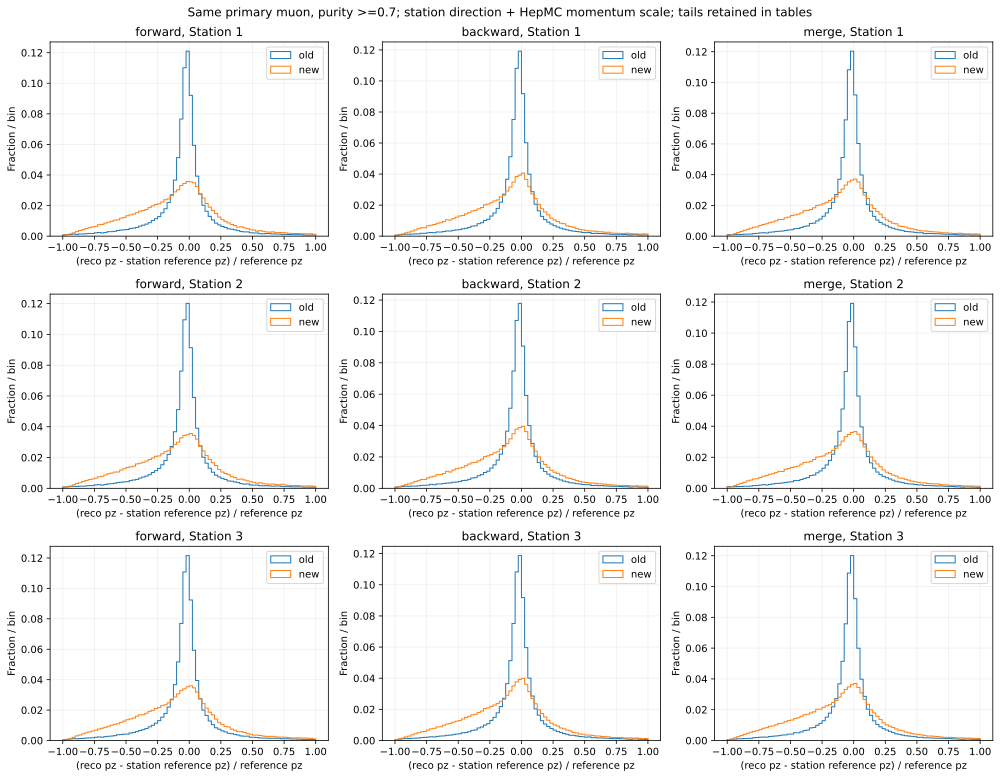
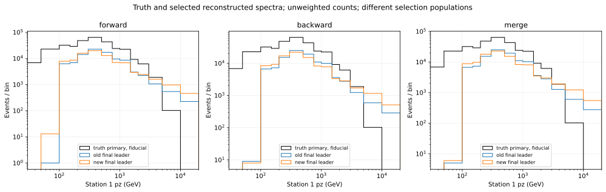
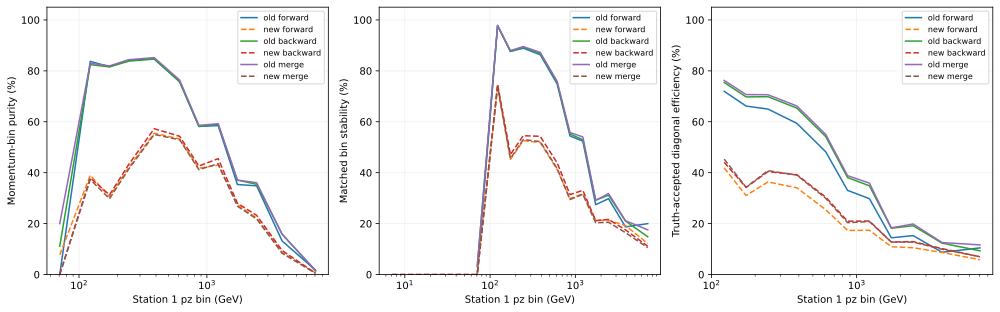

# 阶段 203：新旧重建与主 μ MC 参考的全量配对比较

**本样本中，新版相对于现有 MC 参考的动量准确度下降，并非改善。** 同事件主 μ merge 的 Station 1 绝对 pz 相对误差中位数从 **7.52% 增至 23.64%**，Station 2、3 同样变差；新版仍由 merge 提供最高最终效率。三站 truth acceptance proxy 内，merge 最终失败由旧版 **37,859** 增至新版 **40,383** 个。以上动量参考不是真实 G4 局部输运动量，修复项各自的因果贡献尚未测量。

本报告使用共同输入比较 forward / backward / merge 的重建效率、主 μ 纯度、动量 bin 纯度及 truth acceptance 内的 cut 损失。三个 Station 的位置、方向和动量响应分别测量；动量大小参考来自 HepMC，不能解释为 Geant4 局部输运动量分辨率。

## 样本、软件与固定条件

延续[阶段 202](2026-11-13_stage202_georotation-full-results.md)，旧版为 Calypso `d32b0ff3`，新版为 `88c457c1` 加用户本地修改，使用 `/eos/home-x/xcheng/FASER/geoRotation_calypso` 的冻结现成构建。四套 CKF 显式启用 isolated smoothing，material scattering / energy loss 开启；其余诊断与反事实 overrides 关闭。没有修改或重编外部 Calypso。Athena 24.0.41/GCC13，TI12MC04/FASERNU-04，OFLCOND-FASER-06，without-IFT，原 YAML cuts。软件快照和完整来源见阶段 201 的 provenance。

共同输入 342 个 RDO，每版 **3,374,987 events**，truth-fiducial 分母 **383,670 events**。旧版 index 291 没有通过验收的历史生产，故本次严格配对不包含它；这不等同于声称新版该文件未完成。新版 index 53 沿用 10 个互不重叠的 1,000-event 区间，未因历史整文件 maker 崩溃删除事件。原生产提交 342 个旧版和 351 个新版作业，cluster 9718138。新版 index80 的 forward maker exit129 后用 cluster9718141 的十个1000-event区间恢复，最终有效分片为342个旧版和360个新版，共702个。原失败尝试不计为物理损失；根因未测量。恢复文件10000个唯一ID与原RDO完全一致，truth分母1283、final F/B/M为264/297/308。见 [恢复审计](stage203_station_truth/recovery80_audit.json)。输入与分片路径见 [manifest](stage203_station_truth/input_manifest.tsv)。

所有计数未加 flux/luminosity 权重。all 包括 SIBYLL 替代样本 run 200080；nominal 排除它，另保存逐 run 表。背景、真实 data、系统误差及线程 scaling 未测量。不能把新旧所有差异归因于旋转或 smoothing：版本还含波形及其他代码变化。新版原生结果之外，保留新版轨迹和 Timing Y、换成旧版同事件闪烁体 charge 的控制结果单列。

## 三站 truth 参考：已确认的限制

源码 `FiducialParticleTool::getMomentum` 使用 SiHit 的 global end−start 单位方向，乘 `hit.particleLink()->momentum().rho()`；后者是链接 HepMC 粒子的产生动量大小。各站再按该 barcode 的 SiHit 作向量平均；位置为 SiHit 中点的平均。新旧 `getMomentum` 源码逐字一致。所检查 RDO 的 22 个分支没有 TrackRecord，SiHit 不存局部 G4 动量大小，用户也已确认没有额外局部记录。见 [参考审计](stage203_station_truth/truth_reference_audit.json) 和 [实测大小比例](stage203_station_truth/reference_magnitude_audit.tsv)。

因此下文的“station reference p/pz”表示**站内 SiHit 方向与 HepMC 产生动量尺度组合的参考量**，不是该站真实输运动量。材料能损与本征拟合误差未分离，不能把相对残差的宽度命名为纯 tracking resolution。位置和方向仍可进行对应站比较。缺失参考、缺失拟合状态均计入 coverage，不能静默丢弃。

重建逐状态先逆旋转 `(x,y,z)=(-z′,y′,x′)` 回原坐标。在对应粒子站内平均 truth z 取状态：仅允许 z 相邻间距≤150 mm 的站内线性插值；拟合范围之外仅容许最近状态≤5 mm，否则记 missing，不跨磁铁插值。旧版同样规则。此处是在有限记录上的站内取样，不是新增全场输运。

主 μ 在 ntuple 持久化的 truth 粒子中按入射 ν 对应的带符号 PDG、产生点与 ν 衰变点 xyz 相符（容差 10⁻⁴ mm）唯一匹配，不固定用某个数组下标。默认轨迹 truth-hit purity≥0.7；另列 0.5/0.7/0.9 敏感性。purity 定义为该 barcode 贡献的 measurements / track measurements。

383,670 个 fiducial 事例中，383,589 个可唯一识别主 μ，另 81 个未唯一识别。后者保留在 fiducial 分母中，但不宣称其主 μ 已被正确重建；三站 acceptance 明确要求唯一主 μ，因此不含这些身份不确定事例。

## Truth 分母与 acceptance 定义

Truth-fiducial 沿用原来入射 ν、顶点和 pνz>100 GeV 的选择。额外 truth station acceptance 是其子集，累积要求：唯一主 μ；三站参考有限且 pz>0；≥7 个独立 station/layer 有主 μ truth hit；三站平均 r<95 mm；三站 reference pz>100 GeV；三站 θ<25 mrad。它是**三站 acceptance proxy**，不包含无法定义的 truth fit χ²/nDoF、闪烁体响应、完整 rmax 或 IFT 外推面半径，不能称为通过完整分析 cuts 的精确 truth 事例数。

| 累积 truth 条件 | all events |
|:---|---:|
| fiducial | 383,670 |
| unique_primary | 383,589 |
| three_stations | 235,061 |
| truth_layers_ge7 | 234,907 |
| truth_radius_lt95 | 150,812 |
| truth_pz_gt100 | 146,904 |
| truth_station_acceptance | 140,132 |

完整条件与所有原分析 cut 表达式见 [定义](stage203_station_truth/selection_definition.json)。

## 效率与选中主 μ 的纯度

### Truth-fiducial 分母

| 版本 / 方法 | 主 μ raw | 主 μ long | 主 μ quality | 正确主 μ leader | track cuts 且正确 | final | final 且正确 |
|:---|---:|---:|---:|---:|---:|---:|---:|
| 旧版 forward | 247,227 / 64.437% | 172,015 / 44.834% | 167,254 / 43.593% | 171,726 / 44.759% | 103,866 / 27.072% | 92,937 / 24.223% | 91,763 / 23.917% |
| 旧版 backward | 244,078 / 63.617% | 193,536 / 50.443% | 184,982 / 48.214% | 193,145 / 50.341% | 114,454 / 29.831% | 103,985 / 27.103% | 101,823 / 26.539% |
| 旧版 merge | 250,959 / 65.410% | 195,474 / 50.948% | 187,673 / 48.915% | 194,977 / 50.819% | 115,491 / 30.102% | 104,930 / 27.349% | 102,749 / 26.781% |
| 新版 forward | 244,800 / 63.805% | 168,206 / 43.841% | 163,271 / 42.555% | 167,848 / 43.748% | 99,316 / 25.886% | 87,986 / 22.933% | 86,734 / 22.606% |
| 新版 backward | 240,850 / 62.775% | 187,657 / 48.911% | 180,935 / 47.159% | 187,185 / 48.788% | 109,986 / 28.667% | 99,060 / 25.819% | 96,798 / 25.229% |
| 新版 merge | 250,953 / 65.409% | 194,914 / 50.803% | 188,696 / 49.182% | 194,351 / 50.656% | 114,111 / 29.742% | 102,760 / 26.783% | 100,425 / 26.175% |

### 三站 truth acceptance 分母

| 版本 / 方法 | 主 μ raw | 主 μ long | 主 μ quality | 正确主 μ leader | track cuts 且正确 | final | final 且正确 |
|:---|---:|---:|---:|---:|---:|---:|---:|
| 旧版 forward | 123,523 / 88.148% | 107,806 / 76.932% | 105,335 / 75.168% | 107,732 / 76.879% | 103,189 / 73.637% | 91,270 / 65.131% | 91,163 / 65.055% |
| 旧版 backward | 124,727 / 89.007% | 120,618 / 86.075% | 116,148 / 82.885% | 120,512 / 85.999% | 113,699 / 81.137% | 101,356 / 72.329% | 101,149 / 72.181% |
| 旧版 merge | 125,346 / 89.449% | 121,143 / 86.449% | 117,190 / 83.628% | 121,019 / 86.361% | 114,727 / 81.871% | 102,273 / 72.983% | 102,066 / 72.836% |
| 新版 forward | 122,371 / 87.326% | 105,025 / 74.947% | 102,185 / 72.921% | 104,892 / 74.852% | 98,397 / 70.217% | 86,069 / 61.420% | 85,916 / 61.311% |
| 新版 backward | 123,687 / 88.265% | 117,178 / 83.620% | 113,195 / 80.777% | 117,015 / 83.503% | 108,971 / 77.763% | 96,170 / 68.628% | 95,894 / 68.431% |
| 新版 merge | 125,360 / 89.459% | 120,881 / 86.262% | 117,474 / 83.831% | 120,685 / 86.122% | 113,048 / 80.673% | 99,749 / 71.182% | 99,475 / 70.987% |

Raw/long/quality 是“事件中至少存在一条高 purity 主 μ 候选”，不是轨迹条数。quality 为 long、layers≥7、nDoF≥9、有限 χ² 且 χ²<15 nDoF；track cuts 使用实际 leader 的全部轨迹 cuts。final 不要求 truth 正确，final_correct 额外要求 leader 为高 purity 主 μ。每行逐阶段并非全部嵌套，故不能随意相减为单 cut 效率。

| 版本 / 方法 | final | 正确主 μ | 主 μ 纯度 % | 68% Wilson 下限 % | 上限 % |
|:---|---:|---:|---:|---:|---:|
| 旧版 forward | 92,937 | 91,763 | 98.7368 | 98.6996 | 98.7729 |
| 旧版 backward | 103,985 | 101,823 | 97.9209 | 97.8761 | 97.9646 |
| 旧版 merge | 104,930 | 102,749 | 97.9215 | 97.8770 | 97.9651 |
| 新版 forward | 87,986 | 86,734 | 98.5770 | 98.5366 | 98.6164 |
| 新版 backward | 99,060 | 96,798 | 97.7165 | 97.6686 | 97.7635 |
| 新版 merge | 102,760 | 100,425 | 97.7277 | 97.6808 | 97.7737 |

主 μ 纯度与动量 bin 纯度不同；低 purity、其他 μ、电子、强子和 unmatched 领导轨迹分别记录于 [粒子构成](stage203_station_truth/particle_content.tsv)。[效率全表](stage203_station_truth/efficiency.tsv) 给 68% Wilson 区间；按 pμz、pνz、顶点 r/z 的分箱效率见 [表](stage203_station_truth/binned_efficiency.tsv)。

### 新旧相同事件的选择迁移

| 模式 / 阶段 | 旧通过 | 新通过 | 仅旧 | 仅新 | 新−旧效率百分点 ± paired SE |
|:---|---:|---:|---:|---:|---:|
| forward / track cuts | 105,105 | 100,629 | 6,093 | 1,617 | -1.1666 ± 0.0228 |
| forward / native final | 92,937 | 87,986 | 6,442 | 1,491 | -1.2904 ± 0.0231 |
| forward / new track + old scint charge | 92,937 | 88,961 | 5,476 | 1,500 | -1.0363 ± 0.0217 |
| backward / track cuts | 116,695 | 112,333 | 7,270 | 2,908 | -1.1369 ± 0.0262 |
| backward / native final | 103,985 | 99,060 | 7,645 | 2,720 | -1.2837 ± 0.0265 |
| backward / new track + old scint charge | 103,985 | 100,142 | 6,592 | 2,749 | -1.0016 ± 0.0251 |
| merge / track cuts | 117,753 | 116,532 | 3,943 | 2,722 | -0.3182 ± 0.0213 |
| merge / native final | 104,930 | 102,760 | 4,738 | 2,568 | -0.5656 ± 0.0223 |
| merge / new track + old scint charge | 104,930 | 103,883 | 3,639 | 2,592 | -0.2729 ± 0.0206 |

误差是相同事件配对的统计 SE，不能用两个独立二项误差简单相加。固定 charge 仍未隔离旋转与 smoothing 的各自因果贡献。nominal 与逐 run 结果见 [迁移表](stage203_station_truth/version_migrations.tsv)。

## 有多少 truth acceptance 事例在重建后未通过

| 互斥类别 | 旧 F | 旧 B | 旧 M | 新 F | 新 B | 新 M |
|:---|---:|---:|---:|---:|---:|---:|
| selected_correct | 91,163 | 101,149 | 102,066 | 85,916 | 95,894 | 99,475 |
| selected_wrong_or_low_purity | 107 | 207 | 207 | 153 | 276 | 274 |
| scintillator_failure_after_track_cuts | 12,026 | 12,550 | 12,661 | 12,481 | 13,077 | 13,573 |
| correct_leader_track_cut_failure | 4,543 | 6,813 | 6,292 | 6,495 | 8,044 | 7,637 |
| primary_long_exists_wrong_leader | 27 | 28 | 46 | 43 | 39 | 59 |
| primary_raw_only | 15,716 | 4,109 | 4,200 | 17,346 | 6,503 | 4,471 |
| no_high_purity_primary_raw | 16,550 | 15,276 | 14,660 | 17,698 | 16,299 | 14,643 |
| other_cut_failure | 0 | 0 | 0 | 0 | 0 | 0 |

每一列和均等于相同的三站 truth acceptance 分母。类别按诊断优先级归类：没有高 purity 主 μ raw、仅有 raw 短轨、主 μ long 存在但 leader 错误、正确 leader 轨迹 cut 失败、track cuts 已通过而闪烁体失败、最终通过但 leader 不正确、最终正确通过。低 purity 不等同于严格“物理 μ 不存在”，raw 缺失也不能单凭本表区分 hit/seed/finding 的原因。

| 版本 / 方法 | truth accepted | final pass | final fail | 未正确 final |
|:---|---:|---:|---:|---:|
| 旧版 forward | 140,132 | 91,270 | 48,862 | 48,969 |
| 旧版 backward | 140,132 | 101,356 | 38,776 | 38,983 |
| 旧版 merge | 140,132 | 102,273 | 37,859 | 38,066 |
| 新版 forward | 140,132 | 86,069 | 54,063 | 54,216 |
| 新版 backward | 140,132 | 96,170 | 43,962 | 44,238 |
| 新版 merge | 140,132 | 99,749 | 40,383 | 40,657 |

| 实际流程的首次失败 cut | 旧 F | 旧 B | 旧 M | 新 F | 新 B | 新 M |
|:---|---:|---:|---:|---:|---:|---:|
| At least one long track | 31,705 | 17,961 | 17,360 | 34,238 | 20,624 | 16,955 |
| Veto20 and Veto21 charge > 40 pC | 0 | 0 | 0 | 54 | 60 | 63 |
| Timing Station Charge > 20 pC | 45 | 1 | 23 | 78 | 36 | 56 |
| Preshower Charge > 2.5 pC | 1 | 1 | 1 | 1,098 | 1,211 | 1,251 |
| Track pz > 100 GeV | 1,219 | 1,816 | 1,774 | 3,242 | 4,827 | 4,843 |
| Leading track has at >= 7 layers | 415 | 966 | 899 | 495 | 719 | 581 |
| Track nDoF >= 9 | 1,874 | 3,612 | 3,245 | 1,983 | 2,827 | 2,465 |
| Leading track has chi2/ndof < 15 | 45 | 34 | 20 | 3 | 6 | 6 |
| Track R at max radius < 95 mm | 450 | 520 | 536 | 447 | 505 | 532 |
| Track R at IFT < 95 mm | 1,006 | 1,202 | 1,226 | 952 | 1,152 | 1,176 |
| Track rVetoNu < 120 mm | 39 | 69 | 69 | 40 | 62 | 69 |
| Leading track theta < 25 mrad | 35 | 39 | 39 | 41 | 50 | 49 |
| VetoNu0 reduced charge < 30 pC | 8,249 | 8,567 | 8,646 | 7,823 | 8,122 | 8,428 |
| VetoNu1 reduced charge < 30 pC | 3,779 | 3,988 | 4,021 | 3,569 | 3,761 | 3,909 |

首次失败 cut 各列之和精确等于该列 final fail，不把同时失败多个条件重复计数。各 Station 单独的 pz/r/θ truth-pass→reco-fail 2×2 迁移，另区分缺失局部拟合和错误 leader，见 [局部 cut 迁移](stage203_station_truth/local_cut_migrations.tsv)。这些单站替代条件不取代原流程的 rmax/IFT cuts。

仅要求 leader 正确匹配主 μ、purity≥0.7，逐站检查 `reference pz>100 GeV` 的 cut 迁移（不要求其他 cuts）：

| 版本 | Station | 有效站参考事例 | truth pass | truth pass / reco fail | 其中缺失局部拟合 | truth fail / reco pass |
|:---|---:|---:|---:|---:|---:|---:|
| old | 1 | 194,975 | 187,245 | 4,811 | 1,069 | 754 |
| old | 2 | 194,964 | 187,235 | 4,178 | 294 | 790 |
| old | 3 | 194,772 | 187,061 | 5,157 | 1,523 | 725 |
| new | 1 | 194,348 | 186,521 | 7,907 | 965 | 1,423 |
| new | 2 | 194,340 | 186,512 | 7,556 | 290 | 1,428 |
| new | 3 | 194,279 | 186,459 | 8,931 | 1,622 | 1,309 |

这里的 reco fail 同时包括局部 pz 未过阈值和缺失局部拟合，后者单列；新旧 population 不完全相同。全部主 μ truth 事例（含无轨迹和错误 leader）以及 r/θ 的对应表一并保存在 `local_cut_migrations.tsv`。

## Station 1、2、3 的动量与空间响应

| 版本 / 方法 | Station | 有效 pairs | pz bias 中位 % | central68 半宽 % | \|相对误差\| 中位 % | \|误差\|>50% 比例 % |
|:---|---:|---:|---:|---:|---:|---:|
| 旧版 forward | 1 | 171,497 | -2.2035 | 14.8154 | 7.5459 | 10.3034 |
| 旧版 forward | 2 | 171,450 | -2.2056 | 14.9970 | 7.6287 | 10.4520 |
| 旧版 forward | 3 | 169,840 | -2.2142 | 14.6334 | 7.4833 | 10.0954 |
| 旧版 backward | 1 | 191,798 | -2.0532 | 14.9791 | 7.6445 | 10.5736 |
| 旧版 backward | 2 | 192,828 | -2.0616 | 15.3603 | 7.7754 | 10.9507 |
| 旧版 backward | 3 | 191,747 | -2.0776 | 15.0601 | 7.6634 | 10.7704 |
| 旧版 merge | 1 | 193,832 | -2.0713 | 14.8333 | 7.6008 | 10.3461 |
| 旧版 merge | 2 | 194,653 | -2.0762 | 15.1508 | 7.7100 | 10.6903 |
| 旧版 merge | 3 | 193,064 | -2.0867 | 14.8311 | 7.5933 | 10.4007 |
| 新版 forward | 1 | 167,622 | -5.2693 | 37.7928 | 23.4510 | 24.2665 |
| 新版 forward | 2 | 167,566 | -5.4571 | 38.2053 | 23.7906 | 24.6560 |
| 新版 forward | 3 | 165,876 | -5.8884 | 37.6059 | 23.6392 | 24.3543 |
| 新版 backward | 1 | 185,883 | -5.1845 | 36.5486 | 22.5818 | 23.4588 |
| 新版 backward | 2 | 186,878 | -5.4248 | 37.2575 | 23.1224 | 24.1323 |
| 新版 backward | 3 | 186,063 | -5.8279 | 36.6662 | 22.9742 | 23.8919 |
| 新版 merge | 1 | 193,330 | -5.3892 | 38.3061 | 23.7517 | 24.8042 |
| 新版 merge | 2 | 194,035 | -5.6238 | 38.8619 | 24.1761 | 25.3310 |
| 新版 merge | 3 | 192,462 | -6.0342 | 38.3217 | 24.0906 | 25.1411 |

这里为高 purity 主 μ leader、有限同站 pair；新旧各自的选中人群不同，因此还必须看下面相同事件配对。误差定义 `(reco-reference)/reference`；central68 半宽为 `(q84−q16)/2`，保留尾部并单独计数。p、pz、带电荷符号的 q/p、方向 slope 和 xy 残差的 matched_long / quality / leader / final_leader 全表及缺失覆盖见 [残差](stage203_station_truth/station_residuals.tsv)、[分箱残差](stage203_station_truth/station_binned_residuals.tsv)、[coverage](stage203_station_truth/station_coverage.tsv)；|误差|<10/20/50% 的比例见（仅一事例一 leader 的层给 Wilson 区间；多候选层的事例内相关误差未测量） [表](stage203_station_truth/station_accuracy_fractions.tsv)。



| 方法 | Station | 共同主 μ pairs | 旧 \|误差\| 中位 % | 新 \|误差\| 中位 % | 旧更近 | 新更近 | 相同 | 双侧 sign p |
|:---|---:|---:|---:|---:|---:|---:|---:|---:|
| forward | 1 | 166,129 | 7.4955 | 23.3246 | 120,684 | 45,445 | 0 | 0.0 |
| forward | 2 | 166,063 | 7.5784 | 23.6551 | 120,914 | 45,149 | 0 | 0.0 |
| forward | 3 | 164,505 | 7.4495 | 23.5220 | 120,292 | 44,213 | 0 | 0.0 |
| backward | 1 | 183,337 | 7.5199 | 22.4591 | 131,114 | 52,223 | 0 | 0.0 |
| backward | 2 | 184,442 | 7.6359 | 22.9625 | 132,041 | 52,401 | 0 | 0.0 |
| backward | 3 | 183,614 | 7.5437 | 22.8220 | 131,781 | 51,833 | 0 | 0.0 |
| merge | 1 | 190,798 | 7.5151 | 23.6446 | 138,966 | 51,832 | 0 | 0.0 |
| merge | 2 | 191,599 | 7.6270 | 24.0402 | 139,564 | 52,035 | 0 | 0.0 |
| merge | 3 | 190,163 | 7.5147 | 23.9741 | 139,044 | 51,119 | 0 | 0.0 |

配对要求同一 `(run,event)`、同一主 μ、双方 purity≥0.7、同站参考与拟合均有效。另保存双方都 final pass、truth acceptance 子集及 nominal 分组；sign test 是相关多指标下的探索性检验，p=0 表示浮点下溢，不是数学概率严格为零。F/B/M 的同事件同主 μ 比较见 [模式配对表](stage203_station_truth/paired_mode_station_accuracy.tsv)，merge 是保留候选的去重选择，不是第三次独立拟合。

### 各自最终选中主 μ，Station 1

| 版本 / 方法 | 有效 pairs | 绝对相对误差中位 % | central68 半宽 % | 大于50%尾部 % |
|:---|---:|---:|---:|---:|
| old forward | 91,670 | 5.7302 | 9.9257 | 5.3725 |
| old backward | 101,673 | 5.7818 | 9.9847 | 5.4085 |
| old merge | 102,602 | 5.7158 | 9.8565 | 5.0350 |
| new forward | 86,647 | 21.3147 | 36.3575 | 23.5427 |
| new backward | 96,641 | 20.2865 | 34.7318 | 22.4853 |
| new merge | 100,275 | 21.8265 | 37.0122 | 24.2373 |

新版最终选中 merge 的中位绝对误差 **21.8265%**、central68 半宽 **37.0122%**，旧版为 **5.7158% / 9.8565%**。但双方共同通过 final 的同主 μ pairs（N=98,150）仍是旧 **5.8012%**、新 **21.7652%**，旧更近 **75,566**、新更近 **22,584**；因此观测差异不能只用最终选样人群不同解释。排除 run200080 的共同主 μ merge（N=162,517）旧/新为 **7.7973%/24.0621%**，同样方向。

Merge matched-leader 的站内有效覆盖旧版为 S1 **193,832/194,977**、S2 **194,653/194,977**、S3 **193,064/194,977**；新版为 **193,330/194,351**、**194,035/194,351**、**192,462/194,351**。缺失量已保留，且配对结论使用双方相同的有效事件。Station1 新旧 matched-leader 参考 pz 相对误差小于10%的比例为 **57.5921%/26.5924%**，小于20%为 **74.0172%/44.6827%**，小于50%为 **89.6539%/75.1958%**。

空间表现并非所有指标同向：merge 同主 μ 的 S1/S2/S3 方向 slope 残差中位数，旧 **0.23565/0.22877/0.25187 mrad**，新 **0.28737/0.26605/0.29426 mrad**；xy 中位数旧 **0.31416/0.20663/0.31245 mm**，新 **0.31078/0.21642/0.31128 mm**。例如 S1 xy 新旧胜出95,366/95,434，sign p=0.878，不能宣布该项新版或旧版全面胜出。均值受旧版少数大空间尾部影响，与中位数/多数胜出可有不同方向；完整未截尾均值及 SE 已保留。动量均值亦受极端尾部明显影响，不用均值独自排序。

### 动量分布与动量 bin 纯度

动量 bin 纯度 = “选中正确主 μ 且 truth/reco 在同一 pz bin 的事件” / “选中 reco pz 在该 bin 的全部有效局部 leader”。Bin stability 的分母改为选中正确主 μ 的 truth bin；diagonal efficiency 的分母是该 truth bin 的全部 truth-accepted 事件。三者不可混用；没有局部 reco 或没有主 μ truth 的事件另外保留在 flows/coverage，不暗称 100% 覆盖。

Station1、final merge 的代表性 pz bin（完整表含三站）：

| pz bin GeV | 旧纯度 % | 旧 stability % | 旧 diagonal效率 % | 新纯度 % | 新 stability % | 新 diagonal效率 % |
|:---|---:|---:|---:|---:|---:|---:|
| 100–150 | 82.949 | 97.863 | 76.228 | 37.304 | 73.770 | 45.310 |
| 200–300 | 84.385 | 89.521 | 70.613 | 41.439 | 53.001 | 40.788 |
| 500–750 | 76.384 | 75.856 | 55.025 | 52.922 | 41.619 | 29.925 |
| 1000–1500 | 59.232 | 54.040 | 35.892 | 43.522 | 31.490 | 20.808 |





图中的 truth 是全部 fiducial 主 μ，reco 是各自 final leader，未归一化成相同积分，因此展示的是“谱形＋效率”的共同结果。完整三站、三模式、新旧版本和各分组的 [bin 纯度](stage203_station_truth/momentum_bin_purity.tsv)、[response matrix 非零单元](stage203_station_truth/momentum_response_matrix.tsv)、[flows](stage203_station_truth/momentum_response_flows.tsv) 可用于后续展开研究；当前未做 unfolding 或模型依赖校正。电荷翻转与数值异常见 [表](stage203_station_truth/numerical_and_charge.tsv)。

### 电荷符号

| 方法 | 旧翻转 / 正确主 μ | 旧比例 % | 新翻转 / 正确主 μ | 新比例 % |
|:---|---:|---:|---:|---:|
| forward | 1,085/91,763 | 1.1824 | 5,380/86,734 | 6.2029 |
| backward | 1,297/101,823 | 1.2738 | 5,396/96,798 | 5.5745 |
| merge | 1,059/102,749 | 1.0307 | 6,493/100,425 | 6.4655 |

电荷翻转要求 leader 匹配主 μ 且 purity≥0.7，再核对 charge 与 −sign(PDG)。各自 final 选择人群不同；它测量电荷符号，不能用三站真实动量大小缺失来解释这项指标。最终 leader 的 χ²/pz 非有限和非正 nDoF 均为零，不代表 raw 数值问题消失，raw 异常详见阶段202。

## 验证、资源与存储

先完成 343-event 和 1,000-event pilots，再提交全量。旧版 pilot 曾因仅用于日志的属性读取失败（旧 CKF 无 `MaterialEnergyLoss` 属性）；改为记录实际可用 properties 后重试成功，没有更改重建参数。小样本站内插值与独立实现的 178 个局部 pair 精确一致，另检查线性插值、跨站间距及外侧距离限制。见 [pilot](stage203_station_truth/pilot_validation.json)、[Condor pilot report](stage203_station_truth/pilot_condor_report_validation.json)、[插值验收](stage203_station_truth/interpolation_validation.json)。

全量已逐事例核对新旧所有输入 ID、truth、primary identity、三站参考和层 hit 数；每个生产 shard 的 14 个累计 cut bits 与上一阶段缓存精确一致；官方 ntuple 的 long 动量、χ²/nDoF/layers、truth barcode/PDG/ratio 与附加诊断逐条核对。最终总数也精确复现阶段 202 的旧、新及固定旧 charge 结果。

| 版本 / 步骤 | wall 总和 s | 单 job 中位 s | 最大 RSS KiB | events / summed wall s |
|:---|---:|---:|---:|---:|
| 旧版 / input | 1750.40 | 4.63 | 87,924 | 1928.1233 |
| 旧版 / reco | 552708.13 | 1582.52 | 1,334,012 | 6.1063 |
| 旧版 / forward | 110064.93 | 312.34 | 1,114,208 | 30.6636 |
| 旧版 / backward | 111040.03 | 325.00 | 1,115,744 | 30.3943 |
| 旧版 / merge | 157419.57 | 435.50 | 2,321,144 | 21.4394 |
| 旧版 / extract | 24165.99 | 68.33 | 868,696 | 139.6585 |
| 新版 / input | 1881.67 | 4.71 | 85,808 | 1793.6126 |
| 新版 / reco | 551418.61 | 1440.76 | 1,532,456 | 6.1206 |
| 新版 / forward | 111447.90 | 294.71 | 1,102,908 | 30.2831 |
| 新版 / backward | 112660.67 | 298.14 | 1,124,120 | 29.9571 |
| 新版 / merge | 160903.36 | 426.84 | 2,311,852 | 20.9752 |
| 新版 / extract | 24536.83 | 65.98 | 867,512 | 137.5478 |

请求每 job 1 CPU、3,000 MB memory、6,500 MB disk，workday；OMP/OpenBLAS/MKL 限制为 1。每文件重建一次，三模式 maker 复用 scratch xAOD。新版 index53/80 是分段 job，故中位数按 job 而非严格按文件；merge maker 包含逐状态诊断和 JIT，不能据此比较三种 tracking 算法本身的计算速度。以上是成功生产的步骤 wall，排队、失败尝试及重试额外消耗未混入，批次实际 elapsed 与 wall 总和不同。完整 CPU、ROOT 字节数及每 job 值见 [性能](stage203_station_truth/performance_summary.json) 和 [逐项表](stage203_station_truth/performance.tsv)。

合并后将 **702 个源 NPZ** 的所有事件列、候选列、局部状态、processed IDs 及配置/host/性能元数据与两个合并 NPZ 逐项精确比较，NaN 位置一致，验收 wall **33.79 s**，最大 RSS **1,678,460 KiB**。审计保留原 EOS 路径，配置按唯一内容去重；见 [精确存储验收](stage203_station_truth/storage_validation.json)。本次验收还将 index53/80 的 **4,008 条 long 候选**与上一阶段完整生产的相同事件、mode、raw index 逐值比较，全部一致。全量报告 cluster **9718142** exit 0，统计 wall **341.01 s**、峰值 RSS **2,693,972 KiB**；回读 wall **33.79 s**。整批从首次执行到最后生产结束 **7,366 s**，从提交到结束 **7,558 s**，并非步骤 wall 总和。退出码、失败尝试的已测步骤及 elapsed 见 [作业审计](stage203_station_truth/job_completion_audit.json)。清理数据见 [审计](stage203_station_truth/cleanup_audit.json)。

已在确认本阶段队列为空且精确回读通过后，移除 **702 个生产分片、476,322,667 bytes**，并删除冗余 pilot 数组及远程 tar。保留 `old.npz` **233,613,313 bytes**、`new.npz` **233,365,673 bytes**，共 **466,978,986 bytes**，不入 Git；没有保留中间 xAOD/ROOT。中文报告、代码、数值表、SVG 和紧凑审计入 Git。源文件路径与配置去重映射仍可追溯。

```bash
# 已先提交并验收 pilot；全量冻结/提交
source /cvmfs/sft.cern.ch/lcg/views/LCG_109/x86_64-el9-gcc15-opt/setup.sh
python3 AnalysisZipFramework/submission/prepare_tracking_station.py --all --nevents -1 --name production
condor_submit ~/condor/nu_muAnalysis/stage203_station_truth/production/jobs.sub
# 全部分片完成后，冻结并提交全量报告与精确回读
python3 AnalysisZipFramework/submission/prepare_tracking_station_report.py --name production --manifest workbook/stage203_station_truth/input_manifest.tsv
condor_submit ~/condor/nu_muAnalysis/stage203_station_truth/production_report/report.sub
# 源分片清理后，可用合并 NPZ、原 source_audit/configurations 和冻结 cuts 离线重现
python AnalysisZipFramework/scripts/report_tracking_station.py --repo . \
  --manifest workbook/stage203_station_truth/input_manifest.tsv \
  --combined workbook/stage203_station_truth --output report
```

图已逐张检查，表格的分母、互斥损失、首次失败总数、2×2 迁移、配对胜出总数和动量 bin 范围交叉核对通过，所有报告相对链接和 SVG XML 均有效。见 [表格验收](stage203_station_truth/table_validation.json)。

## 阶段性结论与下一步

在当前冻结配置和这套未加权 GENIE 样本中，新版 **F/B/M 的同事件三站 pz 参考准确度均下降**，主 μ 纯度小幅下降，final 主 μ 电荷翻转比例增加；merge 仍保持最高选择效率。这个比较已经排除新旧 truth、坐标逆变换、历史 cut 不一致和丢失输入事件等已检查的实现原因，但不能把未进行的反事实实验当作根因结论。

三站 truth acceptance 的 merge final 效率旧 **72.9833%**、新 **71.1822%**，配对差 **−1.80116±0.05522 个百分点**；固定旧闪烁体 charge 为 **100,852/140,132**，相对旧版仍 **−1.01404±0.05021 个百分点**。在 truth-fiducial 分母内差别较小，是因为分母和接受人群不同，不能混用两种效率。

Merge 在 acceptance 内“存在质量合格主 μ”的事件由 **117,190** 小幅增至 **117,474**，但正确 leader 由 **121,019** 降至 **120,685**，正确 leader 通过 track cuts 由 **114,727** 降至 **113,048**，final 正确主 μ由 **102,066** 降至 **99,475**。损失并非单纯“找不到轨迹”：实际流程首次失败 pz cut 由 **1,774** 增至 **4,843**，而无 long 首次失败由 **17,360** 降至 **16,955**，Preshower 首次失败由 **1** 增至 **1,251**。这提示需要分别研究动量尺度/方向拟合与波形 cut 迁移，不能归为单一原因。

新版 B/M 同主 μ Station1 配对 N=185,743，其中相同 **137,476**，B 更近 **32,528**、M 更近 **15,739**；旧版相同条件 N=191,583，相同153,067，B更近18,669、M更近19,847。Merge 的效率与动量准确度存在可测取舍，且新旧候选选择表现不同，不能以 merge 较低 χ² 代替 truth 验证。此前 duplicate 全量结论及浏览器见阶段202；本阶段提供更完整的同站参考和主 μ分析，并未改变 merge 策略。

1. 如需测量本征局部动量分辨率，必须用相同 GENIE 输入重新模拟并记录每个 Station sensor step 或 TrackRecord 的实际 G4 动量、粒子 lineage 与坐标约定；先用小样本验收 barcode、面位置、能损及新旧共同事件一致，再扩展全量。现有 RDO 无法事后恢复这项精确信息。
2. 首先用本阶段共同主 μ 的高 purity、both-final 及代表性动量 bins 作为回归输入，固定波形、geometry/conditions 和全部其他 tracking 配置，对 rotation、isolated smoothing 分别做受控比较，并逐项核对 seed covariance、坐标/曲面接口和 refit 状态；验收同时给效率、上述配对三站响应、主 μ/动量 bin 纯度、charge flips、fake 和 duplicate，避免只改善一个指标。
3. 沿用阶段 202 的 merge blockers 与 shared-hit key 审计，比较先保证 long/quality 再去重及完整 cluster key；验收保留所有输入事件并核对新增/损失，不能由较低 χ² 直接断言动量更准确。
