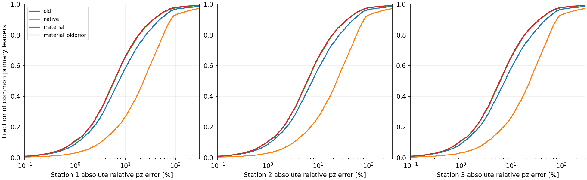
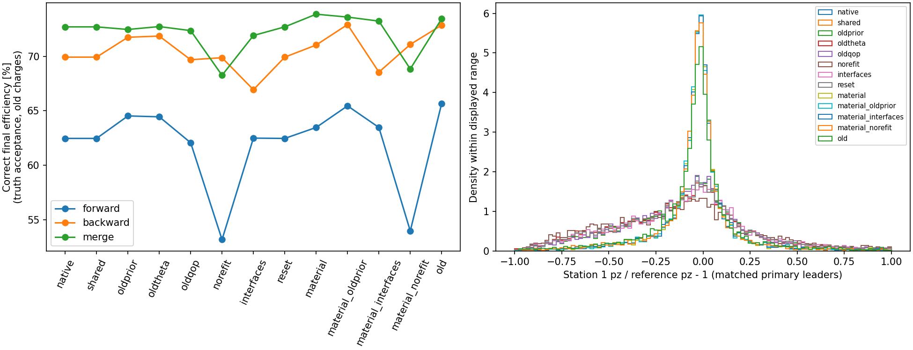

# 阶段 204：新旧 Calypso 准确度和接受度退化的因果检查

**已确认三个主要差异：材料图 bin frame 未旋转、种子先验变化、波形积分与失败回退变化。材料图是动量退化的主因；修正后独立验证的共同主 μ merge Station 1 误差中位数由 23.244% 降至 6.072%（旧版 7.496%）。Isolated smoothing 修复没有导致最终效率退化，应保留。**

## 阶段目标与比较范围

定位阶段 203 中新版动量误差和选择损失增加的具体程序原因；在相同 GENIE RDO 事件上逐项替换材料图、种子先验、smoothing、refit 和参数接口，再用独立事件区间验证。外部 Calypso 工作树只读，使用现成冻结构建，没有把探索性配置写回用户的软件。

旧版 `d32b0ff3cc4a2dad4abfb1474a82422c3c25b305`；新版 `88c457c1e4bf4154e67b96114ee8e7020d9b1a97` 加阶段 201 保存的本地修改。构建、Athena 24.0.41/GCC13、TI12MC04/FASERNU-04、OFLCOND-FASER-06、without-IFT、原 YAML cuts 延续阶段 203。软件分别在 `software/calypso-master-d32b0ff3-el9-gcc13.tar.gz` 与 `software/stage201_tracking/calypso_reco_runtime.tar.gz`。源码差异和生效配置见 [source_audit.json](stage204_causal/source_audit.json)、[旋转相关源码差异](stage204_causal/rotation_source.diff)、[波形源码差异](stage204_causal/waveform_source.diff)。

完整基线是共同 342 RDO、每版 3,374,987 events、383,670 truth-fiducial events，其中 140,132 满足三站 truth acceptance proxy。受控重建选 20 个文件，每文件前 5,000 events 为 discovery，随后 5,000 events 为独立 validation，覆盖 7 个 GENIE run，均未加 flux 权重。文件索引为 `0 15 30 45 63 82 101 125 150 177 186 196 214 232 251 275 300 325 333 340`。这不是对全 337 万事件修正后的重新生产，不能将子样本净恢复数直接外推为全量结果。

Station 动量参考仍为 **SiHit 方向 × 链接 HepMC 产生动量大小**，不是 G4 站内局部输运动量；用户确认没有额外局部记录。逐站重建在对应 truth 平均 z 作站内插值，新版先逆旋转回 FASER 坐标。这里的准确度均指相对此参考的误差，不能称为纯 tracking resolution。truth acceptance 要求唯一主 μ、三站有限、≥7 个 truth layers、三站 r<95 mm、pz>100 GeV、θ<25 mrad；不包含无法定义的 truth χ²、完整 rmax/IFT 外推面和闪烁体响应。主 μ 匹配默认 purity≥0.7，并保留 0.5/0.9 duplicate 敏感性。

## 材料图坐标没有随几何旋转

实际几何变换是 `(xA,yA,zA)=(zF,yF,-xF)`，束流指向内部 x 轴。冻结新版 `faser_reco.py` 仍指定未旋转的 `material-maps-alma9.json`，而 GeometrySvc 直接采用 JSON 的 binUtility transform，不自动旋转材料查询坐标。这会在旋转后的全局位置查询错误材料 cell。

严格修正只将每个材料 bin frame 左乘相同旋转，保留全部 geometry IDs、binning 和材料 cell 数据。在真实 CKF 状态中，新版 forward、truth acceptance 内主 μ、selected、Station 2 (volume 27) 的 107 个材料查询：实际材料厚度中位数 **2.8595004 X₀**；对同一物理点正确旋转查询应为 **0.0060856593 X₀**。原查询 **91/107** 大于 1 X₀，正确查询 **0/107**。这些是每个记录状态上的 slab 查询值，不能将中位数当作整条轨迹的累积材料厚度。错误材料同时进入散射和能损处理。

证据闭合：native 的 7,448 次真实查询与未旋转图相符；修正后的 7,436 次真实查询与旋转图相符，最大相对误差 **5.78834×10⁻⁸**。两种配置的 **1,012 条 seed 逐值完全一致**；audit 开关前后 21 个科学数组完全一致。安装的 ACTS JSON decoder 对全部 22 个 bin frame 的变换验证最大误差为 **0**。见 [真实查询表](stage204_causal/actual_material_queries.tsv)、[查询与 seed 验证](stage204_causal/audit_validation.json)、[ACTS decoder 验证](stage204_causal/material_runtime_validation.json)、[seed→refit lineage](stage204_causal/audit_lineage.tsv)。

最初从其他目录移用的 helper 按 column-major 写 JSON，而实际 ACTS decoder 按 row-major 读，产生 x 镜像；该 v1 结果全部作废并从最终 manifest 排除。正式材料控制均使用已通过实际 decoder 和真实状态查询的 v2。Python 自洽检查不足以替代运行库验证。作废图只保留为软件审计，不用于物理结论。

## 波形重建独立造成 cut 损失

全量 140,132 个 truth-accepted 事件中，Preshower0/1 的旧版 nonfinite charge 均为 0，新版分别为 **308 / 330**；另有 **333 / 342** 个旧正电荷变为新版有限负电荷。Preshower0 单通道阈值的旧通过数 140,131，新版 139,461，lost 671/gained 1；Preshower1 为 140,132→139,435，lost 697/gained 0。两个通道有重叠，不能相加成事件损失。见 [全量电荷迁移表](stage204_causal/discovery/full_scintillator_migrations.tsv) 和 [全量条件替换表](stage204_causal/discovery/full_selection_decomposition.tsv)。

固定新版轨迹和 Timing Y、仅替换为旧版同事件 scintillator charges，merge final 从 **99,749→100,852**，净恢复 **1,103 events** (gained 1,106/lost 3)，即 **+0.787115 个效率百分点**。旧版 final 为 102,273；基线下降 2,524 个中，该条件替换净恢复 43.70%，剩余差为 1,421。这是固定轨迹条件下的替换效果，不能解释为两个机制无交互的唯一分解。

已重放两类具体程序机制，旧/新各 30 events 的两段窗口，共 120 event executions，目标事件四个 charge 与历史缓存逐值完全一致：

| run 200080 / event | 旧 Preshower0 电荷 pC | 新电荷 pC | 新 raw 电荷 pC | 新 status | 原因证据 |
|---|---:|---:|---:|---:|---|
| 383 | 4.7842822 | −∞ | 5.1467190 | 0 | 同一组真实 CB 参数，`TF1::Integral` 为 −∞，`IntegralOneDim` 为 239.2174409 mV·ns，即 4.7843488 pC；积分器报告的误差估计 1.55×10⁻⁷ mV·ns |
| 1915 | 4.4452720 | −0.00589046 | 4.6946287 | 48 | GFIT_FAILED (16) + CBFIT_FAILED (32)，Gaussian peak −1474.76 mV、width 7.967×10⁻⁵ ns，失败结果仍写入 hit |

旧源码以“avoid FPE from symbolic integrator”的注释采用 `IntegralOneDim`，旋转版源码采用 `Integral`，且 event 383 的非有限积分未使 status 置错。阶段207补充核查历史：不是旋转提交“改回”该API，而是旋转分支继承较早实现、old master后来包含`dd56a65e`波形更新，见[版本溯源报告](2026-11-14_stage207_waveform-source-lineage.md)。event 1915 对应的新 `reconstructHit` 在两次 Gaussian 失败后仍无条件保存 gfit，CB 失败仅保留这些结果，旧版 fallback 流程不同。不能仅通过删掉失败事件来修复接受度；也不能把 raw charge 无校准地统一当作最终电荷。见 [真实拟合参数与积分 API](stage204_causal/waveform_fit_383.json)、[失败拟合参数](stage204_causal/waveform_fit_1915.json)、[重放目标表](stage204_causal/waveform_targeted_events.tsv)、[历史缓存逐值验证](stage204_causal/waveform_cache_validation.json)。

## 种子先验的变化与角度坐标含义

旧版 `[covLoc0,covLoc1,covPhi,covTheta,covQOverP]` 为 `[81,0.0361,0.1089,8.41e-6,1e-5]`，新版为 `[81,0.0361,0.1089,8.41e-4,1e-3]`。单位依次为 mm²、mm²、rad²、rad²、GeV⁻²；θ 和 q/p variance 各放大 100 倍，不是标准差放大 100 倍。

同时，相同角度方差在新坐标中物理含义不同。一阶方向 prior RMS 为 `sqrt(sin²θ·var(phi)+var(theta))`。在 audit 的 36 条 accepted-primary forward seeds 上，旧坐标与旧先验为 **4.1241 mrad**，新坐标与新先验为 **331.2688 mrad**；将新版 θ/qop 数字改回旧值仍约 **330.0097 mrad**。backward 对应为 4.1742 / 331.2686 / 330.0095 mrad。这是配置先验的一阶局部尺度，不是测得的角分辨率，也不保证宽先验时线性近似精确。因此 `oldprior` 只能称为“还原两个配置数值”，不能称为完整物理先验匹配或纯旋转控制。见 [物理尺度表](stage204_causal/seed_prior_physical_scales.tsv)。

## 执行与复核方法

大批重建通过 HTCondor，在 `~/condor/nu_muAnalysis/stage204_causal/` 提交。worker 用单 CPU、单线程 BLAS/OMP，RDO 先暂存至 worker scratch，顺序运行 reco、forward/backward/merge maker 和紧凑提取，不保存 xAOD 等 ROOT 中间文件。小样本 1,000 events 先验证；100k discovery 与 100k heldout 区间不重叠。生效配置在最外层 ComponentAccumulator.run 钩子设置，避免被内部 runner 再次覆盖；以最终 `effective_ablation.json` 为准。

```bash
python3 AnalysisZipFramework/submission/prepare_tracking_ablation.py --name discovery100k --indices 0 15 30 45 63 82 101 125 150 177 186 196 214 232 251 275 300 325 333 340 --variants native shared oldprior oldtheta oldqop norefit interfaces reset --nevents 5000
condor_submit ~/condor/nu_muAnalysis/stage204_causal/discovery100k/jobs.sub
python3 AnalysisZipFramework/submission/prepare_tracking_ablation_report.py --name discovery_final
condor_submit ~/condor/nu_muAnalysis/stage204_causal/discovery_final_report/report.sub
```

严格材料控制由同一 prepare 命令选 `material material_oldprior material_interfaces material_norefit`；heldout 选 `native material material_oldprior --skip 5000 --nevents 5000`。精确的各分片输入与命令参数保存于最终报告的 input_manifest.tsv；全部 cluster 与恢复/作废记录见 [execution_audit.json](stage204_causal/execution_audit.json)。归约在 worker 读取 NPZ 和阶段 203 缓存，按 run/event 排序、验证真值一致、native 与历史缓存逐数组相等、保存后精确回读，并从合并缓存恢复每个源分片的科学数组逐值比较。

材料图可用冻结输入独立复查（先进入本阶段 Athena/Calypso runtime；`/tmp/xcheng_stage204/runtime` 来自已记录的新版 runtime 压缩包）：

```bash
export NU_MU_SKIP_LCG=1 FASER_CALYPSO_RUN=/tmp/xcheng_stage204/runtime
source setup_env.sh
nu_mu_calypso_setup
gzip -dc software/stage204_causal/material-original.json.gz > /tmp/stage204_material_original.json
python AnalysisZipFramework/scripts/rotate_tracking_material.py --source /tmp/stage204_material_original.json --output /tmp/stage204_material_rotated.json --report /tmp/stage204_material_rotation_check.json
python AnalysisZipFramework/scripts/validate_tracking_material_runtime.py --source /tmp/stage204_material_original.json --rotated /tmp/stage204_material_rotated.json --output /tmp/stage204_material_runtime_check.json
```

paired 效率用同事件 gained/lost 和配对 SE，给 95% 区间；准确度只在两配置均有高 purity 主 μ leader 的共同事件比较，paired bootstrap 400 次给 median 差的 95% 区间；候选缺失另计效率，不能让条件分辨率掩盖丢失。duplicate 定义为同事件同 dominant truth barcode 的多条 long/quality 轨迹，另统计 excess tracks，不把不同物理粒子误算成 duplicate。

## 完整消融与独立验证结果

正式 discovery 240 个重建作业（12 配置 × 20 文件）与 validation 60 个作业（3 配置 × 20 文件）全部 exit 0，分别为 cluster 9718152/9718160 和 9718154/9718161；归约 cluster 9718173/9718175 均 exit 0。每配置均实际处理 **100,000 events**。Discovery 的 truth-fiducial/accepted 为 **10,505 / 3,783**，validation 为 **10,592 / 3,878**。两组新原生重建与阶段 203 缓存的 21 个科学数组精确相等；所有新版追踪控制之间 truth 和波形数组精确一致；300 个源分片的 21 个科学数组均从合并缓存精确恢复，压缩缓存保存后逐数组回读一致。见 [discovery 验收](stage204_causal/discovery/validation.json)、[validation 验收](stage204_causal/validation/validation.json)。旧版为同事件历史缓存，另有 1,000-event 旧版重放的精确验证，未把缓存读取称为重新运行旧版 100k。

### 动量准确度：材料修正是主效应

以下是四配置都正确匹配主 μ 的共同 merge 事件，给绝对 pz 相对误差的中位数（%）。Discovery 三站共同 N 分别为 5,211 / 5,231 / 5,183；validation 为 5,306 / 5,331 / 5,302。各站保留各自 coverage，未用成功匹配的条件误差代替重建效率。

| 样本 | 配置 | Station 1 % | Station 2 % | Station 3 % |
|---|---|---|---|---|
| discovery | old | 7.509 | 7.576 | 7.459 |
| discovery | native | 23.007 | 23.366 | 23.359 |
| discovery | material | 5.986 | 6.036 | 5.979 |
| discovery | material_oldprior | 5.998 | 6.063 | 5.996 |
| validation | old | 7.496 | 7.696 | 7.587 |
| validation | native | 23.244 | 23.634 | 23.851 |
| validation | material | 6.072 | 6.212 | 6.114 |
| validation | material_oldprior | 5.989 | 6.096 | 6.006 |

单项材料替换的配对 Station 1 比较如下；共同样本 N 只要求这两配置都正确匹配，故与上表四配置共同 N 不同。效率使用全部 truth-accepted 分母，并固定旧 charge。Δ 的单位均为百分点，区间为 95%：

| 样本 | 方法 | 配对 N | 误差中位数 % | 误差差值 95% 区间 | 固定 charge 效率 Δ [95%] |
|---|---|---|---|---|---|
| discovery | forward | 4575 | 22.276 → 5.942 | -17.477 ～ -15.338 | 0.925 [0.571, 1.279] |
| discovery | backward | 5059 | 21.683 → 5.890 | -16.881 ～ -14.809 | 1.110 [0.697, 1.523] |
| discovery | merge | 5265 | 23.035 → 5.986 | -18.116 ～ -16.059 | 1.137 [0.740, 1.533] |
| validation | forward | 4712 | 23.278 → 6.081 | -18.132 ～ -16.393 | 1.418 [1.020, 1.817] |
| validation | backward | 5167 | 22.575 → 6.028 | -17.592 ～ -15.742 | 1.547 [1.098, 1.997] |
| validation | merge | 5371 | 23.289 → 6.130 | -18.292 ～ -16.320 | 1.753 [1.305, 2.202] |

材料修正的优势在两组、三种方法和三个站均复现。即使绕过 refit 或同时改变接口，修正材料后的 merge Station 1 误差仍约 6%，没有回到原生的约 23%。这将材料坐标错配定位为主要动量退化来源；散射项与能损项各自的贡献尚未单独测量。



### 接受度：材料、先验和波形分别影响不同步骤

以下 final 为原样使用各版本电荷，M fixed 为仅替换旧电荷的 merge，M fixed correct 再要求主 μ 匹配 purity≥0.7。所有计数单位为 events，F/B/M 分别为 forward/backward/merge。

| 样本 | 配置 | F final | B final | M final | M fixed | M fixed correct |
|---|---|---|---|---|---|---|
| discovery | old | 2491 | 2765 | 2788 | 2788 | 2778 |
| discovery | native | 2348 | 2628 | 2733 | 2761 | 2750 |
| discovery | material | 2382 | 2669 | 2775 | 2804 | 2794 |
| discovery | material_oldprior | 2455 | 2740 | 2766 | 2795 | 2784 |
| validation | old | 2506 | 2780 | 2806 | 2806 | 2797 |
| validation | native | 2374 | 2632 | 2733 | 2756 | 2743 |
| validation | material | 2428 | 2691 | 2800 | 2824 | 2814 |
| validation | material_oldprior | 2495 | 2760 | 2792 | 2816 | 2808 |

Discovery 中 native→material 的 M fixed 为 2,761→2,804，**gained 51/lost 8，净 +43**；validation 为 2,756→2,824，**gained 74/lost 6，净 +68**。相对于旧版，材料修正后的 M fixed 为 +16 和 +18；其 paired 95% 效率差分别为 **+0.423 [−0.034, +0.880] pp** 和 **+0.464 [+0.054, +0.874] pp**。恢复幅度稳定，但不将轻微超出旧版的差值宣称为单独的旋转收益。

仅修正材料后 F/B 仍比旧版少；再还原两个先验数字，固定旧 charge 的 F/B/M 分别为 discovery **2,482/2,769/2,795**（旧 2,491/2,765/2,788），validation **2,516/2,784/2,816**（旧 2,506/2,780/2,806）。因此 F/B 的剩余退化确有先验配置贡献，组合控制在独立验证中将其恢复到旧版附近。Merge 的候选组合会补偿部分单向损失，其效率对先验的响应不能由 F/B 简单相加。

在 discovery 单独还原 θ 方差，固定 charge 的 F/B 各净增 **75 events**，各 **+1.983 pp**，95% 区间分别为 **[1.521,2.445] / [1.402,2.563] pp**；M 仅净增 2、区间跨 0。单独还原 q/p 使 M Station 1 条件误差中位数从配对的 **23.021%→20.154%**，误差差值 95% 为 **[−3.507,−2.178] pp**，但未改善 M 选择效率。因此不能把“准确度改善”直接等同于“接受度改善”，也不能把还原两个数字当作已完成协方差物理校准。

排除 SIBYLL 替代 run 200080 后，材料修正的 M fixed 净效率提升仍为 discovery **+1.051 [0.634,1.468] pp**、validation **+1.728 [1.233,2.223] pp**，不是单一替代样本造成。上述区间是逐比较区间，未作多重比较校正；主材料效应另有独立事件验证。

Discovery 全部控制如下。误差取各控制与 native 的配对 M Station 1 主 μ 样本，N 随控制变化；选择计数均以 3,783 为分母并固定旧 charge。接口控制同时设置 `CreateTrkTrackTool.CorrectCovariance=True` 和 `KalmanFitterTool.CorrectInterfaces=True`；`norefit` 设 `BypassRefit=True`；`reset` 设 `ResetEventMaps=True`。

| 配置 | 配对 N | M S1 误差 %：native→控制 | F fixed | B fixed | M fixed |
|---|---|---|---|---|---|
| native | — | 基线或旧版参考 | 2372 | 2655 | 2761 |
| shared | 5280 | 23.055 → 23.055 | 2372 | 2655 | 2761 |
| oldprior | 5230 | 23.038 → 20.219 | 2451 | 2727 | 2756 |
| oldtheta | 5260 | 23.021 → 22.995 | 2447 | 2730 | 2763 |
| oldqop | 5236 | 23.021 → 20.154 | 2358 | 2648 | 2750 |
| norefit | 5274 | 23.055 → 29.889 | 2020 | 2655 | 2595 |
| interfaces | 5257 | 22.977 → 23.079 | 2374 | 2543 | 2732 |
| reset | 5280 | 23.055 → 23.055 | 2372 | 2655 | 2761 |
| material | 5265 | 23.035 → 5.986 | 2407 | 2697 | 2804 |
| material_oldprior | 5230 | 22.992 → 6.009 | 2482 | 2769 | 2795 |
| material_interfaces | 5247 | 22.967 → 6.062 | 2407 | 2603 | 2780 |
| material_norefit | 5266 | 23.021 → 6.228 | 2048 | 2699 | 2613 |
| old | — | 基线或旧版参考 | 2491 | 2765 | 2788 |

固定旧 charge 后，M 的首个失败 cut 分解如下，各列之和精确等于分母 3,783 减该配置 M fixed，避免重复计算同时失败多个 cut 的事件。

| 首个失败 cut | old | native | material | material_oldprior |
|---|---|---|---|---|
| At least one long track | 450 | 424 | 429 | 459 |
| Track pz > 100 GeV | 38 | 121 | 72 | 32 |
| Leading track has at >= 7 layers | 23 | 19 | 20 | 21 |
| Track nDoF >= 9 | 72 | 55 | 49 | 63 |
| Leading track has chi2/ndof < 15 | 1 | 0 | 0 | 0 |
| Track R at max radius < 95 mm | 18 | 17 | 18 | 18 |
| Track R at IFT < 95 mm | 41 | 43 | 42 | 45 |
| Track rVetoNu < 120 mm | 1 | 2 | 2 | 1 |
| Leading track theta < 25 mrad | 1 | 0 | 0 | 0 |
| VetoNu0 reduced charge < 30 pC | 251 | 247 | 250 | 251 |
| VetoNu1 reduced charge < 30 pC | 99 | 94 | 97 | 98 |

M 的 pz 首失败由 **121→72**，与材料修正后的动量改善相符；增加旧先验数字控制后降为 32，但 long 缺失和 nDoF 失败增加，解释了后者 M 净效率没有继续上升。所有步骤存在补偿，不能将不同控制的净恢复数无条件相加。



### Isolated smoothing、refit 和跨事件状态

`shared` 将四套 CKF 的 isolated smoothing 全部关闭。100k 中最终 cut bits、原点轨迹表和 raw 主 μ 计数与 native 完全一致，F/B/M 的 final 与 fixed final gained/lost 均为 0。它**不是所有局部状态逐值不变**：reco_station 有 18 条轨迹变化，reco_at_primary_station 有 38 条，事件标量有 4 行变化；局部状态有限 coverage 没有变化。在 reco_at_primary_station 中，全部 46 个变化的 track/station 对、19 个唯一事件已列于 [smoothing_changed_states.tsv](stage204_causal/discovery/smoothing_changed_states.tsv)。

其中高 purity 主 μ leader 涉及 6 个唯一事件、15 个 method/station 对，开启 isolated smoothing 后 12 对的 |pz 相对误差| 更小、3 对更大（同事件多方法/多站并非独立统计）。Truth-accepted 内仅 1 个事件、2 个方法/站对变化，两者均改善且该事件最终仍失败。例 run200083/event244485 的 Station 3：参考 pz 378.185 GeV，isolated 为 230.760 GeV，shared 为 861.863 GeV；两方法均未 final 通过。M Station 1 所有配对主 μ pz 精确相同；Station 3 关闭修复后误差中位数从 **23.41284%→23.44402%**。所以应保留此修复：它作用于少量局部尾部，不能解释约 23% 的整体动量误差或最终效率下降。见 [逐数组差异](stage204_causal/discovery/invariance.json)。

`reset` 的全部已记录科学数组与 native 精确相同。绕过 refit 则使 M Station 1 误差 **23.055%→29.889%**，M fixed **2,761→2,595**，净 −166，效率差 **−4.388 [−5.100,−3.676] pp**。接口控制的 M median 无明确改善、fixed 减少 29；修正材料后接口控制的 M fixed 也比材料单项少 24。当前数据不支持用关闭 refit 或盲目组合接口开关替代材料修正。未对所有异常局部尾部做独立的真实 G4 动量验证。

### Duplicate tracks

以下为 truth-fiducial 内 purity≥0.7 的 duplicate truth groups/excess tracks，分别列 long 与 quality。quality 要求 ≥7 layers、nDoF≥9、有限 χ² 且 χ²<15 nDoF。每个 duplicate group 至少两条轨迹；若 event 内含多个重复 barcode，不把 group 数直接叫 event 数。

| 样本 | 配置 | F long ; quality | B long ; quality | M long ; quality |
|---|---|---|---|---|
| discovery | old | 2/2 ; 2/2 | 1/1 ; 1/1 | 6/6 ; 3/3 |
| discovery | native | 1/1 ; 0/0 | 1/1 ; 0/0 | 6/6 ; 0/0 |
| discovery | material | 1/1 ; 0/0 | 0/0 ; 0/0 | 3/3 ; 0/0 |
| discovery | material_oldprior | 3/3 ; 2/2 | 1/1 ; 1/1 | 5/5 ; 3/3 |
| validation | old | 0/0 ; 0/0 | 0/0 ; 0/0 | 7/7 ; 0/0 |
| validation | native | 0/0 ; 0/0 | 1/1 ; 0/0 | 3/3 ; 0/0 |
| validation | material | 0/0 ; 0/0 | 0/0 ; 0/0 | 2/2 ; 0/0 |
| validation | material_oldprior | 0/0 ; 0/0 | 0/0 ; 0/0 | 5/5 ; 0/0 |

材料修正没有增加本子样本的高 purity duplicates；单独 F/B 较少、merge 较多。两组四个主要配置在 truth-accepted 内的 quality duplicate 均观察为 0，不能据此断言总体概率为 0。样本内 duplicate 计数很少，不能将它作为主 μ 接受度退化的解释。所有配置、long/quality、purity 0.5/0.7/0.9、fiducial/accepted/nominal 的计数均保存在 [discovery duplicates](stage204_causal/discovery/duplicates.tsv) 和 [validation duplicates](stage204_causal/validation/duplicates.tsv)。

## 性能、存储与验证

单 worker 单 CPU，OMP/BLAS 均为 1；未测量多线程 scaling 或 GPU 收益。Discovery 有效作业记录的各 stage wall 合计 **107.712 h**、user+system CPU **100.366 h**；validation 分别为 **25.244 h / 23.884 h**。这些为各作业 stage 时间之和，不是并行生产的日历用时，不含排队/环境初始化和作废 v1 尝试。300 个有效作业观测到的最高进程 RSS 为 **2,205.36 MiB**，低于申请的 3,000 MB 档位；完整逐 stage 数据见两组 performance.tsv。

| 样本 | 配置 | 5k-event reco median wall s | median events/s | reco max RSS MiB |
|---|---|---|---|---|
| discovery | native | 878.40 | 5.692 | 1246.81 |
| discovery | material | 897.33 | 5.605 | 1203.86 |
| discovery | material_oldprior | 965.03 | 5.183 | 1189.34 |
| validation | native | 743.84 | 6.723 | 1218.34 |
| validation | material | 786.83 | 6.372 | 1210.34 |
| validation | material_oldprior | 899.23 | 5.566 | 1170.64 |

不同配置分配到不同 worker，因此这不是同硬件的性能基准，不能据此宣称材料修正提速。归约 discovery/validation 分别用 **102.409 / 24.986 s**，峰值 RSS **1,065.49 / 908.71 MiB**。材料 audit 的约 470 MB/配置原始 JSONL 在 worker 内归约为约 0.35 MB/配置 NPZ 后即删除，bulk 关闭逐状态 audit；最终只保留紧凑数组、表、图、生效配置和必要来源。没有将 xAOD 等 ROOT 中间文件写入 EOS。正式作业与归约全部结束、队列为空并完成本地缓存读取和共同样本中位数复算后，清理了 328 个冗余分片/归约包（208.38 MiB）；保留紧凑 NPZ 共 102.86 MiB。两组最终图的 24 个共同样本中位数与重新计算的结果差值均为 0。原始代码冻结包与紧凑作业退出审计保留，见 [本地缓存验证](stage204_causal/local_cache_validation.json) 和 [作业退出表](stage204_causal/job_exit_audit.tsv)。

每个最终合并缓存的科学数组来自已验证分片，保存后回读及分片恢复均精确一致。Python 编译检查、shell 语法检查、真实 1k pilot、真实积分 API 审计、100k+100k 重建/归约和最终 PNG 目视检查均完成；没有改动 C++ 源码，因此未重编 Calypso。

## 阶段结论与下一步

**主要原因已用受控重建闭合：材料 bin frame 未随几何旋转，造成动量误差和 merge 选择损失；θ/qop 先验同时变化，其中 θ 数值变化明显影响 F/B 效率；独立的波形积分与失败 fallback 退化增加 scintillator cut 损失。Isolated smoothing 修复不应回退。** 材料修正的准确度改善和效率恢复在独立事件中复现；其余接口/重拟合开关不能替代它。完整修正组合在全部 337 万事件上的效率、真实 transported G4 动量分辨率、通量加权效率、系统误差和线程 scaling 均为“未测量”。

下一步按以下优先级执行，当前阶段不修改外部 Calypso：

1. 将已验证的旋转材料图接入新版默认配置。输入为本阶段冻结原图、严格旋转脚本与对应几何 tag；验收要求全部 22 个 ACTS frame 验证通过、真实查询相对误差<2×10⁻⁶、seed 不变，并复现本阶段三站和 F/B/M 的配对结果。原图压缩快照与可用旋转图位于 `software/stage204_causal/`。
2. 波形恢复稳定数值积分，明确检查 integral 的有限性和物理有效性，并在 Gaussian/CB 失败时使用经验证的 fallback。输入为原始 RDO 和本阶段两个重放窗口；验收要求 event383 不再输出 −∞/status0，event1915 不再将失败负峰写为有效最终电荷，再对全样本逐通道检查阈值迁移；不能靠放松 cuts 或直接取绝对值达成。
3. 在物理方向空间或用完整 Jacobian 构造种子协方差，包含旋转引入的相关项。输入为逐 seed 的均值、旧先验与局部表面基；验收以共同 truth 分母的 F/B/M 效率、动量响应、pull 和 duplicate 为准，不能只令新旧参数名字对应的对角数相同。当前 material_oldprior 是可复查的诊断起点，尚非完整标定。
4. 对材料和波形修正分别验收后，再运行共同 342 RDO 的完整回归，保留 isolated smoothing，输出紧凑结果与全量损失分解；验收要求事件/真值分母闭合、无新增 nonfinite 波形、三站响应和各方法效率复现并解释剩余迁移。下一轮 MC 生产增加 G4 在 Station1/2/3 的局部动量记录，才能测量真实输运动量分辨率。

复查入口：[discovery 输入清单](stage204_causal/discovery/input_manifest.tsv)、[validation 输入清单](stage204_causal/validation/input_manifest.tsv)、[最终生效配置](stage204_causal/discovery/effective_configurations.json)、[配对效率全表](stage204_causal/discovery/paired_efficiency.tsv)、[配对动量全表](stage204_causal/validation/paired_accuracy.tsv)、[执行审计](stage204_causal/execution_audit.json)。材料 JSON 次序的运行库依据为 [ACTS v32 AlgebraJsonConverter](https://github.com/acts-project/acts/blob/v32.0.2/Plugins/Json/src/AlgebraJsonConverter.cpp)，同时使用本机已安装库实测，未将其他样本的结论作为本 GENIE 结果。
