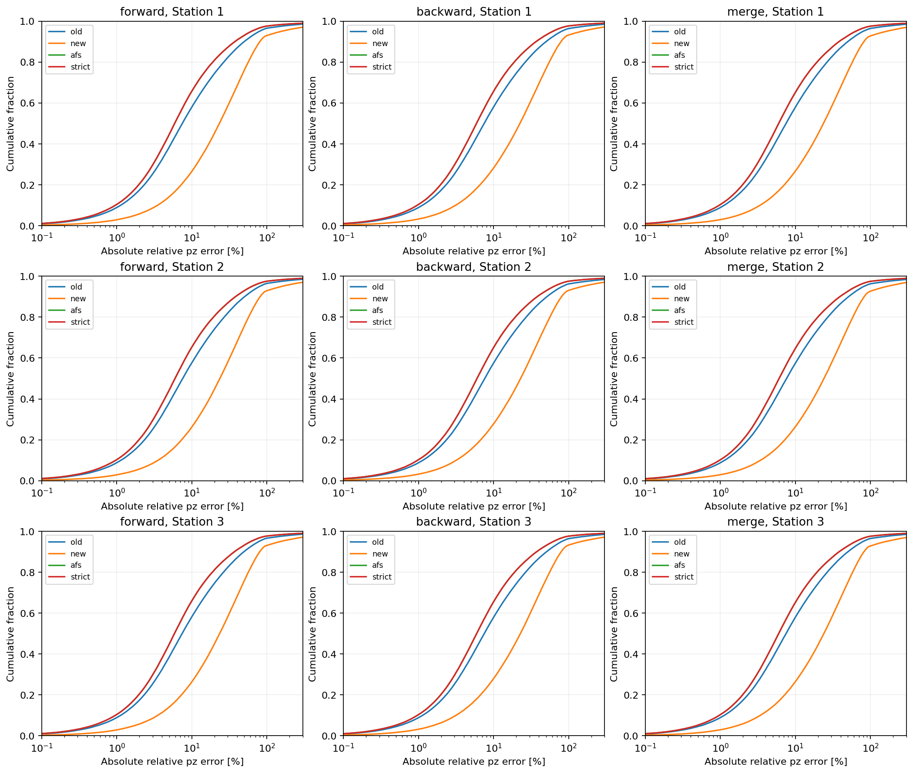
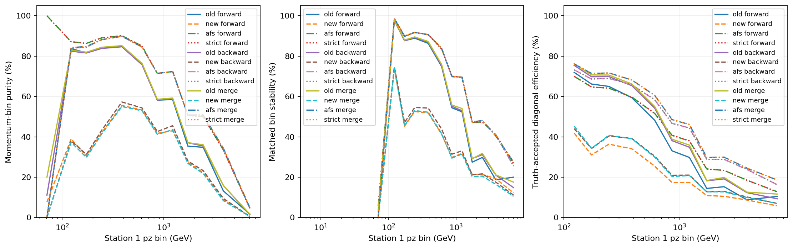
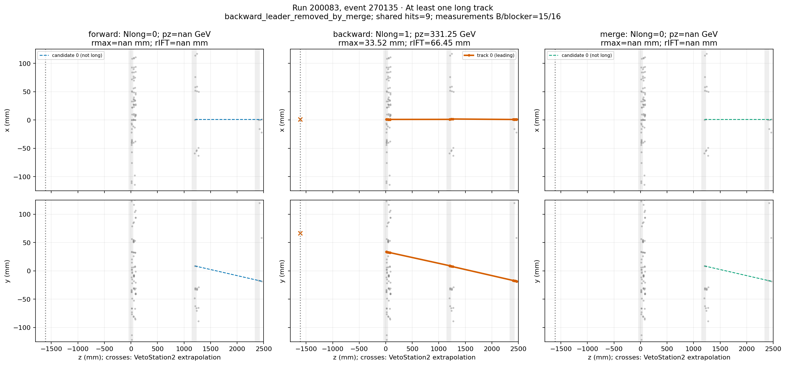

# 阶段 205：旋转材料图后的全量重建、MC 参考与 merge/duplicate 比较

**全量结论：材料图是此前动量准确度下降的主因。更换后，merge 在四版本共同主 μ 上的 Station 1 绝对相对 pz 误差中位数从原生新版 23.6025% 降至 5.9712%，旧版为 7.4996%。实际新版电荷下，truth-accepted merge 效率从 71.1822% 恢复到 72.5687%，仍比旧版 72.9833% 低 0.4146 个百分点；固定旧电荷的控制结果为 73.3665%，高于旧版。**

## 阶段目标、完整输入和口径

按用户给出的 AFS 材料图及 Geometry Rotation Test 手算图，替换新版 Calypso 的材料输入，完成此前全套 forward/backward/merge、三站 MC 参考、接受度及 duplicate 复查。旧版和原生新版复用阶段 203 已验收的完整缓存；本阶段为两种旋转材料配置分别重新执行全量重建，不把阶段 204 的 100k 子样本当成全量结果。

共同输入 **342 RDO、每版 3,374,987 events**，truth-fiducial **383,670 events**，truth-accepted proxy **140,132 events**。沿用阶段 203 排除旧版没有验收结果的 index 291；不剔除任何本阶段失败区间。软件仍为旧 `d32b0ff3` 和新版 `88c457c1` 加已冻结本地修改，Athena 24.0.41/GCC13、TI12MC04/FASERNU-04、OFLCOND-FASER-06、without IFT、原 YAML cuts。新版保留 isolated smoothing、默认 seed priors、refit、energy loss/scattering，只替换材料图。

所有表为未加权事件；all 包含替代生成器 run 200080，nominal 排除它。nominal 的 truth-accepted 分母为 121,425，merge final 旧/原新/AFS/strict 分别为 **87,554 / 85,580 / 87,103 / 87,111**，与全样本恢复趋势相同。系统误差、flux 加权产额和真实 data 表现未测量。

**用户已确认没有额外 Geant4 站内局部动量记录。** 本文的 Station truth reference 是 **SiHit 平均方向 × 链接 HepMC 产生动量大小**，不是经过材料能损输运后的真实局部动量。重建先恢复 FASER 坐标，再在 truth 平均 z 作站内插值，bracketing gap≤150 mm；范围外仅允许 nearest state≤5 mm。由此得到的是相对此参考的响应，不能称为完整 G4 局部动量 resolution。proxy acceptance 要求唯一主 μ、三站有效正 pz、≥7 truth hit layers、三站 r<95 mm、pz>100 GeV、θ<25 mrad；不声称定义了 truth χ²、完整 IFT/rmax 面或闪烁体响应。

详细数字直接由实测 TSV 生成于 [详细比较表](stage205_material/full/detailed_results.md)。全量验收见 [summary.json](stage205_material/full/summary.json)，选择定义见 [selection_definition.json](stage205_material/full/selection_definition.json)。

## 材料图核实与实际安装

比较四组：`old` 旧版、`new` 原生新版未旋转材料图、`afs` 用户指定原图、`strict` 手算图修正 JSON 矩阵序列化。

用户原图 `/afs/cern.ch/work/x/xai/public/FASER/develop/run/material-maps-alma9-rotated.json` 含 12 个非零材料 surface；手算图 `/eos/home-x/xcheng/FASER/geoRotation_test_results/stage02_closure/material-current-rotated.json` 含 22 个 surface，额外 10 个全是零材料。按 geometry identity 连接后，共同 86,400 个 cell 的材料数值逐值一致。两图都将旋转矩阵写成了当前实际 ACTS decoder 所需矩阵的转置。

几何主动旋转为 `(xA,yA,zA)=(zF,yF,-xF)`。`libActsPluginJson.so` 实际按 row-major 解码，AFS 原图使 binX 相对正确局部坐标镜像；AFS 的 2 mm 层位置差沿法向，不进入二维 binX/binY 查询。strict 仅将手算图各 rotation 数组转置，保留 IDs、translations、binning 和全部 cells，与阶段 204 经真实查询验证的 v2 精确相同。两份原图不能直接称为坐标完全正确；也不应因小样本接近便断言镜像无效应。

实测：AFS 原图实际 decoder 对 12 frames 的最大变换差为 2，不能通过严格旋转闭合；strict 的全部 **22 frames 最大误差为 0**。1,000-event pilot，AFS **6,908** 次真实材料查询、strict **7,436** 次均与各自冻结 JSON 一致，最大相对误差分别 **5.7843×10⁻⁸ / 5.7883×10⁻⁸**，两者 **1,012 seeds 完全相同**。两图 audit on/off 的 21 science arrays、全部事件 ID、cutflow 完全相同。见 [decoder](stage205_material/strict_runtime_decoder.json)、[AFS decoder](stage205_material/afs_runtime_decoder.json)、[实际查询及 pilot](stage205_material/pilot/pilot_validation.json)、[审计观察者闭合](stage205_material/audit_observer_validation.json)、[lookup 对照](stage205_material/map_lookup_equivalence.json)。

AFS 和 strict 全量结果接近但不完全相同：truth-accepted final，strict 比 AFS 的 F/B/M 净增 **84 / 32 / 9 events**；merge 为 lost 3/gained 12，净 **+0.00642 pp**，配对 95% CI **[0.00101,0.01184] pp**。两图共同 merge 主 μ Station 1 的误差中位数为 **6.01788% / 6.01571%**。材料 cell 的镜像不是所有位置都相同；中心区域许多 cells 近似对称，但少数差别较大，见 [材料对称性审计](stage205_material/map_reflection_symmetry.json)。默认采用坐标严格闭合的版本。

已安装到：

- `/eos/home-x/xcheng/FASER/geoRotation_calypso/run/material-maps-alma9-rotated-rowmajor.json`。
- 源码 `Control/CalypsoExample/Reconstruction/scripts/faser_reco.py` 和安装脚本 `run/bin/faser_reco.py` 均指向该图；build/bin 是源码链接。
- 三个脚本路径均通过语法与目标路径检查；安装图与冻结图逐字节相同，无需重编 C++。原冻结 bulk runtime 不改写，通过最终 accumulator property 使用同一材料图。

[安装审计](stage205_material/calypso_material_installation.json) 和 [实际补丁](stage205_material/calypso_material_installation.patch) 可复查。外部 Calypso 中其他用户修改未改动。冻结图与 provenance 位于 `software/stage205_material/`。

## 接受度、MC 通过而重建失败

下表分母均为 140,132 truth-accepted events，实际采用各版本自身电荷。括号为效率 %。

| 版本 | Forward 通过 | Backward 通过 | Merge 通过 | Merge 未通过 |
|---|---:|---:|---:|---:|
| old | 91,270 (65.1314) | 101,356 (72.3289) | 102,273 (72.9833) | 37,859 |
| new | 86,069 (61.4199) | 96,170 (68.6282) | 99,749 (71.1822) | 40,383 |
| afs | 87,482 (62.4283) | 97,977 (69.9176) | 101,683 (72.5623) | 38,449 |
| strict | 87,566 (62.4882) | 98,009 (69.9405) | 101,692 (72.5687) | 38,440 |

严格材料修正相对原新版 merge gained **2,294**、lost **351**、净 **+1,943 events**，+**1.38655 pp**，配对 95% CI **[1.3150,1.4581] pp**。相对旧版 gained **1,594**、lost **2,175**、净 −581，−**0.41461 pp**，95% CI **[−0.5004,−0.3288] pp**。不能只报净值而隐藏迁移。

固定 strict 轨迹及其 Timing Y，仅换成旧版同事件 scintillator charges，merge 通过 **102,810**，比 actual strict 多 **1,118**，比旧版多 **537**；相对旧效率差 +**0.38321 pp**，95% CI **[0.3109,0.4555] pp**。这表明剩余 actual merge 接受度下降与波形差异相容；不是说已修复波形。该替换包含阈值/leader 相互作用，不是无交互的唯一因果分解。Forward/backward 即使固定旧电荷仍低于旧版，分别 **88,542 / 99,084**，不能宣称所有方法的接受度已恢复。

互斥分类中，strict merge 的 140,132 个事件包括：正确选中 **101,461**、选中但错误或 purity<0.7 **231**、正确 leader 但 track cut 失败 **5,499**、没有高纯度主 μ raw **14,618**、仅有主 μ raw 非 long **4,537**、有主 μ long 却选错 leader **45**、通过 track cuts 但非轨迹 cuts 失败 **13,741**。分类优先级见代码，后四者不能再与 first-cut 表直接相加。

按实际分析顺序 first-failed-cut：merge 的 pz 阈值失败 old/new/strict 为 **1,774 / 4,843 / 2,670**；Preshower first-fail 为 **1 / 1,251 / 1,248**，材料修正没有修复电荷异常。strict 没有任何 long 的 **17,064**；rmax 首次失败 **532**，rIFT **1,218**。完整 14 cuts、所有方法与逐 run 见 [first_failed_cut.tsv](stage205_material/full/first_failed_cut.tsv)、[互斥损失](stage205_material/full/truth_accepted_losses.tsv)、[事件迁移清单](stage205_material/full/truth_accepted_migration_events.tsv)。

局部单 cut 不等同于完整 final selection。例：Station 1、merge、有效唯一主 μ truth 的 pz>100 GeV 有 **279,474** 个，重建局部 pz 未通过 old/new/strict 为 **94,661 / 99,116 / 95,596**；strict 中 **84,078** 没有对应局部拟合。若限定正确主 μ leader，truth-pass/reco-fail 为 **4,811 / 7,907 / 4,382**，其中 missing local 为 **1,069 / 965 / 980**。各版本自身候选数不同；上述是实际迁移计数，不应当作共同候选条件下的纯 resolution 比较。见 [三站 pz、r、θ 迁移](stage205_material/full/local_cut_migrations.tsv)。

## 三站准确度、纯度与动量分布

四组共同主 μ、hit purity≥0.7、同站有效，比较完全相同事件。单位为绝对相对 pz 误差中位数 %。

| Merge | 共同数 | old | new | afs | strict |
|---|---:|---:|---:|---:|---:|
| Station 1 | 190,420 | 7.4996 | 23.6025 | 5.9741 | 5.9712 |
| Station 2 | 191,199 | 7.6135 | 23.9973 | 6.0528 | 6.0494 |
| Station 3 | 189,776 | 7.4999 | 23.9229 | 5.9764 | 5.9732 |

四组都 final 的 Station 1 共同数 98,071，误差中位数 old/new/strict **5.8010% / 21.7552% / 4.4864%**；truth-accepted 共同主 μ为 118,972，对应 **5.9834% / 22.6706% / 4.6281%**。更换材料图的改善并非仅由选择集合变化产生。



两两配对 old/strict merge Station 1，N=191,045：strict 更近 **109,288**，old 更近 **81,757**；不是每个事件都改善。原新版/strict N=192,702，strict 更近 **148,589**、原新版更近 **44,112**、tie 1。pairwise cohort 与上表四组共同 cohort 不同，不混用分母。完整 p、pz、q/p、方向 mrad、位置 mm、q16/q84、尾部、覆盖率、分动量 bin 和配对 sign 检验见 `station_*`、`paired_station_accuracy.tsv`；所有局部缺失单列。

最终 fiducial 样本的主 μ identity/hit purity≥0.7（不要求同动量 bin），merge old/new/strict 为 **97.9215% / 97.7277% / 97.7946%**，并非所有 purity 都超过旧版。最终正确主 μ的 charge flips 则从 **1,059/102,749（old）**、**6,493/100,425（new）** 降至 **45/102,122（strict）**；full final 的非有限 pz、χ²和非正 nDoF 三者均为 0。raw 全候选数值异常未在本阶段全量保存，因此不能将最终样本正常推广为 raw 完全正常。

动量 bin 纯度的定义为“正确主 μ且 truth/reco 同 bin / 该 reco bin 内所有 selected leaders”，与 hit purity 不同。例 merge Station 1 final：

| pz bin GeV | old 纯度 % | new 纯度 % | strict 纯度 % |
|---|---:|---:|---:|
| 200–300 | 84.3854 | 41.4387 | 88.1497 |
| 300–500 | 85.1918 | 55.0236 | 89.8884 |
| 500–750 | 76.3842 | 52.9219 | 84.5344 |
| 750–1000 | 58.5859 | 41.1871 | 71.4600 |
| 1500–2000 | 37.1034 | 26.8216 | 50.6617 |

高动量尾部仍明显降质：3–5 TeV strict bin purity **34.3336%**，5–10 TeV **4.8632%**；高 pz/宽尾/低统计仍需处理，不能以整体中位数较好掩盖。完整三站 bin 计数、统计区间、稳定性、接受度内对角效率、二维迁移计数及缺失 flow 均已保存。



动量谱使用原始计数，并分别保存 p/pz、三站、truth-fiducial、truth-accepted、leader/track cuts/final、固定旧电荷 final；truth 与 selected spectra 不同人口，不能用两条直方图形状之差单独定义 resolution。见 [momentum_spectra.tsv](stage205_material/full/momentum_spectra.tsv) 及 [谱图](stage205_material/full/momentum_spectra.png)。

## Merge 与 duplicate 全量复查

共同 truth-fiducial 分母 383,670，strict final F/B/M 为 **89,181 / 100,652 / 104,425**。Merge 比 backward 新增 **3,823**、损失 **50**、净 +**3,773 events**，+**0.98339 pp**，配对 95% CI **[0.9518,1.0150] pp**；比 forward 新增 **15,285**、损失 **41**。Merge 仍保持最高效率。

但 merge 不是最小动量误差选择器，也不重新拟合。strict B/M 同主 μ Station 1 N=185,564，完全相同 162,270；B 更近 11,908、M 更近 11,386，sign p=0.0006407，而误差中位数 B/M **5.9581% / 5.9431%**。候选胜负计数、分布中位数和均值尾部不同，不能从其中一项宣布绝对优劣。

strict 的 50 个 B-pass/M-fail 中，首失败 cut 为：无 long **6**、pz **1**、nDoF **10**、rmax **30**、rIFT **1**、θ **2**；原新版 pz first-fail 为 74/130，材料修正使该项大幅减少。缓存中确认 **27** 个原 B leader 在 merge long 保留但不再 leading，**23** 个未在 merge long 找到相同候选；后者不直接等于 raw merge 移除，需要 hit 级重放核对。

Duplicate 定义为同事件同非零 truth barcode、满足 purity 门槛的多条轨迹；记录重复 events、truth groups、excess tracks。主 μ raw 包含短片段；所有粒子只在已保存的 long/quality 上比较，默认≥0.7，另测 0.5/0.9。quality 为每条轨迹 layers≥7、nDoF≥9、有限 χ²且 χ²/nDoF<15，不是 event final。

| 配置/方法 | 所有粒子 long 重复事件 | 所有粒子 quality 重复事件 | 主 μ raw 重复事件 |
|---|---:|---:|---:|
| old merge | 237 | 6 | 30,666 |
| new merge | 171 | 2 | 36,251 |
| strict forward | 5 | 3 | 11 |
| strict backward | 3 | 1 | 42 |
| strict merge | 126 | 3 | 36,536 |

strict merge 主 μ long duplicate **110**、quality **3**；raw 多余主 μ轨迹 **36,541**。Merge 的重复主要是短片段，不能将 raw 的高数值误称为最终选中轨迹严重重复。quality 从原新版 2 到 strict 3 的差只有一个事件，不据此宣布退化；完整敏感性阈值和具体事件见 [duplicates.tsv](stage205_material/full/duplicates.tsv)、[主 μ三层计数](stage205_material/full/primary_duplicate_counts.tsv)、[quality 事件清单](stage205_material/full/duplicate_quality_events.tsv)。

## 剩余50个 merge 损失的完整 hit 级重放

50/50 个 B-pass/M-fail 全部重放，cluster **9718198 exit0**，官方 long-track truth/坐标索引独立核对 **309 条**。每个事件的全量 long candidates、主 μ raw/long/quality 计数、14个 cut bits 和7个 leader scalars精确重现。全量缓存未保存所有 raw candidates，所以本项只宣称 long 参数与 raw 主 μ计数精确核对；完整 raw 候选状态和 shared hits 是此次重放新测得的量。

确认 **23** 个 B leader 被 raw merge 移除，其中 **14** 个由更多 measurements 的候选胜出，**9** 个由相同 measurements、较低 χ²/nDoF 胜出；**27** 个 B leader 保留但最高 pz 的其他候选成为 leader。按 cut 的移除/保留为：无long **6/0**、θ **2/0**、rIFT **1/0**、rmax **13/17**、nDoF **0/10**、pz **1/0**。见 [mechanism_by_cut.tsv](stage205_material/details/mechanism_by_cut.tsv)。

**8** 个移除的 blocker 仅覆盖 stations 2/3；其中 **6** 个事件最终没有任何 long，另2个仍有其他 long却失败。全部满足算法 shared measurements>6 的移除条件；这说明材料修正没有解决“raw 排序在前、三站long要求在后”的语义冲突。

| 事件 run/event | B/blocker measurements | shared hits | blocker distinct planes | blocker 重复测量 | 最终 merge |
|---|---:|---:|---:|---:|---|
| 200082/14116 | 14/14 | 8 | 12 | 2 | 无long |
| 200082/127418 | 14/14 | 9 | 11 | 2 | 无long |
| 200082/359128 | 16/18 | 13 | 12 | 0 | 无long |
| 200083/270135 | 15/16 | 9 | 11 | 0 | 无long |
| 200089/140607 | 14/15 | 8 | 11 | 2 | 无long |
| 200094/228151 | 15/16 | 9 | 12 | 0 | rmax失败 |
| 200094/449216 | 14/15 | 8 | 11 | 2 | pz失败 |
| 200094/621900 | 14/14 | 8 | 11 | 0 | 无long |

50个事件中，双方主 μ且merge long为9个，仅B主 μ15个、仅M主 μ18个、双方都非主 μ2个；6个无long中，B与blocker同主 μ5个、都非主 μ1个。不能把选择损失一律解释为丢失正确主 μ。四组全量三站表是主要准确度依据；此条件小样本不支持“merge始终更差”的结论。

[逐事件机制](stage205_material/details/event_mechanisms.tsv)、[逐事件MC对照](stage205_material/details/truth_by_event.tsv)、[交互事件浏览器](stage205_material/details/event_viewer.html) 保留全部50个事件，并为每类首失败cut/机制组合生成代表性图。详细诊断中旧helper的动量对照是“first track parameter 与产生 pz”，主全量报告是“同站 fit 与 station reference”，二者参考位置不同，不混用。



重放报告使用已验证既有helpers，实测 wall **22.986 s**、峰值 **311.316 MiB**。所有50个原始JSON合并为一个压缩诊断文件并精确回读；单事件pilot另有独立基线核对。完整参数、cut和资源验收见 [production_validation.json](stage205_material/details/production_validation.json)。事件重放命令：

```bash
source AnalysisZipFramework/setup.sh
python AnalysisZipFramework/submission/prepare_tracking_material_details.py --pilot
condor_submit ~/condor/nu_muAnalysis/stage205_material/details_pilot/jobs.sub
python AnalysisZipFramework/submission/prepare_tracking_material_details.py
condor_submit ~/condor/nu_muAnalysis/stage205_material/details/jobs.sub
python AnalysisZipFramework/scripts/report_tracking_georotation_details.py --repo . \
  --manifest workbook/stage205_material/details_input_manifest.tsv \
  --output workbook/stage205_material/details
```

## 作业、异常恢复、性能和验证

先完成两份图各 1,000-event pilot、真实 ACTS decoder/查询/seed/observer 检查，再提交全量。每图初始 695 jobs，一般 5,000 events；index 53/80 采用 1,000-event 区间。所有 bulk 通过 HTCondor；提交目录为 `~/condor/nu_muAnalysis/stage205_material/`。

生产 cluster：AFS **9718183**、strict **9718184**。strict proc 7（index3 skip5000）在 merge maker exit129，精确原因未测量；proc12（index6 skip0）提取缺 awkward。AFS proc664（index327 skip0）同样缺 awkward。两项缺模块来自同一节点 b9p13p2679；不是物理 cut 失败。3个5k区间完整拆成15个1k，strict recovery **9718190** 的10个、AFS **9718195** 的5个全部exit0。最终有效分片 AFS **699**、strict **703**，完整事件区间无缺口/重叠；三次失败开销不计入成功生产性能表。见 [作业审计](stage205_material/job_completion_audit.json)、[最终清单](stage205_material/final_manifest_validation.json) 与 [恢复记录](stage205_material/recovery_plan.json)。

全量归约 cluster **9718196 exit0**，内部 wall **1,109.666 s**，峰值 **4,043,864 KiB**（3.857 GiB），report archive **484,352,000 bytes** 上传回读 `cmp` 完全相同。所有 **1,402** 源分片 science arrays 均可从排序合并缓存精确恢复，所有 cache 回读一致。四组完整事件 ID 精确相同、truth 所有字段一致、新版三组 waveform arrays 一致、生效非材料配置一致；旧电荷自替换精确重现全部14个原旧版累计 cut bits。

成功生产性能（单核 worker，wall 是分片对应步骤之和，不是 campaign 实际挂钟）：

| 图 | reco wall 总 s | reco job 中位 s | reco events/summed-wall-s | reco 峰值 MiB | merge maker wall 总 s | merge maker 峰值 MiB |
|---|---:|---:|---:|---:|---:|---:|
| afs | 576,595.55 | 769.70 | 5.8533 | 1,301.67 | 196,264.20 | 2,347.18 |
| strict | 598,346.59 | 764.24 | 5.6405 | 1,311.17 | 200,517.32 | 2,229.52 |

异构节点和不同分片恢复结构使这些时间不能直接解释为材料图的固有速度差。worker 使用本地 scratch、单线程 BLAS、runtime/RDO 一次暂存，只上传紧凑结果，xAOD/ROOT 中间文件退出时删除。归约暂存并发4路，复用同站响应数组，固定电荷只计算受影响的 final scopes；9张主要表与未优化pilot逐字节相同，9张控制表final rows精确相同，见 [优化验收](stage205_material/report_optimization_validation.json)。

重现核心命令（完整 manifest/provenance 已冻结）：

```bash
python3 AnalysisZipFramework/submission/prepare_tracking_ablation.py \
  --stage stage205_material --name full_afs --all-inputs --variants material \
  --material-map software/stage205_material/material-afs.json.gz
python3 AnalysisZipFramework/submission/prepare_tracking_ablation.py \
  --stage stage205_material --name full_strict --all-inputs --variants material \
  --material-map software/stage205_material/material-manual-rowmajor.json.gz
condor_submit ~/condor/nu_muAnalysis/stage205_material/full_afs/jobs.sub
condor_submit ~/condor/nu_muAnalysis/stage205_material/full_strict/jobs.sub
# 按 recovery_plan 恢复并使用最终 manifest 后
python3 AnalysisZipFramework/submission/prepare_tracking_material_report.py --name full \
  --manifest afs=$HOME/condor/nu_muAnalysis/stage205_material/afs_final_manifest.tsv \
  --manifest strict=$HOME/condor/nu_muAnalysis/stage205_material/strict_final_manifest.tsv
condor_submit ~/condor/nu_muAnalysis/stage205_material/full_report/report.sub
python3 AnalysisZipFramework/scripts/summarize_tracking_material.py workbook/stage205_material/full
python3 AnalysisZipFramework/scripts/configure_calypso_rotated_material.py \
  --calypso /eos/home-x/xcheng/FASER/geoRotation_calypso \
  --audit workbook/stage205_material/calypso_material_installation.json
```

报告图已目视检查，共同CDF的修正后曲线明显收窄；数表保留显示范围之外的 tails、缺失覆盖、低统计 bins 和负动量 flow。没有另建模拟单元测试替代真实输入验证。

## 归档与存储清理

确认 HTCondor 队列为空，且 1,402 个生产分片已逐数组通过合并缓存恢复验收后，仅清理本阶段 `ntuples/tracking_ablation_205_material/` 的 **1,459 个重复文件、997,098,592 bytes**，包括分片、单事件 JSON 和重复报告归档；另删除 `/tmp` 的两份重复归档共 **491,489,280 bytes**。保留 AFS/strict 全量合并缓存 **228,836,175 / 228,995,692 bytes**、50事件压缩诊断 **1,680,112 bytes**、全部图表、数表、配置、冻结材料图及审计。旧版/原新版缓存继续复用阶段203，不另复制；其他阶段文件未清理。

[清理审计](stage205_material/cleanup_audit.json) 和 [逐文件记录](stage205_material/cleanup_removed_files.tsv) 记录实际路径与大小。清理后的输入 manifest 是生产溯源记录；复算应使用冻结软件/配置重跑，或直接读取保留的合并缓存。最终 Python AST、报告文件链接及安装材料图逐字节检查均通过；真实重建、全量归约和50事件重放的验收为本阶段主要验证依据。

## 阶段结论和下一步

材料图坐标修正已在全量共同事件上恢复动量响应，并减少 pz cut 导致的 merge 损失。Isolated smoothing 修复继续保留；本阶段没有重新改变或归因于 smoothing。当前 actual merge 接受度剩余下降为581个，而固定旧电荷后高于旧版537个，下一项明确目标应是阶段204已定位的波形积分/失败回退；不要继续把这部分下降归于几何旋转。

后续具体任务及验收：

1. 用固定 strict tracking 和完全相同 RDO 重放波形积分/失败回退控制；输入为阶段204冻结故障事件和本阶段全量缓存，验收要求消除不合理负/非有限电荷、对照同事件阈值迁移及最终效率，不能只比较总体积分均值。
2. 针对 F/B 固定旧电荷仍低于旧版的部分，分析失去的 raw/long 主 μ、seed 先验和候选排序；输入为两版缓存及独立 seed audits，验收同时检查效率、三站共同响应、wrong-charge 和 duplicates，不能只调整先验直至某单项改善。
3. 用已经完成的全部50个事件 raw hit 重放作为回归集，考虑在去重排序前明确long资格或保留有效三站替代候选；输入为本阶段冻结诊断，验收要求当前 B-pass/M-fail减少且full truth-accepted final、purity、duplicate不恶化。
4. 若将来需要真正 Station 1/2/3 动量 resolution，须在新 G4 生产中保存每站 entry/exit momentum 或 step/TrackRecord；当前输入无法补出，验收需区分产生、入站及出站真值并量化能损。
