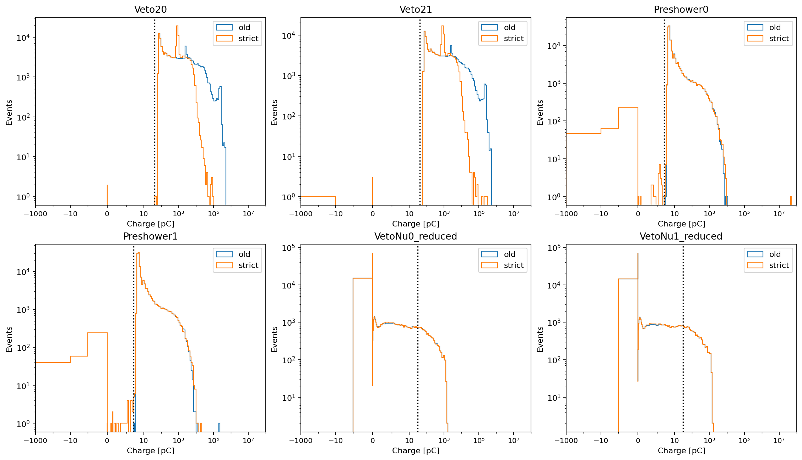
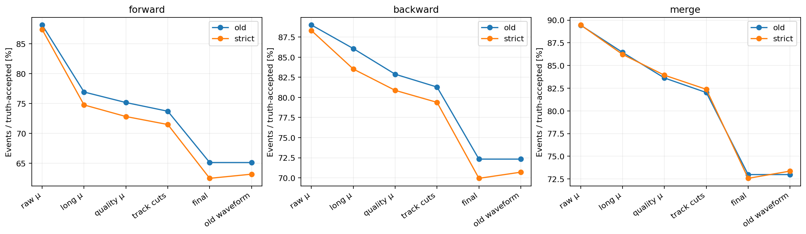

# 阶段206：old 与 strict 的电荷、候选及接受度差异清单

本阶段只比较 **old 与 strict**。目标是列清“哪些实现不同、在哪里改变事件选择、影响多大、哪些因果关系还没有测量”，供下一阶段逐项选择。没有修改 Calypso、波形处理、seed、合并策略或分析 cuts；没有选定任何新的组合。

**此前所说的电荷筛选，主要是闪烁体波形积分后的 pC 电荷筛选，不是 μ 正负电荷选择。当前 cuts 没有 `Track_charge`、`LeadTrack_charge` 或 q/p sign 的要求。** strict 的轨迹 sign 识别改善与闪烁体电荷损失是两件不同的事。

## 范围、分母与证据等级

复用已验收的342个共同 RDO，每版3,374,987输入事件、383,670个 truth-fiducial、140,132个 truth-accepted proxy；nominal 排除替代生成器run200080。旧版为 `d32b0ff3`，strict为 `88c457c1` 加阶段201冻结本地修改、阶段205严格旋转材料图。软件环境、几何/条件tag、without-IFT 和分析阈值延续阶段205。所有计数未加权，未测量 flux 加权产额、系统误差、真实data背景拒绝率。

新测量来自 old/strict 的完整缓存条件替换、通道阈值迁移、轨迹各层效率和 F/B 重叠；所有原始 individual bits、14步累计bits、既有固定旧电荷控制均要求精确重现。波形源码和具体故障重放复用阶段204；该阶段使用原新版，但阶段205已经验证原新版/strict的全量波形数组逐值相同，因此相关波形证据适用于 strict。先验消融采用阶段204的严格材料v2，和 strict 为同图；100k discovery、独立100k validation仍是子样本，不能当作全量先验切换。

证据等级：**A** 为本阶段完整共同缓存的实测选择影响；**B** 为已有真实事件重放或独立子样本控制；**C** 为源码明确不同、但该项单独开关的全量影响未测量。不同机制存在交互；单项恢复数不可直接相加。

Station参考继续为SiHit方向乘HepMC产生动量大小，缺少G4局部输运动量。truth acceptance proxy不包含闪烁体响应、χ²、完整IFT/rmax面，所以“truth-accepted事件最终没通过”不全等于tracking找不到主μ。

## 先列区别与影响：下一阶段的逐项审阅表

| ID | 区别 | old | strict | 已知影响与证据 | 下一阶段可以单独比较什么 |
|---|---|---|---|---|---|
| W1 | Crystal Ball积分器 | `IntegralOneDim`，源码注明避免symbolic integrator FPE | `TF1::Integral` | 已重放出正常参数/status0却得到−∞；Preshower损失的明确机制之一。A/B | 仅换积分API，固定拟合参数及其他流程 |
| W2 | Gaussian约束和拟合顺序 | 正peak/mean范围限制、width 1–50 ns；固定width再释放；失败有局部emergency fit | width 0–20 ns；`QNS`调用；失败将初始width改1再试 | 已见负peak、近零width对应负积分。与W3共同影响，未单独分离。B/C | 分别切换约束、重试策略，记录成功率、参数和charge |
| W3 | 失败结果保存/回退 | Gaussian失败保留raw；CB失败保留先前可用估计；overflow有raw回退 | 在失败后仍保存gfit；CB失败继续用Gaussian结果 | 事件1915旧4.4453 pC→strict−0.00589 pC，raw4.6946 pC；GFIT/CB均失败。B | 明确成功/失败状态与可用结果的对应关系 |
| W4 | raw电荷与初始矩估计 | raw积分全窗口带符号求和；mean/width用peak±10 samples的正波形 | raw积分只求全窗口正值；mean/width也使用全窗口正值 | 改变低信号noise底、起点和回退值；raw不再是同一估计量。源码确定，独立接受度效应未测。C | 固定拟合算法，分别比较raw定义和初始参数 |
| W5 | 饱和/overflow处理 | `RemoveOverflow=False`默认；检测饱和时长；有专用`fitCBallOverflow`和受限170 ns流程 | 默认True，删饱和samples；普通CB拟合；移除专用overflow流程 | Veto高charge尾明显变化；阈值损失较小。不能仅凭尾部下降判断哪版更准确，缺ADC/饱和真值全量对照。A/C | 单独按overflow状态比较拟合电荷、raw和MC沉积 |
| W6 | 拟合时间和有效性定义 | raw时间为peak；fit status按`%10==0`；NaN时间明确标失败 | raw时间为mean；status要求`==0`；NaN路径有`fit_status=false`赋值 | 可能改变接受拟合与VetoNu积分窗；此赋值不等于已证明每例会被当成功。C | 保存time/status/valid，分别检查几条失败路径 |
| W7 | VetoNu reduced charge | 与strict相同积分算法 | 同左，但上游Veto/PS时间、raw回退不同 | reduced算法文本逐字相同；差异可以由输入时间/回退传入。A/C | 固定时间与波形，分别替换输入，追踪30 pC迁移 |
| W8 | waveform cleanup | 具有`KeepOverflow`开关 | 移除此开关 | 改变保留的波形vectors/可审计性；不据此宣称已改变拟合标量。VetoNu生产配置KeepAll=True。C | 区分存储保留与重建物理量，必要时审计KeepAll |
| T1 | seed协方差数字 | θ/qop variance=8.41e−6 rad²/1e−5 GeV⁻² | 8.41e−4 rad²/1e−3 GeV⁻² | 均增100倍；已有独立控制显示F/B接受度受影响。B | 固定strict材料，分别比较θ、qop及组合 |
| T2 | 旋转后角度先验的物理意义 | 近极轴，phi变化对方向影响受sinθ抑制 | 旋转到横向后，同数值phi方差代表更宽物理方向 | 即使还原T1数字，也不等于还原完整物理先验；协方差张量/Jacobian匹配未完成。B/C | 在物理方向/斜率坐标中匹配协方差后再比较 |
| T3 | isolated smoothing | 共享候选状态的旧流程 | 候选隔离修复 | 既有100k新坐标控制切回shared：final/cutbits不变，部分局部state变化；不能归因为当前全量效率损失。B | 单独审阅局部状态污染及修复回归集 |
| T4 | track/ACTS接口及refit | 旧坐标转换 | 旋转后的参数/协方差接口；当前默认CorrectInterfaces/CorrectCovariance不额外打开 | 已有子样本interfaces组合没有统一提升；bypass refit明显损伤F/M。不是只靠换一个开关就确定旧版更好。B/C | 在strict上独立验证每个接口与refit，并同步看效率/响应 |
| T5 | F/B候选互补及merge选择 | 有其自身候选交集 | 单向少一些，合并后互补不同 | full缓存直接显示F/B降低而merge track-only提高。A | 审阅raw→long、候选排序、shared hits、leader选择 |
| T6 | merge去重及leader规则 | 当前比较沿用raw优先去重、后要求long，leader按pz | 同样规则但输入轨迹不同 | strict仍有50个B-pass/M-fail，其中8个blocker仅S2/3；不意味着算法代码新旧不同。A/B | 将“规则相同、输入变化”与真正实现差异分开审阅 |
| A1 | 分析阈值/电荷单位 | veto40、Timing20、PS2.5、reduced30 pC | 全部相同；积分/50换算相同 | 没有整体单位或阈值修改，也没有track-sign cut。A/C | 后续选择实现前保持同阈值，避免混入cut调参 |

W1–W6的源码修改属于两版Calypso间已有的波形版本差异，**几何旋转本身并不要求改变ADC波形积分算法**。本阶段没有理由把这些差异统称为“旋转必然带来的效果”。详见 [源码核对](stage206_old_strict/source_inventory.json)、[已有波形diff](stage204_causal/waveform_source.diff)、[新增配置/cleanup diff](stage206_old_strict/waveform_config_cleanup.diff)；[Tracking/Waveform上游改动文件表](stage206_old_strict/upstream_changed_files.tsv)提供扩展审计入口，不将所有改变的文件都假定为有物理影响。

**阶段207历史方向补充：** 本表按old→strict展示差异，不代表实际提交先后。Git核查确认strict继承较早的波形实现，old master包含2026-08-16的`dd56a65e`波形更新；`geometryRotation`提交在`Waveform/`的改动为0。W1–W8涉及的五个波形文件分别精确等于该更新之前/之后的版本。见[版本溯源报告](2026-11-14_stage207_waveform-source-lineage.md)；本表所有实测数值不变。

## 电荷差异体现在哪里：完整事件上的测量

[全部详细表](stage206_old_strict/full/detailed_results.md)给出每个run、方法和通道的原始TSV入口；以下分母统一为140,132个accepted事件。正常Preshower主峰几乎不动，PS0中位数old/strict为 **5.69122/5.68520 pC**，PS1为 **5.87945/5.87431 pC**。差异不是整体标定平移到2.5 pC阈值以下，而是小比例严重异常：

| 通道 | old −∞ / 有限负值 | strict −∞ / 有限负值 | old通过但strict失败 | strict新增通过 |
|---|---:|---:|---:|---:|
| Preshower0 >2.5 pC | 0 / 0 | 308 / 333 | 671 | 1 |
| Preshower1 >2.5 pC | 0 / 0 | 330 / 342 | 697 | 0 |
| Veto20 >40 pC | 0 / 0 | 33 / 0 | 35 | 0 |
| Veto21 >40 pC | 0 / 0 | 30 / 1 | 34 | 0 |

两个PS通道同时要求通过，事件有重叠，不能相加两个通道的671/697。PS0还有30个有限非负的旧pass→strict fail，PS1为25个；它们未必都归于同一失败机制，未保存全量fit status，尚不能逐例指派积分器或拟合故障。

固定strict tracking和Timing Y的替换效果：

| 换成old的电荷组 | F净恢复 | B净恢复 | M净恢复 |
|---|---:|---:|---:|
| Veto20和21 | 43 | 48 | 51 |
| Timing四通道 | 16 | 17 | 17 |
| Preshower0和1 | 915 | 1,007 | **1,047** |
| VetoNu0 reduced | 0 | 1 | 1 |
| VetoNu1 reduced | 1 | 0 | 0 |
| 全部10通道 | **976** | **1,075** | **1,118** |

M只换PS为gained1,048/lost1，+0.74715 pp，配对95%CI [0.70202,0.79228]；全换为gained1,121/lost3，+0.79782 pp，[0.75111,0.84453]。单组净恢复合计为1,116，少于全换的1,118，存在交互。已遍历五组的全部32种组合；按全部替换顺序平均边际分配，M的1,118为 **PS 1,048、Veto 52、Timing 17、VetoNu0 1、VetoNu1 0**。此分配是确定的选择函数记账（Shapley），不是各源码改动唯一的物理因果贡献。

M全换旧电荷而新通过的1,121个事件，按“先PS非有限、再PS有限负值、再PS其余不足阈值、最后其他”互斥分类为 **454 / 551 / 45 / 71**。这已经说明至少1,005个恢复事件带有PS非有限或负电荷；但不能将所有454个−∞都未经重放直接叫作同一种积分器故障。额外丢失的3个为2个VetoNu1阈值迁移、1个PS迁移；多条件交互以[逐事件表](stage206_old_strict/full/waveform_changed_final_events.tsv)为准。

**两个重放实例给出可直接复核的程序原因**（源ADC相同，四个目标charge与历史缓存精确相同）：run200080/event383，PS0从4.7842822 pC变为−∞、status仍0；同一真实CB参数换成`IntegralOneDim`得到4.7843488 pC。event1915，PS0从4.4452720变为−0.00589046 pC，status48，raw仍4.6946287 pC，对应负peak和近零width。它们分别支持W1与W2/W3；不能用两个事件替代全部异常的机制占比测量。见[积分参数](stage204_causal/waveform_fit_383.json)、[失败参数](stage204_causal/waveform_fit_1915.json)。



Veto20的99%分位old/strict为179,208.84/7,875.67 pC，Veto21为192,437.61/8,227.75 pC；其40 pC cut几乎不受主尾变化影响。源码有饱和流程修改，但缺少每个事件overflow/ADC审计，不能把较低尾部自动判为更准确或更差。Timing0的0.1%分位从−0.69312到+0.00608 pC，说明低信号noise底也变了；负的近零噪声与PS负积分失败不是同一物理概念，不能采用一条“所有负电荷都删除”的规则。

VetoNu0/1 reduced均无非有限值，30 pC阈值仅lost6/gain0和lost13/gain2；完整final的影响接近零。其源码积分段old/current逐字相同，变化应沿输入时间/波形/raw fallback追踪，当前未单独重放这些链路。全量fit time/status未测量，所以不把“输入依赖成立”说成每个迁移事件已解释完毕。

Timing cut本身依赖leader的Y：Y>20 mm用top，Y<−20 mm用bottom，|Y|<20 mm用总电荷。因此它有轨迹和电荷两条路径。固定strict Y时，换旧Timing电荷只恢复M17个；不要把两版Timing单cut通过数之差都当成波形损失。完整Y/charge四组合包含某版没有leader、Y=NaN的事件，是人口变化诊断，不能把旧Y替换造成的全部失败当成外推位置误差。见[timing控制表](stage206_old_strict/full/timing_y_charge_controls.tsv)。

## 目前已经能分清的效率含义

在140,132个truth-accepted分母内：

| 层级 | old F/B/M | strict F/B/M | 解释 |
|---|---|---|---|
| 任意高purity主μ raw | 123,523 / 124,727 / 125,346 | 122,456 / 123,757 / 125,374 | merge raw主μ数量基本持平，单向不同 |
| 任意高purity主μ long | 107,806 / 120,618 / 121,143 | 104,775 / 117,053 / 120,834 | strict F/B主要在进入long前已有损失 |
| 任意高purity主μ quality | 105,335 / 116,148 / 117,190 | 102,054 / 113,334 / 117,619 | merge质量轨迹反而净增429 |
| 通过全部轨迹cuts | 103,299 / 113,912 / 114,941 | 100,184 / 111,246 / 115,439 | 不含闪烁体cuts，merge净增498 |
| final，固定旧版电荷 | 91,270 / 101,356 / 102,273 | 88,542 / 99,084 / 102,810 | merge净增537；F/B仍分别少2,728/2,272 |
| final，各自电荷 | 91,270 / 101,356 / 102,273 | 87,566 / 98,009 / 101,692 | strict波形把merge优势抵消后净少581 |

quality定义为long且layers≥7、ndof≥9、有限χ²且χ²/ndof<15；主μ匹配purity≥0.7。track cuts另外包含动量、外推半径、方向等条件。各层人口不同，不能将各层差值无条件相加为独立损失。

因此“动量更准确，所以重建效率应更高”需要限定口径：**strict merge的纯轨迹选择数量已经更高；实际final还受波形处理限制。F/B则在候选/long层就存在独立差异。** 条件于成功匹配的动量准确度改善，不保证每个单向tracking步骤、固定阈值迁移和final都单调改善。

## 候选互补与剩余轨迹差异

固定旧电荷的final F/B事件集合：

| 集合 | old | strict |
|---|---:|---:|
| F与B都通过 | 90,210 | 84,761 |
| 仅F通过 | 1,060 | 3,781 |
| 仅B通过 | 11,146 | 14,323 |
| F或B至少一方通过 | **102,416** | **102,865** |
| 上述并集通过，但merge失败 | 144 | 55 |
| merge通过而F/B均失败 | 1 | 0 |

所以merge可以在F、B各自都少通过的情况下净增：交集减少5,449，而单方独有的集合增加5,898，F/B并集净增449；merge相对并集的净损失从143缩为55，再改善88；合计 **449+88=537**，精确闭合。这里的55限定accepted且固定旧电荷，与阶段205“全fiducial、actual电荷的50个B-pass/M-fail”不是相同选择，不能混用。

进一步看主μraw，F/B交集从122,898降至120,836，F-only从625升至1,620，B-only从1,829升至2,921；并集从125,352微增至125,377。单向raw减少并非merge的主μraw总效率必然下降。相反，主μlong并集由121,199降至120,876，说明raw→long仍有独立问题需要检查。严格主μ正确leader的merge也从121,019降至120,701；merge最终样本更大不代表所有候选层级都改善。

固定旧电荷时，merge的首失败pz cut从1,774升至2,686，但nDoF失败从3,245降至2,441、layers从899降至588、χ²从20降至3。首失败受cut顺序和前级人口影响；若只移去pz cut而保留所有其他cuts，old/strict额外通过为 **838/1,107**，不是上面的1,774/2,686。只移去nDoF则为 **2,279/2,051**。这些是敏感性测量，不是建议放宽cuts，也不能只根据条件动量更准就预计100 GeV阈值一定保留更多事件。

F/B的主μlong损失并非只出现在束流边缘或某个高能小bin。按产生顶点radius分bin，0–20 mm处F为77.340%→73.758%、B85.814%→81.222%；80–100 mm处F77.541%→75.779%、B87.184%→85.409%。中心区下降反而更大，但顶点radius不是站内track radius，不能据此直接判定几何边界问题。按Station1参考pz分bin，300–500 GeV的F为80.045%→77.797%、B88.268%→85.699%；1–1.5 TeV为F69.911%→68.210%、B81.236%→78.747%。这里描述相关性，未将其单独归因于seed。

完整分bin计数与分母在[运动学效率表](stage206_old_strict/efficiency_by_truth_kinematics.tsv)，复用阶段205实际统计，没有重跑选择或外推高能低统计bins。



## 先验与其他性质：已有独立控制证据

T1旧→strict的有效seed方差分别为 `[81,0.0361,0.1089,8.41e−6,1e−5]`→`[81,0.0361,0.1089,8.41e−4,1e−3]`；单位mm²、mm²、rad²、rad²、GeV⁻²。角度物理尺度的一阶检查：36个accepted-primary forward seeds，旧约4.124 mrad，strict约331.269 mrad，还原两个数字仍约330.010 mrad；这不是角分辨率，宽分布下线性近似也有局限。

同严格材料v2、固定旧电荷，阶段204独立validation的3,878个accepted事件：

| 配置 | F通过 | B通过 | M通过 |
|---|---:|---:|---:|
| old同事件参考 | 2,506 | 2,780 | 2,806 |
| strict等价材料控制 | 2,448 | 2,714 | 2,824 |
| 同材料、还原θ/qop两个先验数字 | 2,516 | 2,784 | 2,816 |

上表材料控制的F/B固定值从同阶段原始表复核；它说明先验确有影响，但**merge没有随单向方法一起提高**，还原两个数字也没有构成“物理协方差匹配”。下一阶段可以选择逐项研究先验，不在本阶段预先切换。其余控制、局部smoothing状态改变、refit和接口限制见 [阶段204报告](2026-11-13_stage204_reconstruction-regression-causes.md)。

轨迹正负电荷识别方面，full fiducial final正确主μ的merge错误sign由old **1,059/102,749**降为strict **45/102,122**。当前sign不进入cut，所以这项改善不直接抵消Preshower的pC阈值损失。细分动量和选择见本阶段详细表；避免把wrong sign与低purity/选错粒子混为一谈。

## 执行、验证、性能与存储记录

本阶段重新分析两版完整缓存，**没有重新重建3,374,987个RDO事件**。输入为`workbook/stage203_station_truth/old.npz`和`workbook/stage205_material/full/strict.npz`，按run/event和truth字段精确配对。pilot每80个fiducial事件取一个，覆盖4,796个fiducial、1,728个accepted；内部计时17.53085 s，最大RSS 1,556,040 KiB。通过原始cuts重现及组合闭合后，提交HTCondor全量归约作业`9718262.0`，节点`b9p14p9675`，exit 0。

全量覆盖383,670个fiducial、140,132个accepted；内部归约计时170.48713 s，含Python导入的进程wall为177.83 s，最大RSS 1,927,580 KiB。两个缓存暂存到worker scratch耗时2.12 s，整个作业remote wall为181 s。请求1 CPU、6,000 MB内存，CERN按内存配置分配2 CPU；BLAS/OMP各限1线程。未长期复制NPZ，仅保留小表、图和审计记录。详见[进程资源](stage206_old_strict/full/report_resources.txt)、[暂存资源](stage206_old_strict/full/staging_resources.txt)。

验证包括：原始individual bits和14步累计bits逐值重现；旧电荷控制逐值一致；四种tracking/waveform组合的90行统计与阶段205精确一致；每组/方法的32种波形组合均完成，Shapley求和及首失败cut分区精确闭合。作业归档上传/下载经`cmp`逐字节一致，大小1,515,520 bytes。18个保留归档文件逐字节核对；逐事件表另补充全部通道和old-only失败分类，共3,185行，原数字字段不变；波形图另调整symlog刻度可读性，输入、bin、阈值和事件选择不变。两张最终图已目视核对，4个Python文件通过AST语法检查，报告相对链接有效。

复现命令如下；全量作业冻结代码保存在提交目录`code.tar.gz`，最终脚本另包含上述事件表补充和绘图可读性调整：

```bash
source AnalysisZipFramework/setup.sh
python AnalysisZipFramework/scripts/report_tracking_old_strict_properties.py --repo . --output workbook/stage206_old_strict/pilot --pilot
python AnalysisZipFramework/submission/prepare_tracking_old_strict_properties.py
condor_submit ~/condor/nu_muAnalysis/stage206_old_strict/report.sub
# 作业结果取回并解包到full目录后：
python AnalysisZipFramework/scripts/summarize_tracking_old_strict_properties.py workbook/stage206_old_strict/full .
python AnalysisZipFramework/scripts/report_tracking_old_strict_properties.py --repo . --output workbook/stage206_old_strict/full --waveform-plots-only
python AnalysisZipFramework/scripts/audit_tracking_old_strict_source.py --calypso /eos/home-x/xcheng/FASER/geoRotation_calypso --output workbook/stage206_old_strict
```

确认队列无本阶段运行作业、归档及保留表验证完成后，仅删除重复的`ntuples/tracking_properties_stage206/report.tar`及其空目录，回收1,515,520 bytes。现有阶段203/205缓存和其他阶段产物未清理；重算时由作业重新生成归档。机器可读记录见[验证汇总](stage206_old_strict/validation.json)、[pilot验证](stage206_old_strict/pilot_validation.json)、[全量汇总](stage206_old_strict/full/summary.json)、[清理审计](stage206_old_strict/cleanup_audit.json)。

## 尚未测量与下一阶段验收

本阶段不提交任何“最佳组合”。用户审阅差异清单后，再逐项决定比较old实现、strict实现或经物理定义的新实现。尤其需要分别审阅W1积分器、W2拟合、W3回退、W4raw定义、W5饱和处理，不能把“整套换回旧波形”当作这些单项已完成验证。

具体后续任务、输入及验收：

1. 波形单项控制：使用相同RDO、strict tracking、当前固定阈值，保留ADC、raw/fit参数和状态。验收覆盖正常、低信号、非有限、负积分、overflow，不仅恢复事件数，还比较信号电荷和时间稳定性；不能只删异常事件。
2. reduced-charge因果链：保存Veto/PS拟合时间、实际积分截止sample与fallback标志，固定其中一项逐一替换。验收逐事件解释30 pC迁移，并检查neutrino背景拒绝能力；当前没有全量时间/status字段，具体链路占比未测量。
3. seed先验：在strict材料上分别控制θ、qop、phi及协方差坐标变换，使用独立区间。验收同时报告raw/long主μ效率、F/B交集、merge收益、wrong sign、动量响应、duplicates及CPU/I/O；不是只最大化final通过数。
4. merge策略：输入阶段205已完成的50事件raw-hit诊断和共同RDO，检验long资格与去重顺序。验收同时减少已知损失、保持全量主μ效率/纯度，并限制duplicate增加。
5. 物理效率和背景：补充加权MC、背景样本和真实data的波形验证后，才能判断某实现恢复的事件是否都应该保留。当前仅凭truth信号接受度不能决定饱和电荷实现或cut阈值。
