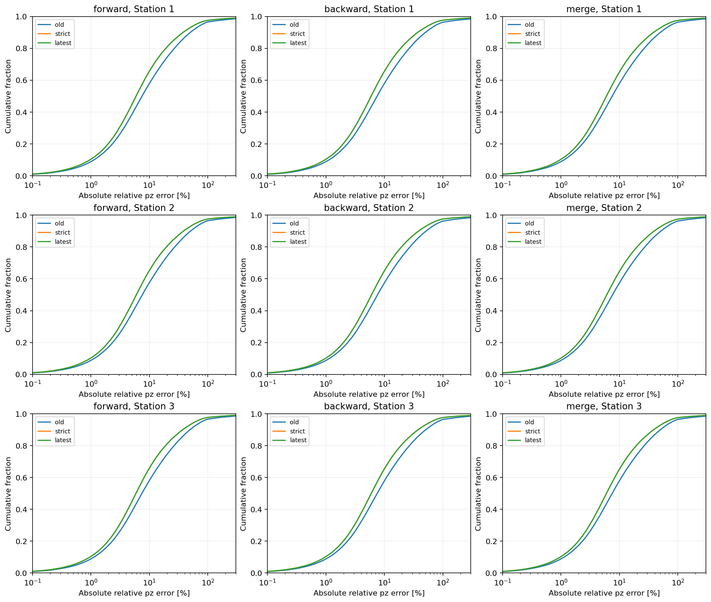
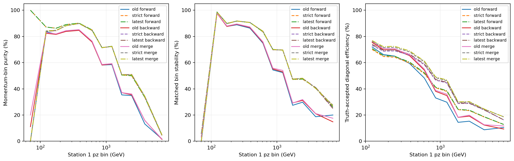

# 阶段 208：将几何旋转与 isolated smoothing 合入最新 Calypso master

## 阶段目标

建立保留双方历史的新几何旋转分支，吸收最新官方 master，默认使用验证过的 strict 旋转材料图及 isolated candidate smoothing。编译、运行验证后，使用相同 RDO 与分析 cuts，完成旧版 Merge 对集成版 Merge 的全套性能比较，同时保留 Forward / Backward 诊断。

## 源码与 Git 工作流

- 官方 master：`7f2d16812070a263210d2b2dc56633345e5a10b1`（2026-11-13）。旧版基线：`d32b0ff3cc4a2dad4abfb1474a82422c3c25b305`。
- 旋转历史：`88c457c1e4bf4154e67b96114ee8e7020d9b1a97`，包含前序 `73c97758`；isolated smoothing 修复 `1c06c7b6`、验证文档 `25147d80`。
- 双亲 merge commit：`a2c3e5228c0cbce4493494200591bcea3be3ba9f`，两个父提交为 `25147d80` 与 `7f2d1681`。没有 squash、rebase 或强制推送。
- MR：[xcheng/calypso !1](https://gitlab.cern.ch/xcheng/calypso/-/merge_requests/1)，source `feature/georotation-master-20261114`，target `geoRotation_latestMaster`。编译及两对 pilot 验收后，已通过普通 fast-forward push 将目标分支从 `25147d80` 更新至 `7fd40df8`；双亲 merge 历史保留。GitLab 网页受 anti-bot 限制、REST Kerberos 返回未认证，网页 MR 状态未核实，不能据此声称网页状态已 merged。
- 新工作目录：`/eos/home-x/xcheng/FASER/geoRotation_calypso_latest`；本机编译使用 `/tmp/xcheng_calypso_master20261114{,_build,_run}`。原 `/eos/home-x/xcheng/FASER/geoRotation_calypso` 的研究改动保持原样，预先保存紧凑审计。

官方 Tracking 包重组保留，旋转改动随文件移动至 `RootWriterTools` / `TrackFinders`。唯一文本冲突是 `KalmanFitterTool.cxx`，同时保留旋转的 geometry-context 引用和 master 的 `ActsInterop/IndexSourceLink.h`。`Waveform/`、`Tracker/`、`Simulation/`、`Generators/`、`xAOD/` 已逐目录验证与官方 master 完全一致。原工作目录中的可选 truth / material audit / covariance 实验控制未批量移入生产分支。

官方相对旧基线的新功能包括 Tracking 包重组、waveform xAOD 旧容器缺失 `trigger_time` 时置 0、FlukaReader event ID、tau decay / quirk simulation / volume debugger。后几项是否影响当前 RDO 比较必须通过运行结果判断，不以提交名称推断性能。

## 材料、坐标与 smoothing

打包材料 `Tracking/Acts/FaserActsGeometry/data/material-maps-alma9-rotated-rowmajor.json.gz` 与阶段 205 冻结 strict 图逐字节一致：压缩 **2,271,338 bytes**，解压 **11,866,364 bytes**。使用 PathResolver 定位安装文件，在每个进程的临时目录仅解压一次，生产配置无需依赖个人 EOS 路径。ACTS 内部坐标变换为 `(x_A,y_A,z_A)=(z_F,y_F,-x_F)`；分析显式转回 FASER 坐标。

`CKF2.IsolateCandidateSmoothing=True` 为默认值。回归测试已通过：能复现共享状态覆盖，验证隔离后的参数 / 协方差、候选顺序独立、输入不变及单状态情况。实测 wall **0.09 s**，详见 [测试记录](stage208_master_integration/smoothing_test_output.txt)。材料安装定位与逐字节比较已通过，实测 wall **5.571 s**，见 [材料验证](stage208_master_integration/packaged_material_validation.json)。本次环境 ACTS JSON decoder 进一步验证全部 **22 frames 最大旋转误差 0**、无遗漏材料，wall **9.44 s**，RSS **724,568 KiB**，见 [decoder 验证](stage208_master_integration/material_runtime_decoder.json)。后续每个 RDO 作业还会断言实际材料 bytes 与全部四个 CKF2 的 smoothing 属性。

## 样本、选择与定义

共同样本沿用阶段 203 / 205：342 个 RDO，**3,374,987 events**；排除旧版缺少有效结果的 manifest index 291。truth-fiducial **383,670 events**，truth-station-accepted proxy **140,132 events**；nominal 单独排除 alternate generator run 200080，所有表保留分 run 结果。使用相同 TI12MC04 / OFLCOND-FASER-06、原 YAML cuts、不加权计数。

Station 1 / 2 / 3 动量参考仍为 **SiHit 方向 × HepMC 产生点动量模长**；对应位置 reco 采用拟合状态插值或 5 mm 内最近状态。样本没有 G4 局部输运动量，已获用户确认按该限制继续；不能将它标记为精确的 G4 station momentum 或忽略能损带来的系统效应。

小样本在同一 worker 依次重跑旧版与集成版，按 index 奇偶交替运行先后顺序，旧版 21 个 science arrays 对冻结缓存逐值检查，记录相同机器上的耗时与 RSS。全量复用已验证旧版及 strict 缓存，只重新重建集成版。检查所有事件 ID、truth 字段、分片恢复闭合、实际配置与材料、波形数值以及 cut 迁移。

## 编译与运行验证

状态：完整编译通过（exit 0）。CMake 配置 210 packages，通过，wall **84.86 s**；Athena 24.0.41、GCC 13.1、ACTS 32.0.2、ROOT 6.28/12，编译并发 8，完整 build wall **3,042.60 s（50 min 42.60 s）**，累计 user **11,323.80 s**、system **5,157.95 s**，time(1) 报告最大进程 RSS **2,858,332 KiB**（不是全部并行进程 RSS 之和）。GeoGetIds、GeoVisitVolumes、CandidateIsolatedSmoothing 三个 CTest 均通过（0 失败，测试总 wall 2.05 s），见 [CTest](stage208_master_integration/ctest_output.txt)。安装通过，wall **60.06 s**。独立 runtime 解压后 4 个库加载、5 个组件配置、材料精确性、smoothing 默认值均通过，内部 wall **5.738 s**，进程 wall **6.64 s**、RSS **628,860 KiB**。runtime archive **61,699,093 bytes**，1,760 entries、regular payload **206,500,351 bytes**，无 symlink、无 debug symbols、无源码 / 构建树；压缩 wall **10.56 s**。见 [组件验证](stage208_master_integration/portable_runtime_validation.json)、[运行包](stage208_master_integration/runtime_package.json)。

30-event smoke 全链路通过，truth-fiducial 4 events，但无跨三站 long track，因此不能作为轨迹诊断验收。实际四个算法为 `CKF2 / CKF_Back / CKF_woIFT / CKF_Back_woIFT`，全部 isolated，实际材料 exact。reco / forward / backward / merge / extract wall 分别 **16.58 / 10.95 / 11.16 / 78.70 / 20.79 s**；merge 含首次诊断 JIT，不能据这个样本作速度结论。补充 index 0、skip 380、10-event 片段通过：truth-fiducial 2 events（383 / 388），3 条 long tracks 均通过官方 ntuple 的逐轨核对，见 [长轨迹 smoke](stage208_master_integration/smoke_long_validation.json)。7 个、每个最多 2,500 events 的 paired pilot 已提交 HTCondor **9718286**，运行先后次序交替。index 342 输入实际仅 **343 events**，首个配对归约通过：16 个 fiducial / 6 个 accepted，旧版 21 个 science arrays 对冻结缓存完全一致，truth 与分片回读通过，新版波形全部与旧版逐值一致。其后加入正常 2,500-event 的 index 63：两对合计 **2,843 input / 320 fiducial / 102 accepted events**，旧版 21 science arrays 精确重放、两版全部输入 ID 相同、truth 精确、材料与四个 smoothing 检查通过、fiducial 全部波形与旧版逐值一致；归约 wall **33.316 s**，RSS **1,535,240 KiB**。old / strict / latest 的 accepted Merge final 为 **77 / 73 / 74**，该样本不足以得出效率差异结论。其余复杂样本 pilot 继续运行。

## 完整 paired pilot 结果

7/7 个重建作业全部 exit 0，归约 cluster **9718299 exit 0**。总输入 **15,343 events**（6 个 2,500-event 片段及 index 342 的全部 343 events），fiducial **1,568**、truth-accepted **607**。旧版全部 21 个 science arrays 对冻结 cache 精确一致；两版输入 ID 与 truth 字段一致；所有分片配置一致，材料 exact、四个 isolated smoothing 全部生效；全部 fiducial 波形与旧版逐值一致。集成版对 strict 的差异仅为 `scintillator`、individual/cumulative cut bits，其他所有 science arrays 精确一致。归约内部 wall **43.198 s**、RSS **1,534,596 KiB**，archive **11,427,840 bytes** 上传回读 cmp 完全相同。

truth-accepted Merge final：old **437/607（71.9934%）**、strict **425/607（70.0165%）**、latest **435/607（71.6639%）**。old→latest 丢失 **6**、新增 **4**，差 **−0.32949 pp**，配对 95% 区间 **[−1.35025,+0.69127] pp**、McNemar **p=0.753906**，不能在该 pilot 声称效率升降。strict→latest 新增 **10**、丢失 **0**，归因于已验证的波形恢复，而非轨迹变化。

truth-accepted 且两版正确匹配的 Merge leader，Station 1 / 2 / 3 的 pz 绝对相对误差中位数：old **6.39764 / 6.37597 / 6.31132%**，latest **5.23952 / 5.24309 / 5.22165%**。共同有效 pairs **522 / 521 / 516**；latest 更接近 truth 的事件 **314 / 312 / 311**，old **208 / 209 / 205**。sign p 分别 **4.0130×10⁻⁶ / 7.3791×10⁻⁶ / 3.5213×10⁻⁶**，仅对应已说明的 station-reference proxy，未包含 G4 能损系统误差。全量与高能分 bin 结果仍待测量。

同 worker、交替先后顺序的 7 对重建：old / latest reco 累计 wall **3,455.24 / 3,565.88 s**，latest 高 **3.2021%**；CPU **3,390.01 / 3,505.72 s**，高 **3.4133%**。reco 最大 RSS **1,219,116 / 1,245,192 KiB**；merge（含诊断）的累计 wall **1,508.72 / 1,542.39 s**。不能将此 pilot ratio 当作所有样本的固定速度差。完整明细见 [pilot 报告](stage208_master_integration/pilot/detailed_results.md)、[配对计时](stage208_master_integration/pilot/paired_timing_summary.json)、[验证摘要](stage208_master_integration/pilot/summary.json)。

## 详细性能结果

全量重建 cluster **9718288** 的 **351/351 jobs 全部 exit 0**，342 个 RDO；index 53 拆成 10 个 1,000-event 片段。351 份结果合计 **235,020,102 bytes**。最终归约 cluster **9718305 exit 0**，内部 wall **648.213 s**、最大 RSS **2,964,416 KiB**，归约 archive **246,077,440 bytes** 上传回读逐字节一致。全部 **3,374,987** 输入 ID、**383,670** fiducial 的共同 truth、351 分片全部 science arrays 回读恢复均精确一致；配置一致、材料逐字节 exact、四个 CKF2 全部 isolated。见 [全量验收](stage208_master_integration/full/summary.json)、[逐作业完成记录](stage208_master_integration/full_job_completion.json)。

全部表、区间和分 run 结果见 [全量详细数据报告](stage208_master_integration/full/detailed_results.md)。以下以 truth-accepted **140,132 events** 为共同效率分母；primary 正确匹配要求 barcode/PDG 对应 primary 且 hit purity≥0.7。下列收益是整套版本对照，未单独分离旋转、材料与 smoothing 各自贡献。

### Merge 效率收益与并非全部改善的阶段

| 指标 | old | latest | latest−old |
|---|---:|---:|---:|
| 任一 primary raw | 125,346 | 125,376 | +30 |
| 任一 primary long | 121,143 | 120,834 | −309 |
| 任一 primary quality | 117,190 | 117,616 | +426 |
| 正确 primary leader | 121,019 | 120,701 | −318 |
| 通过 track cuts | 114,941 | 115,436 | +495 |
| 最终通过 | 102,273（72.983330%） | 102,807（73.364399%） | +534（+0.381069 pp） |
| 最终通过且正确 primary | 102,066 | 102,576 | +510 |
| truth 可过、最终未通过 | 37,859 | 37,325 | −534 |

同事件最终丢失 **1,070**、新增 **1,604**；差值配对 95% 区间 **[+0.308770,+0.453369] pp**，McNemar **p=4.56673×10⁻²⁵**。正确 primary 最终效率差 **+0.363943 pp**，95% **[+0.291830,+0.436055] pp**。nominal（排除 run 200080）分母 **121,425**，最终 **87,554→88,061**，差 **+0.417542 pp**，95% **[+0.339178,+0.495906] pp**。效率收益不依赖 alternate generator run，但任一 primary long 与正确 leader 的数量有所下降，不能声称每个重建环节都提高。

### 三站同事件动量准确度

truth-accepted 中，两版均有正确 primary leader、局部参考与拟合均有效的共同事件；不是分别选择各版容易通过的事件：

| 位置 | 共同 pairs | old pz 绝对相对误差中位数 | latest | latest 更接近参考 |
|---|---:|---:|---:|---:|
| Station 1 | 119,205 | 5.986390% | 4.629086% | 73,086 |
| Station 2 | 119,558 | 6.051292% | 4.670760% | 73,230 |
| Station 3 | 119,410 | 6.015444% | 4.649665% | 73,155 |

三个 sign test 均发生浮点 p 值下溢，原表 p=0 只表示数值精度限制。Station 1 分动量结果如下，其他两站、p/pz、两版均最终通过的选择与 nominal 均在 TSV 中：

| truth pz 区间 | pairs | old 中位数 | latest 中位数 | \|误差\|>50% old→latest |
|---|---:|---:|---:|---:|
| 100–300 GeV | 30,021 | 2.86382% | 2.53318% | 186→119 |
| 300–1,000 GeV | 64,708 | 6.29417% | 4.82580% | 1,831→407 |
| 1–3 TeV | 23,217 | 19.09861% | 11.67820% | 4,108→1,086 |
| ≥3 TeV | 1,259 | 48.51491% | 27.79544% | 615→295 |

最终正确 primary 样本的 Station 1 pz 中央 68% 半宽 **9.85651%→7.02602%**。动量 bin purity 与 primary 身份纯度是不同指标：最终样本 Station 1 的 **1–1.5 / 1.5–2 / 2–3 / 3–5 TeV** 动量 bin purity 分别 **59.2317 / 37.1034 / 36.0510 / 15.7853% → 72.3796 / 50.6312 / 50.7365 / 34.3860%**；同 bin 对角效率 **35.8917 / 18.3417 / 19.8439 / 12.5707% → 46.7552 / 30.0559 / 30.2439 / 24.6386%**。5–10 TeV 仅 86 个 truth-accepted 事件，完整 Wilson 区间保留，不作高统计精度结论。





### 极端有限动量：均值并未改善

没有截掉或静默删除有限极端值。最终正确 primary 的 Station 1 绝对相对误差 q95 **0.503413→0.241936**、q99 **2.061843→0.550319**，但算术均值 **0.362282→5.948007**，无量纲。latest 的 run **200083 / event 728039** 仍通过当前 cuts：Station 1 参考 **2,826.50698 GeV**、reco **1.704988389×10⁹ GeV**、ndof **19**、chi2 **10.4343**；单个事件足以主导均值。该异常 strict 也存在，不能归因于本次 master 合并新增。三站最终样本的 \|误差\|>1000 事件数 old **4 / 3 / 4**，latest **1 / 1 / 1**；虽然数量减少，最严重值却更大。上述高动量改善仅适用于已展示的稳健指标与 bin 迁移，不能概括为“所有准确度指标更好”。见 [尾部统计](stage208_master_integration/full/momentum_tail_audit.tsv)、[极端事件](stage208_master_integration/full/extreme_momentum_events.tsv)。

### 电荷、纯度与 duplicates

全部 **383,670** fiducial 事件中，保存的各波形通道电荷与 old **逐值完全一致**，包括 Preshower。源码已使用官方 master 的完整波形实现；此前 strict 继承旧 waveform 算法的问题及历史方向见 [阶段 207](2026-11-14_stage207_waveform-source-lineage.md)。本批固定 RDO 的电荷差异没有由几何旋转导致；Timing cut 仍可因轨迹 Y 决定使用哪个通道而有差异，不能把“相同电荷数组”理解为“相同事件 cutflow”。strict accepted Merge **101,692**，固定旧电荷时 **102,810**；latest **102,807**，对应波形恢复 **+1,118**、其余少量轨迹差异 **−3**。

在全部 fiducial 最终选择中，正确 primary 纯度 **102,749/104,930=97.92147% → 103,243/105,554=97.81060%**，下降 **0.110872 pp**；错误或低纯度 leader **2,181→2,311**。这里不是完整背景 MC 的信号/背景纯度，不能用于直接估计背景污染。正确 primary 的轨迹电荷**符号**错误 **1,059/102,749→45/103,243**，与闪烁体积分电荷是不同物理量。所有 leader 的 ndof≤0 **785→117**，最终样本两版均没有非有限 chi2 或 pz，但如上仍有巨大有限值。

duplicate 定义为同一事件同一 truth barcode 被至少两条 hit purity≥0.7 的轨迹匹配；quality 要求 layers≥7、ndof≥9、有限 chi2 且 chi2/ndof<15，不等于完整事件选择：

| 方法 | long duplicate events old→latest | quality duplicate events old→latest |
|---|---:|---:|
| Forward | 3→0 | 1→0 |
| Backward | 6→1 | 1→0 |
| Merge | 66→70 | 2→0 |

Merge primary raw 重复事件 **4,136→7,747**，primary long **60→69**，primary quality **1→0**。因此不能说 Merge 的所有重复都减少；质量选择去除了本样本 latest 的上述重复。阈值 0.5 / 0.7 / 0.9、fiducial 与 accepted 两种分母均在 [duplicates.tsv](stage208_master_integration/full/duplicates.tsv)。

### Forward / Backward / Merge 与 truth-pass/reco-fail

| 方法 | old 最终通过 / 140,132 | latest | 效率变化 pp |
|---|---:|---:|---:|
| Forward | 91,270（65.1314%） | 88,539（63.1826%） | −1.9489 |
| Backward | 101,356（72.3289%） | 99,084（70.7076%） | −1.6213 |
| Merge | 102,273（72.9833%） | 102,807（73.3644%） | +0.3811 |

latest Merge 比 latest Backward 多通过 **3,723** 个，Forward / Backward 的单独效率下降没有消失。配对 mode 损失分类与三站响应见 `mode_loss_*`、`paired_mode_station_accuracy.tsv`，未以 Merge 收益掩盖单方向代价。

truth-accepted 中按当前 cut 顺序统计首个失败：无 long **17,360→17,064**，Timing **23→29**，Preshower **1→1**，pz **1,774→2,686**，layers **899→588**，ndof **3,245→2,444**，chi2 **20→3**，rmax **536→538**，rIFT **1,226→1,234**，rVetoNu **69→73**，theta **39→37**，VetoNu0 **8,646→8,616**，VetoNu1 **4,021→4,012**。pz 首失败增加 **912**，但 ndof 等损失减少更多；首失败分类依赖 cut 顺序，不是单变量效率。

另按三站**局部**参考独立比较 truth/reco cuts。正确 primary leader 中，参考 pz>100 GeV 而局部 reco 未过的 Station 1/2/3 事件 **4,811 / 4,178 / 5,157 → 4,384 / 3,874 / 4,996**；其中缺局部拟合 **1,069 / 294 / 1,523 → 980 / 280 / 1,553**。此表两版 leader 分母不同（见原表），不能当作同事件配对收益；也不同于 upstream 位置 `LeadTrack_pz0` 的首失败统计。r/角度与不要求正确匹配的完整分解见 [局部 cut 迁移](stage208_master_integration/full/local_cut_migrations.tsv)。

### strict 与集成版的稀少轨迹差异及重放限制

全量 strict / latest long track 总数 **649,886 / 649,876**。只有 **9/383,670=0.002346%** fiducial 事件的 long track 或局部状态不同，标量 **147** 个单元不同；pilot 中非波形数组精确相同不能外推至全量。run/event 为 **200083:400341,652256**；**200094:64980,341272,453606,641719,658299,726888,727393**。固定旧电荷后 accepted Merge 最终少 **3**、新增 **0**。逐轨证据见 [差异事件](stage208_master_integration/full/strict_changed_track_events.json)。

用同一冻结源码/运行包对 index 166、skip 2250、10 events 做额外短重放，cluster **9718306 exit 0**。本次含目标 **200083:652256**；重放对 strict 的全部非波形 science arrays 精确相同（唯一差异 `scintillator`），但对 latest 全量缓存有轨迹及 cut/scalar 差异。它证明仅靠同一个源码与固定物理配置还不能保证该事件在两种处理上下文中的结果一致；短重放 worker 与全量 worker 不同，**尚未独立区分事件处理历史、数值环境或未定义行为**，也未证实某一源码行是原因。静态 seed map 未清除是源码候选问题，但既有 reset 控制未复现全量差异，因此不能将其写成已确认因果。未为消除这 3 个通过差异而静默改动已冻结生产版本。见 [重放逐数组比较](stage208_master_integration/full/drift_replay_comparison.json)。

### 运行性能与存储

全量 latest reco 累计 worker wall **640,059.03 s**、job 中位 **1,652.48 s**、最大 RSS **1,367,520 KiB**，吞吐 **5.27293 events / 累计 wall s**；Forward / Backward / Merge（含诊断）累计 wall **126,979.82 / 127,996.86 / 174,486.51 s**，Merge 最大 RSS **2,251,864 KiB**；提取 **24,537.22 s**。这不是整个 campaign 的 elapsed time。异构节点全量结果不用于因果速度比；受控 paired pilot 的 reco wall/CPU 分别增加 **3.2021% / 3.4133%**，已在上文报告。临时 xAOD / ROOT 都在 worker 清除，保留可复核的紧凑 NPZ、统计表和图。

## 执行命令与产物

源码审计脚本：`AnalysisZipFramework/scripts/audit_calypso_master_integration.py`；生产重建配置验证：`run_tracking_master_integration.py`；独立运行包组件与材料验收 `validate_calypso_master_runtime.py`；批量准备与 worker：`AnalysisZipFramework/submission/prepare_tracking_master_integration.py`、`run_tracking_master_integration.sh`；归约脚本：`report_tracking_master_integration.py`、`prepare_tracking_master_report.py`；中文数据报告由 `summarize_tracking_master_integration.py` 从实测表直接生成。

实际执行的核心命令（Git 合并冲突按上文保留两项引用解决，未 squash）：

```bash
git fetch https://:@gitlab.cern.ch:8443/faser/calypso.git master:refs/remotes/official/master
git merge --no-ff --no-commit official/master
```

编译在 `/tmp/xcheng_calypso_master20261114` 中使用项目 `setup_environment.sh --build` 设置环境后执行：

```bash
cmake -S . -B /tmp/xcheng_calypso_master20261114_build \
  -DCMAKE_INSTALL_PREFIX=/tmp/xcheng_calypso_master20261114_run \
  -DATLAS_PACKAGE_FILTER_FILE=/tmp/xcheng_calypso_master20261114/package_filters.txt \
  -DCMAKE_CXX_COMPILER_LAUNCHER=ccache -DCMAKE_C_COMPILER_LAUNCHER=ccache
cmake --build /tmp/xcheng_calypso_master20261114_build --parallel 8
cmake --install /tmp/xcheng_calypso_master20261114_build
```

分析仓库中的实际提交命令：

```bash
python3 AnalysisZipFramework/submission/prepare_tracking_master_integration.py \
  --name paired_pilot --indices 0 63 125 186 251 300 342 --nevents 2500 --paired-old
condor_submit ~/condor/nu_muAnalysis/stage208_master_integration/paired_pilot/jobs.sub
python3 AnalysisZipFramework/submission/prepare_tracking_master_integration.py \
  --name full --all --nevents -1
condor_submit ~/condor/nu_muAnalysis/stage208_master_integration/full/jobs.sub
python3 AnalysisZipFramework/submission/prepare_tracking_master_report.py \
  --name full --manifest ~/condor/nu_muAnalysis/stage208_master_integration/full/manifest.tsv
condor_submit ~/condor/nu_muAnalysis/stage208_master_integration/full_report/report.sub
```

归约后补充尾部/差异事件与重放核查，使用 `source /cvmfs/sft.cern.ch/lcg/views/LCG_109/x86_64-el9-gcc15-opt/setup.sh`、`OPENBLAS_NUM_THREADS=1` 后执行：

```bash
python AnalysisZipFramework/scripts/audit_tracking_master_results.py \
  --repo . --report workbook/stage208_master_integration/full
python AnalysisZipFramework/scripts/check_tracking_master_replay.py --repo . \
  --replay ntuples/tracking_master_stage208/drift_replay/latest_166_02250.npz \
  --output workbook/stage208_master_integration/full/drift_replay_comparison.json
python AnalysisZipFramework/scripts/summarize_tracking_master_integration.py \
  --report workbook/stage208_master_integration/full
```

尾部/逐轨核查内部 wall **46.818 s**，进程 wall **52.55 s**；重放归约内部 wall **12.837 s**、最大 RSS **820,524 KiB**。10-event worker 的 reco / merge / extract wall **23.52 / 103.20 / 23.31 s**，Merge 最大 RSS **1,926,332 KiB**，首次 JIT 开销在内。完整命令与资源见 `full/*resources.txt`。提交目录保存原 manifest；全量归约后的 `input_manifest.tsv` 使用 worker scratch 相对路径，永久输入 RDO 来源仍以 `source_audit.json` 和 AFS manifest 为准。

提交脚本请求 1 CPU / 3,500 MB memory / 7,000 MB disk；站点策略实际将其转换为 **2 CPU / 6,000 MB memory / 7,168,000 KiB disk**，`condor_q` 和完成作业 resource table 均已核对。Athena 事件处理与 BLAS 仍为单线程。最终报告区分累计 worker wall、CPU time 和单 job RSS，不将异构 worker 的全量 wall 比值当作受控速度比较。

所有提交目录使用 `~/condor/nu_muAnalysis/stage208_master_integration/`。worker 先暂存 RDO / runtime 至 scratch，仅上传紧凑 NPZ，退出清除 xAOD 与 ROOT 中间文件。最终共同 merged cache 保留于 `workbook/stage208_master_integration/full/latest.npz`（Git 忽略），小表与图保留于同目录。原研究工作树 tracked diff 仍与合并前 **47,353 bytes** 保存 patch 精确一致，新工作树 clean，详见 [原工作树保留核查](stage208_master_integration/final_preservation_audit.json)。

确认本阶段无活动队列、351 份 science arrays 均可从 merged cache 精确恢复，并再次将 archive 内 `latest.npz` 与保留文件逐字节 cmp 后，删除本阶段重复的 351 分片 **235,020,102 bytes** 与归约传输 tar **246,077,440 bytes**，释放 **481,097,542 bytes**。保留 merged cache **229,278,394 bytes**、全部 job 配置/性能/host 审计、原生产 manifest、pilot 与目标事件重放；未删除 old/strict baseline 或其他阶段。见 [存储审计](stage208_master_integration/storage_cleanup.json)。

新目录使用现成运行环境：

```bash
cd /eos/home-x/xcheng/FASER/geoRotation_calypso_latest
source ./setup_environment.sh
```

完整编译树与 CTest 位于 `/tmp/xcheng_calypso_master20261114_build`；新目录 `run/` 是已验证安装产物，不需要重新编译。修改源码后可运行 `bash ./build_local.sh` 在该目录生成本地 `build/`，再用 `bash ./verify_local.sh` 验证。勿将 `/tmp` 路径视为永久安装来源；可搬迁 runtime 位于 `software/stage208_master/calypso_runtime.tar.gz`。

## 阶段性结论与下一步

已完成双方历史合并、冲突解决、210 包完整编译与安装、三项 CTest、完整链路 smoke、7 对 paired pilot、351 全量作业与全部样本归约。目标分支已发布、原工作树保留。全部 ID / truth / 分片回读 / 配置验收通过。新版恢复与旧版相同的波形电荷，三站稳健动量精度及高能 bin 指标改善，Merge 最终效率净提高；primary long、身份纯度、部分 duplicates 与单方向效率有代价，巨大有限动量和 9 个上下文相关差异仍明确保留为限制。

本阶段不改变分析 cuts，也未证明某个单一修复贡献多少收益。下一阶段按用户审阅后再逐项选择：

1. 用冻结运行包，在同一 worker 比较从 event 0 处理至目标与 skip 至目标，重复覆盖 9 个差异事件；必要时仅开关 seed-map reset。输入为原 RDO 与已列 run/event，验收 science arrays、seed/candidate 内容及事件顺序独立性，区分运行环境与事件历史；只有复现因果后才修改生产代码。
2. 针对 200083:728039 与高动量尾部核查 q/p、协方差、拟合状态与 smoothing；输入为同一 RDO，验收三站及 upstream 动量、pull/不确定度、实际高能信号损失，不能直接以任意上限 cut 掩盖故障。
3. 将 primary-long 损失与 Forward/Backward 模式迁移逐事件连接到 seed、measurement、leader 选择，再逐项消融旋转/材料/smoothing。验收完整分母效率、身份纯度、动量 bin 迁移和 duplicates，同时报告收益与代价。
4. 若取得带 G4 sensor-step/TrackRecord 的新样本，重做三站精确局部动量比较，并量化当前 SiHit×HepMC proxy 的能损系统误差；本阶段该输入缺失，精确 G4 局部动量结果**未测量**。
