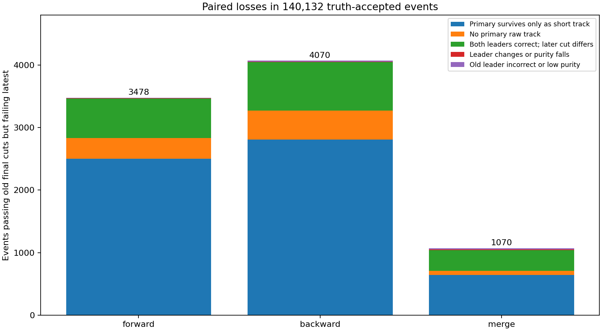
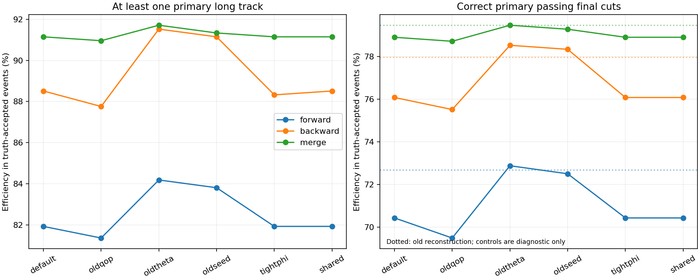

# 阶段 209：latestMaster 极端有限动量与单方向效率下降的因果检查

## 阶段目标与结论边界

针对 `geoRotation_latestMaster` 检查巨大有限相对误差的产生链、现有筛选为何放行，以及 Forward / Backward 效率下降是否只是剔除了错误轨迹。保留生产版本，使用独立诊断 overlay 与单变量对照定位原因；本阶段没有把实验配置或新 cut 合入生产分支。

**全量数据否定了“单方向效率下降主要是更正确地剔除假轨迹”的解释。** 损失主要发生在原先正确主粒子的 long-track 重建。源码与相同事件重放证明，旋转提交同时把种子 θ 方差放大 100 倍，这确实会导致 finder 丢失真实轨迹测量点；不是纯坐标旋转的必然物理代价。另一方面，核心动量误差和高动量 bin 指标的改善可以与这类效率损失同时存在。

**巨大有限动量是接近零的拟合曲率被直接取倒数后的输出。** 已测事件具有正确主粒子 hits、良好 χ²，但动量不具备足够的曲率显著性；现有质量与事件 cuts 不检查它。独立起始动量对照不能消除这个事件，故不能把问题全部归结为巨大种子，也不能声称换一个种子上限已经修好。近零曲率究竟有多少来自 hit 统计涨落、模型偏差、协方差变换或拟合数值问题，仍需固定曲率 profile 与覆盖率检查。

## 版本、样本与可复现输入

- 生产源码：`/eos/home-x/xcheng/FASER/geoRotation_calypso_latest`，分支 `geoRotation_latestMaster`，commit `7fd40df8cd3b60e81b4095a4f84310c4a54700a0`。旧基线为 `d32b0ff3cc4a2dad4abfb1474a82422c3c25b305`。生产源码在本阶段保持干净。
- 重用阶段 208 已验收的同一批 **3,374,987 input events、383,670 truth-fiducial、140,132 truth-station-accepted**。全量主结果使用两个已闭合缓存：`workbook/stage203_station_truth/old.npz` 与 `workbook/stage208_master_integration/full/latest.npz`。
- 相同 `TI12MC04 / OFLCOND-FASER-06`、原 YAML cuts，不加权。正确 primary 要求 barcode / PDG 对应主粒子且 hit purity ≥0.7。long 要求轨迹测量覆盖 Station 1、2、3，不等同于满足后续 layers / ndof cut。raw 指 CKF 输出轨迹，尚未要求 long。
- “正确 primary”是身份 / hits 对应判据，不额外要求动量精确或重建电荷符号正确；这正是为什么可以出现身份纯度 1、但动量误差巨大的轨迹。
- truth-accepted proxy 要求 fiducial 中唯一 primary muon、三站参考均有限且 pz>0、至少 7 个 truth hit layers，三站各自 r<95 mm、pz>100 GeV、θ<25 mrad。它不包含闪烁体响应、真实 IFT / rmax 接受度或重建 χ² / ndof，故不能把所有 truth-pass/reco-fail 事件都称为代码错误。
- Station 1 / 2 / 3 参考仍为 **SiHit 方向 × HepMC 产生点动量模长**。没有 Geant4 局部输运动量记录；已按用户确认继续，不能称为真实的 G4 station momentum。百分误差均指局部 pz 参考，除非特别说明。
- 所有新重放均断言实际材料为阶段 208 打包的 **strict rowmajor 旋转材料图**，解压 bytes 精确一致；四个 CKF 默认 isolated smoothing。`shared` 仅为显式关闭 isolation 的诊断对照。
- 坐标变换为 `(x_A,y_A,z_A)=(z_F,y_F,-x_F)`，分析转回 FASER 坐标。ACTS 的 beam 方向因此接近 `+x_A`，远离其球坐标极轴；这与是否保留相同物理先验是两个不同问题。

## 一、巨大有限动量如何产生

### 1. 全量尾部不是普遍恶化，但最大值确实更严重

truth-accepted、最终通过且匹配正确 primary，Station 1：

| 方法 | `|相对误差|>10` old→latest | `|相对误差|>1000` old→latest | 最大绝对相对误差 old→latest |
|---|---:|---:|---:|
| Forward | 240→22 | 2→1 | 1,947.18→21,687.45 |
| Backward | 246→23 | 3→1 | 5,671.07→603,212.93 |
| Merge | 234→24 | 4→1 | 5,671.07→603,212.93 |

这些都是有限值，没有在统计中静默截断。阶段 208 的 Merge q95 / q99 和高能 bin 指标改善仍成立；均值被一个巨大值主导则是另一个真实结果。事件逐项见 [全部极端轨迹](stage209_master_causes/final_extreme_tracks.tsv)。

### 2. run 200083 / event 728039 的实际拟合链

输入 manifest index 173，RDO `FaserMC-MC24_Genie_epos_k-200083-00720-00729-s0014-RDO.root`，skip 8037，重放 5 events。其主粒子 Station 1 参考 pz 为 **2,826.506981 GeV**，最终轨迹 hit purity **1**、**9 layers**。

| 阶段 | 实测值 |
|---|---:|
| 三站圆拟合种子 p | 375,484,157.575732 GeV |
| 种子 q/p | +2.6632282077×10⁻⁹ GeV⁻¹ |
| Backward isolated 后、refit 输入的首状态 q/p | +4.820509558×10⁻⁷ GeV⁻¹ |
| Backward refit ACTS reference q/p | −5.858914636×10⁻¹⁰ GeV⁻¹ |
| 同处 q/p 方差 | 8.414317616×10⁻⁹ GeV⁻² |
| Backward 最终 Station 1 pz | 1,704,988,389.064 GeV |
| Forward 最终参考面附近 p | 约 6.13×10⁷ GeV |
| Backward χ² / ndof | 10.434304237 / 19 = 0.549174 |
| Backward 曲率显著性 `|q/p|/σ(q/p)` | 6.38715897×10⁻⁶ |
| Forward 同一显著性 | 1.77822617×10⁻⁴ |

三站 CKF 的 F / B 都只有一个候选，因此该事件没有“不同候选互相覆盖 smoothed states”的必要条件。关闭 isolation 也精确重现默认结果。巨大动量已存在于 **ACTS refit 输出**，早于 ACTS→Trk 的 MeV / GeV 换算；不是分析插值或单位 ×1000 单独造出的异常。

同事件旧版 S1 pz 分别为 **4,539.39458 GeV (F / Merge)、4,288.47603 GeV (B)**，误差约 60.60% / 51.72%，本来也是一个较差的高能动量测量。旧版与新版此事件的逐 hit ID 完整对应尚未测量，不能把跨版本 χ² 的微小差直接解释成相同 likelihood 的优劣；本阶段相同 hits 的结论仅针对下述新版多起点对照。

`CircleFitTrackSeedTool` 从每站 segment 中心及沿方向 ±30 mm 的 fake points 作 Taubin 圆拟合。该事件三个中心在弯曲投影上的弓高只有 **3.12721877×10⁻⁷ mm**，圆半径 **2.275661561×10¹² mm**。源码 `CircleFit.cxx` 未提供近共线 / 病态圆拟合状态，`getY()` 还含大数减法；这是应增加退化处理的数值薄弱处。但它是否足以解释最终 ACTS 拟合的近零曲率，必须继续用对照判断。

### 3. 合理的初始动量不能单独治好此事件

在独立 overlay 2 中，仅改变进入 finder 的初始 q/p，保持原电荷符号、位置、方向、协方差、材料和 isolation。Backward 的 selected / refit 测量 hit 集合逐个 ID 比较，全部与默认相同 **24 hits**；所以以下差异并非换了一组 hits：

| 起始 p (GeV) | Backward refit q/p (GeV⁻¹) | refit χ² |
|---|---:|---:|
| 原始种子 3.75484×10⁸ | −5.858914636×10⁻¹⁰ | 10.434304237 |
| 300 | +2.759441858×10⁻¹¹ | 10.434305191 |
| 1,000 | −3.811134748×10⁻¹⁰ | 10.434304237 |
| 3,000 | −5.094754610×10⁻¹⁰ | 10.434303284 |
| 10,000 | −5.646666757×10⁻¹⁰ | 10.434303284 |

五次 refit χ² 跨度仅 **1.90735×10⁻⁶**，曲率均接近零；300 GeV 起点反而给出更大的倒数动量。表明巨大种子不是充分解释。这个实验不是固定曲率 likelihood scan：后续 Kalman 线性化、covariance 与 refit 输入也随初值演化，不能据此宣称已证明全局物理解。见 [fit stages](stage209_master_causes/controls/fit_stages.tsv)、[相同 hits 验证](stage209_master_causes/controls/seedstart_hit_closure.tsv)。

### 4. 为什么当前筛选全部放行

`CreateTrkTrackTool::ConvertActsTrackParameterToATLAS()` 直接计算 `p=abs(1/qOverP)`。只要 q/p 非零且有限，p 可以极大而仍有限；`isfinite(p)` 无法排除这种病态倒数。

CKF 候选优先比较测量数、再比较 χ²。最终 refit 成功便保存，没有曲率精度或初值稳定性判据；Merge 也优先测量数、再比较 χ²/ndof。本事件 F / B 都有 24 个测量，B 的 χ² 比 F 仅低约 **1.35×10⁻⁴**，于是 Merge 继承 B 的巨大动量，Merge 本身没有重新拟合。

本事件新版 F 给正电荷、B 给负电荷，多起点 B 的 q/p 也能跨过零。在曲率显著性远低于 1 的情况下，单纯输出 ±1 会掩盖电荷符号未解析；应同时保留符号置信度。这是轨迹电荷符号，与 Preshower 的积分电荷不同。

分析要求 layers≥7、ndof≥9、χ²/ndof<15、pz>100 GeV，以及半径、方向和闪烁体 cuts。它们检验 hit 拟合、几何接受度和事件选择，**没有检验曲率是否已测准**。该事件 χ²/ndof≈0.55、9 layers、pz 远大于下限，自然通过。小残差并不意味着 `1/(q/p)` 的误差也小；在 q/p 接近零时，倒数动量的分布高度非高斯，不能继续当作普通对称误差点估计。

例如只把 χ²/ndof 阈值从 15 收紧至 3，依然放行这个事件；这不是所缺少的有效性判据。

不能因此直接断言“这是一条假轨迹”。它匹配正确主粒子；真正失效的是有限动量点估计的可解释性。也不能仅凭良好 χ² 就断言拟合模型没有代码问题：需要独立 profile、协方差覆盖率及坐标变换闭合验证。

本事件报告的 `σ(q/p)≈9.17296×10⁻⁵ GeV⁻¹`，按 2,826.5 GeV 参考粗估，真实曲率距拟合零点约 **3.86 个该报告 σ**。这不是已校准的 pull（station proxy 非 G4 局部真值、参考面也不同），但进一步说明“q/p 与零相容”不能被用来证明“误差模型已正确描述该异常”。

## 二、Forward / Backward 效率下降的事件证据

### 1. 损失主要来自正确主粒子

以 **140,132 truth-accepted events** 为共同分母：

| 方法 | old 最终通过 | latest 最终通过 | 变化 pp | 旧通过→新失败 | 旧失败→新通过 |
|---|---:|---:|---:|---:|---:|
| Forward | 91,270 (65.13145%) | 88,539 (63.18257%) | −1.94888 | 3,478 | 747 |
| Backward | 101,356 (72.32895%) | 99,084 (70.70762%) | −1.62133 | 4,070 | 1,798 |
| Merge | 102,273 (72.98333%) | 102,807 (73.36440%) | +0.38107 | 1,070 | 1,604 |

按同事件通过差的配对正态统计区间，F 变化的 95% 区间为 **[−2.03921,−1.85854] pp**，B 为 **[−1.72813,−1.51452] pp**；包含配对相关性，不含生成器、材料或 truth-reference 系统误差。下降远大于该样本的统计涨落，见 [区间记录](stage209_master_causes/efficiency_intervals.json)。

旧通过、新失败的 F / B 事件分类：

| 分类 | Forward | Backward |
|---|---:|---:|
| 旧 leader 不正确或 hit purity<0.7 | **5** | **17** |
| 旧 leader 正确，新 primary 仅保留为 short/raw | 2,502 | 2,809 |
| 旧 leader 正确，新无匹配 primary raw | 328 | 465 |
| 两版 leader 都正确，但后续 cut 不同 | 634 | 774 |
| 旧正确，新 leader 改变或 purity 降低 | 9 | 5 |

前两类真实主粒子的损失不能用“成功清除旧版错误匹配”解释。旧版局部 S1 误差<10% 的事件在 `primary_raw_only` 组有 **1,640/2,502 (F)、1,830/2,809 (B)**，在 `no_primary_raw` 组有 **198/328 (F)、264/465 (B)**。并非所有被丢的旧轨迹原先动量就很差。



### 2. 损失在哪个重建阶段

| truth-accepted 中正确 primary 的阶段 | Forward old→latest | Backward old→latest |
|---|---:|---:|
| 任一 raw | 123,523→122,455 | 124,727→123,757 |
| 任一 long | 107,806→104,772 | 120,618→117,053 |
| 任一 quality | 105,335→102,051 | 116,148→113,334 |
| 正确 leader | 107,732→104,688 | 120,512→116,945 |
| 最终通过且正确 leader | 91,163→88,422 | 101,149→98,840 |

对“旧 leader 正确、旧最终通过、新最终失败”逐事件按原 cut 顺序检查：F **3,473** 个中，无任意 long **2,692**、ndof 首失败 **480**、pz **171**；B **4,053** 个中，无 long **3,025**、ndof **563**、pz **308**。其他原因为 layers、半径等，详见 [首失败表](stage209_master_causes/loss_first_failed.tsv)。这是按 cut 顺序的互斥分类，不是逐 cut 独立效率。

最新分支的全部 fiducial 波形电荷（包含 Preshower）已在阶段 208 对旧版逐值闭合；这里 F / B 正确轨迹损失中的 Preshower 首失败均为 **0**。Timing 仍可能因重建轨迹 Y 选择上下通道而改变，但分别仅 **10 / 3** 个首失败，无法解释主要效率差。不能再将前一 strict 旧波形配置造成的电荷损失混入当前 latestMaster 的 finding 问题。

truth-accepted 最终错误 / 低 purity leader，F **107→117**，B **207→244**；对应正确 primary 纯度 F **99.88277→99.86785%**、B **99.79577→99.75374%**。这些数不代表完整背景 MC 的信号纯度，而且与全部 fiducial 的约 97.8% primary 纯度分母不同。它们同样不支持“降低效率换来了单方向身份纯度提升”的整体解释。

### 3. 源码中的具体变化：不是只转了坐标

`Tracking/Acts/FaserActsKalmanFilter/python/CKF2Config.py` 的变化来自原旋转提交 **`88c457c1` (`geometryRotation`, 2025-11-04)**，不是这次最新 master 集成新加的：

| 种子方差 | old | latest | 单位 |
|---|---:|---:|---|
| loc0 | 81 | 81 | mm² |
| loc1 | 0.0361 | 0.0361 | mm² |
| φ | 0.1089 | 0.1089 | rad² |
| θ | **8.41×10⁻⁶** | **8.41×10⁻⁴** | rad² |
| q/p | **10⁻⁵** | **10⁻³** | GeV⁻² |

也就是 θ 与 q/p 方差各放大 **100 倍**、标准差放大 **10 倍**。源码同时旋转了参数方向，但 seed covariance 仍按固定数字重新填对角矩阵，并未按角变量 Jacobian 变换旧 covariance。

在当前近 `+x_A` 的 beam 方向，`n_xF=−cosθ_A`，所以 θ 的微小变化直接对应原 FASER x 方向的斜率变化；其先验标准差由 **2.9 mrad 放宽至 29 mrad**，会实际影响预测和导航，不是仅换一个角变量名称。

球坐标方向微分度量为 `dα² ≈ sin²θ dφ² + dθ²`。近旧极轴时很大的 φ 方差只对应很小的物理方向不确定度；旋转后 θ≈π/2，同样的 φ 方差变成约 **330 mrad** 的方向不确定度。因此“保留旧 φ 数字”不是“保留旧物理先验”。以本事件 seed 方向作局部线性检查，旧方向 RMS **2.95281 mrad**，生产旋转先验 **331.27133 mrad**。正确 Jacobian 变换得到新的非对角角协方差：

```text
[[ 3.86660731e-7, -7.88805623e-7],
 [-7.88805623e-7,  8.33244969e-6]] rad²
```

转换前后方向 covariance 闭合最大差 **5.08×10⁻²¹**。这是局部数学闭合与一个方向的实例，不是已校准的全样本 seed covariance，不能直接将该矩阵硬编码用于所有轨迹。见 [数值检查](stage209_master_causes/seed_geometry.json)。

宽先验会改变 Kalman 更新、预测方向、表面导航与 hit 匹配，并非越宽效率就单调越高。下面的最新源码单变量重放直接检验了实际影响。

理论上，完整一致的刚体坐标旋转不会改变粒子是否穿过三站、真实接受度或理想拟合结果。避开球坐标极点可改善数值稳定性，却不保证任何一组未同步校准的配置都提高效率和纯度。这里还改变了先验及 smoothing，因此必须分别验证数值精度、finding efficiency 与事件选择；不能用“动量中位误差改善”推出“所有效率都应提高”。

### 4. 相同事件的 finder 阶段因果对照

默认与 `oldtheta` 对照仅将 **covTheta 从 8.41×10⁻⁴ 改为 8.41×10⁻⁶ rad²**，strict 材料、所有几何代码和 isolated smoothing 保持相同。

| 事件与方法 | 默认 finder 测量数 | oldtheta finder 测量数 | oldtheta 最终局部误差 / 通过状态 |
|---|---:|---:|---|
| 200080:737 Backward | 9 | 22 | 5.73093%，最终通过 |
| 200080:4591 Forward | 10（另有 6-hit 分支） | 15（另有 6 / 11-hit 分支） | 0.43813%，最终通过 |
| 200080:4591 Backward | 10 | 15 | 0.43437%，最终通过 |

737 默认只覆盖后两站、不能成为 long；oldtheta 覆盖三站。refit 后 oldtheta 保留 18 个测量。4591 默认 F / B 都没有 long，oldtheta 两者都有正确 long。默认 9 / 10 个测量低于 `KalmanFitterTool.MinMeasurements=12`，不执行 refit，CKF 保留原来的短轨迹；因此不能靠之后 smoothing 或 refit 把未找到的三站 hits 补回来。

只恢复 q/p 方差、只收紧 φ、关闭 isolated smoothing 都没有恢复这两个事件；恢复 θ 或同时恢复 θ 与 q/p 才恢复。差别已存在于 **finder 输出**，早于孤立 smoothing 和最终 refit。故 θ 先验变化对这些信号损失具有直接因果证据；不能将其归因于 isolation 修复。

### 5. 较大样本的单变量验证

使用 index 0 的前 **10,000 input events**（run 200080、alternate generator）及 index 63 的前 **2,500 events**（run 200082、nominal）重复同一组控制，共 **531 truth-accepted events**，其中 nominal **96**。以下是最终正确 primary 数，不含专门选出的极端事件：

| 配置 | Forward | Backward | Merge |
|---|---:|---:|---:|
| 旧版冻结基线 | 386 | 414 | 422 |
| latest 默认 | 374 | 404 | 419 |
| 仅恢复旧 q/p 方差 | 369 | 401 | 418 |
| **仅恢复旧 θ 方差** | **387** | **417** | **422** |
| 同时恢复旧 θ、q/p 方差 | 385 | 416 | 421 |
| 仅收紧 φ 方差至 8.41×10⁻⁶ rad² | 374 | 404 | 419 |
| 关闭 isolated smoothing | 374 | 404 | 419 |

相对 latest 默认，oldtheta F **新增 13 / 丢失 0** 个最终正确事件，B **新增 14 / 丢失 1**，两者净收益均 **+2.44821 pp**。配对正态 95% 区间分别 **[+1.13376,+3.76266] pp**、**[+1.03391,+3.86251] pp**；这是 pilot 内的统计区间，不是全量预期收益或独立调参后的最终区间。Merge 净 **+3 events (+0.56497 pp)**，区间 **[−0.25898,+1.38892] pp**，样本不足以判定 Merge 净改善。

nominal 的 96 个 accepted 中，F **60→66**、B **63→69**、Merge **69→72** 个最终正确事件，同样支持改善方向，但统计量小。两组只恢复 θ 后的 primary long F **435→447**、B **470→486**，证明收益不只是改变最终 pz cut。

index 0 中与旧版共同正确且局部参考有效的事件，oldtheta 的 S1 绝对相对误差中位数 F **3.645996%**（旧 **4.325507%**，364 pairs）、B **3.757047%**（旧 **4.701422%**，396 pairs）、Merge **3.694378%**（旧 **4.361670%**，397 pairs）。恢复效率并未要求在这个对照样本完全放弃旋转版本的中央动量精度收益；完整高能 bin 与全量 tails 仍未对 oldtheta 重跑。

见 [控制组汇总](stage209_master_causes/controls/control_aggregate.tsv)、[配对迁移与区间](stage209_master_causes/controls/control_pair_aggregate.tsv)、[同事件局部精度](stage209_master_causes/controls/control_pair_metrics.tsv)。本轮样本包括用于定位的事件，不能视作最终独立 held-out 优化验收。



## 三、解决方案与需要分别验收的项目

| 问题 | 推荐处理 | 已有证据与验收要求 |
|---|---|---|
| 近零曲率直接输出天文动量 | 保存有符号 q/p、其 covariance、动量解析状态；用曲率 likelihood / 区间处理，无法给出有限双边动量区间时标记 unresolved / overflow | 本事件已证实普通 p 点值不可靠；须检查全样本覆盖率，不能任意赋一个 p_max |
| 巨大或病态圆拟合 seed | 增加近共线和圆拟合条件数处理，使用稳定直线极限、多个有限起点或基于 segment 偏转的先验 | 已发现退化 seed；多起点未治好最终异常，不可把此项单独宣称为根治 |
| F / B 真实 long 损失 | 保留旋转与 strict 材料、isolation，单独校准 seed θ 与完整方向 covariance | θ 恢复有直接因果证据；需独立样本和 full F/B/M 的效率、pure-hit、tails 一起验收 |
| 参数基底切换 covariance | 审计 ACTS plane-bound↔Trk curvilinear 的完整 Jacobian，验证位置 / 方向 / q/p covariance 闭合 | 源码当前直接拷贝 top-left 5×5，仅换 q/p 单位，未见基底 Jacobian；旧版也存在，尚未测出它对损失的独立贡献 |
| Merge 对无解析动量轨迹的排序 | 把测量质量、曲率可解析性和轨迹一致性分开记录，再验证 tie-break 方案 | 当前用极小 χ² 差选择了更大的 p；不应直接按 p 更小或更大选轨 |

不要在当前结论下直接删除所有高动量轨迹。信号接受与动量测量可以分开：主粒子确实可能远高于 100 GeV、符合事件选择，但其 p 不应进入有限精密动量 bin。`|q/p|/σ` cut、硬 p 上限、改 Merge 排序都会改变信号效率，必须量化后由下一阶段选择。

本次还实际检查了 `|q/p|/σ≥1 / 2 / 3` 三种候选 cut：在上述 531 个 accepted 的默认 F / B 最终正确轨迹 **374 / 404** 个中，三阈值均额外拒绝 **0** 个；但其中 truth>1 TeV 只有 **24 / 29** 个，truth>3 TeV **均为 0**，而且局部误差>50% **均为 0**。专门加入的 728039 则在三个阈值下均被 F / B 拒绝，损失 1 个正确主粒子事件。这个有限样本只能验证 cut 对本事件生效，**无法测量高能总体代价或证明全局适用**。特别是 covariance 可能需要修正时，不能先把一个固定显著性阈值当成已校准答案。逐作业数据见 [候选阈值表](stage209_master_causes/controls/qop_significance_tradeoffs.tsv)。

需要进一步区分的原因包括：固定 hits、固定 q/p 下重新优化其余参数的 χ² profile；零场 / 已知均匀场与坐标旋转闭合；covariance pull / coverage；对极端和普通事件的磁场采样、能损及 refit 初始面转换。**本阶段未测量完整 profile、全样本校准 covariance 或这些候选修复的全量生产性能**，不以推测填补。

## 执行与验证

主归约命令（需先加载 LCG）：

```bash
source /cvmfs/sft.cern.ch/lcg/views/LCG_109/x86_64-el9-gcc15-opt/setup.sh
export OPENBLAS_NUM_THREADS=1
export PYTHONPATH="$PWD/AnalysisZipFramework/scripts:${PYTHONPATH:-}"
python AnalysisZipFramework/scripts/report_tracking_master_causes.py \
  --repo . --output workbook/stage209_master_causes
python AnalysisZipFramework/scripts/summarize_tracking_master_controls.py \
  --repo . --manifests \
  ~/condor/nu_muAnalysis/stage209_master_causes/controls/manifest.tsv \
  ~/condor/nu_muAnalysis/stage209_master_causes/loss_targets/manifest.tsv \
  ~/condor/nu_muAnalysis/stage209_master_causes/seedstarts/manifest.tsv \
  --output workbook/stage209_master_causes/controls
python AnalysisZipFramework/scripts/audit_tracking_fit_lineage.py \
  --input ntuples/tracking_causes_stage209 \
  --output workbook/stage209_master_causes/controls
python AnalysisZipFramework/scripts/plot_tracking_master_causes.py \
  --output workbook/stage209_master_causes
```

全量损失归约实测内部 wall **28.80596 s**、最大 RSS **1,783,500 KiB**。未重新重建已完成的全样本，只重放定位所需 RDO 片段。

诊断源码位于独立 `diagnostic/georotation-stage209` 构建树，基于生产 commit；overlay 1 为只读观察，overlay 2 增加显式环境变量种子起点实验。冻结 runtime 仍为阶段 208 原件。补丁与头文件分别见 [observer patch](stage209_master_causes/diagnostic_observer.patch)、[seed-start patch](stage209_master_causes/diagnostic_seedstarts.patch)、[诊断头文件](../AnalysisZipFramework/include/TrackingFitAudit.h)。不能把 overlay 的实验结果标成未修改生产二进制的直接输出；默认对照需以冻结 full cache 闭合为依据。

诊断源码已用独立 commit **`7caa04ec`** 保存于上述分支；生产工作树与诊断 worktree 共用 Git 历史，生产 `geoRotation_latestMaster` 仍为 `7fd40df8`，没有合入观察工具或实验配置。该诊断分支没有发布为生产 MR。

关键生产代码带行号摘录见 [source excerpts](stage209_master_causes/source_excerpts.md)，方差更改的原始提交差异见 [source diff](stage209_master_causes/seed_variance_source.diff)。

首次 observer build wall **142.83 s**，扩展观察 build **102.62 s**，seed-start build **101.06 s**、最大 RSS **2,880,972 KiB**，exit 0。极端事件 5-event smoke 的 **21 个 science arrays 与阶段 208 完全一致**；加入 seed circle 与 momentum quality 观察后再检查仍一致。全部新 Python 通过语法编译，worker 通过 `bash -n`；实际运行 / 闭合检查构成本阶段的主要验证。

提交目录统一为 `~/condor/nu_muAnalysis/stage209_master_causes/`。作业只保留紧凑 NPZ 与压缩诊断，不保存重建 xAOD 中间文件；NPZ / runtime / 二进制不入 Git。全量旧 / 新缓存与其他阶段研究文件保持原样。

准备与提交命令如下（另外两组分别替换为 `loss_targets / loss_target_spec.tsv`、`seedstarts / seedstart_spec.tsv`）：

```bash
python3 AnalysisZipFramework/submission/prepare_tracking_master_diagnostic.py \
  --name controls --spec workbook/stage209_master_causes/control_spec.tsv
condor_submit ~/condor/nu_muAnalysis/stage209_master_causes/controls/jobs.sub
```

实际 cluster 为 **9718343 / 9718345 / 9718346**，各 **19 / 12 / 5** 个作业。编译命令为已设置阶段 208 官方环境后的 `cmake --build /tmp/xcheng_calypso_master20261114_build --target FaserActsKalmanFilter --parallel 4`。每个 worker 使用 1 个重建线程，并限制 OpenMP / OpenBLAS / MKL 为 1；描述符请求 1 CPU、3500 MB，当前站点实际分配记录为 2 CPU / 6000 MB。资源值以逐作业审计为准，不能把不同 worker 的单次 wall 差直接当作优化加速比。

最终 **36/36 jobs 全部正常退出、exit 0，队列无剩余本阶段作业**，见 [完成记录](stage209_master_causes/job_completion.json)。实际累计重放 **75,120 input events**，包含相同片段的配置重复；不同输入的并集是 **12,505 events**，不能把重复重放当成独立统计量。默认 7 组重放的 **147/147 science-array 检查精确一致**；所有控制的 cohort event IDs、不可变 truth / 波形数组、strict 材料及 smoothing 配置均通过。归约内部 wall **12.08873 s**、最大 RSS **1,510,672 KiB**，见 [最终验证摘要](stage209_master_causes/controls/control_summary.json)。

36 次 reco 累计 wall **11,614.38 s**、累计 CPU **10,655.32 s**，单次 wall 范围 **69.09–1,525.38 s**，最大 reco RSS **2,123,856 KiB**。计时包含 5-event 诊断的启动 / JIT 和不同长度片段，不能当作统一生产吞吐量或配置间公平加速比较；逐步骤 wall / CPU / RSS 保存在 [资源表](stage209_master_causes/controls/control_resources.tsv) 与 [资源汇总](stage209_master_causes/controls/resource_summary.json)。小样本实跑后才提交上述批量作业，全部临时 ROOT 中间文件由 worker scratch 清理。

## 参考与下一步验收

- ACTS Collaboration, [A Common Tracking Software Project](https://arxiv.org/abs/2106.13593)：参数 / covariance、Kalman finding / fitting 的共同约定，适用于本次基底转换与拟合链审计；不是本样本性能的替代证据。
- [ACTS v32.0.2 GainMatrixSmoother](https://github.com/acts-project/acts/blob/v32.0.2/Core/include/Acts/TrackFitting/GainMatrixSmoother.hpp)：本环境采用的 smoothing 实现；isolated smoothing 在候选选择之后，不负责补充 finder 丢失的 hits。
- G. Taubin, IEEE TPAMI 13 (1991), 1115–1138：当前圆拟合源码的算法来源；近共线情形应以稳定性对照和条件数检查验证，不因引用算法便假设浮点实现可靠。

下一阶段先分别实现可审查候选：①曲率输出 / unresolved 标记与固定曲率 profile；②seed 完整方向 covariance 与 θ 校准；③plane / curvilinear covariance Jacobian 闭合。输入沿用冻结 RDO 与本次定位事件，并增加独立 nominal / 高能 held-out 样本。验收要求是事件 ID / 材料 / isolation 不变，普通样本精度不退化，极端事件不再被当作精密有限动量，F / B 真实 primary 效率恢复且 Merge 效率、纯度、duplicates、计时均给出配对区间。用户选择各项方案后再变更生产默认；本报告的实验配置并未自动成为生产修复。
