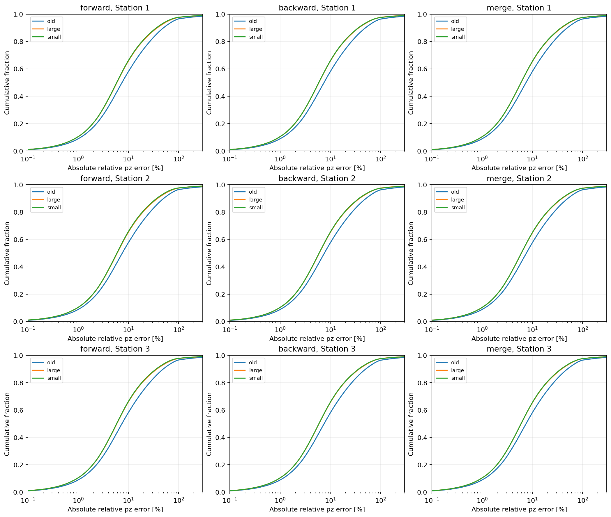

# 阶段 210：旋转前、旋转大协方差与旋转小协方差的全量配对比较

## 阶段目标与配置

直接回答 `initial_variance_inflation` 的 θ、q/p 因子由 100、1000 提高到 10000、100000 后，对最终 Forward / Backward / Merge 的接受效率、主粒子身份纯度、Station 1/2/3 动量准确度、尾部、电荷符号、duplicates 和筛选迁移的影响。正式配置不在本阶段自动变更。

| 标签 | Calypso | inflation：loc0、loc1、φ、θ、q/p | 处理 |
| --- | --- | --- | --- |
| old | 旋转前 `d32b0ff3cc4a2dad4abfb1474a82422c3c25b305` | `[100,100,100,100,1000]` | 复用阶段 203 已验证的完整 cache |
| large | `geoRotation_latestMaster`，`7fd40df8cd3b60e81b4095a4f84310c4a54700a0` | `[100,100,100,10000,100000]` | 复用阶段 208 已验证的完整 cache |
| small | 同一个 latestMaster commit 和二进制 | `[100,100,100,100,1000]` | 新跑全量；仅覆盖四个 CKF 的 `covTheta`、`covQOverP` |

旋转后的两组都使用已编译的正式运行包 `software/stage208_master/calypso_runtime.tar.gz`、strict rowmajor 旋转材料图、四个 CKF 的 isolated smoothing、TI12MC04 和 OFLCOND-FASER-06。不使用阶段 209 的诊断 C++ overlay。本阶段没有修改 Calypso 源码，不需要重新编译。

实际 seed covariance 的对角元如下，不应把 inflation 数字本身当成方差或误差：

| 配置 | loc0 (mm²) | loc1 (mm²) | φ (rad²) | θ (rad²) | q/p (GeV⁻²) |
| --- | --- | --- | --- | --- | --- |
| old / small | 81 | 0.0361 | 0.1089 | 8.41×10⁻⁶ | 1×10⁻⁵ |
| large | 81 | 0.0361 | 0.1089 | 8.41×10⁻⁴ | 1×10⁻³ |

θ 的 seed 标准差由 2.9 mrad 变为 29 mrad；q/p 标准差由 0.00316228 GeV⁻¹ 变为 0.0316228 GeV⁻¹。因此本次是两个方差同时放大 100 倍、标准差同时放大 10 倍。

**large↔small 是只改变所问协方差的配对实验；old↔旋转版是整个软件版本的比较。** 后者包括最新 master、isolated smoothing、坐标及其他已经记录的版本变化，不能把所有差值归因于旋转。旋转后相同的 φ、θ 对角数字也不等于旋转前相同的物理方向先验；参数基底转换需要完整 Jacobian，详见[阶段 209 的源码与控制实验](2026-11-14_stage209_master-reconstruction-causes.md)。

## 输入、选择与统计定义

冻结输入为[阶段 201 manifest](stage201_tracking/input_manifest.tsv)：排除原 index 291，index 53 按十段各 1000 events 处理，其余保持既有划分，共 342 个 RDO、351 个任务。完整共同输入 **3,374,987 events**，truth-fiducial **383,670 events**，truth station acceptance proxy **140,132 events**。原始抽样与排除沿用既有基线，没有因新配置结果而重新挑选事件。统计为未加权事件数；nominal 另行排除 alternate-generator run 200080。

truth acceptance proxy 要求唯一 primary muon、三站有限且正向的 pz、至少 7 层 truth hits、三站 r<95 mm、pz>100 GeV、θ<25 mrad。它不包含闪烁体响应、实际 IFT / rmax 或拟合质量，因此 truth-pass/reco-fail 不全是 tracker 算法丢失。

正确 primary 定义为 leader 匹配 primary barcode / PDG 且 hit purity≥0.7；不额外要求动量误差小或电荷符号正确。最终效率是通过原完整事件筛选的事件数除以固定 truth 分母；最终正确效率另要求正确 primary。身份纯度与动量 bin purity 分开报告。

Station 1/2/3 使用相同 truth hit 位置附近的 reconstructed momentum 与参考比较。**参考是 SiHit 方向乘 HepMC 产生点动量模长；输入未保存 Geant4 局部输运动量。** 因此不能测量三站真实能损或把该 proxy 当成精确局部 G4 truth。p、pz 指标均在完整表中，正文主要使用 pz；相对误差 `reco/reference−1` 无量纲，0.1 表示 10%。

同时报告三组共有的正确 primary leaders、各自最终通过事件和两组配对事件，避免由选择样本改变造成假精度提升。有限的极端值保留在 q95 / q99 / 均值 / 最大值和逐事件清单中，没有用图的显示范围截掉尾部。效率差提供配对 95% 区间及 McNemar 检验；精度提供同事件更接近 truth 的计数与 sign test。

## 全量实测结果

**恢复小协方差后，Forward / Backward 的最终正确效率分别比大协方差提高 2.021 / 1.893 个百分点，且都略高于旧版；Merge 与大协方差没有显著效率差。新版的核心与高动量精度优势仍然保留。** 极端有限动量并未解决，不能把这次配置恢复当成近零曲率问题的修复。

全部细项见[中文实测明细](stage210_covariance/full/detailed_results.md)，原始[summary](stage210_covariance/full/summary.json)和同目录 TSV 保留完整数字。

### 1. 最终正确主粒子效率和 truth-pass/reco-fail

分母统一为 140,132 truth-accepted。下表失败数包括未过 final 或通过但 leader 身份 / hit purity 不合格；一般 final 失败数另列如下。

| 版本 | 方法 | 最终正确 | 未达最终正确 | 正确效率 % |
| --- | --- | --- | --- | --- |
| old | forward | 91163 | 48969 | 65.05509 |
| old | backward | 101149 | 38983 | 72.18123 |
| old | merge | 102066 | 38066 | 72.83561 |
| large | forward | 88422 | 51710 | 63.09908 |
| large | backward | 98840 | 41292 | 70.53350 |
| large | merge | 102576 | 37556 | 73.19955 |
| small | forward | 91254 | 48878 | 65.12003 |
| small | backward | 101493 | 38639 | 72.42671 |
| small | merge | 102525 | 37607 | 73.16316 |

不要求 primary 正确、只要求最终通过时，old / large / small 的 F/B/M 计数分别为 **91,270/101,356/102,273**、**88,539/99,084/102,807**、**91,359/101,710/102,739**。对应 truth 可通过但 reco 最终未通过为 **48,862/38,776/37,859**、**51,593/41,048/37,325**、**48,773/38,422/37,393**。这与上表“最终正确”是两个不同的口径。

large→small 的最终正确效率配对差：

| 方法 | 丢失 | 新增 | 差值 pp | 配对 95% 下限 pp | 上限 pp | McNemar p |
| --- | --- | --- | --- | --- | --- | --- |
| forward | 195 | 3027 | 2.02095 | 1.94227 | 2.09964 | 0.0 |
| backward | 938 | 3591 | 1.89321 | 1.79961 | 1.98682 | 0.0 |
| merge | 969 | 918 | -0.03639 | -0.09715 | 0.02436 | 0.24971593556455352 |

F/B 的 p 在双精度数值中下溢显示为 0，不代表数学概率精确为零。Merge 净少 **51** 个最终正确事件，p=**0.2497**；本样本没有显著差异证据，但不是证明两者物理等价。总量接近同时存在 **969 丢失 / 918 新增**，不是事件逐个相同。

small 相对 old 的最终正确 F/B/M 净增 **91/344/459**，差值 **+0.06494/+0.24548/+0.32755 pp**；配对 95% 区间分别为 **[0.01418,0.11570] / [0.18776,0.30321] / [0.28546,0.36964] pp**。前者增益很小，不应与大协方差恢复出的数千事件混为一谈。

nominal 分母 **121,425**，排除 run 200080 后正确效率 old / large / small：F **64.03294/62.08936/64.08894%**，B **71.28516/69.68911/71.56681%**，M **71.94400/72.34589/72.28495%**。单方向效率恢复并非只发生于 alternate 样本。

### 2. 效率差出现在哪一步

truth-accepted 中，找到任一正确 primary long track 的 F/B/M 计数：old **107,806/120,618/121,143**；large **104,772/117,053/120,834**；small **107,559/119,954/120,913**。满足 quality 的任一正确 primary 计数：old **105,335/116,148/117,190**；large **102,051/113,334/117,616**；small **105,284/116,396/117,602**。small 的 Forward 任意 quality 主粒子数仍比 old 少 **51**，但最终正确数已多 **91**，说明重建阶段和最终接受不能用一个数替代。

按一般 final 迁移，large→small 的 F 新增 **3,013**、丢失 **193**；B 新增 **3,581**、丢失 **955**。新增者中，在 large 下已有正确 primary raw 但没有正确 primary long 的分别为 **2,370 / 2,687**；连正确 raw 都没有的为 **195 / 328**。按首个失败 cut，新增者在 large 下首先失败于“至少一个 long track”的为 **2,444 / 2,793**，首先失败于 ndof 的为 **366 / 430**。这些是大协方差下真实主粒子的丢失恢复，不支持“效率下降主要因为成功去掉假轨迹”的解释。

两组共同最终正确的同事件比较中，large→small 的 F/B/M 测量点增加 **2,768/2,847/2,838**，减少 **417/479/404**，相同 **85,042/94,576/98,365**。点数相同不代表具体 hit ID 相同；本阶段 compact 输出没有保存完整逐 hit ID，完整 hit 集合差异未测量。[配对 track 属性](stage210_covariance/full/paired_track_properties.tsv)中的这组数实际为各两组共同最终正确的 cohort（与三组共同表不同），分别 **88,227/97,902/101,607** events。

Merge 的互补性使情况不同：large 与 small 的任意 quality primary 总数仅差 **14**。一般 final large→small 丢失 **983**、新增 **915**，净少 **68**。其中 small 丢失者首先失败于 long / ndof / pz 的为 **329/478/125**；新增者在 large 下首先失败于这些 cuts 的为 **554/192/128**。在全部 accepted 上，Merge 首次 pz 失败 old / large / small 为 **1,774/2,686/1,454**，首次 long 失败 **17,360/17,064/17,890**，首次 ndof 失败 **3,245/2,444/2,754**。这体现候选及排序、fit quality 和动量阈值之间的变化，不能把净计数相近理解成只改变了误差条。

完整[首失败 cut](stage210_covariance/full/first_failed_cut.tsv)、[版本损失原因](stage210_covariance/full/version_loss_causes.tsv)、[版本迁移首失败](stage210_covariance/full/version_first_failed.tsv)及[逐事件迁移](stage210_covariance/full/version_migration_events.tsv)可定位每个差异事件。

### 3. 三站动量准确度：共同最终正确事件

下表为三组都 final、都匹配正确 primary、truth-accepted 且本站参考与拟合有限的共同事件；数值为绝对相对误差中位数（%）。每站单独要求局部拟合有效，因此有效 pairs 不必完全相同。

| 方法 / Station | pairs | old | large | small |
| --- | --- | --- | --- | --- |
| forward / 1 | 87534 | 5.74878 | 4.37697 | 4.36074 |
| forward / 2 | 87493 | 5.78114 | 4.39728 | 4.37549 |
| forward / 3 | 87494 | 5.75500 | 4.38121 | 4.36537 |
| backward / 1 | 96859 | 5.78493 | 4.43683 | 4.42382 |
| backward / 2 | 96866 | 5.82879 | 4.46791 | 4.44834 |
| backward / 3 | 96893 | 5.78242 | 4.44694 | 4.43336 |
| merge / 1 | 100823 | 5.74054 | 4.44066 | 4.43021 |
| merge / 2 | 100821 | 5.77504 | 4.46385 | 4.44818 |
| merge / 3 | 100836 | 5.74467 | 4.44846 | 4.43608 |

small 比 large 有小幅核心改善，两组旋转版均明显优于 old；不能把整个新版优势归因于协方差大小。Merge Station 1 的中央 68% 半宽 old / large / small 为 **9.88354/7.02367/7.00789%**，误差中位偏差为 **−1.51342/−1.39588/−1.39842%**；仍有负偏差，本样本参考的局部 truth 限制不能忽略。

large↔small 两组共同最终正确、fiducial（不额外要求 truth acceptance）的 Station 1 pz 中，small 更接近参考 / large 更接近的 F/B/M 为 **49,788/38,736**、**54,802/43,402**、**56,764/45,175**，sign-test p 分别约 **9.55×10⁻³⁰³ / 2.38×10⁻²⁹⁰ / 4.78×10⁻²⁸⁹**。大样本使微小差异显著，实际幅度仍很小；不同事件的方向性改善不等于每条 track 都改善。



此图的 cohort 是共同正确 leaders，不要求 final；上方数表使用更严格的共同 final。显示范围不代表删除尾部。

### 4. 高动量区

三组共同 final-correct、truth-accepted、S1 pz 分 bin：

| 方法 | reference pz | pairs | 中位绝对误差 old / large / small (%) | q95 old / large / small (%) |
| --- | --- | --- | --- | --- |
| forward | 1–3 TeV | 15427 | 19.446 / 11.492 / 11.474 | 159.940 / 45.352 / 44.967 |
| forward | ≥3 TeV | 742 | 51.819 / 26.090 / 25.785 | 796.691 / 187.076 / 186.582 |
| backward | 1–3 TeV | 17994 | 19.190 / 11.538 / 11.518 | 137.995 / 45.794 / 45.498 |
| backward | ≥3 TeV | 939 | 50.210 / 27.118 / 26.872 | 652.262 / 221.647 / 227.455 |
| merge | 1–3 TeV | 18775 | 18.771 / 11.516 / 11.501 | 138.092 / 45.879 / 45.519 |
| merge | ≥3 TeV | 987 | 48.768 / 26.936 / 26.666 | 714.191 / 227.007 / 231.662 |

**小协方差保留了高动量核心精度提升；不是所有尾部指标都更好。** ≥3 TeV 的 B/M q95 small 分别 **227.455% / 231.662%**，略高于 large **221.647% / 227.007%**，而对应中位误差略低。Merge 该 bin 的 >50% 误差数 large 和 small 都为 **223/987**；没有依据声称 small 全面压倒 large。

Merge Station 1、final 动量 bin purity old / large / small：1–1.5 TeV **59.232/72.380/72.412%**，1.5–2 TeV **37.103/50.631/50.701%**，2–3 TeV **36.051/50.736/50.806%**，3–5 TeV **15.785/34.386/34.155%**。3–5 TeV 的 accepted 对角效率 **12.571/24.639/24.387%**。5–10 TeV truth-accepted 只有 **86** 个，纯度 **1.667/4.805/4.954%**；≥10 TeV 的 truth 分母为 **0**，reco final 数却为 **523/106/103**，说明高端仍有明显向上迁移，不能解释为发现高能信号。完整三站、F/B/M 数字见[动量 bin 指标](stage210_covariance/full/momentum_bin_purity.tsv)。

### 5. 极端有限尾部

各自最终正确、truth-accepted 且 S1 局部匹配有效，绝对相对误差如下；尾部统计 pairs 比最终正确计数略少，缺少本站有效拟合的事件没有被当作零误差。

| 方法 | 版本 | valid pairs | q95 (%) | q99 (%) | >10 个数 | >1000 个数 | 最大绝对相对误差 |
| --- | --- | --- | --- | --- | --- | --- | --- |
| forward | old | 91072 | 52.9458 | 220.2759 | 240 | 2 | 1947.1824 |
| forward | large | 88332 | 23.5676 | 52.7239 | 22 | 1 | 21687.4458 |
| forward | small | 91164 | 23.3832 | 52.2143 | 22 | 1 | 41036.7662 |
| backward | old | 101002 | 53.1509 | 214.9107 | 246 | 3 | 5671.0720 |
| backward | large | 98683 | 24.2332 | 54.9572 | 23 | 1 | 603212.9316 |
| backward | small | 101345 | 24.1274 | 54.6778 | 24 | 1 | 25747.6789 |
| merge | old | 101922 | 50.4706 | 207.2571 | 234 | 4 | 5671.0720 |
| merge | large | 102424 | 24.2271 | 55.0840 | 24 | 1 | 603212.9316 |
| merge | small | 102380 | 24.1066 | 54.3318 | 24 | 1 | 25747.6789 |

Merge 的均值绝对相对误差 old / large / small 为 **0.36423/5.98627/0.34793**；它们受极少数倒数异常强烈支配，不能替代 q95 / q99。Forward 的均值 **0.31224/0.33045/0.53446**，small 反而更大。

此前事件 **run 200083 / event 728039** 的 S1 reference pz **2,826.506981 GeV**。large→small 的 Forward reconstructed pz **6.130254×10⁷→1.159935×10⁸ GeV**，B/M **1.704988×10⁹→7.277882×10⁷ GeV**。同一 B/M χ² **10.434304**、ndof **19**、layers **9**、purity **1**，仍通过选择。因此“small 的 Merge 最大值变小”不是问题修好，Forward 的极端值甚至变大。[全部极端事件](stage210_covariance/full/extreme_momentum_events.tsv)保留三站与方法；曲率 unresolved / profile / covariance coverage 仍需独立处理。

### 6. 身份纯度、电荷和 duplicates

fiducial 最终选择的身份纯度 old / large / small：F **98.73678/98.68901/98.72390%**，B **97.92085/97.77575/97.88305%**，M **97.92147/97.81060/97.87613%**。small 比 large 略好，但仍不能声称新版所有 purity 指标都高于旧版。身份纯度与高动量 bin purity 的变化方向不同。

正确 primary 的最终 fiducial 轨迹电荷符号错误数 old / large / small：F **1,085/34/32**，B **1,297/44/46**，M **1,059/45/45**；各自分母不同，分别为 F **91,763/88,979/91,831**，B **101,823/99,479/102,139**，M **102,749/103,243/103,182**。相同最终正确事件上 large→small 电荷不一致 F/B/M **2/2/4**；错→对为 **2/0/1**，对→错 **0/2/3**。两种旋转先验对电荷符号影响小，均保留相对旧版的显著改善。

三组闪烁体波形电荷逐值完全一致，固定 old 电荷重新计算 **全部 14 个 cumulative cut bits** 都与原值精确一致。小/大协方差没有改变 Preshower 电荷；Timing cut 仍可因 track 外推 y 和先前 cut 人群变化而有累计计数差。电荷符号与闪烁体积分电荷是不同物理量。

truth-accepted、同 barcode / hit purity≥0.7 的 long duplicate events，F/B/M：old **3/6/66**；large **0/1/70**；small **2/3/38**。通过 quality 后 old **1/1/2**，large 与 small 均 **0/0/0**；这个样本零观测不意味着总体概率为零。仅 primary 的 raw duplicates F/B/M：old **2/7/4,136**；large **1/13/7,747**；small **2/6/4,429**。small 明显减少 Merge raw / long 重复，但 quality 层面两组都没有观测到重复。完整阈值 0.5/0.7/0.9、raw/long/quality 及事件清单见[duplicates](stage210_covariance/full/duplicates.tsv)和[primary duplicates](stage210_covariance/full/primary_duplicate_counts.tsv)。


## 程序机制与解释边界

`CKF2Config.py:46–66` 先将 inflation 乘基础 σ²；`CircleFitTrackSeedTool.cxx:166–172` 用这些值填 ACTS bound covariance 对角元；`CKF2.cxx:235` 将 initial parameters 交给组合 Kalman finder。这不是只给最终动量误差条乘一个比例。协方差参与传播、innovation 与 measurement selection，因而可以改变候选测量点、候选竞争和后续拟合，效率不保证随先验加宽单调增加。

阶段 209 已对两例同事件进行单参数控制：只恢复 θ 或同时恢复 θ 与 q/p 方差可以在 finder 输出恢复真实 long track，单独恢复 q/p 没有恢复；差异早于 isolated smoothing。本阶段的全量 large↔small 差异只确定这两个方差联合改变的总体效应，不能单独分配两者的全样本贡献。

近零 q/p 被取倒数仍可能产生巨大有限动量。hit purity、layers、ndof 与 χ² 检验不能替代曲率显著性检验；改变先验后必须重新测量尾部，不能默认小协方差已经解决问题。本阶段没有增加动量上限、曲率 cut 或改变 Merge 排序。

## 执行、资源与验证

所有大批量重建与全量统计均通过 HTCondor；提交目录位于 `~/condor/nu_muAnalysis/stage210_covariance/`。每个 worker 只复制一次 RDO 与冻结运行包，在本地 scratch 顺序完成 reco、F/B ntuple、Merge 和 compact extraction，BLAS / OpenMP 各 1 线程；完成后删除临时 ROOT，只上传 NPZ。

```bash
python3 AnalysisZipFramework/submission/prepare_tracking_covariance.py \
  --name smoke --variants large small --indices 0 --nevents 5 --skip 735
condor_submit ~/condor/nu_muAnalysis/stage210_covariance/smoke/jobs.sub

python3 AnalysisZipFramework/submission/prepare_tracking_covariance.py \
  --name full --variants small --all --nevents -1 --skip 0
condor_submit ~/condor/nu_muAnalysis/stage210_covariance/full/jobs.sub

python3 AnalysisZipFramework/submission/prepare_tracking_covariance_report.py \
  --name full \
  --manifest ~/condor/nu_muAnalysis/stage210_covariance/full/manifest.tsv
condor_submit ~/condor/nu_muAnalysis/stage210_covariance/full_report/report.sub

python3 AnalysisZipFramework/scripts/validate_tracking_covariance_report.py
```

smoke cluster **9718353** 的 2/2 tasks exit 0，两组各 5 input、1 fiducial；21 个 science arrays 加 `all_run/all_eventID` 与此前默认 / oldseed 对照逐列精确一致。报告 smoke cluster **9718355** exit 0，reduction wall **25.1913 s**、峰值 RSS **1,518,964 KiB**，报告上传下载字节一致。详见[配置契约](stage210_covariance/experiment_contract.json)、[smoke 验证](stage210_covariance/smoke_validation.json)。

全量任务 cluster **9718354**，**351/351 exit 0**，没有重试、缺失输出或任务排除；351 个 compact 输出共 **234,822,633 bytes**。详见[任务审计](stage210_covariance/full_job_audit.json)。全量报告任务 cluster **9718417**。实际全量输入 ID、truth、波形、分片回读与 cutflow 闭合全部通过。统计脚本会核对四个 CKF 的实际 covariance、isolation、材料图解压后原始字节和冻结源码 commit，且逐分片读回合并 cache。


全量 reduction 内部 wall **722.2458 s**，`/usr/bin/time` 包含启动的 wall **732.30 s**，user **703.55 s**、system **13.61 s**，峰值 RSS **3,086,124 KiB**；report cluster exit **0**，上传下载报告 archive **244,828,160 bytes** 字节完全一致。[资源原始记录](stage210_covariance/full/report_resources.txt)、[逐任务统计](stage210_covariance/full/performance.tsv)与[性能汇总](stage210_covariance/full/performance_summary.json)可复核。

| reconstruction | summed job wall (s) | user CPU (s) | system CPU (s) | events / summed wall s | 峰值 RSS (KiB) |
| --- | --- | --- | --- | --- | --- |
| old（先前批次） | 552708.13 | 536582.28 | 4364.52 | 6.10627 | 1334012 |
| large（先前批次） | 640059.03 | 628003.40 | 4567.19 | 5.27293 | 1367520 |
| small（本次） | 648045.34 | 637065.92 | 3617.39 | 5.20795 | 1341964 |

不同批次并非固定同一 worker / 负载的计时控制，不能由约百分之一的变化认定协方差造成确定的耗时回归。本次 Merge 峰值 **2,282,052 KiB**；scratch ROOT 全部随任务清理，累计 transient xAOD **544,511,516,230 bytes** 没有长期保存。

报告任务出现一次未加 quality 的共同 leader 子集 `chi2/ndof` 除零警告；最终轨迹表确认三组 final 均 **nonpositive_ndof=0、nonfinite_chi2=0、nonfinite_pz=0**。该诊断比值与科学选择独立，不影响 final 计数、动量表或闭合断言；未筛选 leaders 的该比值允许非有限，不解释为物理结果。代码现将该局部比值的 NumPy warning 明确限制在 `errstate`，保留原数值，不掩盖 final 数值审计。

Python 语法、worker `bash -n`、Git whitespace 检查通过。对新增配对点数 / 电荷函数及共同 final 三站统计实际运行 smoke 验证；完整 reduction 对所有 science arrays、实际配置和 cutflow 的断言通过。报告图像已人工检查。额外的[报告闭合审计](stage210_covariance/final_validation.json)确认效率、首失败分类、两两迁移、配对属性、最终数值有效性和 Markdown 链接全部通过。正式 Calypso worktree HEAD 仍为 `7fd40df8` 且干净。

最终产物为 `workbook/stage210_covariance/full/`：compact `small.npz` 仅本地保留并 Git ignore；所有 TSV、JSON、PNG/SVG 和中文报告一起提交。重复分片与 archive 在读回验证后清理，紧凑审计与原始 manifest 保留。

## 阶段结论与下一步

本次数据更支持把 **small 作为下一步优先候选**：它恢复 F/B 效率，保留旋转版核心与高动量改善，Merge 的净效率差不显著，raw/long duplicates 更少。但 ≥3 TeV B/M q95 略逊于 large，极端动量仍存在，因此不能宣布所有指标全面更好，也没有在本阶段修改默认。

下一阶段在用户选择配置后开展：

1. 使用同一冻结输入和独立 nominal / 高能 held-out 样本，分别只改 θ 与只改 q/p，验收为全量配对效率、三站共同 cohort 精度和尾部均有区间，区分两参数贡献。
2. 对 728039 及普通高动量事件保存 q/p、covariance 与固定曲率 profile，独立验证坐标 / covariance Jacobian、pull 和 coverage；验收为 unresolved 曲率不再被误当作精密有限动量，并量化事件接受与能谱使用的分别代价。
3. 若采用 small，保持材料、isolation 和完整版本历史，通过可审查配置变更与编译 smoke 再切换生产；本阶段科学结果不自动授权新增 cuts 或 Merge 排序更改。
