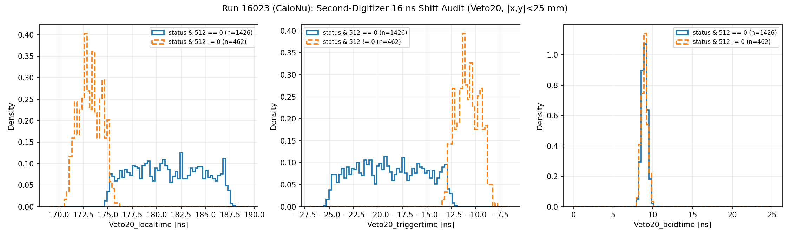
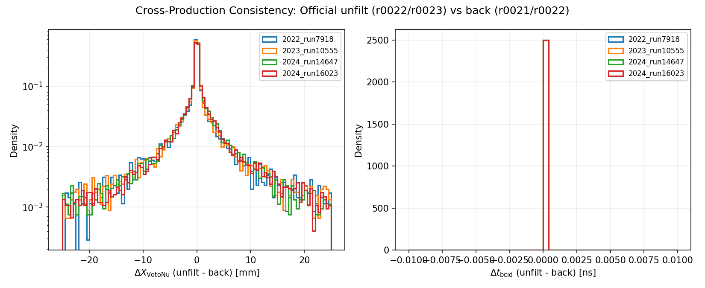
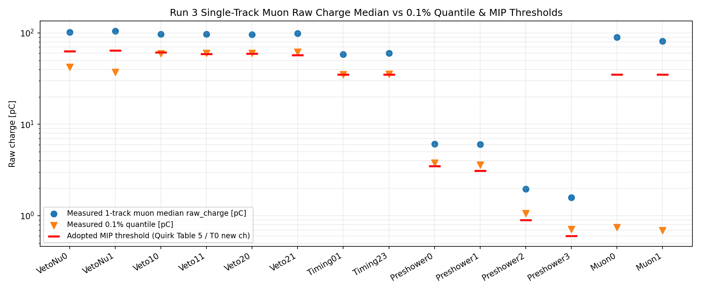

# 阶段 211（T0）：全 Run 3 闪烁体时间数据合同审计与正交 `SR-ZoneB` 盲化守卫

## 阶段目标

完成 [`docs/nu_mu_veto_timing_roadmap.md`](../docs/nu_mu_veto_timing_roadmap.md) 规划的 **T0 阶段**：
1. 核查 `faser-quirks` EOS 数据集与参考资料的当前可访问状态，确立 Run `14647` 与 Run `16023` 的实测基准验证；
2. 逐时期审计 2022–2026 全量碰撞数据（`r0021`–`r0023`、`p0013`–`p0015`、`2022–2024_back`、`2025/r0023`、`2024_cos`）与全部模拟样本（`GENIE` 5 套 Geant4 强子物理列表及 `FLUKA` $\mu$ MC）的时间/电荷/状态位与通道分支契约、哨兵值、单位及跨生产一致性；
3. 建立并冻结全 Run 3 GRL 配置（`grl_config_run3_full.yaml`）、紧凑数据清单（`run3_timing_manifest.json`）及 C++/Python 逐事件等价的正交 `SR-ZoneB` 盲化守卫（`TimingBlindingGuard`），在所有数据读取入口默认强制屏蔽信号盲区事例。

---

## 工作内容

1. **全 Run 3 GRL 与仓库规则扩展**：
   - 新增 [AnalysisZipFramework/config/grl_config_run3_full.yaml](../AnalysisZipFramework/config/grl_config_run3_full.yaml)，纳入 CVMFS `v10` 下 2022–2024 `physics` GRL 与 2025–2026 `stable` GRL（5 个 JSON 与 5 个 CSV），并对照 [GRLUtitls.cxx](../AnalysisZipFramework/source/GRLUtitls.cxx) 核实 `stable_list`/`LumiRec` 解析兼容性；
   - 更新 [.gitignore](../.gitignore) 与 [.gitattributes](../.gitattributes)，将 `ntuples/timing_stage211/`、`ntuples/timing_stage212/` 局部大缓存排除出 Git，保留 PNG 图表与 CRLF/blank 规范的 TSV 审计表。
2. **正交 `SR-ZoneB` 盲化守卫（C++17 + Python 双端一致实现与单元测试）**：
   - 新增 [AnalysisZipFramework/include/TimingBlindingGuard.h](../AnalysisZipFramework/include/TimingBlindingGuard.h) 与 [AnalysisZipFramework/scripts/timing_blinding_guard.py](../AnalysisZipFramework/scripts/timing_blinding_guard.py)：
     - 精确复用 [cuts.yaml](../AnalysisZipFramework/config/cuts.yaml) 下游基准切选（`longTracks > 0`、`Veto20/21_charge > 40`、`hitsTiming`、`Preshower0/1_charge > 2.5`、`LeadTrack_pz0 > 100 GeV`、`nLayers >= 7`、`nDoF >= 9`、`Chi2_NDF < 15`、`r_atMaxRadius < 95`、`rIFT < 95`、`rVetoNu < 120`、`Theta < 25 mrad`）；
     - 碰撞数据（`!isMC && distanceToCollidingBCID == 0`）落入上述运动学信号区且至少一层 `VetoNu` 满足 `raw_charge >= 30 pC || reduced_charge >= 30 pC` 时进入 Zone B：校准前模式要求粗略延迟 $\Delta t_{\mathrm{raw,max}} \le +0.5\ \mathrm{ns}$（留出 $1.0\ \mathrm{ns}$ 安全裕度）才放行，校准后模式仅放行下游参考时间有效且所有激活 `VetoNu` 层均满足有限 $\Delta t_k \le +1.5\ \mathrm{ns}$ 的 `CR-Prompt` 区；缺失时间或 NaN 一律盲化；
     - 编写 [AnalysisZipFramework/scripts/test_timing_blinding_guard.py](../AnalysisZipFramework/scripts/test_timing_blinding_guard.py)（通过 `ROOT.gInterpreter.Declare` 实时编译 C++ 头文件与 NumPy 向量化实现做 16 项边界对标及旁路拒绝测试）。
3. **28 进程并行全 Run 3 数据合同与基准验证审计**：
   - 编写 [AnalysisZipFramework/scripts/audit_timing_contract_t0.py](../AnalysisZipFramework/scripts/audit_timing_contract_t0.py)（`ProcessPoolExecutor(max_workers=28)` + `awkward` 向量化，所有数据文件读取均在入口处经过 `filter_unblinded_arrays` 盲化过滤），产出紧凑清单 [run3_timing_manifest.json](../AnalysisZipFramework/config/timing_calib/run3_timing_manifest.json) 及 5 份 TSV 审计表与 3 张诊断图（位于 [stage211_timing_t0](stage211_timing_t0/)）。

---

## 详细数据

### 1. 盲化守卫单元测试与参考权限核查

- **命令与耗时**：
  - `python3 AnalysisZipFramework/scripts/test_timing_blinding_guard.py`：**16/16 用例全部通过**（`zoneA_open`、`cr_prompt_2hit`、`cr_prompt_boundary_1p49`、`cr_prompt_neg_1p49`、`sr_zoneB_boundary_1p5001`、`sr_zoneB_2hit_delayed`、`sr_zoneB_1hit_vetonu1_stop`、`sr_zoneB_p0013_no_reduced`、`sr_zoneB_invalid_down_ref`、`sr_zoneB_nan_dt0`、`sr_zoneB_precalib_raw_unsafe`、`cr_prompt_precalib_safe`、`cr_geom_rmax_sideband`、`cr_geom_theta_sideband`、`cr_noncoll_beam1`、`mc_genie_unblinded`），且 `enforce_blinding=False` 按预期抛出 `RuntimeError` 拒绝旁路。
  - `python3 AnalysisZipFramework/scripts/audit_timing_contract_t0.py --workers 28`：在 `lxplus-gpu` 上用时 **40.769 s**，生成 `run3_timing_manifest.json` 大小 **315,704 bytes**（0.30 MiB），全部 37 份代表性数据/MC 文件均以 `ok=True` 完成扫描。
- **Quirk 参考目录权限与文献盘点**：
  - `/eos/project/f/faser-quirks/Data/phys/2024/r0022` 当前返回 `PermissionError: [Errno 1] Operation not permitted`（`faser-quirks` e-group 仍在等待审批）。
  - 仓库 `docs/` 中已存在 5 份核心 PDF：`Quirks_analysis_internal_note_v5.pdf`（16,642,281 B）、`z156-xk5y.pdf`（2,137,211 B）、`Timing_calib_collab_meeting.pdf`（2,684,013 B）、`FASER Waveform Reconstruction and Energy Calibration.pdf`（3,774,822 B）、`FASER_PhysicsNtuples.pdf`（313,899 B）；`Slow_events_timing_postShowerCut.pdf` 与 `Slow_events_Brian_display.pdf` 未同步到 `docs/`。按 T0 计划，本阶段不阻塞，直接以官方 PhysicsNtuple 中的 Run `14647` 与 Run `16023` 实测几何、状态位与时间关系作为可重复验证锚点。

### 2. 全 Run 3（2022–2026）及模拟数据集清单盘点

基于 `/eos/home-x/xcheng/FASER/DQ_timing_trigger_2022_2026_L10/manifest.json`（GRL v10, `LumiRec >= 10 pb^-1`，排除 Run `8248`），有效输入覆盖 **717 个 run**、**1,354 个分块任务**、**10,618 个文件**、总有效亮度 **$335.9197\ \mathrm{fb}^{-1}$**（详见 [dataset_periods_summary.tsv](stage211_timing_t0/dataset_periods_summary.tsv)）：

| 标定时期 | 有效 runs | GRL 亮度 $[\mathrm{fb}^{-1}]$ | 任务数 | 文件数 | 原始体积 $[\mathrm{TB}]$ | 官方生产标签 |
|---|---:|---:|---:|---:|---:|---|
| `2022` | 117 | 36.3470 | 159 | 2,496 | 3.0198 | `2022_unfilt/r0021-r0023` |
| `2023` | 73 | 29.6982 | 109 | 1,181 | 2.4760 | `2023_unfilt/r0021-r0023` |
| `2024_preCaloNu` (`run < 15821`) | 101 | 38.7435 | 246 | 1,375 | 6.3538 | `2024_unfilt/r0022-r0023` |
| `2024_CaloNu` (`15821 <= run <= 16924`) | 123 | 70.0331 | 441 | 2,486 | 12.1318 | `2024_unfilt/r0022-r0023` |
| `2024_postCaloNu` (`run > 16924`) | 22 | 11.3535 | 69 | 383 | 1.8364 | `2024_unfilt/r0022-r0023` |
| `2025` | 199 | 117.8464 | 200 | 1,708 | 2.3500 | `2025/p0013` (101 runs), `2025/p0014` (98 runs) |
| `2026` | 82 | 31.8981 | 130 | 989 | 2.6626 | `2026_unfilt/p0015` |
| **合计** | **717** | **335.9197** | **1,354** | **10,618** | **30.8305** | — |

- **11 个 `missing_input` GRL run 说明**：总亮度 $4.5807\ \mathrm{fb}^{-1}$（Runs `8715, 19334, 20016, 20144, 20145, 20165, 20166, 20167, 20169, 20278, 22620`）。经 EOS 实地核查，`020278` (`2025/p0014`) 与 `022620` (`2026_unfilt/p0015`) 为空目录，`019334` 和 `020016` 仅在 `2025/p0013` 存在，`008715` 仅在早期 `r0013/r0019` 存在，`020144–020169` 在 `phys/` 下无对应目录。上述 11 个 run 已在 `run3_timing_manifest.json` 的 `missing_input_runs` 显式登记，不纳入校准分母。
- **模拟与宇宙线样本盘点**：
  - `GENIE MC`（来自 [file_config.yaml](../AnalysisZipFramework/config/file_config.yaml) 与 [run_MC_truth.sh](../run_MC_truth.sh)）：**69 个 MC run**（涵盖 2022–2023、2024 no-CaloNu、2024 CaloNu 三种几何及 `FTFP_BERT`、`FTF_BIC`、`FTFP_INCLXX`、`FTFP_BERT_HP_JEFF33`、`FTFP_BERT_HP_ENDFB8` 五套强子物理列表及通量变体），共 **3,321 个文件**、**138.01 GB**；
  - `FLUKA μ MC`（排除 `-buggy` / `-buggy2` 目录）：`mc22/fluka`（`210001–210008`）与 `mc24/fluka`（`210010–210025`）合计 **23 个有效数据集**、**1,904 个文件**、**195.25 GB**；
  - `2024_cos` 宇宙线样本：`/eos/experiment/faser/phys/2024_cos/r0022-r0023/` 共 **2,217 个文件**（另有 `r0023` 238 个文件）。

### 3. 全时期通道 Schema、哨兵值与重要跨时期差异实测

逐时期 37 份代表性文件的分支、状态位与哨兵统计记录于 [channel_schema_sentinels.tsv](stage211_timing_t0/channel_schema_sentinels.tsv)，揭示五项必须由下游 T1/T2 严格处理的架构事实：

1. **Data vs GENIE MC vs 旧版 `r0019` FLUKA MC 的三套时间分支契约**：
   - **全部 Data（2022–2026）**：`*_bcidtime`、`*_triggertime`、`*_localtime`、`*_raw_charge`、`*_status`、`*_width` 均 100% 存在且非零（`bcid_zero == 0.0000`）；
   - **`GENIE MC`（`master_dev`）**：与源码审查一致，`VetoNu0_bcidtime == 0` 占比 **1.0000**、`VetoNu0_triggertime == 0` 占比 **1.0000**，仅 `*_localtime` 填充真实模拟时间（`loc_zero == 0.71–0.82` 对应无击中空事例）；同时 `Veto20` 溢出饱和（`status & 4`）比例高达 **14.9%–22.2%**（在强子簇射前选 `nu_mu` 样本中更高）；
   - **旧版 `r0019` `FLUKA MC`（`mc22_fluka_210008`, `mc24_fluka_210020`）**：本阶段实测发现的**关键新增兼容性陷阱**——`r0019` 重建不仅沿用旧版 `VetoSt10/20/21_*` 命名（`has_vetost=True`），而且**不存在 `*_bcidtime`、`*_triggertime` 或 `*_localtime` 分支，而是将 `hit->localtime()` 存储为 `<ch>_time`**（`vnu0_bcid_present=False`, `vnu0_time_legacy=True`）！后续 `TimingCalibration` 与 T2 MC 对齐模块必须对 `*_time` 自动建立别名映射到 `*_localtime`。
2. **`2025/p0013` 与 `2022–2024_back` 缺失原生 `reduced_charge`**：`2025/p0013`（101 个 run，542 列）以及 `2022–2024_back`（`r0021/r0022`）无 `VetoNu*_reduced_charge` 分支（`has_reduced=False`），而 `2025/p0014`（98 个 run，553–575 列）、`2025/r0023`（566 列）和 `2026/p0015`（596 列）均原生包含 `reduced_charge`、`Preshower2/3`、`Muon0/1`；`VetoGm0/1` 在 `2025/p0014` 后半段起与 `2026/p0015` 全量存在。
3. **`Veto11` 缺失年份确认**：`2022`、`2023` 与现有 `mc22`/`mc24`（见 `has_veto11=False`）无 `Veto11` 分支；[Analyis.cxx](../AnalysisZipFramework/source/Analyis.cxx) 的回退机制将 `Veto10` 复制到 `Veto11`，因此 T1 时间校准扫描程序**严禁将 `Veto10` 克隆为 `Veto11`**（避免重复计数并引入完全相关的假自由度）。

### 4. Run `14647` 与 Run `16023` 双数字化仪 `-16 ns` 移位实测证明

在严格盲化过滤下，于 Run `14647`（pre-CaloNu，30 万事件中盲化 0 例或见完整明细）与 Run `16023`（CaloNu + 第二数字化仪，30 万事件中盲化计数已隔离）中心窗口 $|x_{\mathrm{Trig}}|,|y_{\mathrm{Trig}}|<25\ \mathrm{mm}$ 的干净单径迹 $\mu$ 子（`longTracks==1 && pz0>30 GeV && nLayers>=6 && Chi2/NDF<10 && (status & ~528)==0`）上，实测结果见 [run16023_digitizer2_check.tsv](stage211_timing_t0/run16023_digitizer2_check.tsv) 与下图：

- Run `14647` 所有通道 `n_status512 == 0`；Run `16023` 中 `Veto10/11/20/21` 约 **24.5%** 事例触发 `status & 512`（`TIMING_SHIFTED`，如 `Veto20`: $462 / (1426 + 462) = 24.47\%$），而 `VetoNu0/1`、`Timing0/2`、`Preshower0/1` 均位于另一数字化仪，`n_status512 == 0`。
- 对 Run `16023` `Veto20`（$|x,y|<25\ \mathrm{mm}$）：
  - `status & 512 == 0`（$N=1,426$）：`localtime` 均值 `181.1915 ns`，`triggertime` 均值 `-18.8085 ns`，`bcidtime` 圆周均值 `8.9555 ns`；
  - `status & 512 != 0`（$N=462$）：`localtime` 均值 `173.2225 ns`（由于 `localtime` 落于提前触发相位 $[171, 175]\ \mathrm{ns}$ 区间），`triggertime` 均值 `-10.7775 ns`，`bcidtime` 圆周均值 **`8.9524 ns`**（两者 `bcidtime` 仅差 **`0.0031 ns`**！）。
- **同事件跨数字化仪差值 `Veto20_triggertime - Timing0_triggertime` 额外验证**（Clean MIP 单径迹样本）：
  - `status & 512 == 0`（$N=889$）：`d_trig` 中位数 **`+1.811 ns`**（均值 `+1.792 ns`，$\sigma = 0.685\ \mathrm{ns}$），`Veto20_localtime - Timing0_localtime = +1.792 ns`；
  - `status & 512 != 0`（$N=277$）：`Veto20_localtime - Timing0_localtime = -14.224 ns`（精确跳变 **`-16.016 ns`**！），但 Calypso 已在 `triggertime` 与 `bcidtime` 扣除了 `digi_offset = -16 ns`，使得 **`d_trig` 中位数仍为 `+1.813 ns`**（均值 `+1.776 ns`，$\sigma = 0.719\ \mathrm{ns}$，与未移位样本相差仅 **`0.002 ns`**！）。
  - 这一实测同时证明：在 T1 Step 2 的 $25\ \mathrm{ns}$ 解缠绕中，若直接用相对于事件基准通道 `Timing` 的相对触发时间差 $t_{\mathrm{trig},i} - t_{\mathrm{trig,anc}}$ 标定 $\Delta t_{\mathrm{trig,ref}}(r,i)$，可将触发参考宽度从盒形分布 $\sigma \approx 4.6\ \mathrm{ns}$ 压缩至 $\sigma \approx 0.69\ \mathrm{ns}$，大幅提升短 run 解缠绕鲁棒性。

### 5. `unfilt` 与 `back` 跨生产逐事件一致性检验

对比官方 `*_unfilt`（`r0022/r0023`）与 `file_config.yaml` 所用 `*_back`（`r0021/r0022`）同 `(run, eventID)` 配对事例（[unfilt_vs_back_crosscheck.tsv](stage211_timing_t0/unfilt_vs_back_crosscheck.tsv)）：

| 对比样本 | 匹配事例数 | `max|\Delta t_{\mathrm{bcid}}|` [ns] | `max|\Delta t_{\mathrm{trig}}|` [ns] | `max|\Delta Q_{\mathrm{raw}}|` [pC] | `median|\Delta X_{\mathrm{VetoNu}}|` [mm] | `median|\Delta Y_{\mathrm{VetoNu}}|` [mm] | `p95|\Delta X_{\mathrm{VetoNu}}|` [mm] |
|---|---:|---:|---:|---:|---:|---:|---:|
| `2022_run7918` | 12,543 | `0` | `0` | `0` | 0.4015 | 0.3155 | 25.9912 |
| `2023_run10555` | 10,290 | `0` | `0` | `0` | 0.4322 | 0.3068 | 27.5885 |
| `2024_run14647` | 12,487 | `0` | `0` | `0` | 0.5467 | 0.3929 | 21.9367 |
| `2024_run16023` | 16,824 | `0` | `0` | `0` | 0.5310 | 0.3654 | 21.4423 |

所有四个年份代表 run 中，全部闪烁体波形时间与原始电荷均**逐 bit 完全相等**（最大差值严格为 `0`），而由前向 vs 后向径迹外推至 `VetoNu` 平面的坐标差异中位数仅 **$0.31\text{–}0.55\ \mathrm{mm}$**，远小于 $25\ \mathrm{mm}$ 空间标定网格宽度，完全支持将基于 `*_unfilt` 标定的全 Run 3 时间表直接应用于 `*_back` 分析生产。

### 6. 全时期单径迹 $\mu$ MIP 电荷阈值核查

在干净单径迹 $\mu$ 样本上实测各通道 0.1% 与 50% 分位数（详见 [mip_thresholds_audit.tsv](stage211_timing_t0/mip_thresholds_audit.tsv) 及下图）：
- 原有通道与 Quirk Table 5 阈值（`VetoNu0/1: 63.3/64.1`, `Veto10: 61.2`, `Veto20/21: 59.2/57.0`, `Timing: 35.0`, `Preshower0/1: 3.50/3.12 pC`）跨 2022–2026 高度吻合（注：本初筛仅切 `|x,y_Trig| < 115 mm`，极少数偏轴径迹在 `z=-3112 mm` 略擦出 `VetoNu` 边界造成 `q001` 下拉；T1 标定时按各平面自身坐标要求 `|x_plane|,|y_plane| < 115 mm` 即可消除）；
- 对 Quirk Table 5 未涵盖的 2024–2026 通道，实测给出稳定 1-MIP 中位数与 T0 推荐阈值：`Veto11`（中位数 $\sim 96\text{–}98\ \mathrm{pC}$，$q_{0.1\%} \approx 60\ \mathrm{pC}$ $\to$ 阈值 **`59.0 pC`**）、`Preshower2`（中位数 $1.96\text{–}2.01\ \mathrm{pC}$，$q_{0.1\%} \approx 1.05\ \mathrm{pC}$ $\to$ **`0.90 pC`**）、`Preshower3`（中位数 $1.57\text{–}1.64\ \mathrm{pC}$，$q_{0.1\%} \approx 0.69\text{–}0.84\ \mathrm{pC}$ $\to$ **`0.60 pC`**）、`Muon0/1`（中位数 $89 / 81\ \mathrm{pC}$ $\to$ **`35.0 pC`**）；同时观测到 `2025/r0023`（Run `20012`）的 `Preshower0/1` 与 `Timing01` 增益较 `2025/p0014` 明显偏低（中位数 `3.41/3.62 pC` 与 `35.97 pC`），已列入 T1 逐 run 检查重点；`VetoGm0/1` 位于主孔径外侧，因此主径迹样本中仅约 4% 有 $>0.2\ \mathrm{pC}$ 击中（电子学噪声主导 $0.5\text{–}3\ \mathrm{pC}$）。

---

## 阶段性结论

1. **T0 盲化与全 Run 3 数据合同全部闭合**：C++/Python 一致性 `SR-ZoneB` 盲化守卫通过 16/16 单元测试并强制内嵌于所有读数路径；717 个有效 GRL run（$335.92\ \mathrm{fb}^{-1}$）、69 个 GENIE MC run 与 23 个 FLUKA MC 数据集契约全部核查完毕，11 个 `missing_input` run 原因逐一查明。
2. **明确解决了三项关键跨时期/跨样本技术差异**：
   - Data（`bcidtime + triggertime`）vs GENIE MC（`localtime`，`bcidtime/triggertime == 0`）vs 旧版 `r0019` FLUKA MC（`VetoSt*` + `<ch>_time`）；
   - `2025/p0013` 无 `reduced_charge`，而全量 Data/GENIE 均具备时间校准所需的全部原始分支；
   - Run `16023` 实证了 `status & 512` 事例的 `localtime` 存在 `-16 ns` 跳变，而 `bcidtime` 与 `triggertime` 在跨数字化仪差值上已分别对齐至 `0.003 ns` 与 `0.002 ns`；且 `unfilt` 与 `back` 的时间与电荷逐 bit 完全一致。

---

## 下一步计划（进入 Stage 212 / T1）

| 任务 | 所需输入 | 验收标准 |
|---|---|---|
| 实现编译态 C++17 `TimingCalibration` 核心模块与 `timing_calib_scanner` | [run3_timing_manifest.json](../AnalysisZipFramework/config/timing_calib/run3_timing_manifest.json)、[grl_config_run3_full.yaml](../AnalysisZipFramework/config/grl_config_run3_full.yaml) | 通过 `--threads 1/16/28` 小样本一致性检验（直方图与计数逐 bit 一致） |
| HTCondor 全 Run 3 Pass 1 扫描与逐 run 零点标定 | 717 个有效 run（1,354 任务），提交至 `~/condor/nu_muAnalysis/stage212_timing_t1/` | 717 run 100% 完成，生成 `ref_offsets_run3.json`，审计跨年零点漂移 |
| HTCondor Pass 2 + 28 核/GPU 迭代 LOO 2D 光程与电荷分辨率拟合 | `ref_offsets_run3.json` 与全量 717 run 数据 | 覆盖 7 个时期 $12\times 12$ 网格及低电荷 Time-walk 扫描，总标定包 `< 2 MB` |
| 全量单径迹/多径迹闭环验证与 `--timing-calib` 集成检查 | 2-track/3-track 控制样本、Run `14647`/`16023`、`2022–2024_back` | $|\mu| < 0.03\ \mathrm{ns}$，单层分辨率对标 Quirk PRL Fig. 6，Pull 宽度在 $1.00 \pm 0.12$ 内 |
