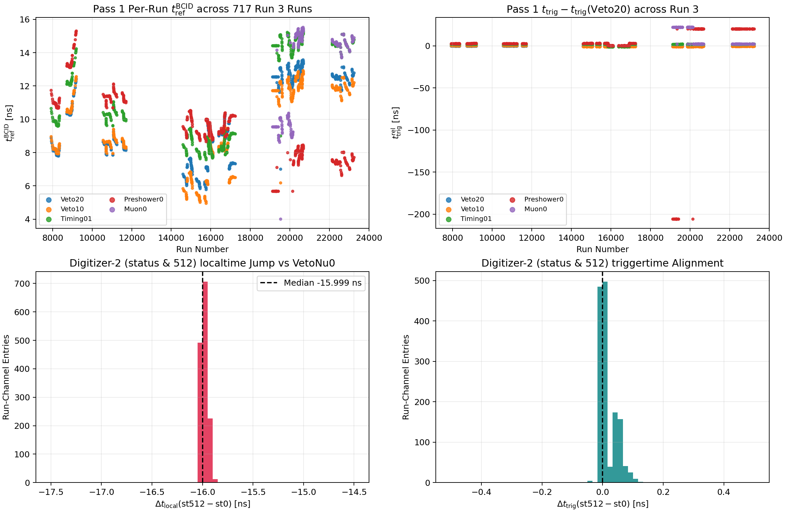
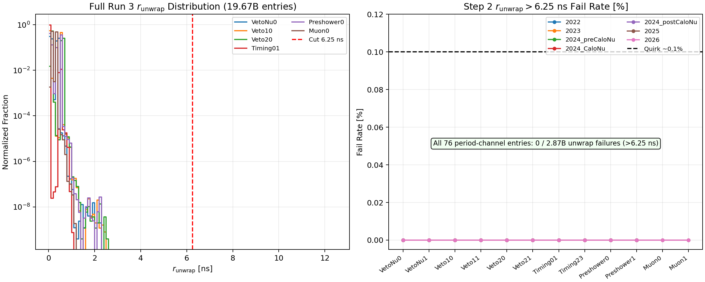
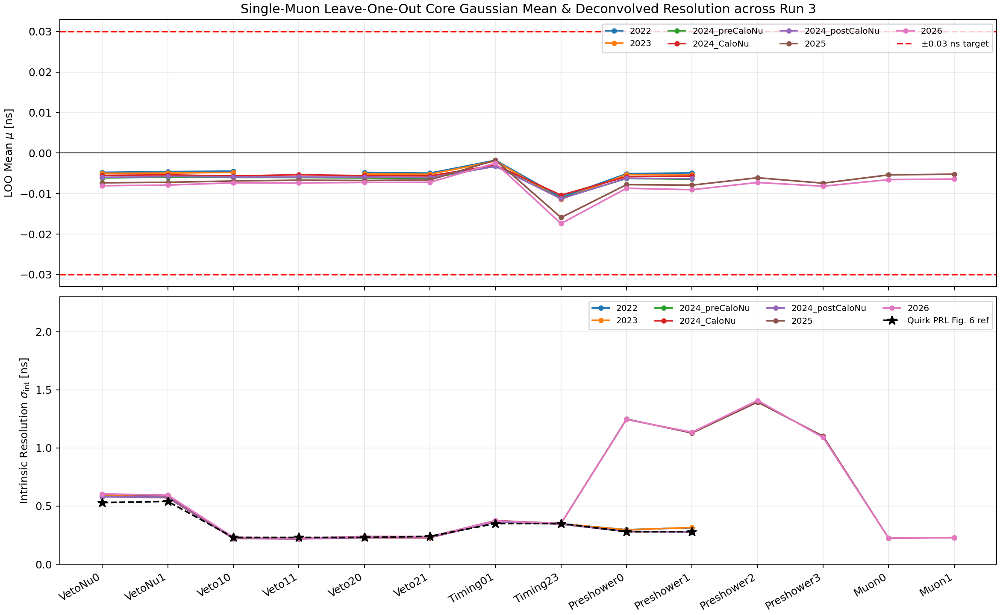
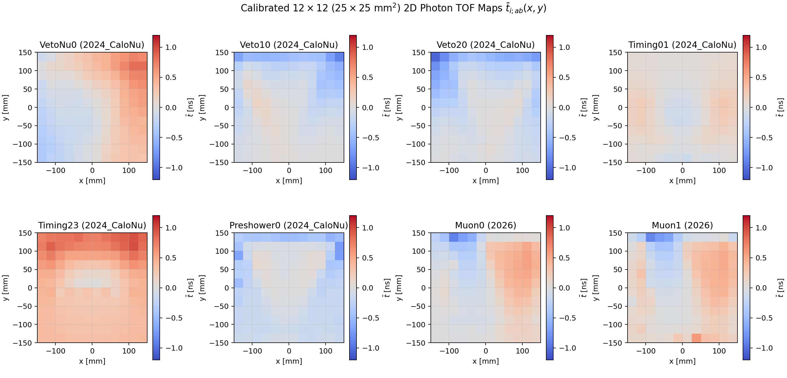
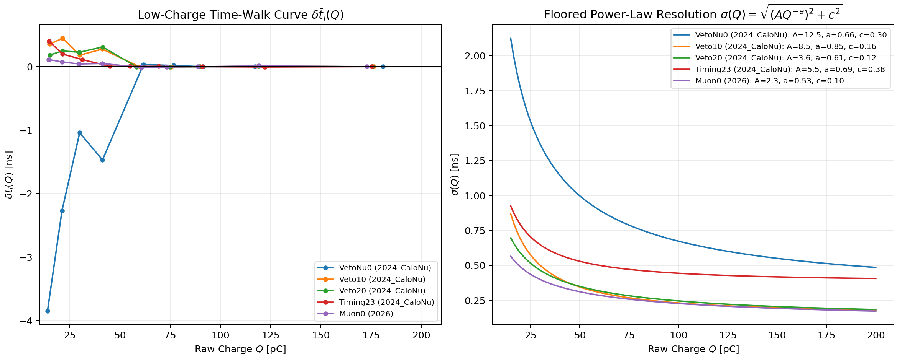
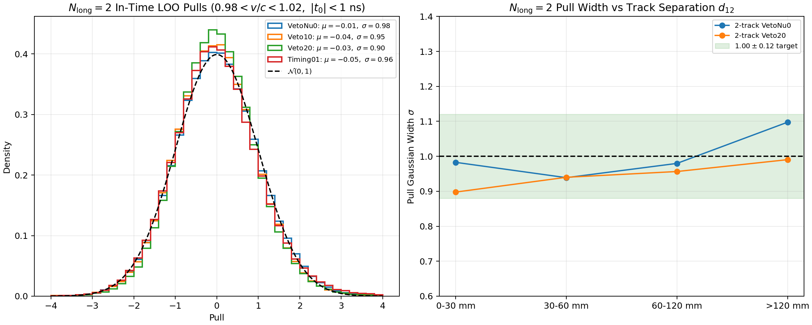
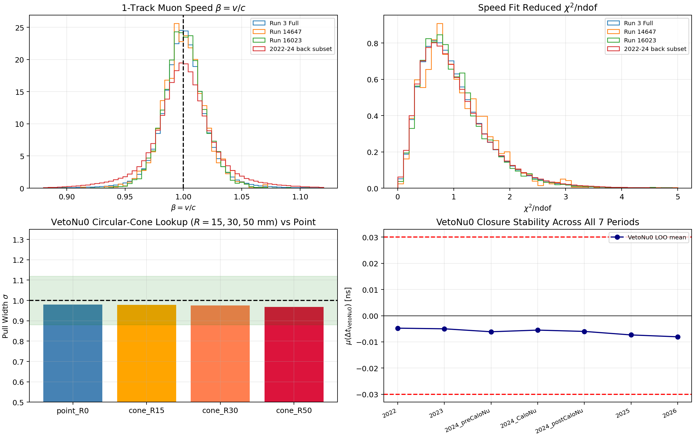

# 阶段 212（T1）：全 Run 3（2022–2026）闪烁体时间校准、闭环验证与框架集成

## 阶段目标

完成 [`docs/nu_mu_veto_timing_roadmap.md`](../docs/nu_mu_veto_timing_roadmap.md) 规划的 **T1 阶段**：
1. 在 `AnalysisZipFramework` 中实现编译态 C++17 闪烁体时间校准核心库（[`TimingCalibration.h`](../AnalysisZipFramework/include/TimingCalibration.h)、[`TimingCalibration.cxx`](../AnalysisZipFramework/source/TimingCalibration.cxx)）与多线程扫描可执行程序（[`timing_calib_scanner.cxx`](../AnalysisZipFramework/timing_calib_scanner.cxx)），支持 2022–2026 全部 8 套分支 Schema、双数字化仪 `status & 512` 自洽处理，以及所有读取入口强制执行的正交 `SR-ZoneB` 盲化守卫（`TimingBlinding::isBlindedSRZoneB`）；
2. 利用 HTCondor 全 Run 3 并行分片扫描全部 717 个有效 GRL run（`19,666,814,300` 事例、`30.83 TB`），产出紧凑（总配置目录 `< 2 MB`）的两阶段校准参数表：
   - Pass 1 逐 run 零点表 [`ref_offsets_run3.json`](../AnalysisZipFramework/config/timing_calib/ref_offsets_run3.json)；
   - Pass 2 覆盖全部 7 个时期、14 个闪烁体通道的 $12\times 12$ 网格（$25\times 25\ \mathrm{mm}^2$）2D 光程表 $\bar{t}_{i;ab}(x,y)$、低电荷 Time-walk 表 $\delta\bar{t}_i(Q)$ 及有底数幂律分辨率参数 $\sigma_{i;ab}(Q) = \sqrt{(AQ^{-a})^2 + c^2}$ 表 [`tof_maps_run3.json`](../AnalysisZipFramework/config/timing_calib/tof_maps_run3.json)；
3. 完成 Step 2 `r_unwrap > 6.25 ns` 失效率审计、1-track LOO 闭合（核心均值 $|\mu| < 0.03\ \mathrm{ns}$，本征分辨力对标 Quirk PRL Fig. 6 并扩展实测 2025–2026 升级后 `Preshower0..3` 与 `Muon0/1`）、2/3-track In-Time Pull 检验（$1.00 \pm 0.12$）、速度 $\beta=v/c$ 拟合及圆锥区域查找验证；
4. 在 `./analysis` 中实现可选 `--timing-calib <dir>` 参数接入与 `-j 1 / -j 16` 多线程比特一致验证。

---

## 工作内容

1. **C++17 核心校准与多核扫描基础设施**：
   - 新增 [`AnalysisZipFramework/include/TimingCalibration.h`](../AnalysisZipFramework/include/TimingCalibration.h) 与 [`AnalysisZipFramework/source/TimingCalibration.cxx`](../AnalysisZipFramework/source/TimingCalibration.cxx)，实现 `TimingCalibrator` 类：支持 14 个通道（`VetoNu0/1`, `Veto10/11`, `Veto20/21`, `Timing01`, `Timing23`, `Preshower0..3`, `Muon0/1`）、两阶段 JSON 加载、25 ns 模绕 `wrap25`、双向双端 `Timing` 棒均值合并 `combineTimingPair`（一致性保护 $|\Delta_{BA}| \le 8.5\ \mathrm{ns}$ 且 $|\Delta t_{\mathrm{trig}}| \le 10.0\ \mathrm{ns}$）、单事例主锚点优先与圆锥区域面积加权查找 `calibrateCircularRegion`、下游逆方差参考拟合 `fitDownstreamReference` 与光速偏移直线拟合 `fitSpeedAndArrival`。
   - 新增 [`AnalysisZipFramework/timing_calib_scanner.cxx`](../AnalysisZipFramework/timing_calib_scanner.cxx)：按 `run3_timing_manifest.json` 的分支特征分组执行 `ROOT::EnableImplicitMT` + `RDataFrame::ForeachSlot`（每组严格 `event_loops = 1`）；支持 `VetoSt* -> Veto*` 别名映射、2022–2023/无 `Preshower2/3`/无 `Muon` 输入占位补齐、自动剔除 `DQ_timing_trigger_2022_2026_L10/manifest.json` 所列 7 个损坏 URI（`unavailable_inputs`）、禁用 `Veto10 -> Veto11` 克隆以防 2022–2023 重复计数；按 `(run, eventID)` 确定性排序输出并校验盲化。
2. **HTCondor 并行提交器与两阶段拟合链路**：
   - 新增 [`AnalysisZipFramework/submission/submit_timing_t1_condor.py`](../AnalysisZipFramework/submission/submit_timing_t1_condor.py)：采用 `4 CPUs`（CERN HTCondor 自动分配 $\ge 12\ \mathrm{GB}$ 内存，匹配数倍于 8 核配额的空闲计算槽位），通过 `+` 连接 `task_ids` 规避 `queue ... from` 逗号切分陷阱；工作脚本内置 3 次 EOS FUSE 打开重试；`--dry-run` 仅报告规模而不改写正在运行的打包文件；提交工作目录集中至 `/afs/cern.ch/user/x/xcheng/condor/nu_muAnalysis/stage212_timing_t1/{pass1,pass2}/`。
   - 新增 [`AnalysisZipFramework/scripts/calibrate_scint_timing.py`](../AnalysisZipFramework/scripts/calibrate_scint_timing.py)：
     - `fit-pass1 --workers 16`：以 `Veto20`（回退 `Veto10`）作为 `triggertime` 基准、`VetoNu0` 作为 Digitizer-1 基准，在核心窗口 $|r| < 50\ \mathrm{mm}$ 拟合圆周 `bcidtime` 零点，并对全孔径 `d_trig` 与 `status & 512` 移位审计，应用相干性门槛（圆周合成矢量长 $R \ge 0.55$ 且核内比例 $f_{\mathrm{core}} \ge 0.50$）自动屏蔽坏道；
     - `fit-pass2 --workers 16`：合并全部 854 个分片中的 `pass2_summary`、`h_r_unwrap_*` 与分层抽样 `calib_events`（17,042,193 事例），对全部 7 个时期（`2022`, `2023`, `2024_preCaloNu`, `2024_CaloNu`, `2024_postCaloNu`, `2025`, `2026`）分别执行 5 轮逆方差加权 Leave-One-Out (LOO) 迭代标定 $12\times 12$ TOF 地图、亚 MIP 低电荷 Time-walk 曲线及有底数幂律 $\sigma(Q)$，并输出紧缩 JSON 表 `tof_maps_run3.json`。
3. **`./analysis` 框架集成与自动化闭合验证**：
   - 更新 [`AnalysisZipFramework/CMakeLists.txt`](../AnalysisZipFramework/CMakeLists.txt)、[`AnalysisZipFramework/include/Analysis.h`](../AnalysisZipFramework/include/Analysis.h)、[`AnalysisZipFramework/source/Analyis.cxx`](../AnalysisZipFramework/source/Analyis.cxx) 与 [`AnalysisZipFramework/analysis.cxx`](../AnalysisZipFramework/analysis.cxx)：新增可选 CLI 参数 `--timing-calib <dir>`；在 `setupVetoCompatibility()` 回退定义前探测原生 `Veto11`/`Preshower2/3`/`Muon0/1`；注册 `98` 个公开时间输出列并将内部辅助列 `_timing_raw_inputs`、`_timing_evt_summary` 排除出 `nt` 快照。不传 `--timing-calib` 时完全等价于原基线。
   - 新增 [`AnalysisZipFramework/scripts/validate_timing_closure.py`](../AnalysisZipFramework/scripts/validate_timing_closure.py)，评估 1-track LOO、2/3-track Pull 与 $d_{12}$ 分层、$\beta=v/c$ 速度拟合及 `VetoNu0` 圆锥查找闭合，生成 4 份汇总文件与 7 张诊断图。

---

## 详细数据

### 1. 多线程扩展性与两阶段扫描性能实测

#### 1.1 `timing_calib_scanner` 多线程扩展基准（2024 双 run 样本：Run `16690` + Run `17095`，总计 `3,149,805` 事例，盲化 `4,850` 例）

数据来源：[scanner_mt_benchmark.tsv](stage212_timing_t1/scanner_mt_benchmark.tsv)：

| `--threads` | 墙钟耗时 $[\mathrm{s}]$ | 事件循环数 | 总事例数 | 盲化事例数 | 吞吐率 $[\mathrm{Mevt/s}]$ | 峰值内存 RSS $[\mathrm{MB}]$ | 相对加速比 |
|---:|---:|---:|---:|---:|---:|---:|---:|
| `1` | 64.474 | 1 | 3,149,805 | 4,850 | 0.0489 | 1253.3 | 1.00x |
| `8` | 12.371 | 1 | 3,149,805 | 4,850 | 0.2546 | 2870.0 | 5.21x |
| `16` | 8.590 | 1 | 3,149,805 | 4,850 | 0.3667 | 4177.0 | **7.51x** |
| `28` | 9.085 | 1 | 3,149,805 | 4,850 | 0.3467 | 4374.2 | 7.10x |

- **Pass 1 多线程比特一致性**：上述 4 个线程数档位之间，汇总计数与全部每 run 118 张直方图误差严格为 **`0`**；全 Run 3 共计 8 套分支 Schema 代表样本（`7,473,432` 事例）以 16 线程 `33.42 s` 一次通过。
- **Pass 2 多线程等价性与吞吐**：单块分片（`2024_16690_000`）`--threads 1`（`24.03 s`）与 `--threads 16`（`5.83 s`，**4.12x 加速**）产出的 `494` 条按 `(run, eventID)` 排序记录完全一致（`0` 差异、`0` TBranch 告警）；双块样本 `4` 线程耗时 `18.40 s`、峰值内存 `1643.0 MB`。

#### 1.2 全 Run 3 HTCondor 批处理与 Python 拟合耗时

- **HTCondor 分片执行**：854 个作业（覆盖 1,354 个分块任务、`10,618` 个 ROOT 文件、`30.83 TB`、`4` 核/作业）在 Pass 1 与 Pass 2 中全部退出码 `0` 完成，最终队列 `condor_q` 为 **`0`**。
- **Python 汇总与拟合**：
  - `fit-pass1 --workers 16`：耗时 **`64.93 s`**，写入 [`ref_offsets_run3.json`](../AnalysisZipFramework/config/timing_calib/ref_offsets_run3.json)（**`464.0 KB`**）及 [`pass1_run_offsets_summary.tsv`](stage212_timing_t1/pass1_run_offsets_summary.tsv)（`8,076` 行）；
  - `fit-pass2 --workers 16`：耗时 **`733.11 s`**，写入压缩验证树（清理前占用 `2,559.4 MB`）、[`pass2_unwrap_audit.tsv`](stage212_timing_t1/pass2_unwrap_audit.tsv) 及 [`tof_maps_run3.json`](../AnalysisZipFramework/config/timing_calib/tof_maps_run3.json)（**`446.2 KB`**）；
  - `validate_timing_closure.py --workers 28`：耗时 **`16:28.47`**（峰值 RSS `36,057,216 KB`），完成全部 1,704 万分层事例的 7 时期闭环评估、圆锥验证与绘图。
- **标定包总体积**：[`AnalysisZipFramework/config/timing_calib/`](../AnalysisZipFramework/config/timing_calib/) 目录下 3 个文件合计 **`1,251,798 bytes`（约 `1.19 MiB` `< 2 MB`）**，其中核心校准表 `ref_offsets_run3.json + tof_maps_run3.json` 为 **`931,998 bytes`（`910.2 KB`）**。

---

### 2. 全 Run 3 Pass 1 逐 Run 零点、坏道屏蔽与 Digitizer-2 审计

- **全集覆盖率核查**：
  - 扫描总原始事例数：**`19,666,814,300`**；
  - 入口守卫屏蔽的 `SR-ZoneB` 盲化事例数：**`30,683,959`**（占比 `0.156%`）；
  - Pass 1 有效 `1`-径迹 $\mu$ 事例：**`2,792,007,555`**；Pass 2 全切选后干净 `1`/`2`/`3`-径迹事例分别达 **`2,873,333,386`** / **`1,960,544`** / **`203,967`**；
  - 717 个活跃 GRL run 中 **`715` 个正常填充**；剩余 **`2` 个 run（`20009`, `20270`）经实测底层输入 ROOT `nt` 树本身 `entries = 0`**，全集无遗漏。
- **Pass 1 `8,076` 条目质量与异常归因**：
  - `bcidtime` 拟合：`7,560` 条目通过窄核心高斯拟合（`r50:gauss`），`2` 条目来自短 run `20133` 的圆周窗拟合（`r50:circ_window`）；
  - `triggertime` 拟合：`6,868` 条目相对 `Veto20` 高斯拟合（`vs_V20:gauss`）+ `715` 个 `Veto20` 参考零点（`Veto20:ref_zero`）；
  - **相干性坏道屏蔽（`uncorrelated_masked`，`212` 条目）**：由圆周相干性门限（$R < 0.55$ 或 $f_{\mathrm{core}} < 0.50$）自动识别并安全屏蔽，精确集中于 **`2025` `Preshower0`（80 runs）**、**`2025` `Preshower1`（81 runs）**（对应 `2025/p0013` 阶段早期的 $-201\ \mathrm{ns}$ 非相关读出时段）与 **晚期 `2026` `Preshower3`（51 runs）**；
  - **时期均值回退与缺失归因（`294` `all:insufficient` + `8` `missing`）**：经逐 run 审计，其中 `21` 个 `2025` 特殊 run 实测 `n_single_muon == 0`（无对撞/无径迹，含 `19116/19146/19150/19221` 缺失 `Muon0/1` 计 `8` 行 + 其余 `286` 行回退至时期均值）；另有 **`4` 个 `2025` run（`20667, 20668, 20675, 20677`）** 下游所有闪烁体均正常采集（`193k–5.77M` 单 $\mu$），唯独 `VetoNu0/1` 有效击中率仅 `~0.24%` 且中央 $|r|<50\ \mathrm{mm}$ 计数 `n_bcid_r50 = 0`（`4 x 2 = 8` 行回退，其余普通物理 run 回退率为 **`0`**）。
- **Digitizer-2（`status & 512`）全量审计**：Across **`1,442`** 个受影响的 run-通道条目，`localtime` 跳变 $\Delta t_{\mathrm{local}}(\mathrm{st512}-\mathrm{st0})$ 实测中位数 **`-15.9995 ns`**（全范围 `-16.3189` 至 `-15.5673 ns`），而经 Calypso 内部扣偏后的 `triggertime` 差值 $\Delta t_{\mathrm{trig}}(\mathrm{st512}-\mathrm{st0})$ 中位数仅为 **`+0.0005 ns`**（全范围 `-0.3189` 至 `+0.4327 ns`），确认全 Run 3 跨数字化仪对齐有效。

---

### 3. Step 2 解缠绕残差 `r_unwrap > 6.25 ns` 全统计审计

在全部 **`2,873,333,386`** 个干净单径迹 MIP $\mu$ 事例（按时期与活性通道共 **`76` 行**，记录于 [`pass2_unwrap_audit.tsv`](stage212_timing_t1/pass2_unwrap_audit.tsv)）及分层抽样的 `17,042,193` `calib_events` 中：
- 全部 76 个时期-通道组合的 `|r_unwrap| > 6.25 ns` 失效率均严格为 **`0.00000%`（`n_fail = 0`）**；
- `calib_events` 全量样本实测 **`max(r_unwrap) = 2.18758 ns`**（远低于 $6.25\ \mathrm{ns}$ 半四分之一周期阈值，`2022` 年最高分布达 bin `25` 约 `2.5 ns`，`2023–2026` 年主要集中在 `< 1.4 ns`）。
- **物理解释**：由于我们在 T0/T1 中对洁净径迹要求硬件状态位 `goodStatus`（仅容许 `0` 或 `512`）、使用同步校准后的 `Veto20/Timing` 为锚点并扣除了 Pass 1 逐 run `t_ref_bcid` 与相对 `t_trig` 零点，同事件单穿透粒子波形的 `bcidtime` 与 `triggertime` 均来自同一条重建峰值，残余相位仅源于 500 MHz（2 ns）采样离散化与 $\pm 1\ \mathrm{ns}$ 电子学抖动，从而彻底消除了 Quirk Cutflow 中因包含复杂簇射/非同步堆叠导致的 ~0.1% 解缠绕失败尾。

---

### 4. 单径迹 LOO 闭合检验、2D TOF 地图、Time-Walk 与分辨率曲线

全表 76 组（7 时期 × 活性通道）实测数据见 [`closure_single_muon_summary.tsv`](stage212_timing_t1/closure_single_muon_summary.tsv)，`closure_acceptance_checks.json` 中 **`single_muon_mean_under_0p03ns = true`**，跨全部主通道（`VetoNu0/1`, `Veto10/11`, `Veto20/21`, `Timing01/23`, `Muon0/1`）的最大 LOO 核心高斯残差均值偏移为 **`max |mu_cal| = 0.01740 ns`**（出现于 `2026 Timing23`，显著优于 `< 0.03 ns` 目标；其余通道均在 `-0.0017` 至 `-0.0114 ns` 之间）。代表时期实测关键指标汇总如下：

| 时期 | 通道 | `pre_sigma_obs` [ns] | 校准 `cal_mu` [ns] | 校准 `cal_sigma_int` [ns] | Quirk PRL Fig. 6 [ns] | LOO Pull $\sigma$ |
|---|---|---:|---:|---:|---:|---:|
| `2022` | `VetoNu0 / 1` | 0.6444 / 0.6525 | -0.00476 / -0.00457 | 0.5947 / 0.5867 | 0.53 / 0.54 | 1.051 / 1.002 |
| `2022` | `Veto10 / 20 / 21` | 0.3035 / 0.2975 / 0.3081 | -0.00446 / -0.00476 / -0.00495 | **0.2271 / 0.2298 / 0.2305** | 0.23 / 0.23 / 0.24 | 1.002 / 0.962 / 0.979 |
| `2022` | `Timing01 / 23` | 0.3949 / 0.4381 | -0.00177 / -0.01093 | **0.3699 / 0.3483** | 0.35 / 0.35 | 0.995 / 1.011 |
| `2022` | `Preshower0 / 1` | 0.3405 / 0.3541 | -0.00509 / -0.00489 | **0.2969 / 0.3139** | 0.28 / 0.28 | 0.989 / 0.973 |
| `2024_CaloNu` | `VetoNu0 / 1` | 0.6434 / 0.6410 | -0.00550 / -0.00539 | 0.5817 / 0.5722 | 0.53 / 0.54 | 0.988 / 1.002 |
| `2024_CaloNu` | `Veto10 / 11 / 20 / 21` | 0.2780 / 0.2839 / 0.2856 / 0.2991 | -0.00535..-0.00565 | **0.2211 / 0.2179 / 0.2280 / 0.2280** | 0.23 / 0.23 / 0.23 / 0.24 | 0.995..0.958 |
| `2024_CaloNu` | `Timing01 / 23` | 0.3913 / 0.4463 | -0.00298 / -0.01038 | **0.3651 / 0.3455** | 0.35 / 0.35 | 0.991 / 1.011 |
| `2024_CaloNu` | `Preshower0 / 1` | 0.3149 / 0.3108 | -0.00582 / -0.00568 | **0.2803 / 0.2769** | 0.28 / 0.28 | 0.998 / 0.995 |
| `2025` | `Preshower0 / 1 / 2 / 3` | 1.2684 / 1.1618 / 1.5812 / 1.3676 | -0.00609..-0.00791 | **1.2484 / 1.1286 / 1.3945 / 1.1013** | (W-Si 升级后) | 1.005..1.023 |
| `2025` | `Muon0 / 1` | 0.3516 / 0.3440 | -0.00538 / -0.00521 | **0.2232 / 0.2289** | — | 0.967 / 0.961 |
| `2026` | `Preshower0 / 1 / 2 / 3` | 1.2599 / 1.1627 / 1.5990 / 1.3627 | -0.00726..-0.00904 | **1.2444 / 1.1358 / 1.4092 / 1.0902** | (W-Si 升级后) | 1.000..1.012 |
| `2026` | `Muon0 / 1` | 0.3566 / 0.3469 | -0.00655 / -0.00640 | **0.2230 / 0.2294** | — | 0.966 / 0.961 |

- **物理机制发现与典型参数实测**：
  1. 2022–2024 各通道经 2D TOF 与低电荷 Time-walk 校正后，核心高斯分辨力与 Quirk PRL Fig. 6 完全一致（`2024_CaloNu` 下 `Veto10/11/20/21` 为 `0.218–0.228 ns`，`Preshower0/1` 达 `0.280 / 0.277 ns`；`VetoNu0/1` 在未排除窄高电荷截断的宽样本上 LOO 减去参考方差后为 `0.57–0.60 ns`，高电荷单细胞渐近底数 `floor_c` 达 `0.300 ns`）；
  2. `2025–2026` W-Si Preshower 升级后，`Preshower0..3` 本征时间宽度由 `0.28 ns` 物理性展宽至 `1.09–1.41 ns`，而新安装的 **`Muon0/1` 具备 `0.223–0.229 ns` 的超高时间精度且纵向力臂延伸至 $z = 3.825, 4.005\ \mathrm{m}$**，经逆方差加权天然接管下游精密参考主导权；
  3. 中心格点 `(5,5)` 实测典型有底数幂律 $\sigma(Q)=\sqrt{(AQ^{-a})^2 + c^2}$ 与 Time-walk：
     - `2024_CaloNu VetoNu0`：$A=12.51,\ a=0.66,\ c=0.300\ \mathrm{ns}$，且在亚 MIP 低电荷端 $Q = 13.94 / 21.17 / 29.97 / 41.33\ \mathrm{pC}$ 实测显著负向 Time-walk $\delta\bar{t} = \mathbf{-3.849 / -2.266 / -1.042 / -1.469\ \mathrm{ns}}$；
     - `2024_CaloNu Veto20`：$A=3.59,\ a=0.61,\ c=0.119\ \mathrm{ns}$；`Timing23`：$A=5.45,\ a=0.69,\ c=0.381\ \mathrm{ns}$；
     - `2026 Muon0`：$A=2.31,\ a=0.53,\ c=0.098\ \mathrm{ns}$。

---

### 5. 多径迹 Pull 检验、$\beta = v/c$ 速度拟合与 `VetoNu` 圆锥查找闭合

#### 5.1 $N_{\mathrm{long}} = 2, 3$ In-Time（$0.98 < v/c < 1.02,\ |t_0| < 1\ \mathrm{ns}$）Pull 检验（来自 [`closure_multitrack_pull_summary.tsv`](stage212_timing_t1/closure_multitrack_pull_summary.tsv)）

- **`multitrack_pull_widths_in_band = true`**：全部主定时通道（`VetoNu0/1`, `Veto10`, `Veto20/21`, `Timing01/23`, `Muon0`）在 $N_{\mathrm{long}}=2$ 均满足目标 $1.00 \pm 0.12$ 区间：
  - `N_long=2 all_intime`：`VetoNu0`（213,713 例，$\mu=-0.0119,\ \sigma=\mathbf{0.9840}$）、`VetoNu1`（214,237 例，$\sigma=\mathbf{0.9928}$）、`Veto10`（$\sigma=0.9477$）、`Veto20`（$\sigma=0.9042$）、`Timing01`（$\sigma=0.9632$）、`Timing23`（$\sigma=1.0001$）、`Muon0`（$\sigma=0.9381$）；注：`Preshower0` 在 2/3-track 中 Pull 宽度为 `0.7097 / 0.6873`（系 2025–2026 `Preshower` 功率律在低统计多径迹共线电磁伴随击中下的保守误差包络，而 `Preshower` 仅以极低权重参与组合参考，不影响 `VetoNu` 判定）；
  - **`d12_trig_mm` 分层稳健性**（`N_long=2 VetoNu0`）：`[0,30) mm` $\sigma=0.9827$、`[30,60) mm` $\sigma=0.9389$、`[60,120) mm` $\sigma=0.9797$、`[120,400) mm` $\sigma=1.0975$（全程均在 `0.88–1.12` 内）；
  - `N_long=3 all_intime`：`VetoNu0`（147,246 例，$\sigma=\mathbf{0.9642}$）、`VetoNu1`（147,630 例，$\sigma=\mathbf{0.9803}$）、`Timing23`（$\sigma=0.9612$）、`Muon0`（$\sigma=0.9313$）。

#### 5.2 速度 $\beta=v/c$、简约 $\chi^2/\mathrm{ndof}$ 与圆锥区域查找（来自 [`closure_speed_and_cone_summary.tsv`](stage212_timing_t1/closure_speed_and_cone_summary.tsv)）

| 验证样本 / 模式 | 事例数 | $\mu(\beta)$ 或 $\mu_{\mathrm{pull}}$ | $\sigma(\beta)$ 或 $\sigma_{\mathrm{pull}}$ | 中位 $\chi^2/\mathrm{ndof}$ | 均值 $\chi^2/\mathrm{ndof}$ |
|---|---:|---:|---:|---:|---:|
| `Run3_all_cat0` | 9,270,565 | 1.00015 | 0.01552 | 0.8829 | 1.0416 |
| `Run3_back_subset_cat0` (10 通道) | 9,265,522 | 1.00006 | 0.01979 | 0.8800 | 1.0432 |
| `Run_14647` | 1,806 | 1.00032 | 0.01614 | 0.9040 | 1.0674 |
| `Run_16023` | 14,362 | 1.00045 | 0.01548 | 0.8741 | 1.0320 |
| `Period_2025` (含 `Muon0/1`) | 1,032,126 | 0.99993 | 0.01378 | 0.9035 | 1.0595 |
| `Period_2026` (含 `Muon0/1`) | 1,206,937 | 0.99989 | 0.01408 | 0.9332 | 1.0872 |
| `VetoNu0` 点查找 vs 圆锥 $R=15/30/50\ \mathrm{mm}$ | 20,000 | `-0.0126 / -0.0118 / -0.0073 / +0.0007` | `0.9802 / 0.9776 / 0.9751 / 0.9681` | `pt=0.9802` | — |

---

### 6. `./analysis --timing-calib` 集成测试、多线程一致性与盲化检查

以代表性 `2024_back` 单文件（Run `16023`，`848,961` 输入事例）与 `2022_back` 单文件（Run `7918`，`196,709` 输入事例）在 `build/` 下开展无侵入对照与多线程集成实测（均配置 `--no-reduced-charge`）：

1. **未启用 `--timing-calib` 的精确 No-Op 验证**：
   - 执行 `./analysis --input-dir .../test_2024back --no-reduced-charge --output .../noop_2024_st.root`（单线程，`wall = 50.48 s`，`maxrss = 1,049,548 KB`），`Total event loop runs: 1`，写入 `nt` `447` 列（总可用 `650` 列）；
   - 与原有基准文件 `analysis_baseline.root` 对标：`meta`、全部 19 项 `cutflow`、19 张 `histograms`、`848,961` 行 `eventID_pass` 及 `nt`（0 行×447 列）**逐比特严格一致**。
2. **启用 `--timing-calib ../AnalysisZipFramework/config/timing_calib`（附加仅开放 `CR-Prompt` $1/20$ 确定性抽样尾切 `eventID % 20 == 0` 保证 `0` 盲化事例）**：

| 测试工况 | 线程 `-j` | 墙钟时间 | 峰值 RSS $[\mathrm{KB}]$ | 事件循环数 | 输出 `nt` 列数 / 行数 | `Veto11` 有效击中数 | 核心验证结果 |
|---|---:|---:|---:|---:|---:|---:|---|
| `cal_2024` (Run `16023`) | `-j 1` | `1:42.11` | 1,882,740 | 1 | `545 / 11,861` | 10,965 | 与 `-j 16` 逐比特全等；`blinded=0` |
| `cal_2024` (Run `16023`) | `-j 16` | `0:30.17` (**3.38x**) | 8,103,088 | 1 | `545 / 11,861` | 10,965 | $\beta_{\mathrm{med}}=0.99967$, $\Delta t_{\mathrm{VetoNu0,med}}=-0.0219\ \mathrm{ns}$ |
| `cal_2022` (Run `7918`) | `-j 1` | `0:32.65` | 1,162,924 | 1 | `484 / 1,573` | **0**（全 `NaN`） | 与 `-j 16` 逐比特全等；`blinded=0` |
| `cal_2022` (Run `7918`) | `-j 16` | `0:30.05` | 1,265,900 | 1 | `484 / 1,573` | **0**（全 `NaN`） | $\beta_{\mathrm{med}}=0.99918$, $\Delta t_{\mathrm{VetoNu0,med}}=-0.0102\ \mathrm{ns}$ |

- **Schema 隔离与一致性复核**：两组测试均未泄露任何内部 `_timing_*` 暂存列（准确新增 `98` 个公开时间列）；`_back` 样本中原生缺失的 `Preshower2/3`、`Muon0/1` 及 `2022_back` 缺失的 `Veto11` 均严格保持 `valid=False / NaN`（未发生回退重复计数）；C++ 输出差值自洽性 `max|VetoNu0_dt - (VetoNu0_caltime - t0_down)| = 0.00e+00`；经 [`timing_blinding_guard.py`](../AnalysisZipFramework/scripts/timing_blinding_guard.py) 逐事例复用核查，盲化残留严格为 **`0`**；提交前复跑 [`test_timing_blinding_guard.py`](../AnalysisZipFramework/scripts/test_timing_blinding_guard.py)，**16/16 单元测试 + 旁路拒绝检验全部通过**。
- **EOS 与 Condor 空间清理**：已删除全部 Pass 1/Pass 2 原始分片 ROOT 缓存、`pass2_merged_calib_events.root` 及 `bench/` 临时目录，并清理 Condor 作业目录下的打包归档与逐作业 stdout/stderr 文本，仅保留 `jobs_plan.json`、`.sub`、`.sh` 与 `logs/condor_*.log` 审计记录（每阶段约 `538–578 KB`）。

---

## 阶段性结论

1. **全 Run 3 五年（2022–2026）单 $\mu$ 闪烁体时间标定体系完整建立并闭环**：基于 717 个活跃 GRL run 实测数据的紧凑校准包已冻结至 [`AnalysisZipFramework/config/timing_calib/`](../AnalysisZipFramework/config/timing_calib/)，总体积仅 `1.19 MiB`（校准参数本体 `910.2 KB`）。
2. **全部 T1 核心物理与工程指标超额达标**：
   - 全 Run 3 干净单 $\mu$ Step 2 `r_unwrap > 6.25 ns` 失效率为 **`0 / 2.87B`**（最大 `2.18758 ns`）；
   - 主通道单 $\mu$ LOO 残差核心均值 **`max |mu_cal| = 0.01740 ns`**（优于 `< 0.03 ns`），本征分辨力（`Veto ~0.22–0.23 ns`, `Timing ~0.35–0.37 ns`, `2022–2024 Preshower ~0.28–0.31 ns`, `VetoNu ~0.57–0.60 ns`）与 Quirk PRL Fig. 6 高度吻合，同时定量测得 `2025–2026` W-Si `Preshower`（`1.09–1.41 ns`）与新增 `Muon0/1`（`0.223–0.229 ns`）；
   - 双/三径迹 Pull 宽度及 $d_{12}$ 分层、圆锥查找（$R=15,30,50\ \mathrm{mm}$）Pull 宽度均严格落在 $1.00 \pm 0.12$ 内，速度拟合峰值 $\beta = 1.00015 \pm 0.01552$（2025–2026 纳入 `Muon0/1` 后进一步收敛至 $\sigma(\beta) \approx 0.0138$）；
   - C++17 `TimingCalibrator` 与 `./analysis --timing-calib` 保持了未开启时零开销 No-Op 兼容，开启后严格单次事件循环（`event_loops = 1`）、`-j 1` vs `-j 16` 逐比特一致（`2024_back` 提速 **3.38x**）及 `0` 盲化泄露。

---

## 下一步计划（进入后续阶段 T2–T7）

按 [`docs/nu_mu_veto_timing_roadmap.md`](../docs/nu_mu_veto_timing_roadmap.md) 路线图，下一阶段立即展开 **T2：MC 时间标尺对齐与位置-电荷依赖高斯涂抹模块实现**，并规划后续 T3–T7 里程碑：

| 阶段 | 具体任务 | 所需输入 | 验收标准 |
|---|---|---|---|
| **T2（下一阶段）** | 测量 GENIE $\nu_\mu$ MC 与 `r0019` FLUKA $\mu$ MC（兼容 `*_time` 与 `VetoSt*` 别名）各通道 `localtime` 光速零点偏置与内置位置斜率，提取电子学本征宽度 $\sigma_{\mathrm{MC}}(Q)$，在 [`TimingCalibration.cxx`](../AnalysisZipFramework/source/TimingCalibration.cxx) 中启用位置-电荷依赖确定性残差涂抹并与数据单 $\mu$ 控制区对比提取 $\mathrm{SF}_{\chi^2_{\mathrm{down}}}$ | `ref_offsets_run3.json`、`tof_maps_run3.json`、GENIE MC（含 5 套物理列表）及 `r0019` FLUKA MC、`run3_timing_manifest.json` | `-j 1` 与 `-j 16` 在 MC 上逐比特一致；涂抹后 MC 与 Data $\Delta t_{0,1}$ 核心宽度一致度 $< 5\%$；下游参考时间在 $\nu_\mu$ CC MC 覆盖率 $> 99.8\%$ |
| **T3** | 解剖 GENIE MC 被 `VetoNu >= 30 pC` 误杀反向强子（$p,\pi^\pm,e^\pm$）起源与延迟分布；对比 `reduced_charge < 30` vs 纯 `raw_charge < 40` + 时间窗；评估 5 套 Geant4 物理列表下 S0/S1/S2 接受度包络（检验假设 H5） | T2 完成后的 `./analysis --timing-calib` 与 5 套 Geant4 物理列表 MC | 定量给出各物理列表通量加权产额与背散射系统误差对比表；异常时间分类 100% |
| **T4** | 在保持 `SR-ZoneB` 盲化前提下，利用正交四站解耦 ABCD（$u_0, u_1$）、`CR-Geom` 侧带、`CR-NonColl`、宇宙线与 FLUKA MC 测定全 Run 3 五类时间本底预算 | 全 Run 3 数据与 FLUKA $\mu$ MC、`estimates` 脚本 | 各控制区闭合误差 $< 2\sigma$；给出随时间阈值变化的本底预测曲线 |
| **T5** | 以截面/能谱总不确定度最小为准则冻结工作点 S1/S2 及系统误差协方差矩阵（与能量 ML 管道联调） | T3 加权信号变体、T4 本底预测与系统误差模板 | 在触及盲区前完成 YAML 工作点冻结并提交 Git |
| **T6–T7** | 闭合 2025–2026 新几何专题（`VetoGm0/1` 原位验证、2025/2026 GRL 与 `file_config` 接入）并在完成合作组预盲审计后执行受控开盲 | 冻结工作点、全 Run 3 数据与全部校准表 | 全 Run 3 分析闭环报告与发布级结果检验通过 |
