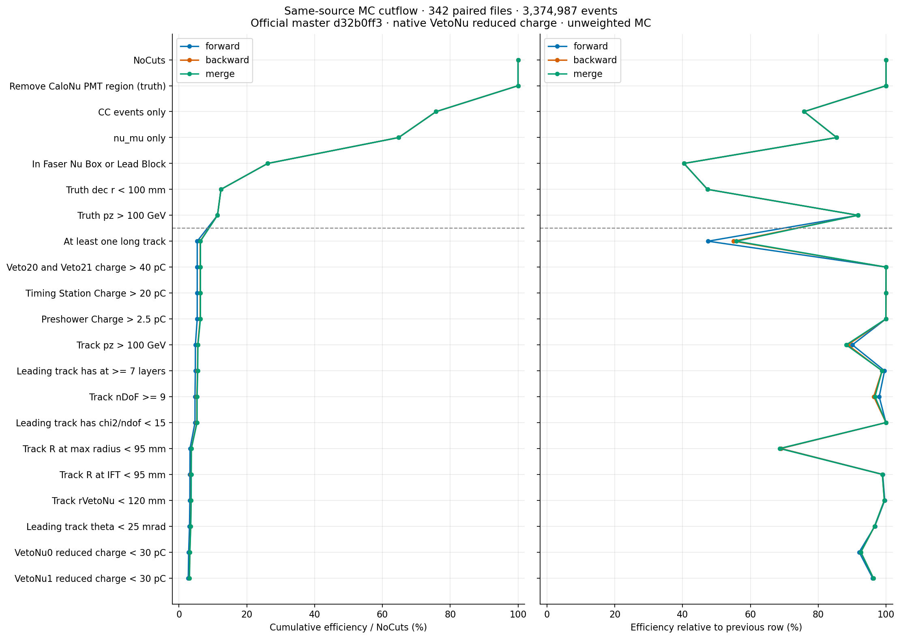
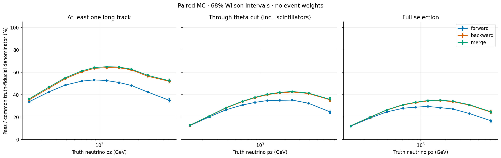
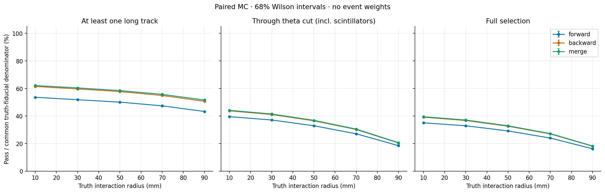
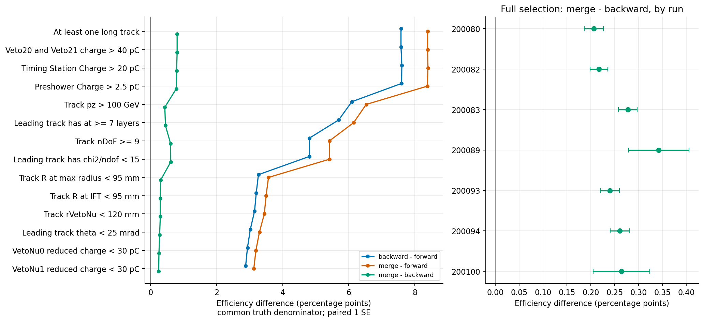

# 同来源 forward / backward / merge cutflow 对照

完整比较：342 个相同 RDO，3,374,987 个配对事件；公共 truth fiducial 分母 383,670。

Pass 为未加权事件数；Eff 为相对上一行的百分比；CumEff 为相对 NoCuts 的百分比。所有行按仓库 cuts.yaml 顺序累计，原生 VetoNu reduced charge。

| Cut | Forward Pass | Eff (%) | CumEff (%) | Backward Pass | Eff (%) | CumEff (%) | Merge Pass | Eff (%) | CumEff (%) |
|:---|---:|---:|---:|---:|---:|---:|---:|---:|---:|
| NoCuts | 3,374,987 | 100.000 | 100.000 | 3,374,987 | 100.000 | 100.000 | 3,374,987 | 100.000 | 100.000 |
| Remove CaloNu PMT region (truth) | 3,374,987 | 100.000 | 100.000 | 3,374,987 | 100.000 | 100.000 | 3,374,987 | 100.000 | 100.000 |
| CC events only | 2,559,272 | 75.831 | 75.831 | 2,559,272 | 75.831 | 75.831 | 2,559,272 | 75.831 | 75.831 |
| nu_mu only | 2,186,815 | 85.447 | 64.795 | 2,186,815 | 85.447 | 64.795 | 2,186,815 | 85.447 | 64.795 |
| In Faser Nu Box or Lead Block | 883,318 | 40.393 | 26.172 | 883,318 | 40.393 | 26.172 | 883,318 | 40.393 | 26.172 |
| Truth dec r < 100 mm | 418,248 | 47.350 | 12.393 | 418,248 | 47.350 | 12.393 | 418,248 | 47.350 | 12.393 |
| Truth pz > 100 GeV | 383,670 | 91.733 | 11.368 | 383,670 | 91.733 | 11.368 | 383,670 | 91.733 | 11.368 |
| At least one long track | 182,133 | 47.471 | 5.397 | 211,222 | 55.053 | 6.258 | 214,310 | 55.858 | 6.350 |
| Veto20 and Veto21 charge > 40 pC | 182,132 | 99.999 | 5.397 | 211,221 | 100.000 | 6.258 | 214,309 | 100.000 | 6.350 |
| Timing Station Charge > 20 pC | 182,025 | 99.941 | 5.393 | 211,212 | 99.996 | 6.258 | 214,247 | 99.971 | 6.348 |
| Preshower Charge > 2.5 pC | 181,953 | 99.960 | 5.391 | 211,109 | 99.951 | 6.255 | 214,089 | 99.926 | 6.343 |
| Track pz > 100 GeV | 163,875 | 90.064 | 4.856 | 187,258 | 88.702 | 5.548 | 188,922 | 88.245 | 5.598 |
| Leading track has at >= 7 layers | 163,152 | 99.559 | 4.834 | 185,010 | 98.800 | 5.482 | 186,740 | 98.845 | 5.533 |
| Track nDoF >= 9 | 159,860 | 97.982 | 4.737 | 178,300 | 96.373 | 5.283 | 180,633 | 96.730 | 5.352 |
| Leading track has chi2/ndof < 15 | 159,794 | 99.959 | 4.735 | 178,247 | 99.970 | 5.281 | 180,598 | 99.981 | 5.351 |
| Track R at max radius < 95 mm | 110,195 | 68.961 | 3.265 | 122,725 | 68.851 | 3.636 | 123,895 | 68.603 | 3.671 |
| Track R at IFT < 95 mm | 109,110 | 99.015 | 3.233 | 121,391 | 98.913 | 3.597 | 122,531 | 98.899 | 3.631 |
| Track rVetoNu < 120 mm | 108,693 | 99.618 | 3.221 | 120,775 | 99.493 | 3.579 | 121,910 | 99.493 | 3.612 |
| Leading track theta < 25 mrad | 105,104 | 96.698 | 3.114 | 116,694 | 96.621 | 3.458 | 117,752 | 96.589 | 3.489 |
| VetoNu0 reduced charge < 30 pC | 96,764 | 92.065 | 2.867 | 108,025 | 92.571 | 3.201 | 109,004 | 92.571 | 3.230 |
| VetoNu1 reduced charge < 30 pC | 92,937 | 96.045 | 2.754 | 103,985 | 96.260 | 3.081 | 104,930 | 96.263 | 3.109 |

## 公共 truth 分母下的选择效率

| 阶段 | Forward (%) | Backward (%) | Merge (%) |
|:---|---:|---:|---:|
| At least one long track | 47.471 | 55.053 | 55.858 |
| Leading track theta < 25 mrad | 27.394 | 30.415 | 30.691 |
| VetoNu1 reduced charge < 30 pC | 24.223 | 27.103 | 27.349 |

## 同事件的获得与损失

| 对照（后者减前者） | 前者独有 | 后者独有 | 共同通过 | 差值（百分点） | 配对统计 SE（百分点） |
|:---|---:|---:|---:|---:|---:|
| backward-forward | 1,132 | 12,180 | 91,805 | +2.8796 | 0.0297 |
| merge-forward | 101 | 12,094 | 92,836 | +3.1259 | 0.0283 |
| merge-backward | 89 | 1,034 | 103,896 | +0.2463 | 0.0087 |

全样本汇总含 SIBYLL π 200080，属于替代生成器，不能作为标称 flux 的加权预测。六个 nominal EPOS/POWHEG run 的单独汇总见 cutflow_nominal.md；各 run 表和 TSV 同时提供。

这些是相同真值条件下的事件选择效率，不是经过 muon truth matching 的单径迹效率。通过 theta 的阶段包含此前 scintillator cut；full selection 还包含 VetoNu veto。68% Wilson 误差只用于各自 binomial 比例；模式差值使用同事件配对协方差，不包含几何、拟合、生成器等系统误差。

## 图表

SVG 为可编辑矢量图。energy_bins.tsv 包含 pz≥10000 GeV 的溢出档，图中只展示有限 bin。

## 配置与复核

实际 cut 表达式见 cut_definitions.tsv；本次跳过的 DATA/aux/raw-charge 分支：

- Colliding
- Trigger
- Good times
- Excluded times
- CaloNu status cleaning
- Sanity cut to remove events with missing aux data
- VetoNu0 raw charge < 40 pC (fallback to raw charge if reduced charge invalid)
- VetoNu1 raw charge < 40 pC (fallback to raw charge if reduced charge invalid)
- VetoNu0 raw charge < 40 pC
- VetoNu1 raw charge < 40 pC

全部 342 项均逐事件验证三种模式的 17 个非轨迹输入完全一致，新旧 merge 的分析标量、cut 决策和事件 ID 完全相同。未比较全部 ntuple 分支的每个数值。
