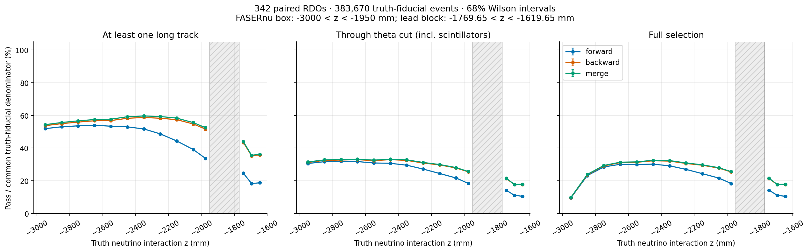
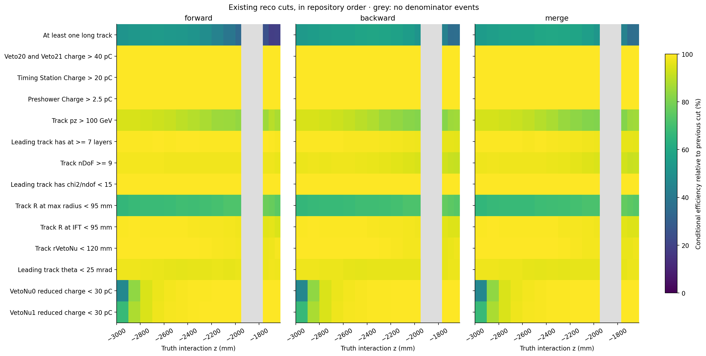

# 三种 tracking 策略的效率随真值相互作用 Z 变化

与阶段 09 相同的 342 个 RDO，公共真值分母 383,670 个事件。

`truth_dec_z_nu = truth_dec_z[0]`，单位 mm，表示入射中微子的真值相互作用点；不使用重建 track 的起点或外推 z。沿用 |PDG|=14、CC 和原有 fiducial/pz cuts。

左、中、右分别累计到 long-track、theta、完整选择；分母均为对应 Z bin 的共同真值事件数。误差为 68% Wilson 区间，不含系统误差。

阴影区是原分析 FASERν box 与 lead block 之间的真值选择空隙；没有分母，效率未定义，不连线插值、不画成零效率。box 使用 100 mm 分箱（最后一档 50 mm），lead block 使用 50 mm 分箱。

热图展示全部 14 个重建阶段 cut 的逐步效率：本行通过数 / 同模式上一行通过数；首行分母为共同真值事件数。灰色表示分母为零。

`z_bins.tsv` 提供所有 cut、模式、分箱计数与两种效率；`z_paired_differences.tsv` 提供同事件模式差值和配对统计 SE；`z_regions.tsv` 提供 box/lead 的分区域统计。

全样本为未加权比较，包含 SIBYLL 替代样本；不是标称 flux 预测或 truth-matched 单 muon 径迹效率。

精简的 `fiducial_events.npz` 只保存共同真值事件的 run/eventID、truth pz/x/y/z 和三模式 uint16 cut 位掩码；可直接补充坐标图，不保留重复 ROOT ntuple 或 xAOD。
