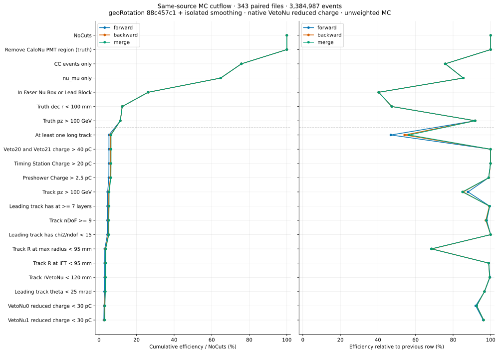
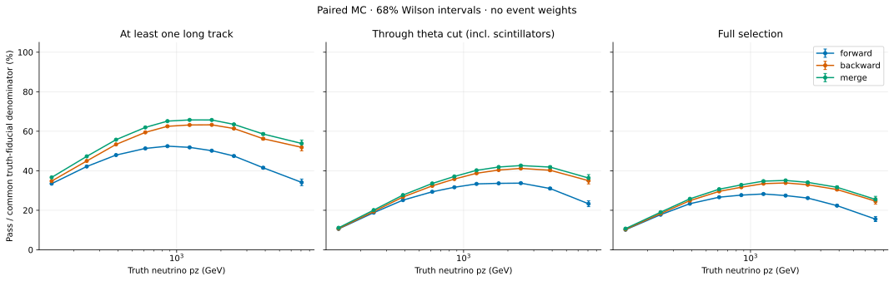
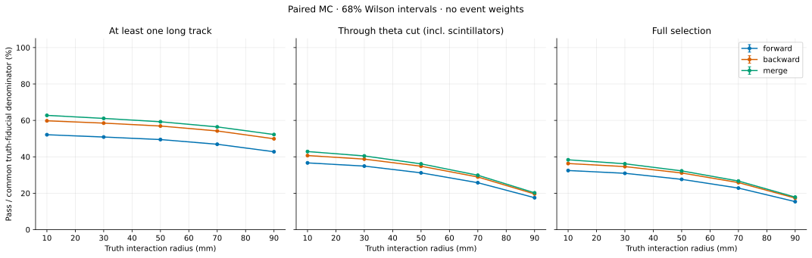
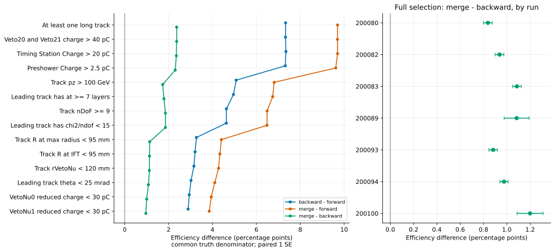

# 同来源 forward / backward / merge cutflow 对照

完整比较：343 个相同 RDO，3,384,987 个配对事件；公共 truth fiducial 分母 384,779。

Pass 为未加权事件数；Eff 为相对上一行的百分比；CumEff 为相对 NoCuts 的百分比。所有行按仓库 cuts.yaml 顺序累计，原生 VetoNu reduced charge。

| Cut | Forward Pass | Eff (%) | CumEff (%) | Backward Pass | Eff (%) | CumEff (%) | Merge Pass | Eff (%) | CumEff (%) |
|:---|---:|---:|---:|---:|---:|---:|---:|---:|---:|
| NoCuts | 3,384,987 | 100.000 | 100.000 | 3,384,987 | 100.000 | 100.000 | 3,384,987 | 100.000 | 100.000 |
| Remove CaloNu PMT region (truth) | 3,384,987 | 100.000 | 100.000 | 3,384,987 | 100.000 | 100.000 | 3,384,987 | 100.000 | 100.000 |
| CC events only | 2,566,874 | 75.831 | 75.831 | 2,566,874 | 75.831 | 75.831 | 2,566,874 | 75.831 | 75.831 |
| nu_mu only | 2,192,851 | 85.429 | 64.782 | 2,192,851 | 85.429 | 64.782 | 2,192,851 | 85.429 | 64.782 |
| In Faser Nu Box or Lead Block | 885,628 | 40.387 | 26.163 | 885,628 | 40.387 | 26.163 | 885,628 | 40.387 | 26.163 |
| Truth dec r < 100 mm | 419,371 | 47.353 | 12.389 | 419,371 | 47.353 | 12.389 | 419,371 | 47.353 | 12.389 |
| Truth pz > 100 GeV | 384,779 | 91.751 | 11.367 | 384,779 | 91.751 | 11.367 | 384,779 | 91.751 | 11.367 |
| At least one long track | 180,333 | 46.867 | 5.327 | 208,543 | 54.198 | 6.161 | 217,654 | 56.566 | 6.430 |
| Veto20 and Veto21 charge > 40 pC | 180,238 | 99.947 | 5.325 | 208,436 | 99.949 | 6.158 | 217,544 | 99.949 | 6.427 |
| Timing Station Charge > 20 pC | 180,097 | 99.922 | 5.320 | 208,370 | 99.968 | 6.156 | 217,425 | 99.945 | 6.423 |
| Preshower Charge > 2.5 pC | 178,151 | 98.919 | 5.263 | 206,306 | 99.009 | 6.095 | 215,159 | 98.958 | 6.356 |
| Track pz > 100 GeV | 156,676 | 87.946 | 4.629 | 176,227 | 85.420 | 5.206 | 182,885 | 85.000 | 5.403 |
| Leading track has at >= 7 layers | 155,914 | 99.514 | 4.606 | 174,985 | 99.295 | 5.169 | 181,867 | 99.443 | 5.373 |
| Track nDoF >= 9 | 152,633 | 97.896 | 4.509 | 170,465 | 97.417 | 5.036 | 177,604 | 97.656 | 5.247 |
| Leading track has chi2/ndof < 15 | 152,623 | 99.993 | 4.509 | 170,436 | 99.983 | 5.035 | 177,577 | 99.985 | 5.246 |
| Track R at max radius < 95 mm | 104,545 | 68.499 | 3.088 | 117,122 | 68.719 | 3.460 | 121,500 | 68.421 | 3.589 |
| Track R at IFT < 95 mm | 103,510 | 99.010 | 3.058 | 115,845 | 98.910 | 3.422 | 120,192 | 98.923 | 3.551 |
| Track rVetoNu < 120 mm | 103,135 | 99.638 | 3.047 | 115,272 | 99.505 | 3.405 | 119,597 | 99.505 | 3.533 |
| Leading track theta < 25 mrad | 99,817 | 96.783 | 2.949 | 111,448 | 96.683 | 3.292 | 115,612 | 96.668 | 3.415 |
| VetoNu0 reduced charge < 30 pC | 91,869 | 92.037 | 2.714 | 103,191 | 92.591 | 3.048 | 107,044 | 92.589 | 3.162 |
| VetoNu1 reduced charge < 30 pC | 88,233 | 96.042 | 2.607 | 99,351 | 96.279 | 2.935 | 103,056 | 96.274 | 3.045 |

## 公共 truth 分母下的选择效率

| 阶段 | Forward (%) | Backward (%) | Merge (%) |
|:---|---:|---:|---:|
| At least one long track | 46.867 | 54.198 | 56.566 |
| Leading track theta < 25 mrad | 25.941 | 28.964 | 30.046 |
| VetoNu1 reduced charge < 30 pC | 22.931 | 25.820 | 26.783 |

## 同事件的获得与损失

| 对照（后者减前者） | 前者独有 | 后者独有 | 共同通过 | 差值（百分点） | 配对统计 SE（百分点） |
|:---|---:|---:|---:|---:|---:|
| backward-forward | 3,935 | 15,053 | 84,298 | +2.8895 | 0.0355 |
| merge-forward | 101 | 14,924 | 88,132 | +3.8523 | 0.0312 |
| merge-backward | 130 | 3,835 | 99,221 | +0.9629 | 0.0163 |

全样本汇总含 SIBYLL π 200080，属于替代生成器，不能作为标称 flux 的加权预测。六个 nominal EPOS/POWHEG run 的单独汇总见 cutflow_nominal.md；各 run 表和 TSV 同时提供。

这些是相同真值条件下的事件选择效率，不是经过 muon truth matching 的单径迹效率。通过 theta 的阶段包含此前 scintillator cut；full selection 还包含 VetoNu veto。68% Wilson 误差只用于各自 binomial 比例；模式差值使用同事件配对协方差，不包含几何、拟合、生成器等系统误差。

## 图表

SVG 为可编辑矢量图。energy_bins.tsv 包含 pz≥10000 GeV 的溢出档，图中只展示有限 bin。

## 配置与复核

实际 cut 表达式见 cut_definitions.tsv；本次跳过的 DATA/aux/raw-charge 分支：

- Colliding
- Trigger
- Good times
- Excluded times
- CaloNu status cleaning
- Sanity cut to remove events with missing aux data
- VetoNu0 raw charge < 40 pC (fallback to raw charge if reduced charge invalid)
- VetoNu1 raw charge < 40 pC (fallback to raw charge if reduced charge invalid)
- VetoNu0 raw charge < 40 pC
- VetoNu1 raw charge < 40 pC

全部 343 项均逐事件验证三种模式的 17 个非轨迹输入完全一致，本次为新版本重建；没有要求新旧 merge 的 cut 决策相同。未比较全部 ntuple 分支的每个数值。
