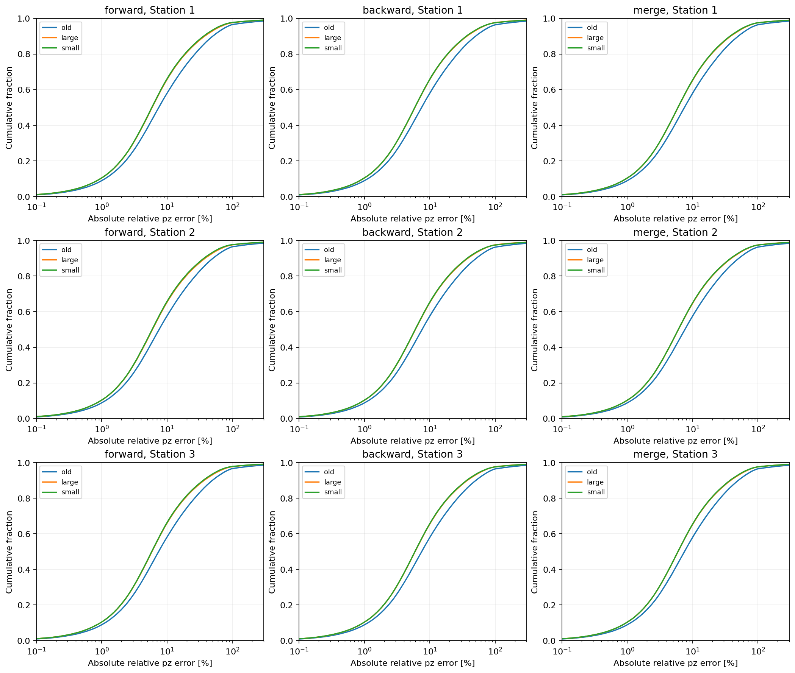
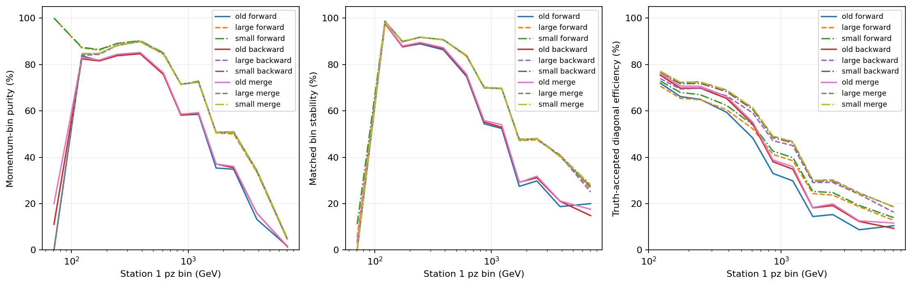
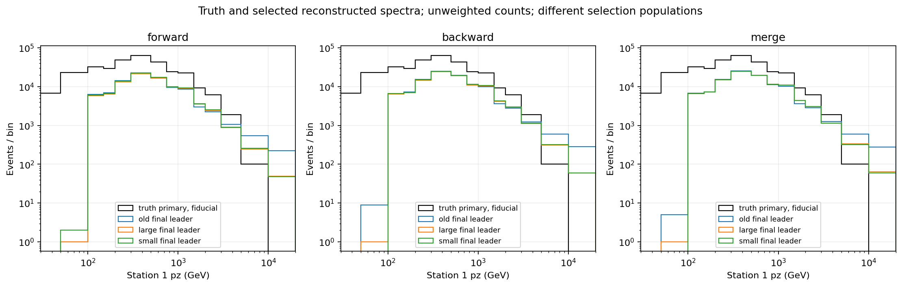

# 旧版与几何旋转两组 seed covariance：实测明细

全量：3,374,987 input events，383,670 truth-fiducial，140,132 truth-accepted proxy。

`old`：旋转前 d32b0ff3；`large`：latestMaster 7fd40df8，inflation [100,100,100,10000,100000]；`small`：同一旋转源码，inflation [100,100,100,100,1000]。两种旋转版本共用 strict rowmajor 材料图与 isolated smoothing，仅改变 θ、q/p 种子方差。

Station 1/2/3 动量参考为 SiHit 方向乘 HepMC 产生点动量模长，没有 G4 局部输运动量。相对误差无量纲；0.1 表示 10%。中位绝对误差表示 |reco/reference−1| 的中位数。正确 primary 指 barcode/PDG 对应主粒子且 hit purity≥0.7，不额外要求动量或电荷符号正确。

old / large 复用已验证全样本，small 新重建。所有共同输入 ID、truth、波形电荷、small 分片回读及实际材料 / covariance / isolation 设置已验证。nominal 排除 alternate run 200080。

## 真实主粒子与最终重建效率

| 版本 | 方法 | 阶段 | 通过 | 未通过 | 分母 | 效率 % |
| --- | --- | --- | --- | --- | --- | --- |
| old | forward | any_primary_raw | 123523 | 16609 | 140132 | 88.1476 |
| old | forward | any_primary_long | 107806 | 32326 | 140132 | 76.93175 |
| old | forward | any_primary_quality | 105335 | 34797 | 140132 | 75.16841 |
| old | forward | correct_leader | 107732 | 32400 | 140132 | 76.87894 |
| old | forward | final | 91270 | 48862 | 140132 | 65.13145 |
| old | forward | final_correct | 91163 | 48969 | 140132 | 65.05509 |
| old | backward | any_primary_raw | 124727 | 15405 | 140132 | 89.00679 |
| old | backward | any_primary_long | 120618 | 19514 | 140132 | 86.07456 |
| old | backward | any_primary_quality | 116148 | 23984 | 140132 | 82.88471 |
| old | backward | correct_leader | 120512 | 19620 | 140132 | 85.99892 |
| old | backward | final | 101356 | 38776 | 140132 | 72.32895 |
| old | backward | final_correct | 101149 | 38983 | 140132 | 72.18123 |
| old | merge | any_primary_raw | 125346 | 14786 | 140132 | 89.44852 |
| old | merge | any_primary_long | 121143 | 18989 | 140132 | 86.44921 |
| old | merge | any_primary_quality | 117190 | 22942 | 140132 | 83.62829 |
| old | merge | correct_leader | 121019 | 19113 | 140132 | 86.36072 |
| old | merge | final | 102273 | 37859 | 140132 | 72.98333 |
| old | merge | final_correct | 102066 | 38066 | 140132 | 72.83561 |
| large | forward | any_primary_raw | 122455 | 17677 | 140132 | 87.38547 |
| large | forward | any_primary_long | 104772 | 35360 | 140132 | 74.76665 |
| large | forward | any_primary_quality | 102051 | 38081 | 140132 | 72.82491 |
| large | forward | correct_leader | 104688 | 35444 | 140132 | 74.70671 |
| large | forward | final | 88539 | 51593 | 140132 | 63.18257 |
| large | forward | final_correct | 88422 | 51710 | 140132 | 63.09908 |
| large | backward | any_primary_raw | 123757 | 16375 | 140132 | 88.31459 |
| large | backward | any_primary_long | 117053 | 23079 | 140132 | 83.53053 |
| large | backward | any_primary_quality | 113334 | 26798 | 140132 | 80.8766 |
| large | backward | correct_leader | 116945 | 23187 | 140132 | 83.45346 |
| large | backward | final | 99084 | 41048 | 140132 | 70.70762 |
| large | backward | final_correct | 98840 | 41292 | 140132 | 70.5335 |
| large | merge | any_primary_raw | 125376 | 14756 | 140132 | 89.46993 |
| large | merge | any_primary_long | 120834 | 19298 | 140132 | 86.2287 |
| large | merge | any_primary_quality | 117616 | 22516 | 140132 | 83.93229 |
| large | merge | correct_leader | 120701 | 19431 | 140132 | 86.13379 |
| large | merge | final | 102807 | 37325 | 140132 | 73.3644 |
| large | merge | final_correct | 102576 | 37556 | 140132 | 73.19955 |
| small | forward | any_primary_raw | 123009 | 17123 | 140132 | 87.78081 |
| small | forward | any_primary_long | 107559 | 32573 | 140132 | 76.75549 |
| small | forward | any_primary_quality | 105284 | 34848 | 140132 | 75.13202 |
| small | forward | correct_leader | 107489 | 32643 | 140132 | 76.70553 |
| small | forward | final | 91359 | 48773 | 140132 | 65.19496 |
| small | forward | final_correct | 91254 | 48878 | 140132 | 65.12003 |
| small | backward | any_primary_raw | 124113 | 16019 | 140132 | 88.56864 |
| small | backward | any_primary_long | 119954 | 20178 | 140132 | 85.60072 |
| small | backward | any_primary_quality | 116396 | 23736 | 140132 | 83.06168 |
| small | backward | correct_leader | 119848 | 20284 | 140132 | 85.52508 |
| small | backward | final | 101710 | 38422 | 140132 | 72.58157 |
| small | backward | final_correct | 101493 | 38639 | 140132 | 72.42671 |
| small | merge | any_primary_raw | 125312 | 14820 | 140132 | 89.42426 |
| small | merge | any_primary_long | 120913 | 19219 | 140132 | 86.28507 |
| small | merge | any_primary_quality | 117602 | 22530 | 140132 | 83.9223 |
| small | merge | correct_leader | 120795 | 19337 | 140132 | 86.20087 |
| small | merge | final | 102739 | 37393 | 140132 | 73.31587 |
| small | merge | final_correct | 102525 | 37607 | 140132 | 73.16316 |

## 同事件最终通过与丢失

| 基线 | 对照 | 方法 | 阶段 | 基线通过 | 对照通过 | 丢失 | 新增 | 差值 pp | 95% 下限 | 95% 上限 | McNemar p |
| --- | --- | --- | --- | --- | --- | --- | --- | --- | --- | --- | --- |
| old | large | forward | final | 91270 | 88539 | 3478 | 747 | -1.948877 | -2.039217 | -1.858537 | 0 |
| old | large | forward | final_correct | 91163 | 88422 | 3500 | 759 | -1.956013 | -2.046716 | -1.86531 | 0 |
| old | large | backward | final | 101356 | 99084 | 4070 | 1798 | -1.621328 | -1.728135 | -1.514522 | 3.174489e-198 |
| old | large | backward | final_correct | 101149 | 98840 | 4085 | 1776 | -1.647732 | -1.754463 | -1.541001 | 4.151942e-205 |
| old | large | merge | final | 102273 | 102807 | 1070 | 1604 | 0.3810693 | 0.30877 | 0.4533686 | 4.566725e-25 |
| old | large | merge | final_correct | 102066 | 102576 | 1075 | 1585 | 0.3639426 | 0.2918305 | 0.4360546 | 4.19235e-23 |
| old | small | forward | final | 91270 | 91359 | 606 | 695 | 0.06351155 | 0.01306308 | 0.11396 | 0.01466622 |
| old | small | forward | final_correct | 91163 | 91254 | 613 | 704 | 0.06493877 | 0.01418108 | 0.1156965 | 0.01310887 |
| old | small | backward | final | 101356 | 101710 | 678 | 1032 | 0.252619 | 0.1947956 | 0.3104423 | 1.063962e-17 |
| old | small | backward | final_correct | 101149 | 101493 | 680 | 1024 | 0.2454828 | 0.1877602 | 0.3032054 | 7.60294e-17 |
| old | small | merge | final | 102273 | 102739 | 223 | 689 | 0.3325436 | 0.2903403 | 0.3747469 | 5.350076e-56 |
| old | small | merge | final_correct | 102066 | 102525 | 224 | 683 | 0.3275483 | 0.2854599 | 0.3696367 | 1.290139e-54 |
| large | small | forward | final | 88539 | 91359 | 193 | 3013 | 2.012388 | 1.933897 | 2.09088 | 0 |
| large | small | forward | final_correct | 88422 | 91254 | 195 | 3027 | 2.020952 | 1.942267 | 2.099636 | 0 |
| large | small | backward | final | 99084 | 101710 | 955 | 3581 | 1.873947 | 1.780259 | 1.967636 | 0 |
| large | small | backward | final_correct | 98840 | 101493 | 938 | 3591 | 1.893215 | 1.79961 | 1.98682 | 0 |
| large | small | merge | final | 102807 | 102739 | 983 | 915 | -0.04852568 | -0.1094602 | 0.0124088 | 0.1240517 |
| large | small | merge | final_correct | 102576 | 102525 | 969 | 918 | -0.03639426 | -0.09715213 | 0.02436362 | 0.2497159 |

## Nominal 最终效率

| 版本 | 方法 | 阶段 | 通过 | 分母 | 效率 % |
| --- | --- | --- | --- | --- | --- |
| old | forward | final | 77850 | 121425 | 64.11365 |
| old | forward | final_correct | 77752 | 121425 | 64.03294 |
| old | backward | final | 86755 | 121425 | 71.4474 |
| old | backward | final_correct | 86558 | 121425 | 71.28516 |
| old | merge | final | 87554 | 121425 | 72.10541 |
| old | merge | final_correct | 87358 | 121425 | 71.944 |
| large | forward | final | 75500 | 121425 | 62.1783 |
| large | forward | final_correct | 75392 | 121425 | 62.08936 |
| large | backward | final | 84846 | 121425 | 69.87523 |
| large | backward | final_correct | 84620 | 121425 | 69.68911 |
| large | merge | final | 88061 | 121425 | 72.52296 |
| large | merge | final_correct | 87846 | 121425 | 72.34589 |
| small | forward | final | 77917 | 121425 | 64.16883 |
| small | forward | final_correct | 77820 | 121425 | 64.08894 |
| small | backward | final | 87105 | 121425 | 71.73564 |
| small | backward | final_correct | 86900 | 121425 | 71.56681 |
| small | merge | final | 87974 | 121425 | 72.45131 |
| small | merge | final_correct | 87772 | 121425 | 72.28495 |

## 三者共同正确 leaders 的 Station 精度（不要求 final）

| 版本 | 方法 | 站 | 共同 pairs | 中位绝对误差 | 偏差中位数 | 中央 68% 半宽 | |误差|>50% |
| --- | --- | --- | --- | --- | --- | --- | --- |
| old | forward | 1 | 103991 | 0.05987042 | -0.01794604 | 0.1035639 | 6210 |
| large | forward | 1 | 103991 | 0.04562332 | -0.01565265 | 0.07137586 | 1581 |
| small | forward | 1 | 103991 | 0.045383 | -0.0156319 | 0.07092134 | 1489 |
| old | forward | 2 | 103928 | 0.06037926 | -0.01795749 | 0.1048319 | 6301 |
| large | forward | 2 | 103928 | 0.04601856 | -0.01573686 | 0.07237289 | 1715 |
| small | forward | 2 | 103928 | 0.04559435 | -0.01565454 | 0.07157691 | 1572 |
| old | forward | 3 | 103699 | 0.05996973 | -0.01797734 | 0.1036272 | 6178 |
| large | forward | 3 | 103699 | 0.04565985 | -0.01565649 | 0.07147839 | 1545 |
| small | forward | 3 | 103699 | 0.04545254 | -0.01566388 | 0.07107508 | 1475 |
| old | backward | 1 | 115109 | 0.06034298 | -0.01693142 | 0.1049034 | 6933 |
| large | backward | 1 | 115109 | 0.04637268 | -0.01526847 | 0.07327186 | 1830 |
| small | backward | 1 | 115109 | 0.04619794 | -0.01526201 | 0.07297563 | 1828 |
| old | backward | 2 | 115603 | 0.06111622 | -0.01699965 | 0.1067673 | 7301 |
| large | backward | 2 | 115603 | 0.04691391 | -0.01531237 | 0.07465277 | 2187 |
| small | backward | 2 | 115603 | 0.04665463 | -0.01524656 | 0.0740537 | 2109 |
| old | backward | 3 | 115565 | 0.0606226 | -0.017155 | 0.1056474 | 7212 |
| large | backward | 3 | 115565 | 0.04661383 | -0.01535153 | 0.07390926 | 2073 |
| small | backward | 3 | 115565 | 0.04644551 | -0.01535286 | 0.07347043 | 2030 |
| old | merge | 1 | 119121 | 0.05981224 | -0.01673959 | 0.1034742 | 6687 |
| large | merge | 1 | 119121 | 0.04626455 | -0.01517325 | 0.07309177 | 1887 |
| small | merge | 1 | 119121 | 0.04616054 | -0.01525109 | 0.07293506 | 1884 |
| old | merge | 2 | 119473 | 0.06046213 | -0.01679927 | 0.105174 | 7029 |
| large | merge | 2 | 119473 | 0.04667834 | -0.01527042 | 0.07413682 | 2131 |
| small | merge | 2 | 119473 | 0.04658286 | -0.01526685 | 0.07391714 | 2144 |
| old | merge | 3 | 119336 | 0.06011918 | -0.0169481 | 0.1041113 | 6895 |
| large | merge | 3 | 119336 | 0.0464769 | -0.01524652 | 0.07354669 | 2030 |
| small | merge | 3 | 119336 | 0.04639458 | -0.01532891 | 0.07334355 | 2014 |

## 三者共同最终正确轨迹的 Station 精度（truth-accepted）

| 版本 | 方法 | 站 | 共同 pairs | 中位绝对误差 | 偏差中位数 | 中央 68% 半宽 | |误差|>50% |
| --- | --- | --- | --- | --- | --- | --- | --- |
| old | forward | 1 | 87534 | 0.0574878 | -0.01634655 | 0.09937299 | 4649 |
| large | forward | 1 | 87534 | 0.04376966 | -0.01438634 | 0.06847053 | 946 |
| small | forward | 1 | 87534 | 0.0436074 | -0.01441753 | 0.06820568 | 931 |
| old | forward | 2 | 87493 | 0.05781137 | -0.01636957 | 0.1001068 | 4693 |
| large | forward | 2 | 87493 | 0.0439728 | -0.01444376 | 0.06902036 | 1009 |
| small | forward | 2 | 87493 | 0.04375492 | -0.01445204 | 0.06858854 | 966 |
| old | forward | 3 | 87494 | 0.05755002 | -0.01640314 | 0.09935148 | 4658 |
| large | forward | 3 | 87494 | 0.04381206 | -0.01445464 | 0.06854378 | 956 |
| small | forward | 3 | 87494 | 0.04365366 | -0.01446834 | 0.06826233 | 938 |
| old | backward | 1 | 96859 | 0.05784932 | -0.01527851 | 0.099851 | 5160 |
| large | backward | 1 | 96859 | 0.0443683 | -0.01402298 | 0.07031197 | 1134 |
| small | backward | 1 | 96859 | 0.04423815 | -0.01399342 | 0.07002996 | 1120 |
| old | backward | 2 | 96866 | 0.0582879 | -0.01530712 | 0.1007694 | 5250 |
| large | backward | 2 | 96866 | 0.04467913 | -0.0139909 | 0.07107256 | 1217 |
| small | backward | 2 | 96866 | 0.04448342 | -0.01396573 | 0.07064472 | 1180 |
| old | backward | 3 | 96893 | 0.0578242 | -0.01541103 | 0.09989545 | 5184 |
| large | backward | 3 | 96893 | 0.04446945 | -0.01408644 | 0.07053739 | 1156 |
| small | backward | 3 | 96893 | 0.04433358 | -0.01405224 | 0.07019814 | 1139 |
| old | merge | 1 | 100823 | 0.05740538 | -0.0151342 | 0.09883535 | 5052 |
| large | merge | 1 | 100823 | 0.04440661 | -0.01395884 | 0.07023675 | 1193 |
| small | merge | 1 | 100823 | 0.04430214 | -0.01398423 | 0.07007894 | 1171 |
| old | merge | 2 | 100821 | 0.05775036 | -0.01517055 | 0.0996672 | 5127 |
| large | merge | 2 | 100821 | 0.04463849 | -0.01396717 | 0.07089651 | 1268 |
| small | merge | 2 | 100821 | 0.04448183 | -0.01396978 | 0.07056399 | 1228 |
| old | merge | 3 | 100836 | 0.05744666 | -0.0152551 | 0.09890379 | 5075 |
| large | merge | 3 | 100836 | 0.04448459 | -0.01401171 | 0.0704218 | 1214 |
| small | merge | 3 | 100836 | 0.04436077 | -0.01401607 | 0.07020085 | 1181 |

## 三者共同最终正确事件的 S1 分动量精度

| 版本 | 方法 | 下限 GeV | 上限 GeV | 共同 pairs | 中位绝对误差 | 绝对误差 q95 | |误差|>50% |
| --- | --- | --- | --- | --- | --- | --- | --- |
| old | forward | 100 | 300 | 23677 | 0.02769847 | 0.111692 | 54 |
| large | forward | 100 | 300 | 23677 | 0.02440847 | 0.07998891 | 10 |
| small | forward | 100 | 300 | 23677 | 0.02440311 | 0.07986818 | 10 |
| old | forward | 300 | 1000 | 47688 | 0.0630449 | 0.3466602 | 1315 |
| large | forward | 300 | 1000 | 47688 | 0.04716543 | 0.1663693 | 158 |
| small | forward | 300 | 1000 | 47688 | 0.04700241 | 0.1660929 | 153 |
| old | forward | 1000 | 3000 | 15427 | 0.1944579 | 1.599396 | 2896 |
| large | forward | 1000 | 3000 | 15427 | 0.1149155 | 0.4535242 | 621 |
| small | forward | 1000 | 3000 | 15427 | 0.1147412 | 0.4496718 | 611 |
| old | forward | 3000 | inf | 742 | 0.5181894 | 7.966908 | 384 |
| large | forward | 3000 | inf | 742 | 0.2609004 | 1.870755 | 157 |
| small | forward | 3000 | inf | 742 | 0.2578501 | 1.865818 | 157 |
| old | backward | 100 | 300 | 25108 | 0.02762017 | 0.1073382 | 66 |
| large | backward | 100 | 300 | 25108 | 0.02431678 | 0.07950291 | 11 |
| small | backward | 100 | 300 | 25108 | 0.02432749 | 0.07958551 | 10 |
| old | backward | 300 | 1000 | 52818 | 0.06223272 | 0.3277344 | 1374 |
| large | backward | 300 | 1000 | 52818 | 0.04712856 | 0.1661583 | 161 |
| small | backward | 300 | 1000 | 52818 | 0.04697489 | 0.1657527 | 157 |
| old | backward | 1000 | 3000 | 17994 | 0.1919045 | 1.379946 | 3248 |
| large | backward | 1000 | 3000 | 17994 | 0.1153768 | 0.4579398 | 750 |
| small | backward | 1000 | 3000 | 17994 | 0.1151787 | 0.4549846 | 742 |
| old | backward | 3000 | inf | 939 | 0.5020973 | 6.522616 | 472 |
| large | backward | 3000 | inf | 939 | 0.2711758 | 2.216466 | 212 |
| small | backward | 3000 | inf | 939 | 0.2687223 | 2.274549 | 211 |
| old | merge | 100 | 300 | 26145 | 0.02729926 | 0.1052552 | 50 |
| large | merge | 100 | 300 | 26145 | 0.02429245 | 0.07968443 | 14 |
| small | merge | 100 | 300 | 26145 | 0.02429948 | 0.07953283 | 12 |
| old | merge | 300 | 1000 | 54916 | 0.06178987 | 0.3153192 | 1268 |
| large | merge | 300 | 1000 | 54916 | 0.04717106 | 0.1663451 | 173 |
| small | merge | 300 | 1000 | 54916 | 0.04706517 | 0.1657535 | 166 |
| old | merge | 1000 | 3000 | 18775 | 0.1877062 | 1.380918 | 3248 |
| large | merge | 1000 | 3000 | 18775 | 0.1151565 | 0.4587878 | 783 |
| small | merge | 1000 | 3000 | 18775 | 0.1150084 | 0.4551874 | 770 |
| old | merge | 3000 | inf | 987 | 0.4876819 | 7.141909 | 486 |
| large | merge | 3000 | inf | 987 | 0.2693596 | 2.270074 | 223 |
| small | merge | 3000 | inf | 987 | 0.2666616 | 2.31662 | 223 |

## 两两配对 S1 精度

| 基线 | 对照 | 方法 | pairs | 基线中位绝对误差 | 对照中位绝对误差 | 基线更近 | 对照更近 | sign p |
| --- | --- | --- | --- | --- | --- | --- | --- | --- |
| old | large | forward | 104053 | 0.05990433 | 0.04564511 | 39926 | 64127 | 0 |
| old | large | backward | 115222 | 0.06039504 | 0.04641732 | 44367 | 70855 | 0 |
| old | large | merge | 119205 | 0.0598639 | 0.04629086 | 46119 | 73086 | 0 |
| old | small | forward | 106982 | 0.0599638 | 0.04534623 | 40751 | 66229 | 0 |
| old | small | backward | 118756 | 0.06054381 | 0.04625201 | 45485 | 73271 | 0 |
| old | small | merge | 119983 | 0.05992877 | 0.04622742 | 46273 | 73710 | 0 |
| large | small | forward | 104311 | 0.04567266 | 0.04543594 | 45447 | 58665 | 0 |
| large | small | backward | 115541 | 0.04643227 | 0.04626098 | 50795 | 64551 | 0 |
| large | small | merge | 119386 | 0.04628696 | 0.04619251 | 52678 | 66516 | 0 |

## 最终正确 primary 的 S1 尾部（truth-accepted）

| 版本 | 方法 | pairs | 中位绝对误差 | q95 | q99 | 绝对误差均值 | 最大绝对误差 | >0.5 | >10 | >1000 |
| --- | --- | --- | --- | --- | --- | --- | --- | --- | --- | --- |
| old | forward | 91072 | 0.05764261 | 0.529458 | 2.202759 | 0.3122447 | 1947.182 | 4917 | 240 | 2 |
| large | forward | 88332 | 0.04386471 | 0.2356765 | 0.5272393 | 0.3304483 | 21687.45 | 977 | 22 | 1 |
| small | forward | 91164 | 0.04361686 | 0.2338319 | 0.5221426 | 0.5344596 | 41036.77 | 990 | 22 | 1 |
| old | backward | 101002 | 0.05813376 | 0.5315089 | 2.149107 | 0.3664495 | 5671.072 | 5486 | 246 | 3 |
| large | backward | 98683 | 0.04456683 | 0.2423323 | 0.5495718 | 6.209451 | 603212.9 | 1187 | 23 | 1 |
| small | backward | 101345 | 0.04439859 | 0.2412738 | 0.5467779 | 0.3506257 | 25747.68 | 1202 | 24 | 1 |
| old | merge | 101922 | 0.0574824 | 0.5047062 | 2.072571 | 0.3642328 | 5671.072 | 5153 | 234 | 4 |
| large | merge | 102424 | 0.04454271 | 0.2422715 | 0.5508398 | 5.986269 | 603212.9 | 1236 | 24 | 1 |
| small | merge | 102380 | 0.04437879 | 0.2410655 | 0.5433181 | 0.3479259 | 25747.68 | 1205 | 24 | 1 |

## 最终选择的 primary 身份纯度

| 版本 | 方法 | 最终 leaders | 正确 primary | 纯度 % |
| --- | --- | --- | --- | --- |
| old | forward | 92937 | 91763 | 98.73678 |
| old | backward | 103985 | 101823 | 97.92085 |
| old | merge | 104930 | 102749 | 97.92147 |
| large | forward | 90161 | 88979 | 98.68901 |
| large | backward | 101742 | 99479 | 97.77575 |
| large | merge | 105554 | 103243 | 97.8106 |
| small | forward | 93018 | 91831 | 98.7239 |
| small | backward | 104348 | 102139 | 97.88305 |
| small | merge | 105421 | 103182 | 97.87613 |

## 最终选择的数值与电荷符号

| 版本 | 方法 | 最终 leaders | 非有限 χ² | ndof≤0 | 非有限 pz | 正确 primary | 电荷符号错误 |
| --- | --- | --- | --- | --- | --- | --- | --- |
| old | forward | 92937 | 0 | 0 | 0 | 91763 | 1085 |
| old | backward | 103985 | 0 | 0 | 0 | 101823 | 1297 |
| old | merge | 104930 | 0 | 0 | 0 | 102749 | 1059 |
| large | forward | 90161 | 0 | 0 | 0 | 88979 | 34 |
| large | backward | 101742 | 0 | 0 | 0 | 99479 | 44 |
| large | merge | 105554 | 0 | 0 | 0 | 103243 | 45 |
| small | forward | 93018 | 0 | 0 | 0 | 91831 | 32 |
| small | backward | 104348 | 0 | 0 | 0 | 102139 | 46 |
| small | merge | 105421 | 0 | 0 | 0 | 103182 | 45 |

## 同事件最终正确轨迹的命中点与电荷变化

| 基线 | 对照 | 方法 | 共同事件 | 测量点减少 | 测量点相同 | 测量点增加 | 电荷符号不同 | 错→对 | 对→错 |
| --- | --- | --- | --- | --- | --- | --- | --- | --- | --- |
| old | large | forward | 87663 | 4150 | 82672 | 841 | 1004 | 994 | 10 |
| old | large | backward | 97064 | 4693 | 90880 | 1491 | 1188 | 1174 | 14 |
| old | large | merge | 100991 | 3206 | 96603 | 1182 | 1010 | 997 | 13 |
| old | small | forward | 90550 | 2104 | 87399 | 1047 | 1042 | 1034 | 8 |
| old | small | backward | 100469 | 2779 | 95922 | 1768 | 1237 | 1221 | 16 |
| old | small | merge | 101842 | 1066 | 99362 | 1414 | 1022 | 1009 | 13 |
| large | small | forward | 88227 | 417 | 85042 | 2768 | 2 | 2 | 0 |
| large | small | backward | 97902 | 479 | 94576 | 2847 | 2 | 0 | 2 |
| large | small | merge | 101607 | 404 | 98365 | 2838 | 4 | 1 | 3 |

## Merge 三站最终动量 bin 指标

| 版本 | 站 | 下限 GeV | 上限 GeV | truth 分母 | reco 分母 | bin purity % | stability % | 对角效率 % |
| --- | --- | --- | --- | --- | --- | --- | --- | --- |
| old | 1 | 100 | 150 | 7025 | 6680 | 82.9491 | 97.86295 | 76.22776 |
| old | 1 | 150 | 200 | 8310 | 7305 | 81.94387 | 87.97766 | 70.67389 |
| old | 1 | 200 | 300 | 18052 | 15287 | 84.38543 | 89.52117 | 70.61267 |
| old | 1 | 300 | 500 | 32117 | 25074 | 85.19183 | 87.25542 | 66.21104 |
| old | 1 | 500 | 750 | 26897 | 19398 | 76.38416 | 75.85624 | 55.02472 |
| old | 1 | 750 | 1000 | 16723 | 11088 | 58.58586 | 55.77881 | 38.82677 |
| old | 1 | 1000 | 1500 | 16873 | 10231 | 59.23175 | 54.03959 | 35.89166 |
| old | 1 | 1500 | 2000 | 7333 | 3625 | 37.10345 | 29.10625 | 18.34174 |
| old | 1 | 2000 | 3000 | 5125 | 2821 | 36.05105 | 31.83099 | 19.8439 |
| old | 1 | 3000 | 5000 | 1591 | 1267 | 15.78532 | 21.11932 | 12.57071 |
| old | 1 | 5000 | 10000 | 86 | 600 | 1.666667 | 17.54386 | 11.62791 |
| old | 1 | 10000 | inf | 0 | 523 | 0 | nan | nan |
| old | 2 | 100 | 150 | 7025 | 6516 | 85.05218 | 97.8979 | 76.24199 |
| old | 2 | 150 | 200 | 8310 | 7222 | 82.84409 | 87.95942 | 70.66185 |
| old | 2 | 200 | 300 | 18052 | 15172 | 84.90641 | 89.38385 | 70.50742 |
| old | 2 | 300 | 500 | 32117 | 25034 | 85.25206 | 87.13154 | 66.14877 |
| old | 2 | 500 | 750 | 26897 | 19376 | 76.26961 | 75.6837 | 54.87973 |
| old | 2 | 750 | 1000 | 16723 | 11076 | 58.48682 | 55.60038 | 38.71913 |
| old | 2 | 1000 | 1500 | 16873 | 10203 | 59.18847 | 53.85233 | 35.77313 |
| old | 2 | 1500 | 2000 | 7333 | 3602 | 37.03498 | 28.86196 | 18.19174 |
| old | 2 | 2000 | 3000 | 5125 | 2834 | 35.8151 | 31.74851 | 19.80488 |
| old | 2 | 3000 | 5000 | 1591 | 1285 | 15.95331 | 21.60169 | 12.88498 |
| old | 2 | 5000 | 10000 | 86 | 615 | 1.626016 | 17.54386 | 11.62791 |
| old | 2 | 10000 | inf | 0 | 524 | 0 | nan | nan |
| old | 3 | 100 | 150 | 7025 | 6403 | 86.64688 | 97.88285 | 76.31317 |
| old | 3 | 150 | 200 | 8310 | 7171 | 83.503 | 88.03293 | 70.69795 |
| old | 3 | 200 | 300 | 18052 | 15112 | 85.28984 | 89.45725 | 70.55174 |
| old | 3 | 300 | 500 | 32116 | 24998 | 85.49084 | 87.25706 | 66.24424 |
| old | 3 | 500 | 750 | 26898 | 19379 | 76.43325 | 75.85006 | 55.00781 |
| old | 3 | 750 | 1000 | 16723 | 11057 | 58.65967 | 55.69772 | 38.76099 |
| old | 3 | 1000 | 1500 | 16873 | 10209 | 59.33 | 54.02729 | 35.87388 |
| old | 3 | 1500 | 2000 | 7333 | 3606 | 37.13256 | 28.94509 | 18.25992 |
| old | 3 | 2000 | 3000 | 5125 | 2832 | 35.87571 | 31.75992 | 19.82439 |
| old | 3 | 3000 | 5000 | 1591 | 1269 | 16.15445 | 21.62447 | 12.88498 |
| old | 3 | 5000 | 10000 | 86 | 597 | 1.675042 | 17.54386 | 11.62791 |
| old | 3 | 10000 | inf | 0 | 526 | 0 | nan | nan |
| large | 1 | 100 | 150 | 7025 | 6629 | 84.2661 | 98.46642 | 76.86833 |
| large | 1 | 150 | 200 | 8310 | 7228 | 84.62922 | 89.87658 | 72.19013 |
| large | 1 | 200 | 300 | 18052 | 15020 | 88.16911 | 91.80589 | 72.48504 |
| large | 1 | 300 | 500 | 32117 | 24733 | 89.94057 | 90.60362 | 68.96348 |
| large | 1 | 500 | 750 | 26897 | 19489 | 84.56565 | 83.9283 | 61.20385 |
| large | 1 | 750 | 1000 | 16723 | 11483 | 71.46216 | 69.97527 | 49.0522 |
| large | 1 | 1000 | 1500 | 16873 | 10905 | 72.37964 | 69.64002 | 46.75517 |
| large | 1 | 1500 | 2000 | 7333 | 4357 | 50.63117 | 47.3289 | 30.05591 |
| large | 1 | 2000 | 3000 | 5125 | 3055 | 50.7365 | 48.10677 | 30.2439 |
| large | 1 | 3000 | 5000 | 1591 | 1140 | 34.38596 | 40.24641 | 24.63859 |
| large | 1 | 5000 | 10000 | 86 | 333 | 4.804805 | 27.11864 | 18.60465 |
| large | 1 | 10000 | inf | 0 | 106 | 0 | nan | nan |
| large | 2 | 100 | 150 | 7025 | 6452 | 86.36082 | 98.32363 | 76.66904 |
| large | 2 | 150 | 200 | 8310 | 7145 | 85.52834 | 89.80162 | 72.11793 |
| large | 2 | 200 | 300 | 18052 | 14912 | 88.69367 | 91.68169 | 72.38533 |
| large | 2 | 300 | 500 | 32117 | 24692 | 90.03321 | 90.49131 | 68.91366 |
| large | 2 | 500 | 750 | 26897 | 19443 | 84.56 | 83.73313 | 61.05514 |
| large | 2 | 750 | 1000 | 16723 | 11483 | 71.25316 | 69.72305 | 48.90869 |
| large | 2 | 1000 | 1500 | 16873 | 10863 | 72.24524 | 69.23688 | 46.4944 |
| large | 2 | 1500 | 2000 | 7333 | 4370 | 50.22883 | 47.04243 | 29.9059 |
| large | 2 | 2000 | 3000 | 5125 | 3066 | 50.35877 | 47.87597 | 30.12683 |
| large | 2 | 3000 | 5000 | 1591 | 1149 | 33.59443 | 39.58974 | 24.26147 |
| large | 2 | 5000 | 10000 | 86 | 336 | 4.761905 | 27.11864 | 18.60465 |
| large | 2 | 10000 | inf | 0 | 115 | 0 | nan | nan |
| large | 3 | 100 | 150 | 7025 | 6344 | 88.09899 | 98.41521 | 76.8968 |
| large | 3 | 150 | 200 | 8310 | 7073 | 86.41312 | 89.82951 | 72.12996 |
| large | 3 | 200 | 300 | 18052 | 14859 | 89.05714 | 91.75565 | 72.42965 |
| large | 3 | 300 | 500 | 32116 | 24641 | 90.28854 | 90.57526 | 68.97497 |
| large | 3 | 500 | 750 | 26898 | 19426 | 84.76269 | 83.86472 | 61.14581 |
| large | 3 | 750 | 1000 | 16723 | 11472 | 71.46095 | 69.92494 | 49.00437 |
| large | 3 | 1000 | 1500 | 16873 | 10885 | 72.42076 | 69.55179 | 46.6959 |
| large | 3 | 1500 | 2000 | 7333 | 4357 | 50.53936 | 47.17224 | 30.00136 |
| large | 3 | 2000 | 3000 | 5125 | 3059 | 50.60477 | 47.97025 | 30.20488 |
| large | 3 | 3000 | 5000 | 1591 | 1143 | 34.12073 | 40.08222 | 24.51288 |
| large | 3 | 5000 | 10000 | 86 | 331 | 4.531722 | 25.42373 | 17.44186 |
| large | 3 | 10000 | inf | 0 | 107 | 0 | nan | nan |
| small | 1 | 100 | 150 | 7025 | 6617 | 84.72117 | 98.48911 | 77.15302 |
| small | 1 | 150 | 200 | 8310 | 7230 | 84.82711 | 89.90032 | 72.39471 |
| small | 1 | 200 | 300 | 18052 | 15015 | 88.21845 | 91.8076 | 72.52382 |
| small | 1 | 300 | 500 | 32117 | 24745 | 89.96969 | 90.68062 | 69.03198 |
| small | 1 | 500 | 750 | 26897 | 19458 | 84.67468 | 83.95842 | 61.18154 |
| small | 1 | 750 | 1000 | 16723 | 11459 | 71.57693 | 69.98294 | 49.02828 |
| small | 1 | 1000 | 1500 | 16873 | 10885 | 72.41158 | 69.77074 | 46.68998 |
| small | 1 | 1500 | 2000 | 7333 | 4353 | 50.70067 | 47.43176 | 30.06955 |
| small | 1 | 2000 | 3000 | 5125 | 3039 | 50.80619 | 48.05478 | 30.12683 |
| small | 1 | 3000 | 5000 | 1591 | 1136 | 34.15493 | 40.41667 | 24.38718 |
| small | 1 | 5000 | 10000 | 86 | 323 | 4.95356 | 28.07018 | 18.60465 |
| small | 1 | 10000 | inf | 0 | 103 | 0 | nan | nan |
| small | 2 | 100 | 150 | 7025 | 6452 | 86.7483 | 98.41744 | 77.02491 |
| small | 2 | 150 | 200 | 8310 | 7152 | 85.71029 | 89.8827 | 72.3586 |
| small | 2 | 200 | 300 | 18052 | 14904 | 88.76141 | 91.68342 | 72.42411 |
| small | 2 | 300 | 500 | 32117 | 24694 | 90.09071 | 90.56012 | 68.97593 |
| small | 2 | 500 | 750 | 26897 | 19435 | 84.63082 | 83.83282 | 61.07744 |
| small | 2 | 750 | 1000 | 16723 | 11436 | 71.49353 | 69.71945 | 48.87281 |
| small | 2 | 1000 | 1500 | 16873 | 10856 | 72.32867 | 69.50518 | 46.51811 |
| small | 2 | 1500 | 2000 | 7333 | 4355 | 50.4248 | 47.16495 | 29.91954 |
| small | 2 | 2000 | 3000 | 5125 | 3051 | 50.50803 | 47.91667 | 30.06829 |
| small | 2 | 3000 | 5000 | 1591 | 1147 | 33.39146 | 39.81289 | 24.07291 |
| small | 2 | 5000 | 10000 | 86 | 327 | 4.892966 | 28.07018 | 18.60465 |
| small | 2 | 10000 | inf | 0 | 109 | 0 | nan | nan |
| small | 3 | 100 | 150 | 7025 | 6346 | 88.40214 | 98.4556 | 77.19573 |
| small | 3 | 150 | 200 | 8310 | 7087 | 86.55284 | 89.92816 | 72.40674 |
| small | 3 | 200 | 300 | 18052 | 14850 | 89.15825 | 91.7851 | 72.49058 |
| small | 3 | 300 | 500 | 32116 | 24651 | 90.33305 | 90.66406 | 69.04658 |
| small | 3 | 500 | 750 | 26898 | 19398 | 84.86442 | 83.91273 | 61.12722 |
| small | 3 | 750 | 1000 | 16723 | 11441 | 71.58465 | 69.89844 | 48.95653 |
| small | 3 | 1000 | 1500 | 16873 | 10864 | 72.43189 | 69.67416 | 46.61293 |
| small | 3 | 1500 | 2000 | 7333 | 4353 | 50.5858 | 47.26336 | 30.00136 |
| small | 3 | 2000 | 3000 | 5125 | 3045 | 50.60755 | 47.88689 | 30.06829 |
| small | 3 | 3000 | 5000 | 1591 | 1135 | 33.9207 | 40.10417 | 24.19862 |
| small | 3 | 5000 | 10000 | 86 | 323 | 4.643963 | 26.31579 | 17.44186 |
| small | 3 | 10000 | inf | 0 | 105 | 0 | nan | nan |

## Duplicates（同 barcode，hit purity≥0.7）

| 版本 | 方法 | 质量 | 重复事件 | 多余 tracks | 事件分母 |
| --- | --- | --- | --- | --- | --- |
| old | forward | long | 3 | 3 | 140132 |
| old | forward | quality | 1 | 1 | 140132 |
| old | backward | long | 6 | 6 | 140132 |
| old | backward | quality | 1 | 1 | 140132 |
| old | merge | long | 66 | 66 | 140132 |
| old | merge | quality | 2 | 2 | 140132 |
| large | forward | long | 0 | 0 | 140132 |
| large | forward | quality | 0 | 0 | 140132 |
| large | backward | long | 1 | 1 | 140132 |
| large | backward | quality | 0 | 0 | 140132 |
| large | merge | long | 70 | 70 | 140132 |
| large | merge | quality | 0 | 0 | 140132 |
| small | forward | long | 2 | 2 | 140132 |
| small | forward | quality | 0 | 0 | 140132 |
| small | backward | long | 3 | 3 | 140132 |
| small | backward | quality | 0 | 0 | 140132 |
| small | merge | long | 38 | 38 | 140132 |
| small | merge | quality | 0 | 0 | 140132 |

## Primary raw / long / quality 重复

| 版本 | 方法 | 质量 | 匹配事件 | 重复事件 | 多余 tracks |
| --- | --- | --- | --- | --- | --- |
| old | forward | raw | 123523 | 2 | 2 |
| old | forward | long | 107806 | 1 | 1 |
| old | forward | quality | 105335 | 0 | 0 |
| old | backward | raw | 124727 | 7 | 7 |
| old | backward | long | 120618 | 4 | 4 |
| old | backward | quality | 116148 | 1 | 1 |
| old | merge | raw | 125346 | 4136 | 4140 |
| old | merge | long | 121143 | 60 | 60 |
| old | merge | quality | 117190 | 1 | 1 |
| large | forward | raw | 122455 | 1 | 1 |
| large | forward | long | 104772 | 0 | 0 |
| large | forward | quality | 102051 | 0 | 0 |
| large | backward | raw | 123757 | 13 | 13 |
| large | backward | long | 117053 | 1 | 1 |
| large | backward | quality | 113334 | 0 | 0 |
| large | merge | raw | 125376 | 7747 | 7747 |
| large | merge | long | 120834 | 69 | 69 |
| large | merge | quality | 117616 | 0 | 0 |
| small | forward | raw | 123009 | 2 | 2 |
| small | forward | long | 107559 | 1 | 1 |
| small | forward | quality | 105284 | 0 | 0 |
| small | backward | raw | 124113 | 6 | 6 |
| small | backward | long | 119954 | 2 | 2 |
| small | backward | quality | 116396 | 0 | 0 |
| small | merge | raw | 125312 | 4429 | 4431 |
| small | merge | long | 120913 | 35 | 35 |
| small | merge | quality | 117602 | 0 | 0 |

## 两两版本的损失分类

| 基线 | 对照 | 方法 | 迁移 | 类别 | 事件 | 总迁移 |
| --- | --- | --- | --- | --- | --- | --- |
| old | large | forward | lost | both_correct_leaders | 634 | 3478 |
| old | large | forward | lost | leader_changed_or_low_purity | 9 | 3478 |
| old | large | forward | lost | no_primary_raw | 328 | 3478 |
| old | large | forward | lost | primary_raw_only | 2502 | 3478 |
| old | large | forward | lost | source_wrong_or_low_purity | 5 | 3478 |
| old | large | forward | gained | both_correct_leaders | 397 | 747 |
| old | large | forward | gained | leader_changed_or_low_purity | 4 | 747 |
| old | large | forward | gained | no_primary_raw | 69 | 747 |
| old | large | forward | gained | primary_raw_only | 270 | 747 |
| old | large | forward | gained | source_wrong_or_low_purity | 7 | 747 |
| old | large | backward | lost | both_correct_leaders | 774 | 4070 |
| old | large | backward | lost | leader_changed_or_low_purity | 5 | 4070 |
| old | large | backward | lost | no_primary_raw | 465 | 4070 |
| old | large | backward | lost | primary_raw_only | 2809 | 4070 |
| old | large | backward | lost | source_wrong_or_low_purity | 17 | 4070 |
| old | large | backward | gained | both_correct_leaders | 1100 | 1798 |
| old | large | backward | gained | leader_changed_or_low_purity | 9 | 1798 |
| old | large | backward | gained | no_primary_raw | 138 | 1798 |
| old | large | backward | gained | primary_raw_only | 506 | 1798 |
| old | large | backward | gained | source_wrong_or_low_purity | 45 | 1798 |
| old | large | merge | lost | both_correct_leaders | 332 | 1070 |
| old | large | merge | lost | leader_changed_or_low_purity | 11 | 1070 |
| old | large | merge | lost | no_primary_raw | 66 | 1070 |
| old | large | merge | lost | primary_raw_only | 643 | 1070 |
| old | large | merge | lost | source_wrong_or_low_purity | 18 | 1070 |
| old | large | merge | gained | both_correct_leaders | 992 | 1604 |
| old | large | merge | gained | leader_changed_or_low_purity | 13 | 1604 |
| old | large | merge | gained | no_primary_raw | 144 | 1604 |
| old | large | merge | gained | primary_raw_only | 408 | 1604 |
| old | large | merge | gained | source_wrong_or_low_purity | 47 | 1604 |
| old | small | forward | lost | both_correct_leaders | 233 | 606 |
| old | small | forward | lost | leader_changed_or_low_purity | 2 | 606 |
| old | small | forward | lost | no_primary_raw | 148 | 606 |
| old | small | forward | lost | primary_raw_only | 220 | 606 |
| old | small | forward | lost | source_wrong_or_low_purity | 3 | 606 |
| old | small | forward | gained | both_correct_leaders | 398 | 695 |
| old | small | forward | gained | leader_changed_or_low_purity | 7 | 695 |
| old | small | forward | gained | no_primary_raw | 14 | 695 |
| old | small | forward | gained | primary_raw_only | 272 | 695 |
| old | small | forward | gained | source_wrong_or_low_purity | 4 | 695 |
| old | small | backward | lost | both_correct_leaders | 277 | 678 |
| old | small | backward | lost | leader_changed_or_low_purity | 6 | 678 |
| old | small | backward | lost | no_primary_raw | 160 | 678 |
| old | small | backward | lost | primary_raw_only | 225 | 678 |
| old | small | backward | lost | source_wrong_or_low_purity | 10 | 678 |
| old | small | backward | gained | both_correct_leaders | 700 | 1032 |
| old | small | backward | gained | leader_changed_or_low_purity | 7 | 1032 |
| old | small | backward | gained | no_primary_raw | 36 | 1032 |
| old | small | backward | gained | primary_raw_only | 271 | 1032 |
| old | small | backward | gained | source_wrong_or_low_purity | 18 | 1032 |
| old | small | merge | lost | both_correct_leaders | 122 | 223 |
| old | small | merge | lost | leader_changed_or_low_purity | 8 | 223 |
| old | small | merge | lost | no_primary_raw | 14 | 223 |
| old | small | merge | lost | primary_raw_only | 67 | 223 |
| old | small | merge | lost | source_wrong_or_low_purity | 12 | 223 |
| old | small | merge | gained | both_correct_leaders | 531 | 689 |
| old | small | merge | gained | leader_changed_or_low_purity | 11 | 689 |
| old | small | merge | gained | no_primary_raw | 23 | 689 |
| old | small | merge | gained | primary_raw_only | 106 | 689 |
| old | small | merge | gained | source_wrong_or_low_purity | 18 | 689 |
| large | small | forward | lost | both_correct_leaders | 62 | 193 |
| large | small | forward | lost | leader_changed_or_low_purity | 1 | 193 |
| large | small | forward | lost | no_primary_raw | 66 | 193 |
| large | small | forward | lost | primary_raw_only | 59 | 193 |
| large | small | forward | lost | source_wrong_or_low_purity | 5 | 193 |
| large | small | forward | gained | both_correct_leaders | 436 | 3013 |
| large | small | forward | gained | leader_changed_or_low_purity | 10 | 3013 |
| large | small | forward | gained | no_primary_raw | 195 | 3013 |
| large | small | forward | gained | primary_raw_only | 2370 | 3013 |
| large | small | forward | gained | source_wrong_or_low_purity | 2 | 3013 |
| large | small | backward | lost | both_correct_leaders | 495 | 955 |
| large | small | backward | lost | leader_changed_or_low_purity | 6 | 955 |
| large | small | backward | lost | no_primary_raw | 107 | 955 |
| large | small | backward | lost | primary_raw_only | 315 | 955 |
| large | small | backward | lost | source_wrong_or_low_purity | 32 | 955 |
| large | small | backward | gained | both_correct_leaders | 553 | 3581 |
| large | small | backward | gained | leader_changed_or_low_purity | 3 | 3581 |
| large | small | backward | gained | no_primary_raw | 328 | 3581 |
| large | small | backward | gained | primary_raw_only | 2687 | 3581 |
| large | small | backward | gained | source_wrong_or_low_purity | 10 | 3581 |
| large | small | merge | lost | both_correct_leaders | 509 | 983 |
| large | small | merge | lost | leader_changed_or_low_purity | 7 | 983 |
| large | small | merge | lost | no_primary_raw | 127 | 983 |
| large | small | merge | lost | primary_raw_only | 307 | 983 |
| large | small | merge | lost | source_wrong_or_low_purity | 33 | 983 |
| large | small | merge | gained | both_correct_leaders | 235 | 915 |
| large | small | merge | gained | leader_changed_or_low_purity | 10 | 915 |
| large | small | merge | gained | no_primary_raw | 62 | 915 |
| large | small | merge | gained | primary_raw_only | 599 | 915 |
| large | small | merge | gained | source_wrong_or_low_purity | 9 | 915 |

## truth 可通过但 reco 首先失败的位置

| 版本 | 方法 | 首个失败 cut | 事件 | truth 分母 |
| --- | --- | --- | --- | --- |
| old | forward | At least one long track | 31705 | 140132 |
| old | forward | Veto20 and Veto21 charge > 40 pC | 0 | 140132 |
| old | forward | Timing Station Charge > 20 pC | 45 | 140132 |
| old | forward | Preshower Charge > 2.5 pC | 1 | 140132 |
| old | forward | Track pz > 100 GeV | 1219 | 140132 |
| old | forward | Leading track has at >= 7 layers | 415 | 140132 |
| old | forward | Track nDoF >= 9 | 1874 | 140132 |
| old | forward | Leading track has chi2/ndof < 15 | 45 | 140132 |
| old | forward | Track R at max radius < 95 mm | 450 | 140132 |
| old | forward | Track R at IFT < 95 mm | 1006 | 140132 |
| old | forward | Track rVetoNu < 120 mm | 39 | 140132 |
| old | forward | Leading track theta < 25 mrad | 35 | 140132 |
| old | forward | VetoNu0 reduced charge < 30 pC | 8249 | 140132 |
| old | forward | VetoNu1 reduced charge < 30 pC | 3779 | 140132 |
| old | backward | At least one long track | 17961 | 140132 |
| old | backward | Veto20 and Veto21 charge > 40 pC | 0 | 140132 |
| old | backward | Timing Station Charge > 20 pC | 1 | 140132 |
| old | backward | Preshower Charge > 2.5 pC | 1 | 140132 |
| old | backward | Track pz > 100 GeV | 1816 | 140132 |
| old | backward | Leading track has at >= 7 layers | 966 | 140132 |
| old | backward | Track nDoF >= 9 | 3612 | 140132 |
| old | backward | Leading track has chi2/ndof < 15 | 34 | 140132 |
| old | backward | Track R at max radius < 95 mm | 520 | 140132 |
| old | backward | Track R at IFT < 95 mm | 1202 | 140132 |
| old | backward | Track rVetoNu < 120 mm | 69 | 140132 |
| old | backward | Leading track theta < 25 mrad | 39 | 140132 |
| old | backward | VetoNu0 reduced charge < 30 pC | 8567 | 140132 |
| old | backward | VetoNu1 reduced charge < 30 pC | 3988 | 140132 |
| old | merge | At least one long track | 17360 | 140132 |
| old | merge | Veto20 and Veto21 charge > 40 pC | 0 | 140132 |
| old | merge | Timing Station Charge > 20 pC | 23 | 140132 |
| old | merge | Preshower Charge > 2.5 pC | 1 | 140132 |
| old | merge | Track pz > 100 GeV | 1774 | 140132 |
| old | merge | Leading track has at >= 7 layers | 899 | 140132 |
| old | merge | Track nDoF >= 9 | 3245 | 140132 |
| old | merge | Leading track has chi2/ndof < 15 | 20 | 140132 |
| old | merge | Track R at max radius < 95 mm | 536 | 140132 |
| old | merge | Track R at IFT < 95 mm | 1226 | 140132 |
| old | merge | Track rVetoNu < 120 mm | 69 | 140132 |
| old | merge | Leading track theta < 25 mrad | 39 | 140132 |
| old | merge | VetoNu0 reduced charge < 30 pC | 8646 | 140132 |
| old | merge | VetoNu1 reduced charge < 30 pC | 4021 | 140132 |
| large | forward | At least one long track | 34540 | 140132 |
| large | forward | Veto20 and Veto21 charge > 40 pC | 0 | 140132 |
| large | forward | Timing Station Charge > 20 pC | 48 | 140132 |
| large | forward | Preshower Charge > 2.5 pC | 1 | 140132 |
| large | forward | Track pz > 100 GeV | 1237 | 140132 |
| large | forward | Leading track has at >= 7 layers | 522 | 140132 |
| large | forward | Track nDoF >= 9 | 2076 | 140132 |
| large | forward | Leading track has chi2/ndof < 15 | 0 | 140132 |
| large | forward | Track R at max radius < 95 mm | 453 | 140132 |
| large | forward | Track R at IFT < 95 mm | 1003 | 140132 |
| large | forward | Track rVetoNu < 120 mm | 40 | 140132 |
| large | forward | Leading track theta < 25 mrad | 32 | 140132 |
| large | forward | VetoNu0 reduced charge < 30 pC | 7988 | 140132 |
| large | forward | VetoNu1 reduced charge < 30 pC | 3653 | 140132 |
| large | backward | At least one long track | 20798 | 140132 |
| large | backward | Veto20 and Veto21 charge > 40 pC | 0 | 140132 |
| large | backward | Timing Station Charge > 20 pC | 8 | 140132 |
| large | backward | Preshower Charge > 2.5 pC | 1 | 140132 |
| large | backward | Track pz > 100 GeV | 2739 | 140132 |
| large | backward | Leading track has at >= 7 layers | 711 | 140132 |
| large | backward | Track nDoF >= 9 | 2802 | 140132 |
| large | backward | Leading track has chi2/ndof < 15 | 3 | 140132 |
| large | backward | Track R at max radius < 95 mm | 511 | 140132 |
| large | backward | Track R at IFT < 95 mm | 1207 | 140132 |
| large | backward | Track rVetoNu < 120 mm | 69 | 140132 |
| large | backward | Leading track theta < 25 mrad | 38 | 140132 |
| large | backward | VetoNu0 reduced charge < 30 pC | 8305 | 140132 |
| large | backward | VetoNu1 reduced charge < 30 pC | 3856 | 140132 |
| large | merge | At least one long track | 17064 | 140132 |
| large | merge | Veto20 and Veto21 charge > 40 pC | 0 | 140132 |
| large | merge | Timing Station Charge > 20 pC | 29 | 140132 |
| large | merge | Preshower Charge > 2.5 pC | 1 | 140132 |
| large | merge | Track pz > 100 GeV | 2686 | 140132 |
| large | merge | Leading track has at >= 7 layers | 588 | 140132 |
| large | merge | Track nDoF >= 9 | 2444 | 140132 |
| large | merge | Leading track has chi2/ndof < 15 | 3 | 140132 |
| large | merge | Track R at max radius < 95 mm | 538 | 140132 |
| large | merge | Track R at IFT < 95 mm | 1234 | 140132 |
| large | merge | Track rVetoNu < 120 mm | 73 | 140132 |
| large | merge | Leading track theta < 25 mrad | 37 | 140132 |
| large | merge | VetoNu0 reduced charge < 30 pC | 8616 | 140132 |
| large | merge | VetoNu1 reduced charge < 30 pC | 4012 | 140132 |
| small | forward | At least one long track | 31965 | 140132 |
| small | forward | Veto20 and Veto21 charge > 40 pC | 0 | 140132 |
| small | forward | Timing Station Charge > 20 pC | 37 | 140132 |
| small | forward | Preshower Charge > 2.5 pC | 1 | 140132 |
| small | forward | Track pz > 100 GeV | 965 | 140132 |
| small | forward | Leading track has at >= 7 layers | 450 | 140132 |
| small | forward | Track nDoF >= 9 | 1789 | 140132 |
| small | forward | Leading track has chi2/ndof < 15 | 0 | 140132 |
| small | forward | Track R at max radius < 95 mm | 455 | 140132 |
| small | forward | Track R at IFT < 95 mm | 1018 | 140132 |
| small | forward | Track rVetoNu < 120 mm | 39 | 140132 |
| small | forward | Leading track theta < 25 mrad | 34 | 140132 |
| small | forward | VetoNu0 reduced charge < 30 pC | 8237 | 140132 |
| small | forward | VetoNu1 reduced charge < 30 pC | 3783 | 140132 |
| small | backward | At least one long track | 18925 | 140132 |
| small | backward | Veto20 and Veto21 charge > 40 pC | 0 | 140132 |
| small | backward | Timing Station Charge > 20 pC | 4 | 140132 |
| small | backward | Preshower Charge > 2.5 pC | 1 | 140132 |
| small | backward | Track pz > 100 GeV | 1403 | 140132 |
| small | backward | Leading track has at >= 7 layers | 765 | 140132 |
| small | backward | Track nDoF >= 9 | 2932 | 140132 |
| small | backward | Leading track has chi2/ndof < 15 | 1 | 140132 |
| small | backward | Track R at max radius < 95 mm | 513 | 140132 |
| small | backward | Track R at IFT < 95 mm | 1236 | 140132 |
| small | backward | Track rVetoNu < 120 mm | 67 | 140132 |
| small | backward | Leading track theta < 25 mrad | 38 | 140132 |
| small | backward | VetoNu0 reduced charge < 30 pC | 8552 | 140132 |
| small | backward | VetoNu1 reduced charge < 30 pC | 3985 | 140132 |
| small | merge | At least one long track | 17890 | 140132 |
| small | merge | Veto20 and Veto21 charge > 40 pC | 0 | 140132 |
| small | merge | Timing Station Charge > 20 pC | 22 | 140132 |
| small | merge | Preshower Charge > 2.5 pC | 1 | 140132 |
| small | merge | Track pz > 100 GeV | 1454 | 140132 |
| small | merge | Leading track has at >= 7 layers | 708 | 140132 |
| small | merge | Track nDoF >= 9 | 2754 | 140132 |
| small | merge | Leading track has chi2/ndof < 15 | 1 | 140132 |
| small | merge | Track R at max radius < 95 mm | 534 | 140132 |
| small | merge | Track R at IFT < 95 mm | 1247 | 140132 |
| small | merge | Track rVetoNu < 120 mm | 69 | 140132 |
| small | merge | Leading track theta < 25 mrad | 38 | 140132 |
| small | merge | VetoNu0 reduced charge < 30 pC | 8651 | 140132 |
| small | merge | VetoNu1 reduced charge < 30 pC | 4024 | 140132 |

## 图表

完整分 run、三站 p/pz、cutflow、粒子组成、所有配对迁移与资源使用数据保存在同目录 TSV / JSON。身份纯度与动量 bin purity 含义不同；本样本不能直接给出完整背景污染率。尾部保留有限极端值，图显示范围不表示已删除溢出事件。
